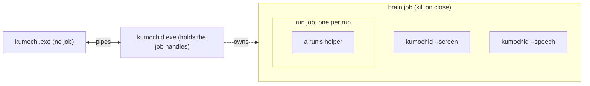
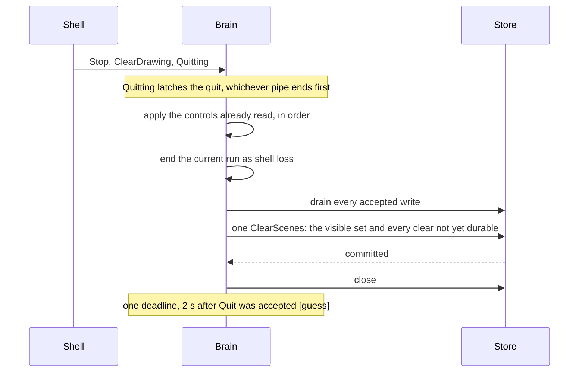

# Processes, jobs and recovery

Kumochi runs as two processes, and the brain runs its helpers inside Windows Job Objects so that
nothing it started can outlive it.

Each process starts its scene dropper before accepting scene data and fails startup if the
thread cannot start. Retirement never joins that thread from the shell's UI.

- **The brain job** has `JOB_OBJECT_LIMIT_KILL_ON_JOB_CLOSE`, and only the brain holds its handle.
  When the brain exits or is killed, Windows ends everything in it.
- **A run job** nests inside the brain job. A helper is created with
  `PROC_THREAD_ATTRIBUTE_JOB_LIST` naming both jobs, so it's inside from its first instruction.
  Ending a run terminates its run job and waits until the job is empty, which ends that run's
  processes and nothing else.
- **The screen worker** sits in the brain job directly, so ending a run never touches it.
  Its [supervisor](screen.md) owns its pipes, deadlines and respawns. It waits up to 2 s for a lost
  worker's process to exit before it reports the loss, and replaces it only when the exit was seen.
- **The speech worker** sits there too, under the same supervisor. It's the only process that
  loads sherpa-onnx (see [voice.md](voice.md), "The speech worker").
- **Ending a worker** asks Windows to terminate it, and only a wait shows that it ended. At quit
  the brain ends its job while each supervisor, seeing its command lane close, terminates its own
  worker. That worker is already exiting, and Windows refuses `TerminateProcess` on a process
  that is exiting with access denied, so `Helper::terminate` counts that refusal as a request
  already under way. Exit is still proved by a wait: the supervisor's 2 s exit confirmation, and
  at quit the job's wait until it's empty. A worker that is still running after that wait is
  reported (`worker exit unconfirmed`) and is never replaced. Closing the job ends it when the
  brain exits.
- Helpers inherit no handles except each worker's two explicit stdin/stdout handles. A worker's
  stderr is disconnected.
  Nothing secret is ever on their command lines.
- **Starting a helper with an explicit launch** (`platform::spawn`, for Claude Code) takes an
  argument vector, a working folder and the whole environment: nothing is inherited from the
  brain. Arguments are quoted by the rules `CommandLineToArgvW` reads, so an empty argument
  survives. An executable or working folder that isn't absolute, a NUL in either or in an
  argument (it would cut the string short), a command line over 32,767 UTF-16 units, or an
  environment name that's empty, holds `=`, or repeats another without regard to case, is
  refused before anything starts. The block
  is sorted by ordinal uppercase, and an empty environment is passed as an empty block, never a
  null pointer, which would inherit the brain's. A `Launch` prints counts, never argument or
  environment values. It holds `platform::spawn_lock()` from marking its handles inheritable
  until they're closed, as every other process start in the brain does.
- **Its standard handles** are one of three:
  - `Piped`: three anonymous pipes, no window. The brain gets blocking ends; the async bridge
    belongs to the supervisor that owns a run's lifetime.
  - `Null`: the `NUL` device, no window.
  - `Console`: a new visible console with its own handles, for a sign-in the user must be able to
    answer. The brain gets no pipe and sees none of it.
- **Why Win32 and not std:** std's `Command` can't place a process in a job from its first
  instruction, and GPUI has no process API. macOS counterpart: `posix_spawn` with its own process
  group and an explicit `envp`, ended with `killpg` (unverified).
- **Job membership as a check** (`Job::contains`, `IsProcessInJob`): the bridge listener
  serves only a client inside its launch's own run job, which a run's children inherit. It proves
  where a process came from, not which one of the run's processes it is (see
  [claude-code.md](claude-code.md), "The listener"). macOS counterpart: a process-group check
  on the peer pid, which is weaker (unverified).
- **The shell** isn't in any job, so a brain crash doesn't take the window with it. Each process
  starts the other detached and, where the starting job allows it, outside that job.

Resource owners can opt into a per-command dispatch receipt without changing other callers.
The supervisor records `Dispatched(generation)` before handing the body to a writer; only
discarding a command that was never handed off records `NotDispatched`. A caller timeout or a
closed notification channel is not a discard receipt. [Speech input](voice.md#the-speech-worker)
uses these facts with matching confirmed exits to keep removal from deleting a live model.

Resource commands also retain an armed completion through the actual one-shot reply. Sending
the reply does not transfer ownership: dropping an unconsumed reply, rejecting its typed result
or consuming it at or after the original deadline requests retirement of its worker generation.
Only a timely, valid synchronous handoff disarms the completion. Ordinary single and streamed
replies keep their existing payloads and do not allocate a per-request control channel.

Each supervisor has one synchronized, coalesced retirement watermark, initially absent rather
than generation zero. A newer generation supersedes older intents. An exact current match wakes
the existing terminate/confirm-exit path even with no pending request; stale intents cannot
retire a replacement. Replacement waits for physical exit confirmation, and generation exhaustion
stops without spawning or reusing an identity. Closing the ordinary command lane also confirms
the final worker. The retirement receiver remains alive until its final exit is published;
closing that lane is unavailability, never an exit receipt.

## Recovery

| What happens | What the other process does |
|---|---|
| The shell dies | The brain relaunches it after 0.2 s, then 1 s, then 5 s, then stops: a fourth crash within a minute isn't relaunched. A shell that dies before connecting counts |
| The brain dies | Its helpers end with it. The shell restarts it once; a second loss within a minute shows Retry |
| No shell for 30 s, and none being relaunched | The brain exits with its helpers, so a shell that gave up on a slow brain or quit before it was up leaves nothing behind. The next shell starts a new brain |
| A Claude Code launch's process ends or the brain crashes | The launch's run job is terminated and confirmed empty, or the kill-on-close brain job ends it. The next lane call sweeps its folder under the account lock ([claude-code.md](claude-code.md), "Launches") |
| A shell is started by hand | It finds the running brain through the pipes and the capability |
| Quit | The shell sends `Quitting`. The brain clears the visible scenes (below), cancels any pending shell relaunch, ends its jobs, deletes the instance capability and exits, then the shell exits. A shell still connecting starts no brain, and tells one it already started once it connects |

## The visible scenes

The visible set is the newest four scenes, by `SceneId`, that belong to a live thread and have
no `scene_cleared` event. Every way a scene leaves the set writes that event, so the brain reads
back at start the set it held in memory:

- the user clears it (`ClearDrawing`);
- a new typed drawing replaces its thread's other drawings, unless its header says `keep`;
- a fifth surviving scene begins: the oldest leaves. Typed replacement/cap victims clear in
  the new first-step transaction, as labelled placeholders already do for their cap eviction;
- a Stop keeps none of a scene's steps: a labelled scene clears with the run's outcome;
  a typed scene's zero cut commits before its acknowledgement, followed by its clear;
- the user quits.

So only a crash, or a shell that restarts, brings drawings back. A scene's id leaves the brain
only once its first step has committed; the run's later steps wait for it without blocking the
core loop. shortcut: on the staged labelled path, a crash between Stop and its outcome loses
which steps Stop kept; typed v1 cuts are already durable before acknowledgement.

- **Accepting Quit.** The control reader latches the quit when it reads `Quitting`. If another
  pipe ended first, the same read carries on for up to 250 ms [guess], still applying the
  controls it forwards, so a `Quitting` already in the pipe, even one partly read, is accepted.
- **One deadline.** Ending the run, draining the writes, the clear and closing the store all use
  the same absolute deadline, and none restarts a budget. Only a committed clear is a complete
  quit. A timeout or a failed write is logged, without content, as incomplete: the scenes come
  back at the next start, as after a crash. The shell isn't relaunched either way.
- **Typed work.** Quit drains in-flight typed lookups, steps and cuts even after their run
  ended. A failed cut has no reply to wait for: clear-all supersedes that debt and Quit waits
  for the resulting durable clear instead. A clear that is not acknowledged is incomplete.

The dock's status panel is transient: closing it isn't Quit. Quit lives in the tray and status
panel and follows the same bounded, idempotent link shutdown. See [presence](presence.md).
