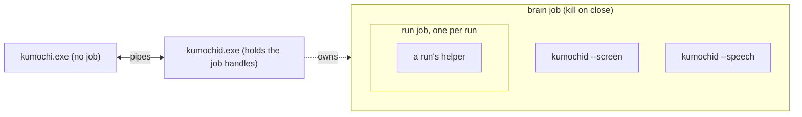
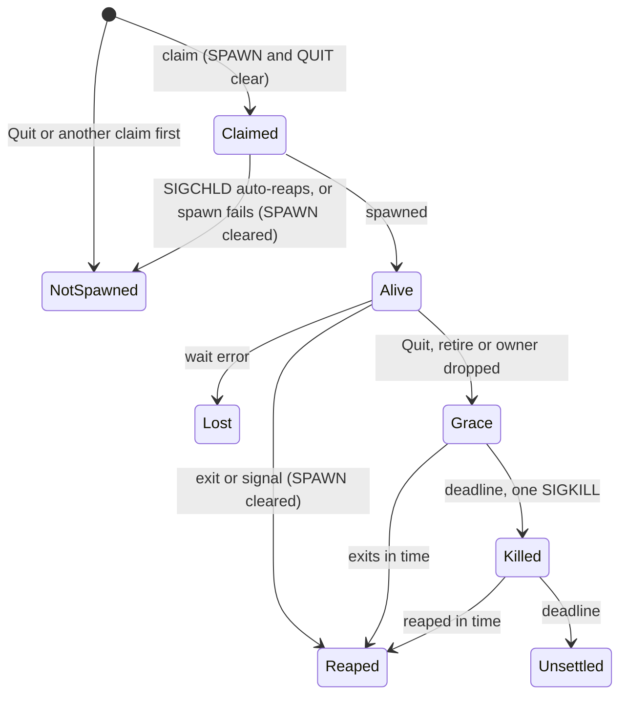
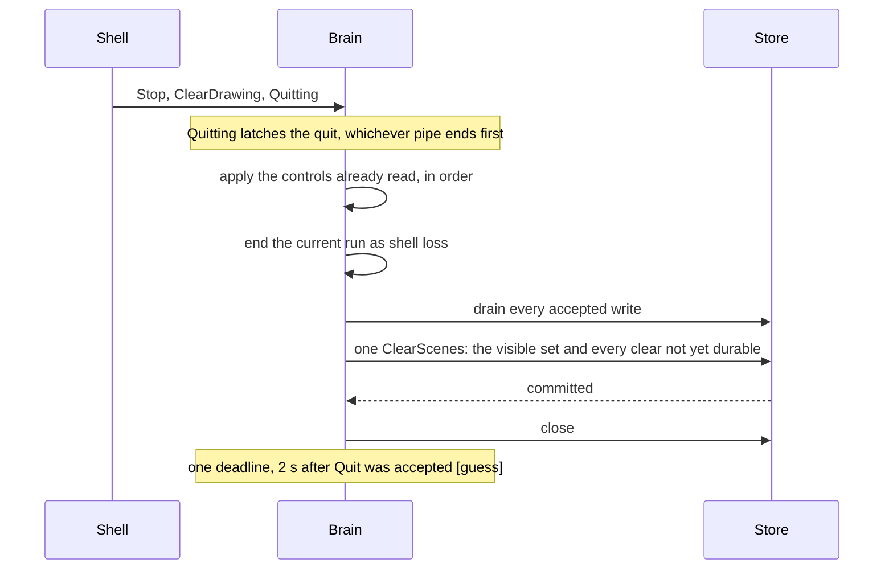

# Processes, jobs and recovery

Kumochi runs as two processes. On Windows, the brain runs its helpers inside Job Objects so that
nothing in those jobs can outlive it.

Executable names come from `protocol::constants`: `kumochi.exe` and `kumochid.exe` on Windows,
`kumochi` and `kumochid` elsewhere, matching Cargo's native output. Each process resolves the
other beside its own executable, never through PATH. Only the executable names differ;
stored DEV/release namespaces are unchanged. This naming does not implement macOS process,
desktop or authenticated transport support; the lifecycle below describes Windows.

Without a native process adapter, containment and every native launch request return
`Unsupported` before creating a process or its pipes. The supervisor's injected tests still
exercise its request and retirement policy without a native child. No unmanaged child or
inherited environment is a fallback.

The brain's launch mode is a lifetime contract. Windows supports **Detached**, in which the brain
outlives its shell. **ParentBound** means the shell starts the brain with an inherited pair and
owns its lifetime; no platform supports it yet, including under Gate identity. macOS and Linux
support neither mode. The executable and the library's brain, parent-bound, bridge, screen and
speech entries check the same platform support table before starting anything. The executable
exits 69 for an unsupported mode without initializing logs, creating a runtime or touching app
data. The detached launcher doesn't observe that status.

Only a first argument of `--parent-bound` selects ParentBound. It must be the only argument;
anything after it, even an empty or non-Unicode value, exits 64 before the support check. In
Detached, the first argument selects the worker or diagnostic; no flag or an unknown flag starts
the normal brain. The bridge consumes one launch argument and ignores the rest; a missing or
invalid launch fails rather than starting the brain. The other workers and diagnostics ignore the
entire tail. Recognized debug diagnostics still exit 10 on a supported release build.

A ParentBound start checks, in order, the support table, Gate identity (refused, 69) and then
descriptors 3 and 4. The executable's own platform module (`main/platform.rs`) takes them as
owned handles only when both are open, before anything else in the process can open a
descriptor, and refuses with 76 otherwise; it never closes or scans other descriptors, since the
shell spawns with `POSIX_SPAWN_CLOEXEC_DEFAULT`. The library entry, `run_parent_bound`, takes
those handles as `InheritedFds` and repeats the mode and Gate checks before it reads them, so a
refused call drops them unread and the shell sees EOF. Past those checks it starts the admission
clock and hardens the process: `/` as the working folder and core dumps off, soft and hard limits
both 0. Then it adopts the pair, arms the parent watch and runs the parent-bound root
(architecture.md, "Parent-bound startup"). It returns a typed `ParentBoundError`, and only the
executable maps it to a code:

| Result | Exit |
|---|---|
| A clean, confirmed quit | 0 |
| `Unsupported`: the mode, Gate identity or missing prerequisites | 69 |
| `Incomplete`: a settlement stage short of confirmed | 70 |
| `Busy`: another session holds the instance | 75, `BRAIN_EXIT_BUSY`, shared with the shell |
| `Refused`: the descriptors, hardening, the parent, the pair, the greeting, the commit claim, or serving that ended other than by a Quit | 76 |

Detached keeps 75 for a busy profile. Today every ParentBound start still exits 69 at the support
check; past it, this build's prerequisites would refuse with 69 after admission.

Argument matching uses OS strings without logging them. Non-Unicode input no longer panics: a
non-Unicode first argument falls through like an unknown flag; a non-Unicode bridge launch is
treated as an invalid launch (exit 1 on Windows); and any non-Unicode argument in a tail that was
already ignored is still ignored. The executable name isn't parsed.

The brain's platform module assembles native workers. On Windows it retries pending voice-model
removals before creating the brain Job, then attaches voice and Claude Code before shared startup
starts the screen worker and publishes the capability. Without native containment, worker
assembly refuses; it does not fall back to uncontained workers.

## Containment tiers

`platform::containment(mode)` reports a tier separately from runtime admission. A tier does not
establish custody of any particular process. Windows Detached is runtime-enabled at **Kernel**:
helpers join a Job from creation, and closing the last Job handle ends its contents. Existing
Windows jobs, nesting, and bridge peer checks are unchanged.

macOS ParentBound is staged at **Group**, only for the fixed shell-to-brain launch. The shell uses
`posix_spawn` with `POSIX_SPAWN_SETSID` and closed-by-default descriptors. That puts the child
in a private session and process group from creation; the shell holds the exact child, and the
brain watches its original parent. A headless fixture combines both owners: it observes a latched
parent loss, checks that the brain cannot claim admission, and witnesses its cooperative exit.
Neither macOS runtime mode nor any macOS helper launch is enabled by this tier.

On normal exit the shell reaps the exact child without signalling the group. When forced
retirement is needed, it may signal the group once while it still owns the unreaped leader; a
refusal or lost custody cannot become a clean exit. That is not proof the group is empty. Group
does not promise cleanup of descendants after the leader exits or after the owner crashes, and
cannot contain descendants that leave the group. Other modes without an adapter remain unsupported.

The dormant Darwin parent watch supplies exit evidence for a future parent-bound session. It
registers just the original parent, verifies the kernel's receipt and checks lineage again
before arming. Only that registration's `NOTE_EXIT` proves exit. If lineage changes without
that note, the watcher polls once more and reports unconfirmed loss if no exit note arrives.
It blocks in the kernel between one-second lineage checks, and a stop pipe lets an abandoned
in-process attempt wake and join it. `ShellProcess::loss()` gives a receiver for the retained
verdict on Mac and no receiver on Windows or Linux. Transport EOF doesn't change the verdict,
and this watch doesn't enable Mac startup or shutdown.

Before I1d wires the watch, use copied verdicts and release all watch borrows before teardown,
especially before dropping the last `ShellProcess`. A borrow holds the watch read lock and can
block publication while teardown joins the publisher. Keep that join off the async dispatcher
and deadline-critical paths, and test retirement racing with publication.

Each process starts its scene dropper before accepting scene data and fails startup if the
thread cannot start. Retirement never joins that thread from the shell's UI.

- **The brain job** has `JOB_OBJECT_LIMIT_KILL_ON_JOB_CLOSE`, and only the brain holds its handle.
  When the brain exits or is killed, Windows ends everything in it.
- **A run job** nests inside the brain job. A helper is created with
  `PROC_THREAD_ATTRIBUTE_JOB_LIST` naming both jobs, so it's inside from its first instruction.
  Ending a run terminates its run job and waits until the job is empty, which ends that run's
  processes and nothing else.
- **The screen worker** sits in the brain job directly, so ending a run never touches it.
  Its [supervisor](screen.md) owns its pipes, deadlines and respawns. It waits up to 2 s for a lost
  worker's process to exit before it reports the loss, and replaces it only when the exit was seen.
- **The speech worker** sits there too, under the same supervisor. It's the only process that
  loads sherpa-onnx (see [voice.md](voice.md), "The speech worker").
- **Ending a worker** asks Windows to terminate it, and only a wait shows that it ended. At quit
  the brain ends its job while each supervisor, seeing its command lane close, drops its worker's
  pipes and then terminates it. Either can start the worker's exit first, and Windows refuses
  `TerminateProcess` on a process that is already exiting with access denied, so
  `Helper::terminate` counts that refusal as a request already under way. Exit is still proved by
  a wait. The supervisor waits 2 s, and a worker still running then is reported as `worker exit
  unconfirmed` and never replaced. So is a replacement whose reader or writer thread didn't start:
  its process is terminated and waited for the same way before anything respawns. At quit the
  brain may exit before that wait ends, so the
  report can instead be only the job's: `couldn't end the helpers; closing the job ends them`
  when the job isn't empty after 5 s. Closing the job ends the worker when the brain exits. Quit
  shuts the job down: it marks the job refusing under `platform::spawn_lock()`, which every start
  into a job holds until its process exists, and only then terminates it. So a respawn that loses
  the race to quit fails at once instead of landing in the job, and its supervisor stops without
  an error.
- Helpers inherit no handles except each worker's two explicit stdin/stdout handles. A worker's
  stderr is disconnected.
  Nothing secret is ever on their command lines.
- **Starting a helper with an explicit launch** (`platform::spawn`, for Claude Code) takes an
  argument vector, a working folder and the whole environment: nothing is inherited from the
  brain. Arguments are quoted by the rules `CommandLineToArgvW` reads, so an empty argument
  survives. An executable or working folder that isn't absolute, a NUL in either or in an
  argument (it would cut the string short), a command line over 32,767 UTF-16 units, or an
  environment name that's empty, holds `=`, or repeats another without regard to case, is
  refused before anything starts. The block
  is sorted by ordinal uppercase, and an empty environment is passed as an empty block, never a
  null pointer, which would inherit the brain's. A `Launch` prints counts, never argument or
  environment values. It holds `platform::spawn_lock()` from marking its handles inheritable
  until they're closed, as every other process start in the brain does.
- **Its standard handles** are one of three:
  - `Piped`: three anonymous pipes, no window. The brain gets blocking ends; the async bridge
    belongs to the supervisor that owns a run's lifetime.
  - `Null`: the `NUL` device, no window.
  - `Console`: a new visible console with its own handles, for a sign-in the user must be able to
    answer. The brain gets no pipe and sees none of it.
- **Why Win32 and not std:** std's `Command` can't place a process in a job from its first
  instruction, and GPUI has no process API. The staged macOS Group adapter above covers only the
  shell's brain child, not this helper launch.
- **Job membership as a check** (`Job::contains`, `IsProcessInJob`): the bridge listener
  serves only a client inside its launch's own run job, which a run's children inherit. It proves
  where a process came from, not which one of the run's processes it is (see
  [claude-code.md](claude-code.md), "The listener"). macOS counterpart: a process-group check
  on the peer pid, which is weaker (unverified).
- **The shell** isn't in any job, so a brain crash doesn't take the window with it. Each process
  starts the other detached and, where the starting job allows it, outside that job.

Resource owners can opt into a per-command dispatch receipt without changing other callers.
The supervisor records `Dispatched(generation)` before handing the body to a writer; only
discarding a command that was never handed off records `NotDispatched`. A caller timeout or a
closed notification channel is not a discard receipt. [Speech input](voice.md#the-speech-worker)
uses these facts with matching confirmed exits to keep removal from deleting a live model.

Resource commands also retain an armed completion through the actual one-shot reply. Sending
the reply does not transfer ownership: dropping an unconsumed reply, rejecting its typed result
or consuming it at or after the original deadline requests retirement of its worker generation.
Only a timely, valid synchronous handoff disarms the completion. Ordinary single and streamed
replies keep their existing payloads and do not allocate a per-request control channel.

Each supervisor has one synchronized, coalesced retirement watermark, initially absent rather
than generation zero. A newer generation supersedes older intents. An exact current match wakes
the existing terminate/confirm-exit path even with no pending request; stale intents cannot
retire a replacement. Replacement waits for physical exit confirmation, and generation exhaustion
stops without spawning or reusing an identity. Closing the ordinary command lane also confirms
the final worker. The retirement receiver remains alive until its final exit is published;
closing that lane is unavailability, never an exit receipt.

## The shell's brain child (ParentBound, dormant)

Under ParentBound the shell starts the brain as its own child and owns its lifetime. The
custody rules live in shared code (`shell-core/platform/child.rs`), so every platform tests them
against a scripted child; macOS supplies the system calls (`platform/macos/child.rs`):
`posix_spawn` with an empty environment, an exact-pid `waitpid(WNOHANG)`, SIGKILL, and a read of
SIGCHLD's disposition. On macOS the link's attempts go through `platform::connect` to
`connect_pair`, which returns the child's owner with the connection; Windows and Linux keep
`connect_brain` and get no owner. Nothing reaches the link on macOS yet: the Mac shell opens only
the disconnected window, so no child starts.

- **What the child inherits.** `start_brain` makes the two socket pairs (`platform/macos/pair.rs`)
  and spawns the brain with `--parent-bound` as its only argument, an empty environment and
  `POSIX_SPAWN_CLOEXEC_DEFAULT`, so the child gets only what the file actions name: the control
  end on descriptor 3, the data end on 4 and `/dev/null` on 0 to 2. Both ends first move above
  4 and then down, so they land right even when they start on 3 and 4 swapped; a move that
  wouldn't fit under the open-descriptor limit refuses the spawn. The shell's copies of the
  child's ends close as soon as the spawn returns, whether or not it made a child, so the
  shell sees EOF when the brain exits. Rust marks a new socket close-on-exec only after
  creating it, and Darwin has no flag to do it at creation, so a process started elsewhere in
  the shell at that instant could inherit an end. It would see lengths and timing and could
  disrupt delivery or delay EOF, but not read content: the session handshake needs the
  instance secret.
- **Retirement waits** are the link's Quit timeout, 3 s, before the kill and again after it.
  `start_brain` hands the shell its ends only after the owner reports its one spawn attempt,
  and waits 5 s for that report. A refusal means no child; a report that's late is **Pending**,
  not a refusal: a child may still start, but its owner is gone, so the owner retires it, and
  the spawn claim stays taken until it's reaped. Either way all four ends are closed before
  `start_brain` returns.

- **One owner.** A `ChildOwner` thread exists before the spawn, spawns on itself and is the only
  code in the shell that waits on, signals or reaps the brain. The UI never blocks on it. It polls
  every 20 ms; that's a poll period, not a scheduling bound, so each deadline is acted on at the
  first poll at or after it. The kill is `killpg` on the private session the spawn created, after
  an exact-pid `waitid(P_PID, WEXITED | WNOHANG | WNOWAIT)` peek that reaps nothing
  (`platform/unix/brain_group.rs`), not a plain SIGKILL to the pid.
- **What a wait means.** Only an exit or a signal is a reap. Any other status, such as a traced
  stop, which Darwin can report without `WUNTRACED`, counts as alive. An interrupted wait is
  retried. Any other error is **Lost**: custody is gone, never success, and the child is never
  signalled again.
- **Quit against spawn.** One atomic word holds SPAWN and QUIT. The owner claims it right before
  the spawn, only while both bits are clear, and `LinkHandle::begin_quit` sets QUIT on it. Quit
  first means no child from that link. Claim first means the owner holds whatever the spawn made,
  sees QUIT on its next poll and retires it. SPAWN is cleared only when the spawn made no child or
  the child was reaped, so each replacement needs a fresh claim. QUIT is never cleared.
- **Retirement.** On Quit, on `retire` (link loss, or startup cancelled before readiness) or when
  the link drops the owner, the owner waits for the child to exit, then sends one SIGKILL and
  waits once more. A failed kill isn't retried. A child still unreaped after that is
  **Unsettled**: it's reported once, the claim stays taken so nothing replaces it, and the owner
  keeps reaping it quietly while the shell lives. The owner never holds the shell's ends of the
  pair, only the child's until the spawn: the link closes its own ends when the connection ends
  (aborted for Legacy, dropped for Queued), so the brain sees EOF before it's retired.
- **Settling.** `ChildOwner::settle` retires the child and waits for how custody ended, no longer
  than the owner's two waits and two polls plus 1 s; no answer by then, or an owner thread that's
  gone, is **Unsettled**. The link settles a child once its connection ends, and a failed attempt
  settles before it returns, so the next attempt runs only after that. Only a reap frees the spawn
  claim, so a replacement starts only after its predecessor is reaped, and after Lost or
  Unsettled every later attempt, Retry included, is refused before any spawn.
- **Busy.** A brain whose instance another session of this user holds exits with
  `BRAIN_EXIT_BUSY` (75) before READY. An attempt whose child settles that way is `Busy`; any other
  exit keeps the attempt's own error. The shell never signals another session's brain. Busy is a
  failed connect like any other: Failed, then the user's Retry, one spawn per attempt.
- **Preconditions.** Before the spawn and before the signal the owner checks that SIGCHLD isn't
  ignored and `SA_NOCLDWAIT` isn't set, and refuses otherwise. It never changes a process-wide
  disposition, and nothing else in the shell may wait on children (`wait`, `waitpid(-1)`,
  `waitid(P_ALL)`); review enforces that, since a check can't exclude a change racing it. The
  review grep (`waitpid|waitid|wait4|wait3|SIGCHLD|sigaction|libc::signal|try_wait|.wait()|Command::new`
  over `shell` and `shell-core`, tests aside) allows only the owner's exact-pid `waitpid` and
  disposition read, the exact-pid `waitid` WNOWAIT peek before the kill, and Windows' detached
  launch. It doesn't cover dependencies such as gpui or cpal, which could install a SIGCHLD
  handler or wait on their own children; nothing checks them yet.
- **A clean Quit** is `Quitting` written whole to an attempt's pair and that same attempt's
  child reaped with exit code 0. Each attempt carries its own write receipt, set by its control
  writer only after the frame is written (or by the parked Quit on a queued pair), never when
  Quit is queued. When the link ends on Quit it joins that receipt to that attempt's settlement
  as a `QuitEnd`: the attempt's generation, set only once Connected went out, and a
  `QuitOutcome` of `Clean`, `Reaped` with the exit, `Lost` or `Unsettled`. An attempt that
  fails before Connected carries its child's state out with its error, so Quit there gives no
  generation and `NotSpawned`, `SpawnPending`, or the spawned child's own settlement.
  `LinkHandle::quit_end` reads it after `finish_quit`; it's None when Quit came between attempts
  or the attempt owned no child, as for a detached brain.
- **Terminal custody ends the pair.** Once the owner reaps, loses or gives up on the child, the
  attempt's hook aborts both legs, so the link stops serving a pair whose peer may still hold
  its ends open, without waiting for EOF. A watchdog beside the owner, armed when retirement
  starts, ends custody as `Unsettled` at retirement's bound even while a kill never returns: it
  latches the spawn word, reports, and runs the hook. Neither the hook nor the watchdog signals
  or reaps; that stays on the owner thread, which may still reap later without reporting or
  freeing a claim. A `settle` that gives up also latches the word.

## Recovery

| What happens | What the other process does |
|---|---|
| The shell dies | The brain relaunches it after 0.2 s, then 1 s, then 5 s, then stops: a fourth crash within a minute isn't relaunched. A shell that dies before connecting counts. A debug brain that has either live key budget (`KUMOCHI_LIVE_KEY_CATALOG_BUDGET`, `KUMOCHI_LIVE_KEY_MESSAGES_BUDGET`) relaunches it with both at 0, so a brain that shell starts gets no key requests |
| The brain dies | Its helpers end with it. The shell restarts it once; a second loss within a minute shows Retry |
| No shell for 30 s, and none being relaunched | The brain exits with its helpers, so a shell that gave up on a slow brain or quit before it was up leaves nothing behind. The next shell starts a new brain |
| A Claude Code launch's process ends or the brain crashes | The launch's run job is terminated and confirmed empty, or the kill-on-close brain job ends it. The next lane call sweeps its folder under the account lock ([claude-code.md](claude-code.md), "Launches") |
| A shell is started by hand | It finds the running brain through the pipes and the capability |
| Quit | The shell sends `Quitting`. The brain clears the visible scenes (below), cancels any pending shell relaunch, ends its jobs, deletes the instance capability and exits, then the shell exits. A shell still connecting starts no brain, and tells one it already started once it connects |

## The visible scenes

The visible set is the newest four scenes, by `SceneId`, that belong to a live thread and have
no `scene_cleared` event. Every way a scene leaves the set writes that event, so the brain reads
back at start the set it held in memory:

- the user clears it (`ClearDrawing`);
- a new typed drawing replaces its thread's other drawings, unless its header says `keep`;
- a fifth surviving scene begins: the oldest leaves. Typed replacement/cap victims clear in
  the new first-step transaction, as labelled placeholders already do for their cap eviction;
- a Stop keeps none of a scene's steps: a labelled scene clears with the run's outcome;
  a typed scene's zero cut commits before its acknowledgement, followed by its clear;
- the user quits.

So only a crash, or a shell that restarts, brings drawings back. A scene's id leaves the brain
only once its first step has committed; the run's later steps wait for it without blocking the
core loop. shortcut: on the staged labelled path, a crash between Stop and its outcome loses
which steps Stop kept; typed v1 cuts are already durable before acknowledgement.

- **Accepting Quit.** The control reader latches the quit when it reads `Quitting`. If another
  pipe ended first, the same read carries on for up to 250 ms [guess], still applying the
  controls it forwards, so a `Quitting` already in the pipe, even one partly read, is accepted.
- **One deadline.** Ending the run, draining the writes, the clear and closing the store all use
  the same absolute deadline, and none restarts a budget. Only a committed clear is a complete
  quit. A timeout or a failed write is logged, without content, as incomplete: the scenes come
  back at the next start, as after a crash. The shell isn't relaunched either way.
- **Typed work.** Quit drains in-flight typed lookups, steps and cuts even after their run
  ended. A failed cut has no reply to wait for: clear-all supersedes that debt and Quit waits
  for the resulting durable clear instead. A clear that is not acknowledged is incomplete.

The dock's status panel is transient: closing it isn't Quit. Quit lives in the tray and status
panel and follows the same bounded, idempotent link shutdown. See [presence](presence.md).
