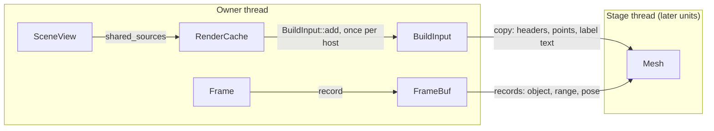

# The drawing renderer

`crates/render` (package `kumochi-render`) is the renderer the NativeShell shell will draw
drawings with, in place of the GPUI overlay's painter. It builds each view's geometry into a
mesh once and writes each frame as a list of small records, so a frame that animates uploads
records and never tessellates. It has no GPU, window or thread yet; later units add them. No
shell uses it, and nothing ships it.

## Two sides

The renderer works on two threads that share nothing.

- **The owner side** runs where the presenter runs. `Stager` is the presenter's `Stage`: it
  stages a `RenderCache` for each committed view, which collects the view's shared primitive
  lists (`SceneView::shared_sources`) sorted by handle and builds nothing. When a host needs a
  view's geometry, the owner copies the view into a `BuildInput` with `BuildInput::add`:
  primitive headers, points and label text, with each rect's corner pieces already counted.
  Each frame, `record` writes the frame's paint items into a `FrameBuf` as records.
- **The stage side** (`src/stage`) is what the stage thread will hold. `Mesh::build` turns one
  geometry of a `BuildInput` into vertex and index buffers; `BuildInput::wipe` then overwrites
  the copied text. A `Record` names an object, a range of its primitives and the sampled pose,
  and `Mesh::range` resolves it to indices.

`cargo xtask check-core` fails when a stage-side file names `kumochi_scene`,
`kumochi_shell_core` or the owner side's modules. The scene's memory never reaches the stage
thread, so a retired view or a dead dropper leaves nothing there.

Records follow `Frame::paint_items`: every object's ordinary geometry first, then edge-label
chips and text. Writing them is arithmetic into reserved buffers and a binary search per item,
so it never allocates, waits or locks.

## Tessellation

The mesh is built with lyon, the tessellator main's painter uses, at the shell's pin
(`=1.0.19`), so fills and strokes match main's: polygons and rect bodies fill nonzero, and
lines stroke with lyon's default joins, ends, miter limit and tolerance (`src/limits.rs`). A
border is the band between a rect's outline and its inset, one quad per outline edge. Main
fills that band even-odd, which covers the same area. Every vertex carries its distance along
its stroke and its place in the reveal, measured over its own primitive's length, so a draw-in
or a dash phase changes per frame without a rebuild.

Main counts a rect's corner pieces at the pose's scale, and refuses a pose that needs more than
the scale the scene crate charged. The mesh is built once for every pose, so the owner counts
the pieces at the charged scale with the scene crate's `corner_segments`, and every pose,
those main refuses included, draws from that mesh. The scene crate's charge doesn't change;
the pieces count against this crate's own buffers. A primitive lyon refuses, or one that would
pass the mesh's reservation, fails its picture as `Failure::Build`.

## What is charged and what is fixed

A `RenderCache` is charged with its scene like any paint cache: its `bytes()`, fixed when it
is staged, count the boxed cache and its source references. The primitive lists themselves
stay charged to the view's layout.

Everything else is reserved once, whether or not a drawing shows, and `Stager::fixed_bytes`
returns its sum, a constant (`limits::FIXED_BYTES`):

| Buffer | Sized for | Bytes |
|---|---|---|
| Three `FrameBuf`s | 4 pictures × 2 passes × 600 objects of 64-byte records | 3 × 307,344 |
| One `BuildInput` | 1,500 objects, 27,449 primitive headers, 42,048 points, 9,756,912 bytes of text | 11,532,828 |
| One `Mesh` | 243,584 vertices, 736,896 indices, 28,217 pieces | 8,274,180 |
| lyon's working memory | main's 2 MiB allowance for the same tessellator | 2,097,152 |
| Total | | 22,826,192 |

Objects, points and mesh sizes follow from the global caps in `kumochi_scene::limits`: the
object cap, the fill-vertex and outline-point caps, and the path-segment cap, which bounds
every line (a polyline of n points is charged at least n − 1 segments, and a lyon stroke emits
at most 4n + 4 vertices). No global cap counts primitives or label bytes, so those two sizes
are derived from what layout's producers emit under the caps; `limits.rs` writes each out as
arithmetic. Label text is more than the drawings' bytes because layout generates some: number
cells, axis ticks that repeat their unit, and pie percentages. A view past any size fails when
it is copied, so a size that turns out small refuses a drawing and never grows a buffer.

The whole is held under a 22 MiB ceiling, a proposal until the label raster's
scratch is sized (`limits::FIXED_CEILING_BYTES`, checked when the crate compiles).

## Measuring

`cargo bench -p kumochi-render --bench render-workloads -- mesh_at_limits` times the owner's
copy and the mesh build of one view at the global paint caps.
`cargo bench -p kumochi-render --bench render-workloads -- record_frame` times writing one
frame of four views at the global object cap and fails if it allocates or frees; the
`record_allocations` test checks the same frame's allocations and frees in every test run. Run them on
Rez under a measuring hold.
