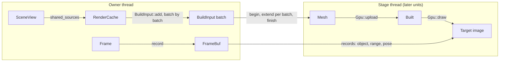

# The drawing renderer

`crates/render` (package `kumochi-render`) is the renderer the NativeShell shell will draw
drawings with, in place of the GPUI overlay's painter. It builds each view's geometry into a
mesh once and writes each frame as a list of small records, so a frame that animates uploads
records and never tessellates. It draws those records with wgpu on Direct3D 12 into an image;
it has no window, surface or thread yet, and draws no label text. Later units add them. No
shell uses it, and nothing ships it.

## Two sides

The renderer works on two threads that share nothing.

- **The owner side** runs where the presenter runs. `Stager` is the presenter's `Stage`: it
  stages a `RenderCache` for each committed view, which collects the view's shared primitive
  lists (`SceneView::shared_sources`) sorted by handle and builds nothing. When a host needs a
  view's geometry, the owner copies the view into `BuildInput` batches with
  `BuildInput::add`: primitive headers, points and label text, with each rect's corner pieces
  already counted. A batch has a fixed size, so a view copies from a `Cursor` (an object and a
  primitive in it), each primitive whole, until the view ends or a part of the batch is full;
  `add` returns where the next batch starts. One batch can hold parts of several views. Each
  frame, `record` writes the frame's paint items into a `FrameBuf` as records.
- **The stage side** (`src/stage`) is what the stage thread will hold. `Mesh::begin` starts
  one geometry, `Mesh::extend` builds each of its batches in order, and `Mesh::finish` ends it.
  A batch out of order or for another geometry is refused as `Failure::Order`, and any refused
  batch leaves the mesh as it was before it. A `Record` names an object, a range of its
  primitives and the sampled pose, and `Mesh::range` resolves it to indices inside that object.

A `Mesh` builds one geometry at a time, and `Mesh::begin` discards whatever it held. So all of
one geometry's batches must arrive before another geometry begins on the same mesh, or the
first is copied again from its start. A copy names only cursors `add` returned, `Cursor::START`
included, and a batch holds at most one part of a view; anything else is `Failure::Order`. A
batch whose view table, headers or other parts are full returns the cursor it was given.

Whoever owns a batch wipes it with `BuildInput::wipe`, which overwrites its points and text, on
every path: after its build, when a copy or a build is refused, and before dropping it. The mesh
never wipes a batch, because the batch may hold other views' parts.

`cargo xtask check-core` lints the stage side: a stage-side file that names `kumochi_scene`,
`kumochi_shell_core` or another `crate::` module than `stage` and `limits` fails it, and so
does a `super::super` path under `stage/` or any `super::` path in `stage.rs`. It reads
spellings, so it catches a slip and proves nothing. The scene's memory never reaches the stage
thread, so a retired view or a dead dropper leaves nothing there.

Records follow `Frame::paint_items`: every object's ordinary geometry first, then edge-label
chips and text. Writing them is arithmetic into reserved buffers and a binary search per item,
so it never allocates, waits or locks.

## Tessellation

The mesh is built with lyon, the tessellator main's painter uses, at the shell's pin
(`=1.0.19`), so fills and strokes match main's: polygons and rect bodies fill nonzero, and
lines stroke with lyon's default joins, ends, miter limit and tolerance (`src/limits.rs`). A
border is the band between a rect's outline and its inset, one quad of its own per outline
edge. Main fills that band even-odd, which covers the same area.

A draw-in or a dash phase changes per frame without a rebuild, so each vertex carries what a
rasterizer needs to place it. A consumer interpolates `along`, `reveal` and `weight` across a
triangle, and reads `skip` flat from the triangle's first index:

- **Strokes.** A pixel's source distance, which dashes and reveal walk, is the interpolated
  `along` plus the first vertex's `skip`, and its reveal is that distance over its piece's
  `length`. The mesh tessellates by endpoint ids, so each vertex names the source point it
  came from. lyon drops a point closer than its merge distance to the last one it kept, and
  decides closure from the points it kept, so the mesh walks the same kept points. `along` is
  continuous across a join: each kept edge adds the source length from the last point merged
  into the point before to this one. `skip` is the source length merged into the vertex's
  point. Each stroke triangle's first index is the vertex at its earliest point, so an edge
  arriving at a merged run reaches main's distance there, and the edge leaving it starts past
  the run, as main's walk does. A closed line keeps its seam however its last point is
  written. Where lyon folds the join at its first point, the opening edge's triangles name a
  vertex of the closing side; the mesh gives them a copy at the opening distance. A closed
  line lyon keeps two points of goes out and back as two open lines, the return leg a piece of
  its own marked `retrace`.
- **Borders.** A vertex carries its reveal times a weight, 1 on the outer edge and the inner
  edge's length over the outer edge's on the inner one. A pixel is revealed when the
  interpolated `reveal` is at most the frame's draw fraction times the interpolated `weight`,
  which gives main's cut exactly: a straight line joining the same fraction of the outer and
  the inner edge. Don't divide: where the inset collapses a corner, the inner edge has length
  0, so `reveal` and `weight` are both 0 there and every cut meets at the inner corner. Draw a
  full reveal whole and an empty one not at all, without the comparison.

Known differences from main's painter:

- **A cut at a join.** At a partial reveal, main tessellates the revealed prefix again and ends
  it with a butt cap along the last segment's perpendicular. The mesh is built once, so the
  moving end of a reveal, and a dash end inside a join, interpolate across the join's own
  triangles instead: the cut bends through the miter's vertices. Away from joins the two agree.
- **The turn of an out-and-back line.** Where a dash run or the reveal's end crosses the turn
  of a closed line of two kept points, main strokes that run as one open polyline with lyon's
  folded join, and this mesh draws both legs at full width, so the two cover different areas
  near the turn. Drawn whole and undashed, a consumer skips the `retrace` piece and draws the
  line once, as main does.

Main counts a rect's corner pieces at the pose's scale, and refuses a pose that needs more than
the scale the scene crate charged. The mesh is built once for every pose, so the owner counts
the pieces at the charged scale with the scene crate's `corner_segments`, and every pose,
those main refuses included, draws from that mesh. The scene crate's charge doesn't change;
the pieces count against this crate's own buffers. A primitive lyon refuses, or one that would
pass the mesh's reservation, fails its picture as `Failure::Build`.

## Drawing with the GPU

`Gpu` (`src/stage/gpu.rs`, with drawing in `gpu/draw.rs` and its shader `gpu/draw.wgsl`) is the
stage side's one Direct3D 12 device. Only the stage side names wgpu.

- **Opening.** `Gpu::open` refuses as `GpuFailure::NoAdapter` when the build has no Direct3D
  12 back end (`wgpu::Instance::enabled_backend_features`, checked before an instance exists,
  since wgpu panics without one) or no adapter answers. It refuses as `NoDevice` when the
  adapter lacks what drawing needs: 4x multisampling and resolve of `Bgra8Unorm`,
  sample-rate shading (`DownlevelFlags::MULTISAMPLED_SHADING`) and storage buffers in the
  vertex stage. wgpu's native futures for the adapter, the device and its error scopes are ready
  when made, so each is polled once; one still pending fails closed as `NoDevice` and nothing
  spins.
- **Loss.** The device-loss callback and the uncaptured-error handler are installed before any
  resource exists, and both set one sticky flag that carries nothing of the error. An upload or
  a draw sets it too when wgpu refuses a write with both error scopes clean: wgpu drops a lost
  device's errors, so nothing else explains it, and an explicit destroy invalidates the device
  before wgpu runs the callback. Every call checks the flag first, and an upload and a draw
  check it again before they answer, so once it is set every later call answers `Lost`;
  releases still take back their slots and charges.
- **Budget.** `Gpu` keeps a budget of requested resource bytes: the sizes its buffers and
  textures ask wgpu for, not measured video memory. The record buffer, 3,000 records of 64
  bytes, is the first charge. An operation reserves its whole charge with checked arithmetic
  before it creates anything and creates inside validation and out-of-memory error scopes.
  wgpu holds a resource until the last submission that uses it, so a released charge waits for
  the last draw that read it, or for the device's next submission, which carries an upload's
  queued writes, when no draw read it; one that nothing read or queued comes back at once. Only
  each draw's `Queue::on_submitted_work_done` callback moves what has retired: a returned
  submission index proves nothing. Nothing waits for it: a reservation that doesn't fit polls the
  device once without blocking, which runs finished work's callbacks, and tries again. Eight
  waits are tracked one by one; past them a release merges into the newest, which only holds
  that charge longer.
- **The one poll.** That poll is the one call here wired to wgpu's fatal handler, for a poll
  error wgpu can't convert. It can't reach it: a non-blocking poll on Direct3D 12 sets no wait,
  so its only error is reading the fence, which never fails there. It must be rechecked if
  another back end is ever enabled; check-core pins the feature set.
- **Upload.** `Gpu::upload` takes the geometry the mesh last finished, `Mesh::geometry`, and
  stages its vertices, indices and pieces for buffers created unmapped, each encoded field by
  field, through `Queue::write_buffer_with`, inside the same error scopes. The staged bytes are
  wgpu's own, outside the budget, and go to the GPU with the device's next submission. A write
  wgpu refuses answers `Refused` when a scope caught why and `Lost` otherwise. A failure gives
  the slot back at once and the charge as above. A `Built` is provisional: its buffers were
  created and its writes handed to wgpu with no error and no loss seen, not confirmed on the
  GPU. A device lost under a write reports nothing then; once the loss is latched every later
  upload answers `Lost`, and nothing of that `Built` is drawn. Nothing here maps a buffer,
  and the one poll can't reach wgpu's fatal handler, so this crate's own calls reach none of
  the wgpu entries that end there; the known limits below are wgpu's own.
- **Range tables.** An upload also copies the mesh's range tables into one of five reserved
  slots (`limits::UPLOADED`): one per picture of a frame and one more for a geometry uploading
  in place of a shown one. So the mesh can build the next geometry while this one stays, and
  `Built::range` resolves a record as the mesh did when it was uploaded. With every slot held,
  an upload answers `Budget`. `Gpu::release_built` gives the slot back at once and the charge
  as above; one from another device is handed back unreleased, so its own device can still take
  it. A `Built` dropped instead keeps both for the device's life.
- **Targets.** A `Target` is a 4x multisampled `Bgra8Unorm` texture resolved into a
  single-sampled one, as GPUI's Windows renderer draws paths. It charges both: 20 bytes a pixel.
  `Gpu::release_target` gives the charge back as above, at once when no draw used it; one from
  another device is handed back unreleased. A `Target` dropped instead keeps its charge for the
  device's life.
- **Drawing.** `Gpu::draw` clears the target and draws one chosen picture or every picture of a
  frame, each from the `Built` of its geometry. It stages the records through
  `Queue::write_buffer_with` inside the same error scopes, with an upload's rules: `Refused` when
  a scope caught why, the flag and `Lost` otherwise, before anything is drawn. The GPU reads
  them in place: a record's index there is its place in the frame, so the one chosen picture and
  all of them read the same slots. A target or geometry of another device, a geometry no drawn
  picture shows, a picture the frame doesn't list or a record outside its geometry is refused as
  `Mismatch` before any GPU command. `View` places the frame: its origin is subtracted once,
  then everything is scaled. The answer, `Drawn`, counts pictures drawn, pictures whose ranges
  draw nothing (label text only, empty or fully transparent) and pictures whose geometry wasn't
  given. It is provisional, as a `Built` is: submitted with no error and no loss seen, not
  confirmed on the GPU, and never presented. Text primitives keep their range boundaries, so the
  label unit can draw them, and draw nothing here.

The fragment stage runs per sample. `along`, `reveal` and `weight` are interpolated at each of
the four samples, so the end of a reveal or a dash inside a pixel covers part of it, as an edge
does; `skip`, the piece and the record are read flat from each triangle's first vertex
(`@interpolate(flat, first)`, Direct3D's provoking vertex). A pixel's alpha is the primitive's
opacity times the colour override's, when there is one, times the record's, clamped to 0 to 1,
and the colour is premultiplied by it once and blended over. A full reveal draws a revealed piece
whole and an empty one nothing, without the comparison; fills are never revealed. A retraced leg
is skipped when its line is drawn whole and undashed.

The device tests build on Windows only. They ask for Direct3D 12's software adapter
(`force_fallback_adapter`, a CPU adapter) and fail with a fixed message when it is absent; they
never skip. They read the resolved image back and check pixels worked by hand. Without
Direct3D 12 in the build, on Linux, one test checks that `Gpu::open` answers `NoAdapter`.

**Known limits.** This crate's own calls avoid every wgpu entry that reaches wgpu's fatal
handler, but wgpu 29.0.4 itself unwraps some Direct3D failures, as when it begins its
pending-writes command list at device open and on the first queued write after a submission.
A device removed at those moments can panic inside wgpu, and a release build aborts on panic.
Dropping the device after a submission waits for the GPU and panics on a hang or an unexpected
error. Both must be closed before a shell hosts the renderer.

## What is charged and what is fixed

A `RenderCache` is charged with its scene like any paint cache: its `bytes()`, fixed when it
is staged, count the boxed cache and its source references. The primitive lists themselves
stay charged to the view's layout.

Everything else is reserved once, whether or not a drawing shows, and `Stager::fixed_bytes`
returns its sum, a constant (`limits::FIXED_BYTES`):

| Buffer | Sized for | Bytes |
|---|---|---|
| Three `FrameBuf`s | 4 pictures and 3,000 64-byte records: both passes of 1,500 objects | 3 × 192,144 |
| One `BuildInput` batch | 1,500 objects, 27,449 primitive headers, 42,048 points, 262,144 bytes of text | 2,038,156 |
| One `Mesh` | 165,120 28-byte vertices, 376,896 indices, 47,602 16-byte pieces | 7,008,928 |
| Five geometry slots' range tables | 27,450 primitive starts and 1,500 object starts each | 5 × 115,848 |
| lyon's working memory | an allowance, main's 2 MiB for the same tessellators | 2,097,152 |
| Total | | 12,299,908 |

The range tables are reserved when a `Gpu` opens. What the GPU's buffers and textures request is
charged to that device's budget instead, and wgpu's own allocations, such as the staged copies of
a mesh or a frame's records, are the framework's.

Objects, points and mesh sizes follow from the global caps in `kumochi_scene::limits`: the
object cap, the fill-vertex and outline-point caps, and the path-segment cap, which bounds
every line (a polyline of n points is charged at least n − 1 segments). `limits.rs` writes out
the arithmetic, including the most vertices and triangles lyon's stroke emits per segment,
read from its source. No global cap counts primitives, so that size is derived from what
layout's producers emit under the caps. Every primitive's points fit an empty batch, and so
does the longest label, 400 characters of at most 4 bytes. Label text has no fixed bound,
since a continued scene keeps labels from many calls, so the batch's text size is a tunable
(`limits::BATCH_TEXT_BYTES`, a proposal) and a view past it copies in several batches.

lyon's fill sweep has no vertex bound that follows from its source: it adds a vertex per event,
and splitting edges at the crossings it finds can add events past the points and crossings the
scene charges. The fill cap is a reservation, and a fill past what is left of the mesh fails
its picture. lyon's tessellators grow their own working memory, which the mesh can't cap; the
`record_allocations` test measures what they keep after builds at the fill cap against the
allowance.

The whole is held under a 16 MiB ceiling, a proposal until the label raster's scratch is sized
(`limits::FIXED_CEILING_BYTES`, checked when the crate compiles).

## Measuring

Build the workloads with `cargo bench --locked -p kumochi-render --bench render-workloads
--no-run`. The command prints the executable's path. Run that executable with one workload
name (or `--list`), one at a time, on an otherwise idle machine:

- `mesh_at_limits` times the owner's copy and the mesh build of one view at the global paint
  caps.
- `copy_labels` times copying thirteen tables at the cell cap, whose labels take several
  batches.
- `record_frame` times writing one frame of four views at the global object cap and fails if
  it allocates or frees; the `record_allocations` test checks the same frame in every test run.
