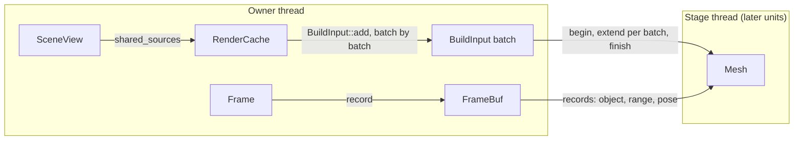

# The drawing renderer

`crates/render` (package `kumochi-render`) is the renderer the NativeShell shell will draw
drawings with, in place of the GPUI overlay's painter. It builds each view's geometry into a
mesh once and writes each frame as a list of small records, so a frame that animates uploads
records and never tessellates. It has no GPU, window or thread yet; later units add them. No
shell uses it, and nothing ships it.

## Two sides

The renderer works on two threads that share nothing.

- **The owner side** runs where the presenter runs. `Stager` is the presenter's `Stage`: it
  stages a `RenderCache` for each committed view, which collects the view's shared primitive
  lists (`SceneView::shared_sources`) sorted by handle and builds nothing. When a host needs a
  view's geometry, the owner copies the view into `BuildInput` batches with
  `BuildInput::add`: primitive headers, points and label text, with each rect's corner pieces
  already counted. A batch has a fixed size, so a view copies from a `Cursor` (an object and a
  primitive in it), each primitive whole, until the view ends or a part of the batch is full;
  `add` returns where the next batch starts. One batch can hold parts of several views. Each
  frame, `record` writes the frame's paint items into a `FrameBuf` as records.
- **The stage side** (`src/stage`) is what the stage thread will hold. `Mesh::begin` starts
  one geometry, `Mesh::extend` builds each of its batches in order, and `Mesh::finish` ends it.
  A batch out of order or for another geometry is refused as `Failure::Order`, and any refused
  batch leaves the mesh as it was before it. A `Record` names an object, a range of its
  primitives and the sampled pose, and `Mesh::range` resolves it to indices inside that object.

Whoever owns a batch wipes it with `BuildInput::wipe`, which overwrites its points and text, on
every path: after its build, when a copy or a build is refused, and before dropping it. The mesh
never wipes a batch, because the batch may hold other views' parts.

`cargo xtask check-core` lints the stage side: a stage-side file that names `kumochi_scene`,
`kumochi_shell_core` or another `crate::` module than `stage` and `limits` fails it, and so
does a `super::super` path under `stage/` or any `super::` path in `stage.rs`. It reads
spellings, so it catches a slip and proves nothing. The scene's memory never reaches the stage
thread, so a retired view or a dead dropper leaves nothing there.

Records follow `Frame::paint_items`: every object's ordinary geometry first, then edge-label
chips and text. Writing them is arithmetic into reserved buffers and a binary search per item,
so it never allocates, waits or locks.

## Tessellation

The mesh is built with lyon, the tessellator main's painter uses, at the shell's pin
(`=1.0.19`), so fills and strokes match main's: polygons and rect bodies fill nonzero, and
lines stroke with lyon's default joins, ends, miter limit and tolerance (`src/limits.rs`). A
border is the band between a rect's outline and its inset, one quad of its own per outline
edge. Main fills that band even-odd, which covers the same area.

Every stroke vertex carries its distance along the stroke's source points and its place in the
reveal, so a draw-in or a dash phase changes per frame without a rebuild. The mesh tessellates
by endpoint ids, so each vertex names the source point it came from and takes that point's
distance. Where lyon merges points closer than its merge distance, the kept point takes the
distance of the last point merged into it, as main's walk reaches it. A closed line of two
points goes out and back as two open lines, so its return leg keeps its distance. A border
vertex carries its reveal times a weight, 1 on the outer edge and the inner edge's length over
the outer edge's on the inner one. A rasterizer interpolates both and divides per pixel, which
gives main's cut exactly: a straight line joining the same fraction of the outer and the inner
edge. Where the inset collapses a corner, the inner edge has length 0 and weight 0, and every
cut there meets at the inner corner.

Known differences from main's painter:

- **A cut at a join.** At a partial reveal, main tessellates the revealed prefix again and ends
  it with a butt cap along the last segment's perpendicular. The mesh is built once, so the
  moving end of a reveal, and a dash end inside a join, interpolate across the join's own
  triangles instead: the cut bends through the miter's vertices. Away from joins the two agree.
- **The out-and-back line, whole.** A closed line of two points drawn whole and undashed is one
  rectangle in main and two overlapping ones here, so a translucent one blends twice. Main's
  partial and dashed walk overlaps the same way.

Main counts a rect's corner pieces at the pose's scale, and refuses a pose that needs more than
the scale the scene crate charged. The mesh is built once for every pose, so the owner counts
the pieces at the charged scale with the scene crate's `corner_segments`, and every pose,
those main refuses included, draws from that mesh. The scene crate's charge doesn't change;
the pieces count against this crate's own buffers. A primitive lyon refuses, or one that would
pass the mesh's reservation, fails its picture as `Failure::Build`.

## What is charged and what is fixed

A `RenderCache` is charged with its scene like any paint cache: its `bytes()`, fixed when it
is staged, count the boxed cache and its source references. The primitive lists themselves
stay charged to the view's layout.

Everything else is reserved once, whether or not a drawing shows, and `Stager::fixed_bytes`
returns its sum, a constant (`limits::FIXED_BYTES`):

| Buffer | Sized for | Bytes |
|---|---|---|
| Three `FrameBuf`s | 4 pictures and 3,000 64-byte records: both passes of 1,500 objects | 3 × 192,144 |
| One `BuildInput` batch | 1,500 objects, 27,449 primitive headers, 42,048 points, 262,144 bytes of text | 2,038,156 |
| One `Mesh` | 165,120 24-byte vertices, 376,896 indices, 27,602 pieces | 5,918,024 |
| lyon's working memory | an allowance, main's 2 MiB for the same tessellators | 2,097,152 |
| Total | | 10,629,764 |

Objects, points and mesh sizes follow from the global caps in `kumochi_scene::limits`: the
object cap, the fill-vertex and outline-point caps, and the path-segment cap, which bounds
every line (a polyline of n points is charged at least n − 1 segments). `limits.rs` writes out
the arithmetic, including the most vertices and triangles lyon's stroke emits per segment,
read from its source. No global cap counts primitives, so that size is derived from what
layout's producers emit under the caps. Every primitive's points fit an empty batch, and so
does the longest label, 400 characters of at most 4 bytes. Label text has no fixed bound,
since a continued scene keeps labels from many calls, so the batch's text size is a tunable
(`limits::BATCH_TEXT_BYTES`, a proposal) and a view past it copies in several batches.

lyon's fill sweep has no vertex bound that follows from its source: it adds a vertex per event,
and splitting edges at the crossings it finds can add events past the points and crossings the
scene charges. The fill cap is a reservation, and a fill past what is left of the mesh fails
its picture. lyon's tessellators grow their own working memory, which the mesh can't cap; the
`record_allocations` test measures what they keep after builds at the fill cap against the
allowance.

The whole is held under a 16 MiB ceiling, a proposal until the label raster's scratch is sized
(`limits::FIXED_CEILING_BYTES`, checked when the crate compiles).

## Measuring

Build the workloads with `cargo bench --locked -p kumochi-render --bench render-workloads
--no-run`. The command prints the executable's path. Run that executable with one workload
name (or `--list`), one at a time, on an otherwise idle machine:

- `mesh_at_limits` times the owner's copy and the mesh build of one view at the global paint
  caps.
- `copy_labels` times copying thirteen tables at the cell cap, whose labels take several
  batches.
- `record_frame` times writing one frame of four views at the global object cap and fails if
  it allocates or frees; the `record_allocations` test checks the same frame in every test run.
