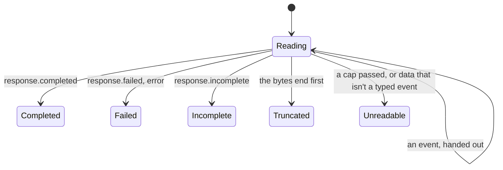

# Model requests: the Responses stream

A signed-in account answers turns through OpenAI's Responses API on the user's ChatGPT plan:
`POST https://api.openai.com/v1/responses` with `store: false` and `stream: true`. This page
covers the HTTP/1.1 framing the transport uses and what the brain does with the answer. The
transport itself, and the send lease that keeps a deleted task's text from leaving, come with PR
11c.

Code: `crates/brain/src/connections/model/`.

## HTTP framing

`wire` holds the HTTP/1.1 the transport speaks, so the transport, not a library buffer, decides
when the request's last byte has left. `request` builds the request in one buffer, sized once and
wiped on drop, and refuses a bearer that isn't a valid header value (no CR, LF, NUL, space or
other control bytes). `head` parses a response head with `httparse`, and `Body` steps through the
body's framing, handing out the data between framing bytes.

| Bound | Limit |
| --- | --- |
| A response head | 16 KiB and 32 headers |
| Interim heads (100, 103) | 4; 101 and other 1xx are refused |
| A chunk-size line, extensions included | 1 KiB, at most 16 hex digits |
| Trailers | 16 KiB |

Framing is one clear choice: `Content-Length`, `Transfer-Encoding: chunked`, or read to close
with `Connection: close`. Both length and chunked, a repeated length, another transfer coding, or
no framing at all is refused, and so is anything but HTTP/1.1. The request sends
`Accept-Encoding: identity`, and a head with any other Content-Encoding is refused, so no
compressed bytes reach the framer or a reader. Header names and tokens match
case-insensitively, lengths parse with checked arithmetic, and no peer-supplied length sizes an
allocation. A body that ends inside its framing is `Truncated`.

`budget` caps model requests for live checks: debug builds read `KUMOCHI_LIVE_BUDGET`, which
`cargo xtask live` sets, and a value that isn't a count allows none. Release builds have no cap.

## Reading the stream

`sse::Reader` takes the response body's bytes in whatever chunks they arrive and hands out each
event's JSON. Lines end in LF or CRLF. Comments, `event:`, `id:` and `retry:` are ignored, because the
JSON's own `type` names the event. A `data: [DONE]` event is skipped.

| Bound | Limit |
| --- | --- |
| A line, its line feed excluded | 1 MiB |
| One event's data, lines joined | 1 MiB |
| The stream, up to its terminal event | 16 MiB |
| Visible text (`response.output_text.delta`) | 1 MiB |

Only `response.completed` succeeds. The run-wide caps and the 120-second run deadline belong to
the coordinator, across all of a run's rounds.

## What a failure means

`error::ProviderError` keeps a refusal's status, and its `error.code` and `error.param` as closed
types. It never keeps `message`, `detail` or any other provider text, so nothing of it can reach a
log or the shell. A refusal inside the stream (an `error` event, or `response.failed`'s `error`)
reads the same way, with status 200.

Codes from the published plan-usage ledger (Sign in with ChatGPT, "Errors and recovery") decide
first, then the status:

| Code | User sees | Action |
| --- | --- | --- |
| `subscription_sharing_usage_limit_exceeded` | `UsageLimit` | Manage usage |
| `subscription_sharing_usage_unavailable`, `…_user_unavailable` | `AccountOffline` | Retry |
| `subscription_sharing_user_not_eligible` | `PlanUnavailable` | none |
| `subscription_sharing_unsupported_capability`, `…_route_not_supported` | `RequestRefused` | none |
| `subscription_sharing_invalid_user` | `AccountRefused` | Sign in |
| `chatpass_v2_scope_not_authorized`, `chatpass_v2_invalid_authorization_context` | `AccountMisconfigured` | none |
| no known code: 401 | `AccountRefused` | Sign in |
| no known code: 403 | `PlanUnavailable` | none |
| no known code: other 4xx | `RequestRefused` | none |
| no known code: 429, 5xx, or inside the stream | `AccountOffline` | Retry |
| `response.incomplete`, an early end | `AccountOffline` | Retry |
| unreadable | `ResponseUnreadable` | Retry |

None of these erases the token set. A rejected bearer isn't a confirmed revocation: Sign in
replaces the set, and only the refresh path's terminal codes end a session. The usage limit fails
only the run that hit it; keeping later automatic requests from following is the coordinator's job.

Fixtures: `crates/brain/fixtures/responses/` holds the streams and the ledger's error bodies. They're
stored byte for byte (`.gitattributes`), so the CRLF one stays CRLF.
