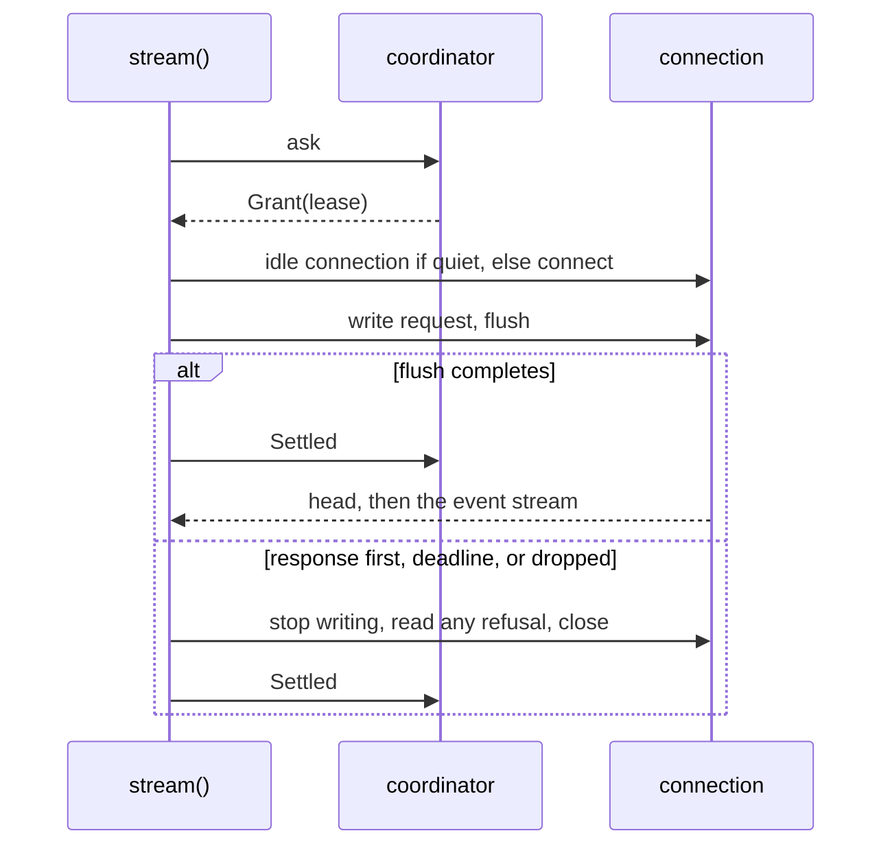
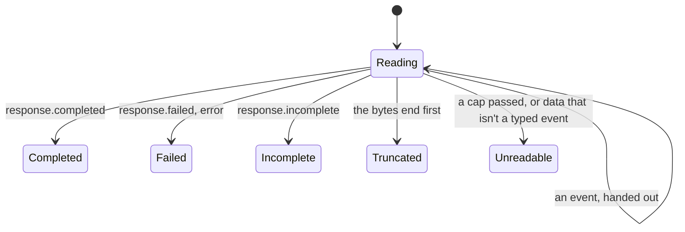

# Model requests: the Responses stream

A signed-in account answers turns through OpenAI's Responses API on the user's ChatGPT plan:
`POST https://api.openai.com/v1/responses` with `store: false` and `stream: true`. This page
covers how the brain sends it, and what it does with the answer.

Code: `crates/brain/src/connections/model/`.

## Sending the request

`model::stream()` sends one request, and nothing is spawned: the connection, its writes and reads,
and the send lease all live in the caller's future, so dropping it (Stop, a replaced run, the
coordinator's deadline) closes the socket at once.

1. **Checks first.** `ResponsesBody::new` refuses a body without `"store": false` and
   `"stream": true`, or over 16 MiB, and the bearer must be a valid header value. Neither touches
   the network.
2. **The gate.** The caller passes the coordinator's ask for this attempt (`SendGate::ask`, in
   `engines`), and the transport awaits it only after those checks. Rebuild, or a coordinator
   that's gone, ends the request with nothing sent. A retry is another call, so it asks again.
3. **The lease.** A grant carries the coordinator's `SendLease`, which settles when it drops. The
   transport drops it once the request's last byte has been flushed to the kernel, or once the
   connection holding the request has closed, whichever comes first. `Attempt` declares the
   connection before the lease, so on every other path the socket closes first.
4. **The budget.** Debug builds honour `KUMOCHI_LIVE_BUDGET` for live checks. A spent budget ends
   the request before it connects.
5. **The upload.** The transport writes the HTTP/1.1 request itself, then flushes. tokio-rustls's
   flush returns only once rustls holds no TLS records and the TCP flush has returned, so a
   completed flush means no request byte is left in the process. Response bytes that arrive
   meanwhile are read: interim heads (100, 103) are skipped and a success head is kept, so the
   upload goes on. Any other final head stops writing for good: the refusal is read, the
   connection closes, and only then does the
   lease settle.
6. **The answer.** The head is read with `httparse`, the body is framed by `wire::Body`, and an
   event-stream body goes through the reader below.

**One deadline before settlement.** Ten seconds from the grant cover the connect, any replacement
of a stale idle connection, the upload, the flush and an early refusal. They're never reset, so they
stay under the coordinator's own send deadline. After settlement, each read waits at most 60 s, and
an error body gets its own 10 s.

**No replay.** Once any request byte has been written, a write, flush or read failure ends the
request as `Transport`: it may have arrived, so it's never sent again on its own. The one
reconnect is before the write. An idle connection is checked with a single non-blocking read
first, and if bytes, an end or an error are waiting, it's closed and a new one opens under the
same lease and budget unit.

**Reuse.** One idle connection is kept, for at most 50 s. A connection goes back only when its
request was fully written, its response framing was read to the end (`response.completed` isn't
the end of the HTTP body, so the rest gets one more second), no bytes are left over, and the
server didn't send `Connection: close`.

**HTTP bounds.** ALPN offers only `http/1.1`, and TLS early data is off. The framing bounds are
under HTTP framing below. On top of them, an error body is read up to 1 MiB and a response up to
17 MiB of wire bytes. A 2xx must be `text/event-stream` or have no Content-Type, and a 3xx is
refused. With no Content-Type, the body's first 128 bytes must start like an event stream (blank
space, then `data:`, `event:` or a `:` comment); those bytes then go to the reader. Another type,
or more than one, is refused.

## HTTP framing

`wire` holds the HTTP/1.1 the transport speaks, so the transport, not a library buffer, decides
when the request's last byte has left. `request` builds the request in one buffer, sized once and
wiped on drop, and refuses a bearer that isn't a valid header value (no CR, LF, NUL, space or
other control bytes). `head` parses a response head with `httparse`, and `Body` steps through the
body's framing, handing out the data between framing bytes.

| Bound | Limit |
| --- | --- |
| A response head | 16 KiB and 32 headers |
| Interim heads (100, 103) | 4; 101 and other 1xx are refused |
| A chunk-size line, extensions included | 1 KiB, at most 16 hex digits |
| Trailers | 16 KiB |

Framing is one clear choice: `Content-Length`, `Transfer-Encoding: chunked`, or read to close
with `Connection: close`. Both length and chunked, a repeated length, another transfer coding, or
no framing at all is refused, and so is anything but HTTP/1.1. The request sends
`Accept-Encoding: identity`, and a head with any other Content-Encoding is refused, so no
compressed bytes reach the framer or a reader. Header names and tokens match
case-insensitively, lengths parse with checked arithmetic, and no peer-supplied length sizes an
allocation. Chunk extensions must follow RFC 9112's grammar (`;name`, optionally `=token` or a
quoted string) and each trailer must be a field line; both are then ignored. A body that ends
inside its framing is `Truncated`.

`budget` caps model requests for live checks: debug builds read `KUMOCHI_LIVE_BUDGET`, which
`cargo xtask live` sets, and a value that isn't a count allows none. Release builds have no cap.

## Reading the stream

`framer::Framer` takes the response body's bytes in whatever chunks they arrive and hands out each
event's data. Lines end in LF or CRLF. Comments, `event:`, `id:` and `retry:` are ignored, because
the data's own `type` names the event, and an event's `data` lines are joined by line feeds. The
framer knows no JSON and no terminal event, so other providers' readers share it and its byte
bounds. `sse::Reader` reads each event's data as Responses JSON and hands it out; a `data: [DONE]`
event is skipped.

| Bound | Limit |
| --- | --- |
| A line, its line feed excluded | 1 MiB |
| One event's data, lines joined | 1 MiB |
| The stream, up to its terminal event | 16 MiB |
| Visible text (`response.output_text.delta`) | 1 MiB |

The framer enforces the first three, and counts bytes only up to the event that stops the
stream; the reader counts visible text. Only `response.completed` succeeds. The run-wide caps
and the 120-second run deadline belong to the coordinator, across all of a run's rounds.

## What a failure means

`error::ProviderError` keeps a refusal's status, and its `error.code` and `error.param` as closed
types. It never keeps `message`, `detail` or any other provider text, so nothing of it can reach a
log or the shell. A refusal inside the stream (an `error` event, or `response.failed`'s `error`)
reads the same way, with status 200.

Codes from the published plan-usage ledger (Sign in with ChatGPT, "Errors and recovery") decide
first, then the status:

| Code | User sees | Action |
| --- | --- | --- |
| `subscription_sharing_usage_limit_exceeded` | `UsageLimit` | Manage usage |
| `subscription_sharing_usage_unavailable`, `…_user_unavailable` | `AccountOffline` | Retry |
| `subscription_sharing_user_not_eligible` | `PlanUnavailable` | none |
| `subscription_sharing_unsupported_capability`, `…_route_not_supported` | `RequestRefused` | none |
| `subscription_sharing_invalid_user` | `AccountRefused` | Sign in |
| `chatpass_v2_scope_not_authorized`, `chatpass_v2_invalid_authorization_context` | `AccountMisconfigured` | none |
| no known code: 401 | `AccountRefused` | Sign in |
| no known code: 403 | `PlanUnavailable` | none |
| no known code: other 4xx | `RequestRefused` | none |
| no known code: 429, 5xx, or inside the stream | `AccountOffline` | Retry |
| `response.incomplete`, an early end | `AccountOffline` | Retry |
| unreadable | `ResponseUnreadable` | Retry |
| the connection failed or stalled, or Rebuild | `AccountOffline` | Retry |
| a refused body, or a spent live-check budget | `RequestRefused` | none |
| a bearer that isn't a header value | `AccountRefused` | Sign in |

None of these erases the token set. A rejected bearer isn't a confirmed revocation: Sign in
replaces the set, and only the refresh path's terminal codes end a session. The usage limit fails
only the run that hit it; keeping later automatic requests from following is the coordinator's job.

Fixtures: `crates/brain/fixtures/responses/` holds the streams and the ledger's error bodies. They're
stored byte for byte (`.gitattributes`), so the CRLF one stays CRLF.

## Opt-in Dev text observation

The regular Windows brain with debug assertions and the Dev identity can open
`live/<number>/chatgpt-text.stamps` when its executable path ends in
`live/<number>/bin/kumochid.exe`, `KUMOCHI_LIVE_CHATGPT_TEXT` is exactly `1`, and
`KUMOCHI_LIVE_BUDGET` parses as 1–60. It writes a ready row at startup and never
overwrites an existing file. The path and variables don't prove this is a fresh copy,
a trusted parent directory or a disposable profile. Copying the executable does not
isolate account state.

A reservation follows an ordinary send lease and successful budget debit. The first
accepted nonempty text delta is recorded before forwarding to the run pump. An owned
connection's destruction gets a QPC sample on each side; only a Stop earlier than
the first sample can establish that Stop preceded that drop. Pooling is distinct, and
`no_io` means no connection was installed on the attempt, not that its connector did
no I/O. None of these observations proves provider-side cancellation.

These boundaries append fixed numeric records without waiting, formatting or file I/O.
Only after runtime shutdown, when no more model or auxiliary work can dispatch, does
the brain write the buffered rows and a final count. A failed append, a 65th auxiliary
attempt, or a reservation beyond the model ceiling invalidates the observation, so
there is no final count. Auxiliary HTTP categories do not spend the model budget.
Missing or inconsistent totals are invalid; the model budget still applies independently.
Neither stream content nor request data is written.

## Opt-in offline draw observation

The Windows Debug GATE brain also accepts the `draw` opt-in in that copy layout, with budget
`1`. An unavailable receipt fails closed instead of choosing the account engine. This mode
uses a fixed in-memory HTTP/SSE replay; the ordinary Responses reader and connection do no
drawing observation. The replay knows the exact byte offsets of the call start's SSE JSON
and each step record's opening byte, and stamps the reads that actually carry them. Only
the replay's argument events select the coordinator's observed tokenizer call, which
stamps a step when its record closes. The store thread marks the successful transaction
reply before sending it; the data queue marks the accepted `SceneStepCommit` hand-off.
At Quit the mode writes only PID, run, scene, index, byte count and QPC stamps. It omits
the final marker if any of the four step receipts is missing or inconsistent.

The replay's connector cannot open a socket or use a provider bearer. This is not a
process-wide network sandbox: normal account startup remains enabled and could load
credentials or fetch a catalog on a configured profile. The draw trial starts with an
empty GATE profile, Claude Code off, and no account actions or sign-in. It writes the
fixture turn and drawing to its local database to measure a real durable reply. The
driver retains validated receipts and cleans the isolated app data through the shared
gate teardown; cleanup failures are reported separately.
