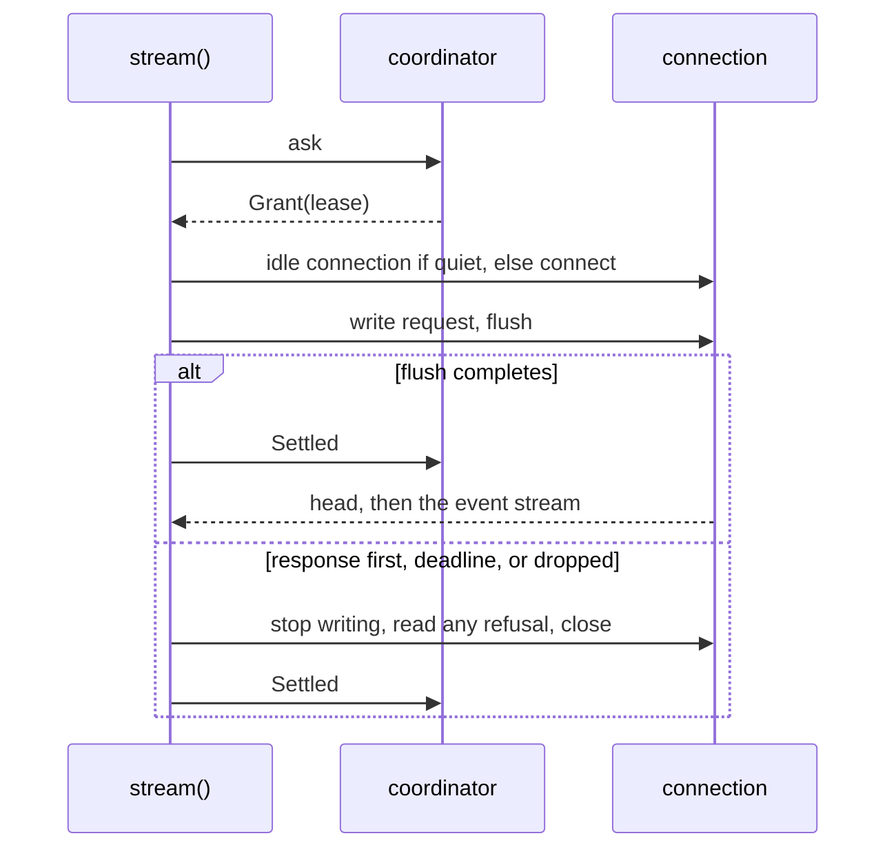
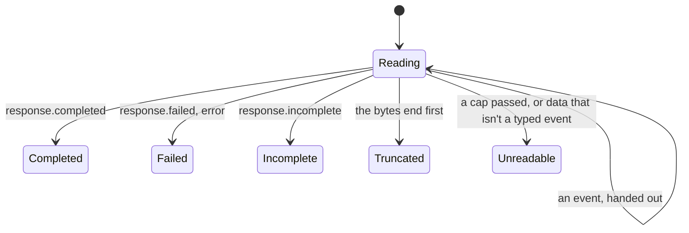

# Model requests: the Responses stream

A signed-in account answers turns through OpenAI's Responses API on the user's ChatGPT plan:
`POST https://api.openai.com/v1/responses` with `store: false` and `stream: true`. This page
covers how the brain sends it, and what it does with the answer.

Code: `crates/brain/src/connections/model/`.

## Sending the request

`model::stream()` sends one request, and nothing is spawned: the connection, its writes and reads,
and the send lease all live in the caller's future, so dropping it (Stop, a replaced run, the
coordinator's deadline) closes the socket at once.

1. **Checks first.** `ResponsesBody::new` refuses a body without `"store": false` and
   `"stream": true`, or over 16 MiB, and the bearer must be a valid header value. Neither touches
   the network.
2. **The gate.** The caller passes the coordinator's ask for this attempt (`SendGate::ask`, in
   `engines`), and the transport awaits it only after those checks. Rebuild, or a coordinator
   that's gone, ends the request with nothing sent. A retry is another call, so it asks again.
3. **The lease.** A grant carries the coordinator's `SendLease`, which settles when it drops. The
   transport drops it once the request's last byte has been flushed to the kernel, or once the
   connection holding the request has closed, whichever comes first. `Attempt` declares the
   connection before the lease, so on every other path the socket closes first.
4. **The budget.** Debug builds honour `KUMOCHI_LIVE_BUDGET` for live checks. A spent budget ends
   the request before it connects.
5. **The upload.** The transport writes the HTTP/1.1 request itself, then flushes. tokio-rustls's
   flush returns only once rustls holds no TLS records and the TCP flush has returned, so a
   completed flush means no request byte is left in the process. If response bytes arrive first,
   writing stops for good, the refusal is read, the connection closes, and only then does the
   lease settle.
6. **The answer.** The head is read with `httparse`, the body is framed by `wire::Body`, and an
   event-stream body goes through the reader below.

**One deadline before settlement.** Ten seconds from the grant cover the connect, any replacement
of a stale idle connection, the upload, the flush and an early refusal. They're never reset, so they
stay under the coordinator's own send deadline. After settlement, each read waits at most 60 s, and
an error body gets its own 10 s.

**No replay.** Once any request byte has been written, a write, flush or read failure ends the
request as `Transport`: it may have arrived, so it's never sent again on its own. The one
reconnect is before the write. An idle connection is checked with a single non-blocking read
first, and if bytes, an end or an error are waiting, it's closed and a new one opens under the
same lease and budget unit.

**Reuse.** One idle connection is kept, for at most 50 s. A connection goes back only when its
request was fully written, its response framing was read to the end (`response.completed` isn't
the end of the HTTP body, so the rest gets one more second), no bytes are left over, and the
server didn't send `Connection: close`.

**HTTP bounds.** ALPN offers only `http/1.1`, and TLS early data is off.

| Bound | Limit |
| --- | --- |
| A response head | 16 KiB and 32 headers |
| Interim heads (100, 103) | 4; 101 and other 1xx are refused |
| A chunk-size line, extensions included | 1 KiB, at most 16 hex digits |
| Trailers | 16 KiB |
| An error body | 1 MiB |
| Wire bytes per response | 17 MiB |

Framing is one clear choice: `Content-Length`, `Transfer-Encoding: chunked`, or read to close
with `Connection: close`. Both length and chunked, a repeated length, another transfer coding, or
no framing at all is refused. Header names and tokens match case-insensitively, lengths parse with
checked arithmetic, and no peer-supplied length sizes an allocation. A 2xx must be
`text/event-stream`, and a 3xx is refused.

## Reading the stream

`sse::Reader` takes the response body's bytes in whatever chunks they arrive and hands out each
event's JSON. Lines end in LF or CRLF. Comments, `event:`, `id:` and `retry:` are ignored, because the
JSON's own `type` names the event. A `data: [DONE]` event is skipped.

| Bound | Limit |
| --- | --- |
| A line, its line feed excluded | 1 MiB |
| One event's data, lines joined | 1 MiB |
| The stream, up to its terminal event | 16 MiB |
| Visible text (`response.output_text.delta`) | 1 MiB |

Only `response.completed` succeeds. The run-wide caps and the 120-second run deadline belong to
the coordinator, across all of a run's rounds.

## What a failure means

`error::ProviderError` keeps a refusal's status, and its `error.code` and `error.param` as closed
types. It never keeps `message`, `detail` or any other provider text, so nothing of it can reach a
log or the shell. A refusal inside the stream (an `error` event, or `response.failed`'s `error`)
reads the same way, with status 200.

Codes from the published plan-usage ledger (Sign in with ChatGPT, "Errors and recovery") decide
first, then the status:

| Code | User sees | Action |
| --- | --- | --- |
| `subscription_sharing_usage_limit_exceeded` | `UsageLimit` | Manage usage |
| `subscription_sharing_usage_unavailable`, `…_user_unavailable` | `AccountOffline` | Retry |
| `subscription_sharing_user_not_eligible` | `PlanUnavailable` | none |
| `subscription_sharing_unsupported_capability`, `…_route_not_supported` | `RequestRefused` | none |
| `subscription_sharing_invalid_user` | `AccountRefused` | Sign in |
| `chatpass_v2_scope_not_authorized`, `chatpass_v2_invalid_authorization_context` | `AccountMisconfigured` | none |
| no known code: 401 | `AccountRefused` | Sign in |
| no known code: 403 | `PlanUnavailable` | none |
| no known code: other 4xx | `RequestRefused` | none |
| no known code: 429, 5xx, or inside the stream | `AccountOffline` | Retry |
| `response.incomplete`, an early end | `AccountOffline` | Retry |
| unreadable | `ResponseUnreadable` | Retry |
| the connection failed or stalled, or Rebuild | `AccountOffline` | Retry |
| a refused body, or a spent live-check budget | `RequestRefused` | none |
| a bearer that isn't a header value | `AccountRefused` | Sign in |

None of these erases the token set. A rejected bearer isn't a confirmed revocation: Sign in
replaces the set, and only the refresh path's terminal codes end a session. The usage limit fails
only the run that hit it; keeping later automatic requests from following is the coordinator's job.

Fixtures: `crates/brain/fixtures/responses/` holds the streams and the ledger's error bodies. They're
stored byte for byte (`.gitattributes`), so the CRLF one stays CRLF.
