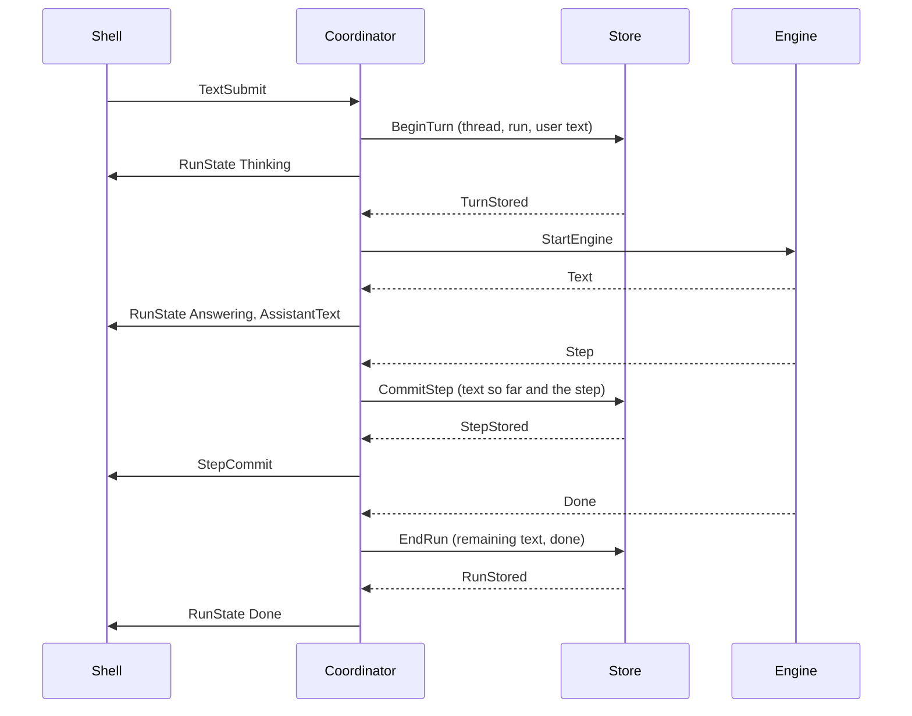

# Runs and the coordinator

A **run** is one user turn: in slice 2 a typed message, later a voice hold or an ask-about. The
brain's **coordinator** (`crates/brain/src/coordinator/`) is its core loop, written sans I/O: it
takes inputs and returns effects, and the systems around it (the store, the engine, the pipes,
timers) do the work and report back. So the order of Esc, late completions and interruption is
tested as plain unit tests.

## Ids and staleness

The coordinator hands out thread and run ids, starting above the store's high-water marks, so an
id is never reused, even across restarts and deletions. One run is current at a time. An engine
event, a control input or a timer that names any other run is **stale**: it returns `Stale` and
changes nothing. That's how a step an engine finishes after `Stop` is refused, and the store
refuses it again, since it only takes events for active runs. Store replies are the exception:
those for a run that is still ending are accepted, so its outcome is still written and a failure
still reported (see [the store contract](#the-store-contract)).

## One run, start to end

- **The turn is stored before the engine starts** (OSC-105 boundary 8). A blank turn (empty or
  whitespace only) starts nothing.
- **A thread's events stay in run order.** A new turn's write waits until every older run's
  outcome is queued, so a replaced run's last text lands before the new turn and the new engine
  starts only after its predecessor is stored. The shell still hears the old run's `Interrupted`
  and the new run's `Thinking` at once. A held turn that is stopped or replaced in turn is
  still stored, then its outcome, in order.
- **A step is sent only after it's committed.** When the engine says it's done while a step is
  still in the store, the run ends right after that step is stored and sent.
- **Data keeps the engine's order.** Text the engine produces after a pending step waits behind
  it and goes out right after its `StepCommit`. Control inputs such as `Stop` are handled at
  once while it waits.
- **Text goes out in pieces of at most 64 KiB**, split on character boundaries, so every frame
  fits the data pipe.
- **Streamed text is stored with each step and with the outcome**, in the same transaction.
  shortcut: text after the last step is lost if the brain dies mid-run; store it on a timer once
  real engines stream long answers (slice 3).

## The store contract

The store runs operations in order, each in one transaction, and answers every one:
`TurnStored`, `StepStored` or `RunStored` on success, `StoreFailed` on failure. So a
`StoreFailed` always belongs to the run's oldest unanswered operation, and step
acknowledgements arrive by index in order. An acknowledgement for anything else (a repeat, an
index out of range, a step before its turn is stored) is `Stale` and changes nothing.

## Ending a run

Every ending runs in the same order: cancel the engine so it produces nothing more (unless it
finished, or never started because the turn wasn't stored yet), drop the data it still held for
the shell, tell the shell (every ending but `done`), then store the outcome
with the unstored text and, when the user stopped it, the `revealed` set. The outcome is
written once the run's earlier operations are answered, so a run stopped before its turn was
stored gets its outcome after the turn, and its engine never starts.

An ended run stays with the coordinator until the store answers for its outcome, so a failure is
never lost:

- if the turn failed, there's no run row, and nothing more is written;
- if a step or the outcome failed, the outcome is written as `failed(store)` without its text,
  but with the Stop's `revealed` set and its scene's clear, so the drawing keeps what the shell
  kept; if that fails too, the run stays `active` and the next start's recovery marks it
  `failed(crash)`. Its scene's clear, or its kept selection, is then retried on its own until
  it commits, and a Quit is incomplete until it has, unless the Quit's own clear durably
  removes that scene: a kept selection that keeps failing still ends in a complete Quit then.

| Cause | Outcome | Shell told |
|---|---|---|
| Engine finished | `done` | once the store has it |
| `Stop` (Esc) | `interrupted(stop)`, with `revealed` | at once |
| A new turn | `interrupted(replaced)` | at once |
| The shell went away | `interrupted(shell_lost)` | no |
| The shell took no data for 2 s | `interrupted(view_stalled)` | at once |
| A budget ran out | `failed(budget)` | at once |
| The engine failed or sent an oversized step | `failed(engine)` | at once |
| A store write failed | `failed(store)` | at once |

`revealed` keeps only indices of steps already sent to the shell, each once, in order.

### What the shell can rely on

- **A run's data is complete at its `RunEnd`, on the data pipe.** Every run that reaches a
  terminal `RunState` also gets one `RunEnd`, after all of its data frames. The two pipes aren't
  ordered with each other, so a terminal `RunState` on control says nothing about what has
  arrived on data; the shell keeps reading the run's data until its `RunEnd`.
- `RunState Done` means the run's text, steps and outcome are committed.
- Every other terminal `RunState` comes at once, whatever the store is doing, so `Stop`'s
  answer never waits on an fsync or a long write. It's the shell's to show, not a promise that
  the outcome is stored.
- A terminal `RunState` can be followed by `RunState Failed` for the same run, when its
  writes later fail. The shell shows the failure; nothing else follows it.
- A `Stop` for a run that already ended doesn't change its outcome: it still ends `done`,
  `failed` or `interrupted(replaced)`, and its data still drains. But the shell could still
  stop it while it drew the run's last steps, so the scene keeps only what the shell kept. While
  the run's writes are pending, the selection goes with its outcome once they settle, or with
  the late first step that begins its scene; once they're done and the scene is visible, the
  brain writes the selection on its own, or the scene's clear when nothing stayed. A scene is
  trimmed once: a later `Stop` for its run is stale. So is one for a run an earlier connection
  started, ended or not, and after a restart, since a connection can stop only runs it started
  itself. One that arrives while the engine has finished but its last step is still being stored interrupts
  the run, since the shell never showed that step.

## Budgets

Budgets are absolute for the run and never reset (OSC-105 boundary 5): 120 s of wall clock, 1 MiB
of visible text and 64 steps. Exceeding one ends the run as `failed(budget)`, and the text or
step that went over is never sent. The wall clock starts when the turn is accepted, so time a held
turn spends waiting counts against it, and it stops applying once the engine says it's done, even
while the run's last writes are still pending. Model rounds, tool calls and speech budgets arrive
with the engines that use them.

## The fixture engine

Until slice 3 brings real engines, every run plays a fixture script
(`crates/brain/fixtures/default.txt`, or in a dev build the file `CAPSULA_FIXTURE` names). One
line per event: `<ms> text <words>`, `<ms> fill <bytes>`, `<ms> step <label>`, `<ms> fail`, and
`late <label>`, a step the engine still finishes after it's cancelled. The coordinator refuses
that late step as stale, and the store would refuse it too.

## Around the coordinator

The store runs on its own thread, which owns the connection and keeps the store contract above:
operations in order, one transaction each, every one answered. The fixture engine, the store
thread and the deadline timer report back as inputs, and the pipes' readers and writers are
described in `ipc.md`. A shell that disconnects ends the current run as
`interrupted(shell_lost)`. Every Stop and Clear the control reader read before the pipe ended is
applied first, even one read in the same poll as the end. Store replies keep reaching the coordinator while no shell is
connected, and on exit the brain waits up to 2 s for ended runs to be stored, then up to 2 s for
the store to close. A deletion's purge (`store.md`) copies the store on a helper thread only
while no run is active, and an op arriving, or closing, stops the copy without waiting for it.
Removing its files runs on a helper too, so turns and runs stop only for the swap, about
10 ms on Rez up to 984 MiB, and otherwise share the disk with the helper.

shortcut: a store that never answers leaves a finished run unconfirmed. At the next start, runs
still active in the store become `failed(crash)`; outcomes already committed stay, and work not
yet committed may be lost. Fine while the store is local SQLite.

On Quit the brain shuts down by one deadline instead, described in [processes](processes.md).

The step is a labelled placeholder until slice 4's scene format. A run's steps draw in one scene:
its first step's write begins the scene and returns its id, and the steps after it wait in the
run until that ack. A Stop, a replacement, a failed first write or a lost shell drops the waiting
steps, and the run still settles.
