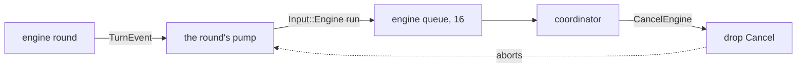
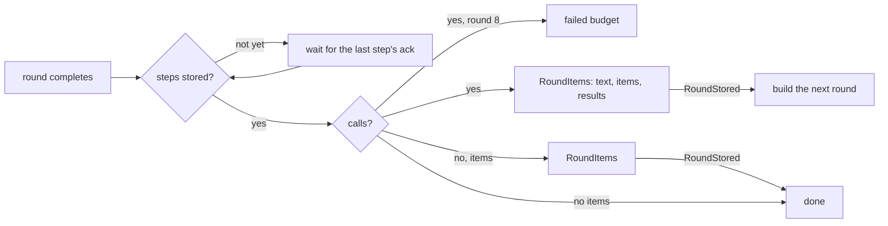

# Runs and the coordinator

A **run** is one user turn: a typed message, a voice hold or an ask-about. The
brain's **coordinator** (`crates/brain/src/coordinator/`) is its core loop, written sans I/O: it
takes inputs and returns effects, and the systems around it (the store, the engine, the pipes,
timers) do the work and report back. So the order of Esc, late completions and interruption is
tested as plain unit tests.

## The shell's input target

`crates/shell-core/src/runs.rs` owns `Target::{Kumo, Task(ThreadId), New}` separately from
`Threads.open`, the history being viewed. Viewing doesn't change the target or selection
revision. **Switch to this task**, **Back to Kumo** and **New task** advance the revision;
switching to the id in `SettingsView.main_thread` normalizes to `Target::Kumo`.

The default is Kumo at shell start, when `met()` meets a new brain incarnation and drops a
non-durable target, and when the user confirms deletion of the targeted task. These fallbacks
advance the revision too. A task known from a stored row or an answered run is durable and
survives reconnect; an unconfirmed new task falls back to Kumo when the brain incarnation
changes. This replaces slice 2's new-conversation default (OSC-157).

Each submit captures its turn number, target, selection revision and text in a bounded queue.
`Target::Kumo` resolves to the connection's `SettingsView.main_thread`; `Target::New` sends
`None`. Submits are refused as offline until that connection has supplied its `SettingsView`,
even for New task. Disconnect clears the main id and pending submissions, so a previous
connection's id cannot be reused before the new view arrives.

The shell also retains the submitted text until its named run ends. A named Failed state
with SessionEnded, AccountRefused, SignInNeeded, ConnectionNeeded, ClaudeCodeSignedOut,
AnthropicKeyRejected or RenewalUnconfirmed returns that text once before Answering, only while its captured selection revision and
thread still match the current input target. The typing view restores it only into an empty
input; even whitespace is a newer draft. No frame resends a turn automatically. General
account errors and TurnRefused cannot restore text because neither identifies a failed run.
Esc, a new submit attempt, a target change, disconnect, a new brain incarnation, confirmed
deletion, success or interruption discard the recovery content. Duplicate terminal states
cannot offer it again. Recovery carriers redact their text in Debug output.

Otherwise, a named failure declaring Retry can transfer its submitted snapshot to one
run-owned recovery slot. Automatic restore and this transfer are exclusive: a draft already
returned to the input has no second retained copy. `Runs::retry` takes the matching slot
before checking its captured revision, thread and the current draft, or attempting delivery.
Refusal consumes it too. New's named run establishes the stored thread before capture can
be retried; Retry never submits another unbound New turn. Dismissal drops the slot, as does
a settings update that changes the input's target. Switching back doesn't revive it.
Chat keeps the notice but omits actions that have no route or whose run lost its Retry slot.
A valid Retry can still be temporarily disabled by a newer draft, pending account work, or
the connection state.

`shell-core/chat_notice.rs` retains the typed error and its run, account or settings-field owner.
Presence pushes that notice into the composer. Its render reads Settings, so GPUI tracks
that dependency and invalidates the window on settings-only enabled-state changes without
an explicit Settings observer. Input observation notifies the composer only when draft
emptiness changes; typing within a nonempty draft and caret blinking emit no extra composer
notification. Input still invalidates its window; this does not cache the window's render tree.
Recovery controls apply only to the still-current notice they rendered from. Replacing,
clearing or dismissing the notice invalidates its callbacks, even if the same error returns.
Dispatch then checks the declared action and uses the existing run, account or settings
admission. An account Retry cannot resend run text. Manage usage opens the existing URL only
when no account operation is pending, even if the click arrived before the link repainted.
Settings routes select their exact tab without toggling a visible settings window closed.
Retry and Dismiss return focus to the retained composer so typing and its Escape
handling continue after the recovery control disappears.

Renewal warnings coalesce within the connection lifetime. A named run promotes a general
warning to run ownership, replacing the composer notice only if that renewal is still showing.
A newer unrelated notice, or an empty composer after its dismissal, stays undisturbed. Later
duplicates cannot demote or resurrect the incident. The Accounts diagnostic remains independent.
Authoritative account recovery, an accepted new turn or a connection reset starts the next
incident. No timer correlates the frames.

Answering is ordered before a later Failed on the control pipe. It suppresses automatic
restoration even if text on the data pipe is delayed: authentication can fail on a later
model round after earlier output. Thinking alone does not prove no model or tool ran.

While `Target::New` has a submission pending at the current revision, another submit is
refused as `Busy` without sending a second `TextSubmit { thread: None }`. The typing draft
stays, so after the first `RunState` adopts the task, retrying continues that task. Pending
turns from older selections don't block New task: explicitly choosing **New task** again
advances the revision and permits a separate task.

Only a run's first `RunState` can answer a pending submit, through its explicit
`RunOrigin::Typed { turn }` and matching captured concrete thread. An originally New submit
can instead bind the returned thread, and adopts it only at the same selection revision
while the target is still New and the thread holds no delete slot. `TurnRefused` settles only
its exact turn and captured optional thread. Neither path falls back to FIFO. Duplicate,
unknown, Hold-origin and origin-less states cannot take pending text or Focus authority;
ordinary unowned runs still show output, release held data credit and remain stoppable.
Later origin-less phases can finish an already-bound run and its recovery normally.

The link retains its reader generation on both control events. Presence rejects old-session
events before restoring text, reporting errors, sending Stop or credit, refreshing histories
or synchronizing deletes, including when turn numbers restart on reconnect. Run fences reset
only for a new brain incarnation. Removing a keyed pending entry decrements each Esc or
deletion prefix only when that original position belonged to the prefix. Older cancelled or
deleted submissions retain their own metadata until their response; a cancelled submit's
first state owes exactly one Stop for its own run. A delayed state after an explicit switch
still answers its own turn but doesn't move input. Esc cancels work, not the target or
revision. Settings updates replace names and the main id without changing the input draft,
keyboard focus, viewed history, target or revision. Voice uses a separate metadata-only
pending hold keyed by gesture, captured target/revision and current session, not the typed
queue or its watermark. Only its matching visible Hold-origin first state can bind New;
Thinking stays cancellable and Answering returns to ordinary Runs. A refused first state
ends its matching pending hold and owes one gesture cancel, even if the run is already
fenced and needs no further Stop. Source admission and transcription remain in the
[voice owner](voice.md#voice-only-held-turns).

## Typed drawing admission

`drawing/` is a deterministic reducer beside the coordinator. Direct complete calls and
closed records share validation, repair and per-run step budgets, including calls opened
before another call exhausted the run. It owns one global scene
budget and serializes store lookups, step transactions and effective cuts. A step is admitted
without mutation, written, then committed to the canonical state only after its store reply;
only then do `SceneBegin` and `SceneStepCommit` leave on the scene-owned data FIFO. A failed
step write leaves no handles, revision or reserved scene name behind. Call outcomes contain
model-visible ids and fixed error codes, never diagnostic drawing content.

A wire scene name is reserved only within its thread and typed surface, including after clear.
A live name can continue only a scene on that surface and only with a matching header. First-step
admission checks the same namespace before allocating a durable scene ID. Overlay calls don't
learn screen-scene names through these lookups. Clear, replacement, recovery and presentation
still use the durable IDs; the thread-wide replacement and global visibility policies are unchanged.

Provider completion drains the accepted drawing prefix before ending its run. Stop closes
queued records but still drains an accepted step transaction before acknowledging its cut.
An empty Stop received before the first scene id arrives cuts that run's unseen, unactivated
scene to zero after the step commits. Effective cuts are durable before acknowledgement;
failed cuts remain owed and block subsequent step writes. A no-op cut is acknowledged without
adding a log entry. A new scene defaults to replacing its thread's visible drawings; `keep`
retains them. After this selection, exceeding the global four-scene cap selects the oldest
survivor. Selection changes nothing until admission and the first-step transaction succeed.
That transaction includes every selected clear, even across threads. Earlier explicit clear
debt still holds new first steps. A refused step or rolled-back write preserves the old set.
Every matching successful reply settles victims, even if deletion, interruption or a latched
user clear suppresses the newcomer. A shell preparation failure after this commit does not
restore victims and may leave no drawing. Failed cut retries share the clear backoff, from 500 ms up to
30 seconds [guess], without resetting while a cut is in flight.

A successor keeps one bounded pending-replacement fact until its first validated `StepShown`.
A terminal brain validation/store error or shell refusal before that paint emits one content-free
`DrawingReplacementFailed` for the replacement's original thread/run. Validation and preparation
tool results keep their specific cause; a store failure instead ends the run as `failed(store)`.
Both keep the single separate loss notice, and neither result duplicates it. User cancellation
reports no drawing failure, and already-ended results are not rewritten.
The run owns the loss, not the scene: the failure moves it to the run's ledger
(`RunLedger.loss`, at most one per run), so a whole-scene refusal that removes the successor
keeps it. A `StepShown` for any step that run committed drops it silently, because the shell
sends one only for a painted frame with items; a commit never shown does not. The notice is
deferred until the run can no longer draw a step: at once when its step budget is spent, at the
end of a call that spends it, or at `RunClosed`. `RunClosed` carries a `Loss` the coordinator
takes from the run's outcome: `Drop` for `Interrupted(Stop | Replaced | Deleted)`, which the user
caused, and `Tell` for every other end, including `Done` and `Failed`. Either way the ledger
leaves with the run. After `Drop`, none of the run's scenes reports a loss, including a
replacement whose first step was still being saved. After `Tell`, a scene of the run that still
shows nothing and fails later is told at once if the run hasn't already reported a loss. Once
told, the run can't warn again, including for a replacement still being saved or a first step
its last admitted call writes later. A thread deletion drops its runs' losses silently. A run
that loses a replacement and then paints a different drawing before the loss is told gives no
notice.
Whole-scene `SceneFailed` refusals derive their original
identity here even when the shell had no run at header refusal; they are distinct from explicit
`ClearDrawing` requests. The shell retains only its existing single notice, filters it by
conversation and localizes its fixed text; it never attaches late loss
to whichever conversation happens to be open. Recovery creates no pending replacement fact.

A run that ends `done` after calling `draw`, with no committed step left that the shell
didn't refuse, sends one `DrawingNotReturned` for its thread/run once its outcome is stored,
which the shell shows as "No drawing came back" through the same single notice. This covers
every call refused, calls that came back empty, and committed steps that a `StepFailed` cut
then dropped; those still count against the run's step budget. A step that was shown or that
the user cleared counts as returned. Stop and failed runs, which report their own ending, get no
notice, and neither does a step refused after its run ended. A run that never calls `draw` gets no notice: the brain doesn't guess intent from the
request.

`StepShown`, `StepReady` and `StepFailed` validate lifetime indices and the run that committed
the step.
Bad observations or held-scene cuts break the connection; removed scenes are stale. Pending
thread deletion holds late drawing frames until the outcome: a refusal releases them in
order, while a hide or removal discards them and retires the canonical scenes. A run's owed
`RunEnd` travels with its last held run-bearing frame, after that frame on replay or alone
when deletion discards the payload. Revoking that frame transfers the end to the last
remaining frame of its run, or emits it when no run-bearing payload remains.
Successful deletion fences future drawing work, then discharges any live-session end still
owned by a removed run without waiting for preparation, storage or speech to go quiet. That
discard boundary does not report a durable Done phase.
The end uses no additional slot in the existing 64-frame bound; overflow still breaks the
connection. Durable outcome storage, run release and send-lease settlement do not wait for
this data-end delivery, so they cannot deadlock a delete waiting on a lease. Connection loss
retires owed ends immediately without dropping held payload or canonical scenes. Reconnect
waits for pending writes and clear debt before freezing checked descriptors and whole-event
chunks. A scene whose producer-built descriptor or chunks fail validation or frame encoding
is omitted whole and cleared durably before the remaining scenes are described. Any transition
that drains or discards drawing work rechecks run completion, including clear and deletion.
Quit drains in-flight typed writes, supersedes failed cut debt with its clear and waits for
the clear acknowledgement within the existing deadline; an unconfirmed clear is incomplete.
A v1 recovery (`ScenesV1`) is sent when typed scenes exist. Otherwise the legacy `Scenes`
list is sent, and only the trusted debug fixture's newline-label placeholder steps can fill
it ("The fixture engine").

## Asking about a part

A click on a labelled 3D solid sends `DataToBrain::AskAbout { turn, scene, element }` on the
data pipe. It carries ids only, never text. It queues with `TextSubmit` in one FIFO of turns,
so the two keep their order and share the 64-turn bound. The coordinator counts it as a turn on
the connection, like `TextSubmit`, and classifies it once, whether or not the part resolves,
so the delete fences it passed retire (`coordinator/ask.rs`).

`Drawing::part` looks the part up in a live scene only, never a cleared, deleted or held-gone
one. It needs the exact `Handle` of a live `Solid` that has a label, and returns the scene's
thread, its `alt`, and the part's current label and info: the put at the handle's revision,
then each later *kept* `set` in order (`scene/src/state/part.rs`). Only a public scene's part
resolves: the ask becomes stored turn text that every later model reads, so a scene stamped
for one recipient, or restored without a public marker, doesn't. A part that doesn't
resolve, or a thread with a delete pending or fenced, answers `TurnRefused { turn, thread:
None }`. That takes no run id, and the debug log names only whether the ask was admitted.

Otherwise the ask becomes the turn text from `ask-about-part`, `ask-about-part-info` and
`ask-about-part-alt` in `locales/en/brain.ftl`, which quote the drawing's own text as
descriptive data. It runs in the scene's thread, never the shell's selected one, as a typed
turn would: it replaces the current run, uses that thread's model and history, and gets the
builder's local-time suffix. Right after its first state, and before the immediate failure of
an ask sent while signed out, the brain sends `Focus { run, thread }` so the shell follows it.
A delete, a sign-out or a newer turn that cuts the run before its turn is stored, while its
build is held, or before its send is granted leaves it nothing to send. A granted send follows
the lease contract.

`Focus` is fenced by run (15a), so a stale one moves nothing. The fence can't take back a click
the shell already sent: an ask that reached the brain before a later typed turn or a manual
switch still starts its run, as a typed turn would. The shell's ask sender (slice 5 PR 12) has
to drop stale clicks before enqueueing. It records each ask as submitted to the scene's
thread, counts the turn only after a successful send, rechecks for a newer submission under
the same selection at send time, and never lets a deferred click overtake a typed turn that
was already enqueued.

## Ids and staleness

The coordinator hands out thread and run ids, starting above the store's high-water marks, so an
id is never reused, even across restarts and deletions. One run is current at a time. An engine
event, a control input or a timer that names any other run is **stale**: it returns `Stale` and
changes nothing. A step an engine finishes after `Stop` never gets that far, since cancelling a
round closes its pump (see [engines and rounds](#engines-and-rounds)); the coordinator would
refuse it as stale, and the store again, since it only takes events for active runs. Store replies are the exception:
those for a run that is still ending are accepted, so its outcome is still written and a failure
still reported (see [the store contract](#the-store-contract)).

## One run, start to end

```mermaid
sequenceDiagram
  participant S as Shell
  participant C as Coordinator
  participant DB as Store
  participant E as Engine
  S->>C: TextSubmit
  C->>DB: BeginTurn (thread, run, user text)
  C->>S: RunState Thinking
  DB-->>C: TurnStored
  C->>E: StartEngine (RunRequest)
  E-->>C: TextDelta
  C->>S: RunState Answering, AssistantText
  E-->>C: ToolCallStarted (draw), ToolArgsDelta (a closed record)
  C->>DB: Drawing (the step's transaction)
  DB-->>C: DrawingWritten
  C->>S: SceneBegin, SceneStepCommit
  E-->>C: ToolCallReady, Finished (Completed)
  C->>S: SceneEnd (complete)
  C->>DB: CommitCall (the draw result)
  DB-->>C: CallCommitted
  C->>DB: RoundItems (text, items, results)
  DB-->>C: RoundStored
  Note over C,E: the next round is built from the store and started; one with no calls ends the run
  C->>DB: EndRun (remaining text, done)
  DB-->>C: RunStored
  C->>S: RunState Done
```

- **The turn is stored before the engine starts** (OSC-105 boundary 8). A blank turn (empty or
  whitespace only) starts nothing.
- **A thread's events stay in run order.** A new turn's write waits until every older run's
  outcome is queued, so a replaced run's last text lands before the new turn and the new engine
  starts only after its predecessor is stored. The shell still hears the old run's `Interrupted`
  and the new run's `Thinking` at once. A held turn that is stopped or replaced in turn is
  still stored, then its outcome, in order.
- **A step is sent only after it's committed.** When the engine's round completes while a step is
  still in the store, the run ends right after that step is stored and sent.
- **Data keeps the engine's order.** Text the engine produces after a pending step waits behind
  it and goes out right after its `StepCommit`. Control inputs such as `Stop` are handled at
  once while it waits.
- **Text goes out in pieces of at most 64 KiB**, split on character boundaries, so every frame
  fits the data pipe.
- **A voice run** will show `Listening` while the key is held and `Transcribing` while speech
  becomes text; both phases are reserved until hold admission lands. Its `Transcript`, `SegmentQueued` and `SpeechPcm` frames belong to the run, so
  the shell fences them like `AssistantText`.
- **Streamed text is stored with each step and with the outcome**, in the same transaction.
  shortcut: text after the last step is lost if the brain dies mid-run; store it on a timer once
  real engines stream long answers (slice 3).

## The store contract

The store runs operations in order, each in one transaction, and answers every one:
`TurnStored`, `StepStored` or `RunStored` on success, `StoreFailed` on failure. So a
`StoreFailed` always belongs to the run's oldest unanswered operation, and step
acknowledgements arrive by index in order. An acknowledgement for anything else (a repeat, an
index out of range, a step before its turn is stored) is `Stale` and changes nothing.

## Ending a run

Every ending runs in the same order: cancel the engine so it produces nothing more (unless it
finished, or never started because the turn wasn't stored yet), drop the data it still held for
the shell, tell the shell (every ending but `done`), then store the outcome
with the unstored text and, when the user stopped it, the `revealed` set. The outcome is
written once the run's earlier operations are answered, so a run stopped before its turn was
stored gets its outcome after the turn, and its engine never starts.

An ended run stays with the coordinator until the store answers for its outcome, so a failure is
never lost:

- if the turn failed, there's no run row, and nothing more is written;
- if a step or the outcome failed, the outcome is written as `failed(store)` without its text,
  but with the Stop's `revealed` set and its scene's clear, so the drawing keeps what the shell
  kept; if that fails too, the run stays `active` and the next start's recovery marks it
  `failed(crash)`. Its scene's clear, or its kept selection, is then retried on its own until
  it commits, and a Quit is incomplete until it has, unless the Quit's own clear durably
  removes that scene: a kept selection that keeps failing still ends in a complete Quit then.

| Cause | Outcome | Shell told |
|---|---|---|
| Engine finished | `done` | once the store has it |
| `Stop` (Esc) | `interrupted(stop)`, with `revealed` | at once |
| A new turn | `interrupted(replaced)` | at once |
| The shell went away | `interrupted(shell_lost)` | no |
| The shell took no data for 2 s | `interrupted(view_stalled)` | at once |
| Its thread is being deleted | `interrupted(deleted)` | at once |
| A budget ran out | `failed(budget)` | at once |
| The engine failed, its round ended truncated or interrupted, or it sent an oversized step or a malformed call | `failed(engine)` | at once |
| A store write failed | `failed(store)` | at once |

`revealed` keeps only indices of steps already sent to the shell, each once, in order.

### Draining a spoken run

A run with spoken replies (see [voice.md](voice.md#a-spoken-run)) ends `done` in one place,
`Coordinator::complete`, and only when four things hold: the engine finished, nothing it wrote is
pending, its drawing settled, and its speech is final. Until then the run is draining: it stays
current and stoppable, the 120 s deadline no longer applies, and the settle pass that follows each
input checks the run again.

- **The stall timer.** A draining run that makes no progress for 5 s (no audio made, no progress
  played, no segment started) ends `interrupted(stop)`.
- **Every other ending revokes the speech.** TTS stops, and the shell gets `SpeechRevoked`,
  unless the ending is its own Stop. Then the terminal `RunState` and the `RunEnd` wait until
  the outcome is stored *and* the shell's `SpeechStopped` says its output is quiet, in either
  order. That's the one exception to "told at once" above. If the shell went away, nobody waits
  for quiet.
- **A shell that never goes quiet.** If `SpeechStopped` hasn't come 2 s after a revoke, the
  connection ends as broken. A second `SpeechStopped`, from a Stop that crossed a revoke,
  changes nothing.
- **A report that can't be true**, such as a played total that isn't the samples sent, also ends
  the connection as broken.
- A store failure while waiting for quiet is told as `Failed` once it's settled. If the store
  gave up, it's told without waiting for quiet.

### What the shell can rely on

- **A run's data is complete at its `RunEnd`, on the data pipe.** Every run that reaches a
  terminal `RunState` also gets one `RunEnd`, after all of its data frames. The two pipes aren't
  ordered with each other, so a terminal `RunState` on control says nothing about what has
  arrived on data; the shell keeps reading the run's data until its `RunEnd`. Drawing frames
  held for deletion obey the same boundary for Done, interruption, failed storage and quieting
  completion. Scene-wide control such as `SceneCutApplied` is independent of run output and
  may follow `RunEnd`. Connection loss retires old-session owed ends before further replay,
  discard or rehome; recovery descriptors later supersede the held payload.
- `RunState Done` means the run's text, steps and outcome are committed.
- Every other terminal `RunState` comes at once, whatever the store is doing, so `Stop`'s
  answer never waits on an fsync or a long write. It's the shell's to show, not a promise that
  the outcome is stored.
- A terminal `RunState` can be followed by `RunState Failed` for the same run, when its
  writes later fail. The shell shows the failure; nothing else follows it.
- A `Stop` for a run that already ended doesn't change its outcome: it still ends `done`,
  `failed` or `interrupted(replaced)`, and its data still drains. But the shell could still
  stop it while it drew the run's last steps, so the scene keeps only what the shell kept. While
  the run's writes are pending, the selection goes with its outcome once they settle, or with
  the late first step that begins its scene; once they're done and the scene is visible, the
  brain writes the selection on its own, or the scene's clear when nothing stayed. A scene is
  trimmed once: a later `Stop` for its run is stale. So is one for a run an earlier connection
  started, ended or not, and after a restart, since a connection can stop only runs it started
  itself. One that arrives while the engine has finished but its last step is still being stored interrupts
  the run, since the shell never showed that step.

## Budgets

Budgets are absolute for the run and never reset (OSC-105 boundary 5): 120 s of wall clock, 1 MiB
of visible text and 64 steps. Exceeding one ends the run as `failed(budget)`, and the text or
step that went over is never sent. The wall clock starts when the turn is accepted, so time a held
turn spends waiting counts against it, and it stops applying once the engine says it's done, even
while the run's last writes are still pending. The deadline and the text counter belong to the run,
so they carry across rounds, and so do the tool loop's budgets: 8 model rounds and 16 tool calls
[guesses] ([The tool loop](#the-tool-loop)). Speech budgets arrive with the engines that use them.

## Availability

Whether a run can be answered is kept per connection kind, as `Input::Engines(kind, Availability)`.
It's `Ready`, with the connection and the catalog, or `Unavailable` with what the user can do
(`coordinator/availability.rs`). The runtime sends `ChatGPT`'s at start and after every account
input. Claude Code's and the Anthropic key's start `Unavailable` with `ModelUnavailable` and Open
Settings. The runtime reports Claude Code's when it's attached, before any shell connects, and
after every op and wake; while it's being found that's `Finding`, which reads as
`ModelUnavailable` everywhere except the wait below.

- **The connection** names the sign-in that issued the account's token set. It's saved with the
  set, kept through refreshes and restarts, and new on every sign-in (random per process, with
  the top bit set, so a set saved before connections existed reads as 0).
- **The account's reason is kept.** Signed out, signing in or with a sign-out accepted gives
  `SignInNeeded`; a declined plan `PlanNotEnabled`; an ended session `SessionEnded`; a plan
  the account can't use `PlanUnavailable`; a held credential lock `CredentialsUnavailable`.
- **A turn while no kind is ready is stored**, so the text is kept, and its run fails
  `failed(engine)` at its first build, where its choice is known, telling the shell the reason. A
  sign-in before then doesn't revive it.
- **A run is bound to a route**: a connection kind and one of its sign-ins (`context::Route`).
  Its turn records the sign-in each kind had ready when it arrived. Its first build binds the
  kind of the run's choice (`ChatGPT` when there is none) under the sign-in that kind had then. A
  kind that wasn't ready at arrival fails the run with that kind's reason, even once it's ready,
  so a later sign-in never answers it: `SignInNeeded` for `ChatGPT`, and `ModelUnavailable` with
  Open Settings for another kind, since a notice's Sign in starts `ChatGPT`'s. Before the
  binding, a change to a kind takes that kind out of the arrival, and the run fails once no kind
  is left; after it, only a change to the route's own kind matters. A catalog-only change keeps
  the run. Any other change, a sign-out the account accepted included, cancels the engine and
  fails the run with the reason. Another sign-in on the kind is `SignInNeeded` for `ChatGPT` and
  `ModelUnavailable` with Open Settings for another kind (`Coordinator::refusal`). A held ask for
  that run is answered `Rebuild`, and `send_ready`
  checks the route again before every `Grant`. Only a `ChatGPT` route takes a bearer.
- **History keeps evidence about the original turn.** The run remembers its first user-turn
  grant, separate from inline compaction. A closed connection failure and accepted answer
  text prove a partial answer. Without text, a pre-seed sign-out or failed bearer admission
  can prove the user-turn request never went out; a final HTTP rejection after its first upload proves it
  wasn't accepted. An early response without a completed upload, a stream error without text,
  an expired check, or a refusal belonging to a different
  attempt makes no delivery claim. The existing terminal outcome carries these facts to the store
  with the run's last events, without changing notices or starting a retry.
- **A recovered `ChatGPT` connection keeps to its history cutoff** (`Input::RecoveredChatGpt`,
  which carries the [cutoff](store.md) the vault read back and matched). Every read for a route
  on that sign-in carries the cutoff: the run's builds, inline compaction, history calls, and title
  and compaction jobs. A build, compaction or job read to any other cutoff, or to none, fails the
  run on the store or ends the job unsent, and the bearer, the `Grant` and a job's grant each
  check the body's cutoff again. A first cutoff on the ready sign-in cancels a `ChatGPT` job and
  ends a run on it, as another sign-in would; the same report again changes nothing. A cutoff
  naming another sign-in, or one that differs from the cutoff its sign-in already has, installs
  nothing: it cancels the `ChatGPT` job, fails a pending hold and leaves `ChatGPT`
  `SignInNeeded` until a consistent report, which an ordinary refresh of that sign-in doesn't
  stand in for. A turn that arrives meanwhile is marked, so a build answering on `ChatGPT` reads
  no history at all. Each sign-in keeps its own first cutoff and refusal, and a report naming a
  sign-in another has replaced is late and changes nothing. An ask about a part in a thread from before the cutoff fails on the store, since
  its turn is that old drawing's own text. Nothing reports a recovered connection at startup yet.
- **A typed turn while Claude Code is being found waits** (OSC-753). A turn that arrives while
  Claude Code reports `Finding` records that. Until its first build the newest Claude Code
  report wins: `Finding` keeps it (forgetting a sign-in found before), Ready records that
  sign-in in its arrival, and any other report drops it and that sign-in, so its first build
  ends it with its own choice's reason. If its first build finds a Claude Code choice and no
  sign-in for it, the run waits up to `finding_wait_s` (30 s by default) after the turn is
  read, with no build and no snapshot, while the shell keeps showing Thinking and Esc, a delete,
  a new turn or a lost shell end it as they end any run before its first build. The next report
  that isn't `Finding` and arrives before the wait ends releases it into a new first build:
  Ready answers it, anything else refuses it with that report's reason. The wait fails it with
  `ModelUnavailable` and Open Settings, without reading the choice. The 30 s uses the run's own
  deadline slot: the runtime holds one deadline, an arm effect replaces it, and the loop
  pass that delivers a deadline clears it, so a superseded deadline is never delivered; a change
  that queues deadlines must add a generation. On discovery release, the new first build and
  the runtime timer share one absolute deadline, set from `wall_clock_s` (120 s by default)
  at release. Existing cancellation still applies, and the previous build stays cancelled.
  Turns from a capture hold don't wait.
- **Holds and jobs.** A hold records the same arrival when it's prepared and answers on its
  choice's route, checked when its read returns and again before each send. A change to another
  kind leaves it, a change to its own kind ends it, and while its read is still out a change to
  any kind ends it. A title or summary job answers on the route of the run that started it: one
  whose read names another connection ends unsent and frees the slot
  ([engines](engines.md#background-jobs)).
- **The engine follows the connection.** A request on `ChatGPT`'s choice, or on none, starts the
  `ChatGPT` engine. One on Claude Code's choice takes a one-launch engine from
  `Claude::question`, which offers the foreground build's
  [MCP tools](claude-code.md#a-question). A refusal starts `Unserved` with Claude Code's reason, or
  the refusal's own. A connection with no engine yet starts `Unserved`, whose round fails with
  `ModelUnavailable` (`Brain::owned_engine`, which a job's request takes too).
- **A turn nothing can answer** fails at its first build with the reason of its choice's own
  kind (`Coordinator::route_for`). On `ChatGPT`'s choice, or none, that's `ChatGPT`'s reason and
  its action, except that it gets `ConnectionNeeded` with Open Settings when `ChatGPT` needs a
  sign-in and Claude Code is installed but signed out (owner, OSC-742;
  `Coordinator::nothing_ready`). Every other Claude Code state, the one before its first report
  included, keeps `ChatGPT`'s notice and its Sign in. On Claude Code's choice it's Claude Code's
  own reason, with Open Settings.
- **S4: the model is checked against its own route.** When the first build returns, a missing
  choice or catalog entry fails with `ModelUnavailable` and Open Settings. ChatGPT also needs
  known effort support on that entry. The run pins the highest supported effort no higher
  than the wanted effort, or the lowest supported effort if none qualifies, before inline
  compaction. Inline compaction, rebuilt attempts and later rounds use that value on the
  same model; they don't rewrite the saved choice. This proves effort support at admission,
  not at upload: a same-tag catalog change doesn't re-resolve the pin. A held run still compares
  its full original snapshot to the hold's defaults at the send fence. ChatGPT title and summary
  jobs resolve their own requests on the job's route or end unsent; a title wants Low, while a summary
  wants the effort its own read found.
- **Draws come only from an offered tool** (D13-H2). A `draw` call opens the draw buffer only
  when the admitted request offered `draw`, or when the dev fixture answers (`trusted_draw`,
  which exists only in debug builds). Any other draw is an unknown call and draws nothing.
- **The shell hears why** in `RunState.error`, sent only with `Failed`. shortcut: it isn't
  stored, so a reloaded page shows the generic failure.

## Engines and rounds

An engine (`crates/brain/src/engines/`) implements one trait: `Engine::start` takes a `RunRequest`
(the run, its thread and the turn) and plays **one model round**, sending `TurnEvent`s: `TextDelta`,
`ToolCallStarted { call, name }` (always before the call's first argument delta),
`ToolArgsDelta`, `ToolCallReady` with the whole arguments, `OutputItem` with its output index for
native items kept for replay, and `Finished` with `Completed`, `Truncated`, `Failed` or `Interrupted`. Call ids are the
provider's, ASCII and at most 64 bytes, refused rather than cut. `Debug` prints only the sizes of
text, arguments, turns and items.

One round per `start` is the direct-provider rule: an engine that calls a model API ends its
round when the model's response does, and the coordinator starts the next round itself. An engine
that runs its own tool loop (Claude Code, slice 8) may play several model rounds inside one start;
the coordinator never dispatches those calls again.



- **Each start gets its own pump and channel.** The pump forwards the round's events tagged with
  its run, and closes after the first `Finished`, so nothing of a finished round reaches the
  coordinator, even under a later round of the same run.
- **A round that ends without `Finished` is `Truncated`**, even after text: the pump reports it,
  in one place for every engine, and the run fails as `failed(engine)`, never `done`.
- **The brain owns cancellation.** Dropping the round's `Cancel` aborts the pump and the engine's
  future with it, even while the pump waits on a full engine queue, so `Stop` under backpressure
  ends the run at once, and a local `Stop` is never reported as truncation.
- **A round's end isn't the run's.** The coordinator decides, through the tool loop below.
  `Truncated`, `Failed` and an engine's `Interrupted` fail an active run, since only the
  coordinator interrupts runs. Only events for a run that already ended are stale.
- **The draw call's arguments are split into steps** in `coordinator/run.rs`, one per closed
  line. The open line is charged against the 256-byte label cap before it grows, so arguments with
  no newline fail the run at the cap. `ToolCallReady` must match what streamed; a last line
  with no newline is one more step.

## The tool loop

`coordinator/tools.rs` answers a direct-provider engine's calls, one model round at a time:



- **Every call gets one result.** A call is charged when it starts, before anything of it is kept
  (D13-M2), and the 17th in a run fails it `failed(budget)`. Only the offered `draw` call keeps
  state (its steps); every other call keeps only its id, drops its arguments, and gets
  `{"error":"unknown tool"}`, which names nothing the provider sent. A repeated call id, arguments
  for a ready or unknown call, or a round that completes with a call not ready fails the run
  `failed(engine)`. shortcut: the offered `draw` call gets no result and ends the loop, which only
  the fixture's draw-only rounds rely on until B10 offers `draw` to a model.
- **A round is stored before the next one is built.** `StoreOp::RoundItems` writes, in one
  transaction, the text streamed since the last write, the round's native items in output order,
  then each call's result in call order. `Input::RoundStored { run, round }` answers it, and only
  then does the next round's build go out through admission, so it reads what was just stored.
  Ordinary reply text enters the attempt's buffer on acceptance, even if live delivery waits
  for a drawing receipt. An accepted receipt for the current attempt inserts unspoken narration
  in that same buffer before the deferred suffix. A crash before the round or outcome write
  keeps the committed drawing but loses its unflushed Chat line along with the unflushed reply.
  The round counter is the build key's: a round that would be the 9th is refused before its build,
  so no ninth ask or send happens. A delete's rebuild keeps `(run, round)` and the counters,
  but drops the withdrawn attempt's response, including its typed key calls.
- **A round with no calls** is stored too when it has native items, so the final message replays
  natively; `done` waits for its acknowledgement. A round with neither ends the run at once.
- **A late acknowledgement only confirms storage.** After a Stop, a sign-out, a replacement or the
  deadline, `RoundStored` lets the ended run's outcome be written and never starts a build. A
  failed round write ends the run `failed(store)` and its late acknowledgement is stale.
- **The deadline still counts** while a round with calls is being stored. It stops counting only
  for a round with no calls whose last writes are still pending.

The builder replays stored rounds per run (engines.md, "What a request holds").

**One run at a time.** The coordinator keeps one current run, and a new turn replaces it,
whatever its thread. That's a limit of slice 3, not of the seam: engines, and everything new that
works for a run, take the run id from the request and never ask for "the current run", so runs
keyed by id (OSC-56) need no rework.

## The fixture engine

The runtime picks the engine once at start (`runtime::Selected`). A dev build with
`KUMOCHI_FIXTURE` set plays that script for every run, ready with no account; a release build
can't pick it. Otherwise the Responses engine answers once the account is ready (engines.md, "The
Responses engine"). A script plays through `engines/fixture.rs`; `crates/brain/fixtures/default.txt`
is a sample. One line per event: `<ms> text <words>`, `<ms> fill <bytes>`,
`<ms> step <label>`, `<ms> fail`, and `late <label>`, a step the engine still sends after it's
cancelled. Its round's pump has closed by then, so the late step reaches nobody; the coordinator
and the store would refuse it too.

shortcut: steps stream as one `draw` call: the first step starts it, each step is one
newline-terminated argument delta, and the script's end sends `ToolCallReady` with the joined lines,
then `Finished(Completed)`. Real engines send recorded draw arguments; only the fixture keeps
this adapter.

## Around the coordinator

The store runs on its own thread, which owns the connection and keeps the store contract above:
operations in order, one transaction each, every one answered. The engine's pump, the store
thread and the deadline timer report back as inputs, and the pipes' readers and writers are
described in `ipc.md`. A shell that disconnects ends the current run as
`interrupted(shell_lost)`. Every Stop and Clear the control reader read before the pipe ended is
applied first, even one read in the same poll as the end. Store replies keep reaching the coordinator while no shell is
connected, and on exit the brain waits up to 2 s for ended runs to be stored, then up to 2 s for
the store to close. A deletion's purge (`store.md`) copies the store on a helper thread only
while no run is active. A write arriving, or closing, stops the copy and waits only until it has
let go of the live store, never for the rest of the copy: the worst of 10 samples at 984 MiB on
Rez was 29 ms, though none forced the cancel deep into `VACUUM INTO`.
Removing its files runs on a helper too, so turns and runs stop only for the swap, about
10 ms on Rez up to 984 MiB, and otherwise share the disk with the helper.

shortcut: a store that never answers leaves a finished run unconfirmed. At the next start, runs
still active in the store become `failed(crash)`; outcomes already committed stay, and work not
yet committed may be lost. Fine while the store is local SQLite.

On Quit the brain shuts down by one deadline instead, described in [processes](processes.md).

### Shell crash containment

The supervisor keeps the existing 200 ms, 1 s and 5 s relaunch delays, then gives up on
the fourth death within 60 s. Each connection starts with no recovery membership; only a
nonempty `ScenesV1` records native scene ids. A repeat death while recovery chunks are
still queued, or within 10 s of queueing the final chunk, clears that connection's described
drawings before relaunch. The 10 s value is a guess for preparation, not paint: B5/B6 must
re-anchor it to actual painting. Pre-connect deaths cannot reuse the preceding membership.

On give-up, the brain instead clears the union of every membership described in the rolling
60 s window, regardless of the 10 s condition. Expired memberships and confirmed cleared ids
are forgotten. Both paths use existing clear debt and asynchronously drain store replies under
one 2 s deadline [guess]. Only a successful acknowledgement for every requested id and settled
drawing work permits relaunch; failure, unavailable storage or timeout suppresses it. An
empty new clear plan does not bypass this barrier: unavailable drawing recovery or
unconfirmed earlier clear debt still suppresses automatic relaunch. An
in-process hand-started connection still waits behind settlement before describe. Failed debt
is memory-only and does not survive brain exit; typed drawing history is never deleted.

A run's steps draw in one scene:
its first step's write begins the scene and returns its id, and the steps after it wait in the
run until that ack. A Stop, a replacement, a failed first write or a lost shell drops the waiting
steps, and the run still settles.

### Voice hold admission

The runtime owns one pending hold, keyed by shell epoch and gesture with its captured
selection revision and a shared cancellation flag. Recognition queues `ReadHold` on the
existing stamped page reader: after prior accepted writes, one bounded, cancellable read
transaction captures the live target's deletion generation and wanted model/effort.
New captures defaults without creating a thread or inventing a run identity.

Only `submit_hold` assigns real thread/run ids and emits a Hold-origin run. Recognized words
become ordinary deletable user history, written once through the existing ordered turn,
context and send gates; they do not advance typed/Ask deletion watermarks. The run retains
the pinned choice and connection before its first build, which skips the thread-choice
reread but still checks the catalog. No separate transcript or audio record is stored.

Deletion generation safety follows acceptance ordering: the runtime invalidates the shared
flag before accepting any later target deletion or model write, including changes away and
back. It also invalidates on selection/settings/connection/session changes, newer explicit
input and cancel. This applies while a snapshot read is pending and after it completes, so
an answered deletion cannot revive an old admission. Once submitted, the coordinator also
fences target deletion/model inputs before routing them. SendReady requires the live flag,
exact pinned snapshot, ready connection and model; cancellation never grants another send.

The Shell retains one gesture/selection/target handoff without words or a typed
turn count. Only its first matching Hold-origin state can bind New to a real
thread. Thinking remains cancellable; Answering transfers to ordinary run
handling. Selection changes, confirmed deletion and newer typed/Ask input
invalidate it. Callers revoke collection and drain `take_hold_cancel` before
queueing replacement input; typed submission refuses while cancellation is
undelivered. Refused/offline gestures are consumed too. Once this Shell has
attempted a voice hold, unrequested or cancelled first Hold states are stopped,
never displayed or allowed to retarget. Before that, the existing unowned-run
display behavior is unchanged. Disconnect
clears connection-local cancellation but retains the lifetime gesture high-water.

A hold that shows the screen when it's released begins with `begin_screen_hold`, under the same
admission. It reads the standing notice itself, from the two answers `screen_notice` takes:
while the notice is `On` it sends `ScreenHoldRecognized`, which carries no lease and no pointer,
and otherwise the hold is a voice hold. `screen_release` builds that hold's one `ScreenRelease`
from what the shell took at release, and only while the hold is still the current one and the
notice, read again, is still `On`. A voice hold, a window hold, another gesture, a second
release and a hold that was cancelled each build none. So does a notice that changed during the
hold, and that refusal is final: nothing builds the hold's release later, even if the notice is
`On` again. `releases_screen` asks the same question, with the same finality, without building
anything, so the shell can ask before it takes the lease. The model is never told that a hold
is listening: the shell cancels a hold released before then, and a cancelled hold is no longer
the current one. `Presence::recognize_voice` and `release_screen` are their callers. Both
messages carry, as `notice`, the offer revision the gesture's first input was seen under, which
the caller passes to `begin_screen_hold`; a hold begun with none is a voice hold. It is
eligibility under the user's standing setting, not proof that a notice was seen
([ipc](ipc.md#notice-revision)).

A screen hold has no line while it is held. `hold_screen` puts the brain's refusal on it, once,
and `releases_screen` puts the notice's reason on it, with its own line for a setting switched
off during the hold. A hold that shows the screen at release says "too large" and "changed" in
that flow's words; a stored turn doesn't say which flow it came from, so history reads both
in words that are true of either.
