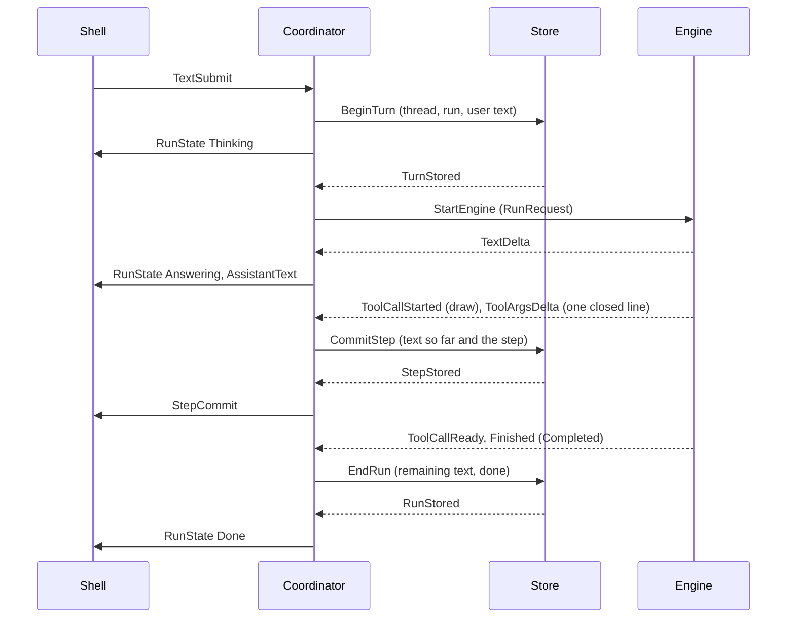
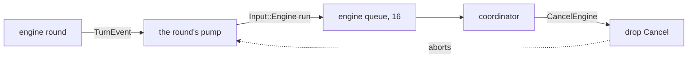

# Runs and the coordinator

A **run** is one user turn: in slice 2 a typed message, later a voice hold or an ask-about. The
brain's **coordinator** (`crates/brain/src/coordinator/`) is its core loop, written sans I/O: it
takes inputs and returns effects, and the systems around it (the store, the engine, the pipes,
timers) do the work and report back. So the order of Esc, late completions and interruption is
tested as plain unit tests.

## The shell's input target

`crates/shell/src/runs.rs` owns `Target::{Kumo, Task(ThreadId), New}` separately from
`Threads.open`, the history being viewed. Viewing doesn't change the target or selection
revision. **Switch to this task**, **Back to Kumo** and **New task** advance the revision;
switching to the id in `SettingsView.main_thread` normalizes to `Target::Kumo`.

The default is Kumo at shell start, when `met()` meets a new brain incarnation and drops a
non-durable target, and when the user confirms deletion of the targeted task. These fallbacks
advance the revision too. A task known from a stored row or an answered run is durable and
survives reconnect; an unconfirmed new task falls back to Kumo when the brain incarnation
changes. This replaces slice 2's new-conversation default (OSC-157).

Each submit captures the target in `TextSubmit` and queues the current revision in a FIFO.
`Target::Kumo` resolves to the connection's `SettingsView.main_thread`; `Target::New` sends
`None`. Submits are refused as offline until that connection has supplied its `SettingsView`,
even for New task. Disconnect clears the main id and pending submissions, so a previous
connection's id cannot be reused before the new view arrives.

While `Target::New` has a submission pending at the current revision, another submit is
refused as `Busy` without sending a second `TextSubmit { thread: None }`. The typing draft
stays, so after the first `RunState` adopts the task, retrying continues that task. Pending
turns from older selections don't block New task: explicitly choosing **New task** again
advances the revision and permits a separate task.

A new `RunState` answers the oldest pending turn. Only a matching queued revision while the
target is still `New` can adopt that run's thread, without advancing the revision. An empty
FIFO never adopts, and a task holding a delete slot cannot become the target. A delayed state
after an explicit switch still answers its own turn but doesn't move input. Esc cancels work,
not the target or revision. Settings updates replace names and the main id without changing
the input draft, keyboard focus, viewed history, target or revision.

## Typed drawing admission

`drawing/` is a deterministic reducer beside the coordinator. Direct complete calls and
closed records share validation, repair and per-run step budgets, including calls opened
before another call exhausted the run. It owns one global scene
budget and serializes store lookups, step transactions and effective cuts. A step is admitted
without mutation, written, then committed to the canonical state only after its store reply;
only then do `SceneBegin` and `SceneStepCommit` leave on the scene-owned data FIFO. A failed
step write leaves no handles, revision or reserved scene name behind. Call outcomes contain
model-visible ids and fixed error codes, never diagnostic drawing content.

Provider completion drains the accepted drawing prefix before ending its run. Stop closes
queued records but still drains an accepted step transaction before acknowledging its cut.
An empty Stop received before the first scene id arrives cuts that run's unseen, unactivated
scene to zero after the step commits. Effective cuts are durable before acknowledgement;
failed cuts remain owed and block subsequent step writes. A no-op cut is acknowledged without
adding a log entry. A fifth scene clears the oldest before attempting the new admission, and
the new first step waits for that clear and any earlier typed clears to commit. A failed
clear holds the queued first step, not an extra uncleared scene in the store. Replacement
alone does not cut old scenes. Failed cut retries share the clear backoff, from 500 ms up to
30 seconds [guess], without resetting while a cut is in flight.

`StepShown` and `StepFailed` validate lifetime indices and the run that committed the step.
Bad observations or held-scene cuts break the connection; removed scenes are stale. Pending
thread deletion holds late drawing frames until the outcome: a refusal releases them in
order, while a hide or removal discards them and retires the canonical scenes. Reconnect
waits for pending writes and clear debt before freezing checked descriptors and whole-event
chunks. A scene whose producer-built descriptor or chunks fail validation or frame encoding
is omitted whole and cleared durably before the remaining scenes are described. Any transition
that drains or discards drawing work rechecks run completion, including clear and deletion.
Quit drains in-flight typed writes, supersedes failed cut debt with its clear and waits for
the clear acknowledgement within the existing deadline; an unconfirmed clear is incomplete.
During staging, a v1 recovery is sent only when typed scenes exist; the production
fixture and an empty placeholder-only recovery remain legacy until B3 switches both ends.

## Ids and staleness

The coordinator hands out thread and run ids, starting above the store's high-water marks, so an
id is never reused, even across restarts and deletions. One run is current at a time. An engine
event, a control input or a timer that names any other run is **stale**: it returns `Stale` and
changes nothing. A step an engine finishes after `Stop` never gets that far, since cancelling a
round closes its pump (see [engines and rounds](#engines-and-rounds)); the coordinator would
refuse it as stale, and the store again, since it only takes events for active runs. Store replies are the exception:
those for a run that is still ending are accepted, so its outcome is still written and a failure
still reported (see [the store contract](#the-store-contract)).

## One run, start to end

- **The turn is stored before the engine starts** (OSC-105 boundary 8). A blank turn (empty or
  whitespace only) starts nothing.
- **A thread's events stay in run order.** A new turn's write waits until every older run's
  outcome is queued, so a replaced run's last text lands before the new turn and the new engine
  starts only after its predecessor is stored. The shell still hears the old run's `Interrupted`
  and the new run's `Thinking` at once. A held turn that is stopped or replaced in turn is
  still stored, then its outcome, in order.
- **A step is sent only after it's committed.** When the engine's round completes while a step is
  still in the store, the run ends right after that step is stored and sent.
- **Data keeps the engine's order.** Text the engine produces after a pending step waits behind
  it and goes out right after its `StepCommit`. Control inputs such as `Stop` are handled at
  once while it waits.
- **Text goes out in pieces of at most 64 KiB**, split on character boundaries, so every frame
  fits the data pipe.
- **Streamed text is stored with each step and with the outcome**, in the same transaction.
  shortcut: text after the last step is lost if the brain dies mid-run; store it on a timer once
  real engines stream long answers (slice 3).

## The store contract

The store runs operations in order, each in one transaction, and answers every one:
`TurnStored`, `StepStored` or `RunStored` on success, `StoreFailed` on failure. So a
`StoreFailed` always belongs to the run's oldest unanswered operation, and step
acknowledgements arrive by index in order. An acknowledgement for anything else (a repeat, an
index out of range, a step before its turn is stored) is `Stale` and changes nothing.

## Ending a run

Every ending runs in the same order: cancel the engine so it produces nothing more (unless it
finished, or never started because the turn wasn't stored yet), drop the data it still held for
the shell, tell the shell (every ending but `done`), then store the outcome
with the unstored text and, when the user stopped it, the `revealed` set. The outcome is
written once the run's earlier operations are answered, so a run stopped before its turn was
stored gets its outcome after the turn, and its engine never starts.

An ended run stays with the coordinator until the store answers for its outcome, so a failure is
never lost:

- if the turn failed, there's no run row, and nothing more is written;
- if a step or the outcome failed, the outcome is written as `failed(store)` without its text,
  but with the Stop's `revealed` set and its scene's clear, so the drawing keeps what the shell
  kept; if that fails too, the run stays `active` and the next start's recovery marks it
  `failed(crash)`. Its scene's clear, or its kept selection, is then retried on its own until
  it commits, and a Quit is incomplete until it has, unless the Quit's own clear durably
  removes that scene: a kept selection that keeps failing still ends in a complete Quit then.

| Cause | Outcome | Shell told |
|---|---|---|
| Engine finished | `done` | once the store has it |
| `Stop` (Esc) | `interrupted(stop)`, with `revealed` | at once |
| A new turn | `interrupted(replaced)` | at once |
| The shell went away | `interrupted(shell_lost)` | no |
| The shell took no data for 2 s | `interrupted(view_stalled)` | at once |
| Its thread is being deleted | `interrupted(deleted)` | at once |
| A budget ran out | `failed(budget)` | at once |
| The engine failed, its round ended truncated or interrupted, or it sent an oversized step or a call nothing answers | `failed(engine)` | at once |
| A store write failed | `failed(store)` | at once |

`revealed` keeps only indices of steps already sent to the shell, each once, in order.

### What the shell can rely on

- **A run's data is complete at its `RunEnd`, on the data pipe.** Every run that reaches a
  terminal `RunState` also gets one `RunEnd`, after all of its data frames. The two pipes aren't
  ordered with each other, so a terminal `RunState` on control says nothing about what has
  arrived on data; the shell keeps reading the run's data until its `RunEnd`.
- `RunState Done` means the run's text, steps and outcome are committed.
- Every other terminal `RunState` comes at once, whatever the store is doing, so `Stop`'s
  answer never waits on an fsync or a long write. It's the shell's to show, not a promise that
  the outcome is stored.
- A terminal `RunState` can be followed by `RunState Failed` for the same run, when its
  writes later fail. The shell shows the failure; nothing else follows it.
- A `Stop` for a run that already ended doesn't change its outcome: it still ends `done`,
  `failed` or `interrupted(replaced)`, and its data still drains. But the shell could still
  stop it while it drew the run's last steps, so the scene keeps only what the shell kept. While
  the run's writes are pending, the selection goes with its outcome once they settle, or with
  the late first step that begins its scene; once they're done and the scene is visible, the
  brain writes the selection on its own, or the scene's clear when nothing stayed. A scene is
  trimmed once: a later `Stop` for its run is stale. So is one for a run an earlier connection
  started, ended or not, and after a restart, since a connection can stop only runs it started
  itself. One that arrives while the engine has finished but its last step is still being stored interrupts
  the run, since the shell never showed that step.

## Budgets

Budgets are absolute for the run and never reset (OSC-105 boundary 5): 120 s of wall clock, 1 MiB
of visible text and 64 steps. Exceeding one ends the run as `failed(budget)`, and the text or
step that went over is never sent. The wall clock starts when the turn is accepted, so time a held
turn spends waiting counts against it, and it stops applying once the engine says it's done, even
while the run's last writes are still pending. The deadline and the text counter belong to the run,
so they carry across rounds. Model rounds, tool calls and speech budgets arrive with the engines
that use them.

## Engines and rounds

An engine (`crates/brain/src/engines/`) implements one trait: `Engine::start` takes a `RunRequest`
(the run, its thread and the turn) and plays **one model round**, sending `TurnEvent`s: `TextDelta`,
`ToolCallStarted { call, name }` (always before the call's first argument delta),
`ToolArgsDelta`, `ToolCallReady` with the whole arguments, `OutputItem` with its output index for
native items kept for replay, and `Finished` with `Completed`, `Truncated`, `Failed` or `Interrupted`. Call ids are the
provider's, ASCII and at most 64 bytes, refused rather than cut. `Debug` prints only the sizes of
text, arguments, turns and items.

One round per `start` is the direct-provider rule: an engine that calls a model API ends its
round when the model's response does, and the coordinator starts the next round itself. An engine
that runs its own tool loop (Claude Code, slice 8) may play several model rounds inside one start;
the coordinator never dispatches those calls again.

- **Each start gets its own pump and channel.** The pump forwards the round's events tagged with
  its run, and closes after the first `Finished`, so nothing of a finished round reaches the
  coordinator, even under a later round of the same run.
- **A round that ends without `Finished` is `Truncated`**, even after text: the pump reports it,
  in one place for every engine, and the run fails as `failed(engine)`, never `done`.
- **The brain owns cancellation.** Dropping the round's `Cancel` aborts the pump and the engine's
  future with it, even while the pump waits on a full engine queue, so `Stop` under backpressure
  ends the run at once, and a local `Stop` is never reported as truncation.
- **A round's end isn't the run's.** The coordinator decides. `Completed` ends the run as `done`;
  `Truncated`, `Failed` and an engine's `Interrupted` fail an active run, since only the coordinator
  interrupts runs. Only events for a run that already ended are stale.
  shortcut: a completed round ends the run whatever calls it made, which only the fixture's
  draw-only rounds rely on; the tool loop (slice 3's PR 13b) answers every call, a draw
  included, and starts the next round. Until then a call to any tool but `draw`, or a second
  call, fails the run.
- **The draw call's arguments are split into steps** in `coordinator/run.rs`, one per closed
  line. The open line is charged against the 256-byte label cap before it grows, so arguments with
  no newline fail the run at the cap. `ToolCallReady` must match what streamed; a last line
  with no newline is one more step.

**One run at a time.** The coordinator keeps one current run, and a new turn replaces it,
whatever its thread. That's a limit of slice 3, not of the seam: engines, and everything new that
works for a run, take the run id from the request and never ask for "the current run", so runs
keyed by id (OSC-56) need no rework.

## The fixture engine

Until slice 3 brings real engines, every run plays a fixture script
(`crates/brain/fixtures/default.txt`, or in a dev build the file `KUMOCHI_FIXTURE` names) through
`engines/fixture.rs`. One line per event: `<ms> text <words>`, `<ms> fill <bytes>`,
`<ms> step <label>`, `<ms> fail`, and `late <label>`, a step the engine still sends after it's
cancelled. Its round's pump has closed by then, so the late step reaches nobody; the coordinator
and the store would refuse it too.

shortcut: steps stream as one `draw` call: the first step starts it, each step is one
newline-terminated argument delta, and the script's end sends `ToolCallReady` with the joined lines,
then `Finished(Completed)`. Slice 4's B3 replaces this adapter with recorded draw arguments.

## Around the coordinator

The store runs on its own thread, which owns the connection and keeps the store contract above:
operations in order, one transaction each, every one answered. The engine's pump, the store
thread and the deadline timer report back as inputs, and the pipes' readers and writers are
described in `ipc.md`. A shell that disconnects ends the current run as
`interrupted(shell_lost)`. Every Stop and Clear the control reader read before the pipe ended is
applied first, even one read in the same poll as the end. Store replies keep reaching the coordinator while no shell is
connected, and on exit the brain waits up to 2 s for ended runs to be stored, then up to 2 s for
the store to close. A deletion's purge (`store.md`) copies the store on a helper thread only
while no run is active. A write arriving, or closing, stops the copy and waits only until it has
let go of the live store, never for the rest of the copy: the worst of 10 samples at 984 MiB on
Rez was 29 ms, though none forced the cancel deep into `VACUUM INTO`.
Removing its files runs on a helper too, so turns and runs stop only for the swap, about
10 ms on Rez up to 984 MiB, and otherwise share the disk with the helper.

shortcut: a store that never answers leaves a finished run unconfirmed. At the next start, runs
still active in the store become `failed(crash)`; outcomes already committed stay, and work not
yet committed may be lost. Fine while the store is local SQLite.

On Quit the brain shuts down by one deadline instead, described in [processes](processes.md).

### Shell crash containment

The supervisor keeps the existing 200 ms, 1 s and 5 s relaunch delays, then gives up on
the fourth death within 60 s. Each connection starts with no recovery membership; only a
nonempty `ScenesV1` records native scene ids. A repeat death while recovery chunks are
still queued, or within 10 s of queueing the final chunk, clears that connection's described
drawings before relaunch. The 10 s value is a guess for preparation, not paint: B5/B6 must
re-anchor it to actual painting. Pre-connect deaths cannot reuse the preceding membership.

On give-up, the brain instead clears the union of every membership described in the rolling
60 s window, regardless of the 10 s condition. Expired memberships and confirmed cleared ids
are forgotten. Both paths use existing clear debt and asynchronously drain store replies under
one 2 s deadline [guess]. Only a successful acknowledgement for every requested id and settled
drawing work permits relaunch; failure, unavailable storage or timeout suppresses it. An
empty new clear plan does not bypass this barrier: unavailable drawing recovery or
unconfirmed earlier clear debt still suppresses automatic relaunch. An
in-process hand-started connection still waits behind settlement before describe. Failed debt
is memory-only and does not survive brain exit; typed drawing history is never deleted.

The step is a labelled placeholder until slice 4's scene format. A run's steps draw in one scene:
its first step's write begins the scene and returns its id, and the steps after it wait in the
run until that ack. A Stop, a replacement, a failed first write or a lost shell drops the waiting
steps, and the run still settles.
