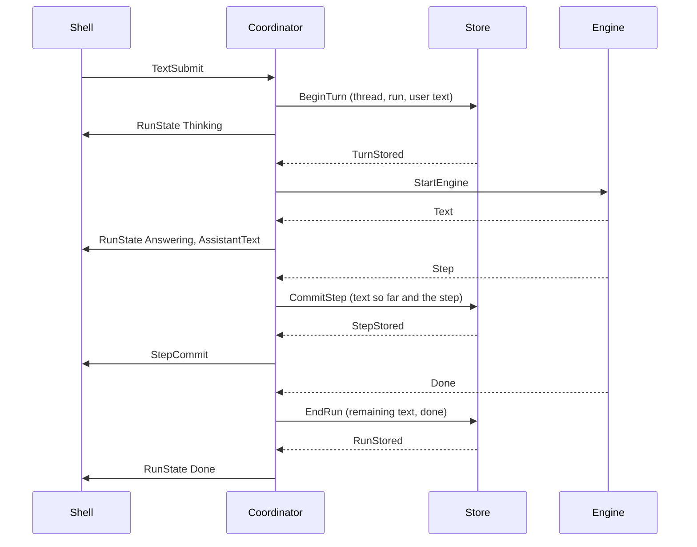

# Runs and the coordinator

A **run** is one user turn: in slice 2 a typed message, later a voice hold or an ask-about. The
brain's **coordinator** (`crates/brain/src/coordinator/`) is its core loop, written sans I/O: it
takes inputs and returns effects, and the systems around it (the store, the engine, the pipes,
timers) do the work and report back. So the order of Esc, late completions and interruption is
tested as plain unit tests.

## Ids and staleness

The coordinator hands out thread and run ids, starting above the store's high-water marks, so an
id is never reused, even across restarts and deletions. One run is current at a time. Any input
that names another run is **stale**: it returns `Stale` and changes nothing. That's how a step
an engine finishes after `Stop` is refused, and the store refuses it again, since it only takes
events for active runs.

## One run, start to end

- **The turn is stored before the engine starts** (OSC-105 boundary 8). A blank turn (empty or
  whitespace only) starts nothing.
- **A step is sent only after it's committed.** When the engine says it's done while a step is
  still in the store, the run ends right after that step is stored and sent.
- **Data keeps the engine's order.** Text the engine produces after a pending step waits behind
  it and goes out right after its `StepCommit`. Control inputs such as `Stop` are handled at
  once while it waits.
- **Text goes out in pieces of at most 64 KiB**, split on character boundaries, so every frame
  fits the data pipe.
- **Streamed text is stored with each step and with the outcome**, in the same transaction.
  shortcut: text after the last step is lost if the brain dies mid-run; store it on a timer once
  real engines stream long answers (slice 3).

## The store contract

The store runs operations in order, each in one transaction, and answers every one:
`TurnStored`, `StepStored` or `RunStored` on success, `StoreFailed` on failure. So a
`StoreFailed` always belongs to the run's oldest unanswered operation, and step
acknowledgements arrive by index in order. An acknowledgement for anything else (a repeat, an
index out of range, a step before its turn is stored) is `Stale` and changes nothing.

## Ending a run

Every ending runs in the same order: cancel the engine so it produces nothing more, drop the data
it still held for the shell, tell the shell (every ending but `done`), then store the outcome
with the unstored text and, when the user stopped it, the `revealed` set. The outcome is
written once the run's earlier operations are answered, so a run stopped before its turn was
stored gets its outcome after the turn, and its engine never starts.

An ended run stays with the coordinator until the store answers for its outcome, so a failure is
never lost:

- if the turn failed, there's no run row, and nothing more is written;
- if a step or the outcome failed, the outcome is written again as `failed(store)`, alone; if
  that fails too, the run stays `active` and the next start's recovery marks it
  `failed(crash)`.

| Cause | Outcome | Shell told |
|---|---|---|
| Engine finished | `done` | once the store has it |
| `Stop` (Esc) | `interrupted(stop)`, with `revealed` | at once |
| A new turn | `interrupted(replaced)` | at once |
| The shell went away | `interrupted(shell_lost)` | no |
| The shell took no data for 2 s | `interrupted(view_stalled)` | at once |
| A budget ran out | `failed(budget)` | at once |
| The engine failed or sent an oversized step | `failed(engine)` | at once |
| A store write failed | `failed(store)` | at once |

`revealed` keeps only indices of steps the run produced, each once, in order.

### What the shell can rely on

- `RunState Done` means the run's text, steps and outcome are committed.
- Every other terminal `RunState` comes at once, whatever the store is doing, so `Stop`'s
  answer never waits on an fsync or a long write. It's the shell's to show, not a promise that
  the outcome is stored.
- A terminal `RunState` can be followed by `RunState Failed` for the same run, when its
  writes later fail. The shell shows the failure; nothing else follows it.
- A `Stop` that arrives after the engine finished is stale: the run still ends `done`.

## Budgets

Budgets are absolute for the run and never reset (OSC-105 boundary 5): 120 s of wall clock, 1 MiB
of visible text and 64 steps. Exceeding one ends the run as `failed(budget)`, and the text or
step that went over is never sent. Model rounds, tool calls and speech budgets arrive with the
engines that use them.

## Not here yet

The coordinator isn't wired to the pipes until the next pull request, which adds the store
thread, the fixture engine, the per-pipe writers and the watchdog. The step is a labelled
placeholder until slice 4's scene format.
