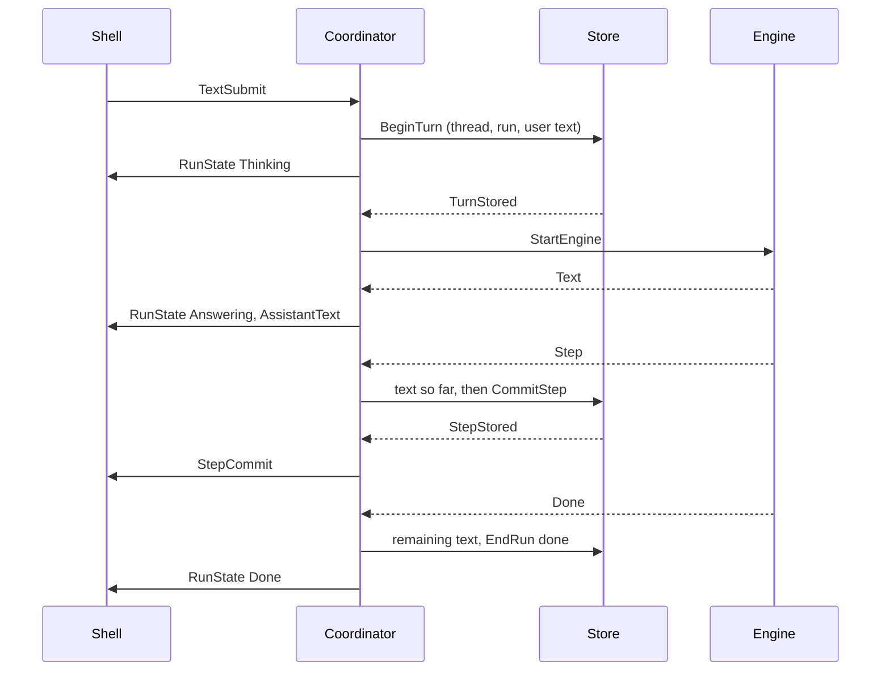

# Runs and the coordinator

A **run** is one user turn: in slice 2 a typed message, later a voice hold or an ask-about. The
brain's **coordinator** (`crates/brain/src/coordinator/`) is its core loop, written sans I/O: it
takes inputs and returns effects, and the systems around it (the store, the engine, the pipes,
timers) do the work and report back. So the order of Esc, late completions and interruption is
tested as plain unit tests.

## Ids and staleness

The coordinator hands out thread and run ids, starting above the store's high-water marks, so an
id is never reused, even across restarts and deletions. One run is current at a time. Any input
that names another run is **stale**: it returns `Stale` and changes nothing. That's how a step
an engine finishes after `Stop` is refused, and the store refuses it again, since it only takes
events for active runs.

## One run, start to end

- **The turn is stored before the engine starts** (OSC-105 boundary 8).
- **A step reaches the shell only after it's committed.** When the engine says it's done while
  a step is still in the store, the run ends right after that step is shown.
- **Text goes out in pieces of at most 64 KiB**, split on character boundaries, so every frame
  fits the data pipe.
- **Streamed text is stored before each step and at the end**, as one event each time.
  shortcut: text after the last step is lost if the brain dies mid-run; store it on a timer once
  real engines stream long answers (slice 3).

## Ending a run

Every ending runs in the same order: cancel the engine so it produces nothing more, store the
unstored text, store the `revealed` set when the user stopped it, store the outcome, then tell
the shell. A run stopped before its turn was acknowledged still gets its outcome stored, because
the store runs operations in order.

| Cause | Outcome | Shell told |
|---|---|---|
| Engine finished | `done` | yes |
| `Stop` (Esc) | `interrupted(stop)`, with `revealed` | yes |
| A new turn | `interrupted(replaced)` | yes |
| The shell went away | `interrupted(shell_lost)` | no |
| The shell took no data for 2 s | `interrupted(view_stalled)` | yes |
| A budget ran out | `failed(budget)` | yes |
| The engine failed or sent an oversized step | `failed(engine)` | yes |
| The store refused the turn | `failed(store)`, nothing more written, since there's no run row | yes |
| A later store write failed | `failed(store)` | yes |

`revealed` keeps only indices of steps the run produced, each once, in order.

## Budgets

Budgets are absolute for the run and never reset (OSC-105 boundary 5): 120 s of wall clock, 1 MiB
of visible text and 64 steps. Exceeding one ends the run as `failed(budget)`, and the text or
step that went over is never sent. Model rounds, tool calls and speech budgets arrive with the
engines that use them.

## The fixture engine

Until slice 3 brings real engines, every run plays a fixture script
(`crates/brain/fixtures/default.txt`, or in a dev build the file `CAPSULA_FIXTURE` names). One
line per event: `<ms> text <words>`, `<ms> fill <bytes>`, `<ms> step <label>`, `<ms> fail`, and
`late <label>`, a step the engine still finishes after it's cancelled. The coordinator refuses
that late step as stale, and the store would refuse it too.

## Around the coordinator

The store runs on its own thread, which owns the connection and executes store operations in
order. The fixture engine, the store thread and the deadline timer report back as inputs, and
the pipes' readers and writers are described in `ipc.md`. A shell that disconnects ends the
current run as `interrupted(shell_lost)`.

The step is a labelled placeholder until slice 4's scene format.
