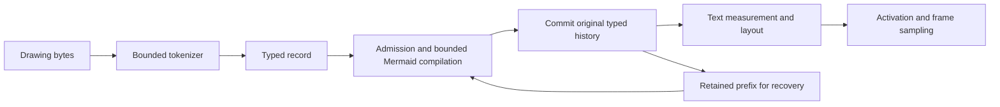
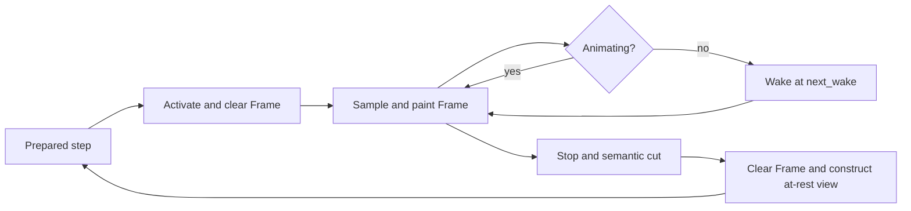
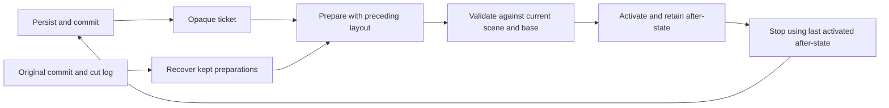
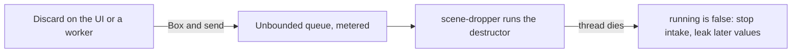
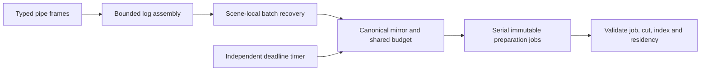

# Scene v1

`kumochi-scene` is the shared, synchronous drawing format. It depends on neither
GPUI nor tokio. The brain parses model JSON; the shell decodes the same validated
types from postcard. The brain's drawing reducer owns canonical scene state; preparation is
synchronous and host-independent, and rendering is not wired yet.



## Records

A drawing call is `{"records":[begin, step, ..., end]}`. Each record is externally
tagged, for example:

```json
{"begin":{"v":1,"scene":"demo","surface":"overlay","alt":"Two connected nodes"}}
```

```json
{"step":{"id":"first","put":[{"diagram":{"id":"d","box":[40,60,880,420]}},{"node":{"id":"a","in":"d","label":"First"}}]}}
```

```json
{"end":{}}
```

The version, scene id, surface and alternative text are required. Steps have a
required id, optional `say`, empty-by-default `put`, `set` and `remove` lists, and
`start` defaulting to `"speech"`. `put` is bounded to 856 operations (600 objects
plus 256 tracks); `set` and `remove` each allow at most 600 entries. Other starts are `"now"` and
`{"after":"earlier-step","ms":200}`. Ordering and reference checks belong to
the scene-state validator, not the typed parser.

`put` accepts `line`, `arrow`, `path`, `shape`, `text`, `callout`, `highlight`,
`diagram`, `node`, `edge`, `table`, `row`, `chart`, `series`, `anim` and `mermaid`.
Wire objects require model ids: there are no generated `_1` aliases. Mermaid
compilation preserves source node and named-group ids and privately generates the
root, anonymous-group and edge ids.
Ids contain 1–40 ASCII letters, digits, underscores, dots or hyphens. Host handles
are a separate, opaque `u32` identity.

Points are logical pixels of the inline scene's `size` or the overlay display.
Anchors are `[x,y]` or `{"ref":"object-id"}`. Coordinates must be finite and
within ±20,000. Chart data uses finite f64 values instead of coordinate-bounded
numbers. Composed transforms and domain-specific ranges are admission checks.
Screen/capture anchors and all 3D operations are absent, not ignored.

JSON decoding enables exact float round trips: a stored and reloaded typed step must retain
the original f64 chart values, rather than changing a final bit during recovery.

All relative timing fields, including delays, entrances, edge flow, after-step
offsets and animation key times, are milliseconds in 0–60,000. `Ms` validates on
both routes and `checked_add` returns none if a sum exceeds that cap. `at_word` denotes an estimated offset within a synthetic speech
segment, not real-audio alignment. Optional style values are left to preparation;
for example, an omitted diagram direction can use the inline surface's downwards
default instead of imposing the overlay's direction at parse time.

## Strict decoding and errors

`parse_record` consumes exactly one JSON record of at most 32 KiB. Unknown fields,
unknown operations, duplicate fields, invalid ids, unsupported versions, non-finite
numbers and excess text/list lengths fail. Text counts Unicode scalar values, not
UTF-8 bytes; overlong content is never truncated. Bounded lists reject the excess
element before decoding or storing it.

Path data (`d`) and Mermaid source (`src`) use `Source`, not display `Text`.
Each is capped at 8 KiB of UTF-8 bytes (`MAX_SOURCE_BYTES`); the path figure comes
from S1, while the Mermaid figure is a starting cap. Admission's shared SVG preflight
enforces the 512-command path limit. Source Debug exposes byte length only.

The mixed-syntax types (`Start`, `Anchor`, `Color`, cells, chart points and key
values) use JSON visitors only when `is_human_readable()` is true. Their binary
branches use declaration-order enum tags and the same validated payload types and
constructors. RGB payloads are restricted to 24 bits in both formats. There are no
untagged enums, flattened fields or omitted binary struct fields.

Postcard enum declaration order is **append only**: never reorder variants or
insert a new variant before an existing one. Golden-byte tests pin every enum's
tags, including the private mixed-syntax representations, because steps will be
persisted and replayed. Version is the literal integer 1, not an enum index.

Decode paths come from `serde_path_to_error`, filtered through known schema field
names and array indices. Unknown model keys never become diagnostic path text.
Only fixed custom-error tokens and serde diagnostic prefixes are inspected to
choose an `ErrorCode`; the parser's original message is discarded. `StepError`
uses `MissingField` for absent required fields and appends only an allowlisted
field name to its path. `UnknownOp` denotes only an unknown record/op tag;
unknown vocabulary values and invalid numeric values are `OutOfRange`.
`StepError`'s `Display` and `Debug` contain only the path and code. `tool_text` may include a
known step id when replying to its model, but never the rejected field value.
`Text`, `Source` and `WireId` expose lengths only; `Finite`, `Number`, `Rgb`, `Ms`, `Cell` and
`Point` redact values, while `Step`, `Frame` and `FrameItem` summarize counts, hiding
timings, repeat counts and word offsets along with drawing values. Do not trace records,
serialize drawing content into logs, or trace a model-facing tool reply.

## Admission and identity

`SceneState::begin` validates positive optional canvas dimensions. `CallState`
guards one call's begin/step/end order; a new call gets a fresh guard and must
repeat the stored header with typed equality. Ending a call does not end its scene.

`admit` resolves references against earlier surviving objects plus every object
declared in the same step, independent of put order. `start.after` must name an
earlier kept step, never one dropped by a cut. Admission rejects cycles, missing
or wrongly typed parents/endpoints, properties the target does not own, invalid
track values/times, and removals that orphan a surviving dependant. Only `draw`
has kind-specific track ownership checks so far; a `set` or `anim` targeting an object
removed by that same step fails as `UnknownRef`. The motion layer defines the
remaining property rules. Admission expands bounded Mermaid sources before checking
the executable candidate; callers still submit and persist the original typed step.

Ids, including dropped or removed ids, stay reserved for the scene's lifetime.
An identical typed step id is a no-op even after its step was dropped; a conflicting
payload is an error. The 64-step cap counts all lifetime commits, not just kept
steps. Rejecting admission consumes neither ids, revisions nor global generations.

`Admission::New` owns a checked candidate. The caller persists it before calling
`commit` and serializes all scene/global mutations across that boundary. Commit
checks scene identity, global-context identity, scene revision, its own mutation
stamp and global generation in O(1); `StaleAdmission` is its only error and changes
nothing. Admission computes charges without mutating either state; commit installs
them. A scene bound to one budget rejects mutations through a different instance.

A handle encodes `(original_revision << 10) | expanded_put_slot`: revisions are
one-based, slots are zero-based, and animation slots are not compacted away.
Neither Stop nor append renumbers old handles. The returned commit index is
zero-based over lifetime commits. Handle decoding rejects zero/unused revisions
and slots beyond the 856-operation bound.

### Bounded Mermaid flowcharts

`{"mermaid":{"in":"d","src":"flowchart LR\nA[Start] --> B[Done]"}}`
adds a self-contained flowchart inside diagram `d`. The target may be declared later
in the same step, but it must be a diagram, not another container. The parser consumes
the complete source, including its suffix; it never commits a valid prefix.

The D1 subset accepts `flowchart` and `graph`, TB/TD/BT/LR/RL directions, box,
round, pill, diamond, circle and cylinder nodes, chains and spaced `&` fan-out,
normal/open/dotted/thick labelled links with no, end or both arrowheads, nested
subgraphs and whole-line `%%` comments. Subgraphs may set their own direction;
otherwise it inherits from the nearest diagram. Source order determines node
first-mention order and edge fan-out order.

The first closing subgraph that references a node owns it, including edge-only
references. A later declaration does not move it. Repeated declarations in the same
scope update its label and shape; explicitly shaped or labelled declarations in
different scopes are refused. Bare membership mentions are references, not
redefinitions. A quoted multiword header creates a fresh anonymous group; a quoted
one-word header keeps its valid source id. Reopening a named group is unsupported.

Symbolic directions and BR, minimum-length links, edge ids, group endpoints,
other shapes or heads, configuration, styling, interactions, HTML, entity codes,
Mermaid Markdown strings and non-WireId identifiers return `Unsupported` rather
than disappearing. Unknown header words, including misspellings, and refused
statement-leading id bytes also return `Unsupported`; D1 does not distinguish
an unknown diagram kind from a typo. Malformed or truncated D1 syntax returns `Malformed`, including
an `import` after an otherwise valid graph. Text and source limits remain enforced;
labels such as `click style direction end` and `1<2` are ordinary text. `<br>` stays
unsupported rather than becoming a line break.

Each source expands in place into a boxless root, parent-first groups, first-mentioned
nodes and source-ordered edges. A bounded deterministic allocator skips every id
reserved by the scene or declared or referenced anywhere in the step, including
source group ids, parents, anchors, edge endpoints and animation, set and remove
targets. A generated object cannot satisfy an otherwise dangling reference.
All expanded objects and operations count once against the ordinary scene and step
caps before handles are constructed. The 48-node and 96-edge caps apply to each
diagram after membership and edge ownership are resolved, not to the whole source.

A header-only chart is accepted and costs its one empty boxless root; it draws nothing.
An explicitly blank node label, quoted or unquoted, stays empty rather than falling
back to its id. The node still occupies its normal shape and counts against the budget.

The original `Step` remains authoritative for duplicate identity, `SceneState::step`,
`PreparedStep::step` and recovery. A private executable step and slot-origin map drive
admission, preparation and motion. Syntax errors name the original
`put[i].mermaid.src`; generated-slot errors map there too, while root-target errors
name `.mermaid.in` and shifted plain-operation errors retain their original indices.
Whole-scene budget failures can still name the root. Replaying original records
recompiles the same handles and private drawing facts without a wire-format change.

Private group titles, reversed direction and link paint travel beside the executable
step, not in new wire fields. A title is text on its group's own handle, so it is
not another child or object and survives ordinary updates and retained-handle cuts.
Its measured width is capped at 180 logical pixels. For content bounds C and title
size L, the title band has width `max(C.width, L.width)` and reserves
`L.height + 16` pixels above C. A rounded, unfilled frame encloses the band and
contents with 8 pixels of padding, using the theme's line color at 1 pixel width.
The title is centred inside its top inset. The final bounds pass resizes both the
frame and title placement when members change. Untitled structural diagrams stay
frameless, so anonymous layout wrappers do not introduce unexplained boundaries.

This parser is a reduced port of Pele's flowchart lexer/parser, with its MIT notice
and pinned revision in `THIRD-PARTY-NOTICES.md`. Unsupported families are deliberate
differences, not claims of full Mermaid or upstream-suite compatibility.

The ignored `measure_whole_scene_removal_admit` test measures the complete
admission call for 600 existing text objects and 600 removals, including the
metadata-map clone and semantic checks. It uses five warm-ups and 128 samples;
fixture construction and candidate destruction are outside the timed interval.
Build `--release --test state_followups --no-run` below normal priority, acquire
the shared measurement lock and wait for 30 seconds without cargo/rustc, then run
that executable with `--exact measure_whole_scene_removal_admit --ignored
--nocapture --test-threads=1` at normal priority. Results belong in the PR/report,
not this page. This is an admission measurement, not a frame or end-to-end latency.

## Stop and recovery

`StopCut.activated` is the revision activated **through**, not a count of kept
steps. Zero returns `Cleared` without resetting revision only before anything was
shown; afterward it is rejected, and a user clear uses `clear`. Stop first undoes all
unactivated steps' removals, then drops their objects and retains exactly the
revealed handles in the activated prefix. A retained object whose dependency was
discarded becomes detached. This can leave a node, row or series without its parent,
or an edge without an endpoint. Its live placed geometry stays frozen; A5 must
prepare incrementally through the log so recovery obtains that pre-cut placement.
Dropped steps keep their ids and original revisions; their future sets/removals
are no longer replayed as active work.

The recovery log contains **every original committed step**, interleaved in commit
order with **every effective StopCut**. A Stop keeping everything adds no entry.
There is at most one effective cut per newly committed revision, so there are at
most 64 steps and 64 cuts. This is not a normalized checkpoint or a final cut
applied to a filtered step list: after Stop drops an unfinished dependant, an
append may legally remove its old target. Replaying the dependant without its
intervening cut would wrongly reject that removal.

`SceneState::replay` uses the same admission, commit and Stop transitions and
requires each original revision in order, including dropped steps. Recovery's
kept prefix is considered activated; its removals are retired. The selected global
budget strategy is **validate the combined final replayed result once**, rather
than replay independent scenes against unrelated historical peaks. The budget
layer implements this through `SceneState::replay_all`, returning the restored
scenes and their shared budget atomically. The shell's layout-aware counterpart,
`layout::recover_all`, returns an outcome per scene instead (see Preparation).
Standalone `replay` returns an unbound scene; its next mutation must install its
entire remaining charge. During replay,
each commit releases removal/replacement charges without advancing the activated
bound, so a later `Stop(1)` still works after replaying steps 1 and 2. Undo metadata
stays available until actual activation or a cut.

At runtime the shell retires removals at activation; the brain calls `retire`
only on StepShown or retires the kept prefix on Stop. Repeated retirement is a
no-op. Preparation failure stops the scene with the same cut: it keeps activated
objects, drops the failed step and every queued successor, and restores their
removals. A first-step failure cuts at zero and clears. The host accepts no further
steps for that scene in the current call, persists the cut, and activates no later
queued segment. A later call can continue the kept scene after that cut. This needs
no separate failed-step event and leaves the 64-step/64-cut bound unchanged.

An already-cut scene is left alone on a later Esc; a user clear goes through
`clear`, not a second effective cut. `clear` is terminal and idempotent; its
separate host clear event removes the scene from the visible recovery set.
Prepared display residency is not an admission input.

## Caps

Admission enforces the logical caps below, independently of prepared residency.
`SceneState::usage` and `GlobalBudget::usage` report the installed charges. A pending
removal still counts until the shell activates it or the brain receives StepShown.
Pending replacements reserve each object's maximum expanded cost and the union of
its property owners, rather than charging the same identity twice. Retirement,
Stop and terminal `clear` return charges exactly once.

Table rows charge padded cells. Charts charge every data point and reject invalid log
domains and non-finite stacked sums. Only explicit tracks consume track/key budgets;
entrances, edge flow and generated glides are bounded structurally by the live objects,
at most two generated effects per object. Chart data changes instantly at activation.
Repeated finite animations, including delay, must fit 60 seconds; infinite repeat must
fit its first play and remains bounded by the scene deadline. Zero-period repetition,
zero-period flow and duplicate same-step (target, property) tracks fail with `OutOfRange`.

The private SVG walker accepts M/L/H/V/Q/C/Z, absolute or relative, including implicit
repetitions. It validates coordinates and counts commands before vertices exist.
Quadratic and cubic second differences determine power-of-two subdivision counts at
0.25 logical-pixel tolerance after conservative composed scale bounds. Preparation uses
the same walker and subdivision function when producing vertices. Procedural curves,
rounded rectangles, ellipses, cylinder caps, pie arcs and chart axes have shared
segment reservations in `path.rs`; generated output must stay within them.

Transform checks compose conservative scale, translation and rotation envelopes down
the parent graph, including spring overshoot, and reject overflow or scale underflow.
Composed scales must be normal positive floats and at most 64, even when layout has
not measured the object's dimensions yet. Preparation must still check measured bounds.
These envelopes can reject near-cap combinations whose extrema never coincide.
Detaching an object preserves its inherited bounds so later admissions cannot forget
its path cost or transform basis. This is budget metadata, not placed geometry: layout
still prepares stepwise through the ordered log and validates measured output.
Prepared residency remains the preparation layer's separate limit.

| Resource | Per object/scene | Global across visible scenes |
|---|---|---|
| Encoded input | 32 KiB/record, 512 KiB/call, JSON depth 16 | — |
| Text and ids | 400 Unicode scalars/text, 40 ASCII characters/id | — |
| Path/Mermaid source | 8 KiB UTF-8/source | — |
| Steps | 64 | — |
| Step lists | 856 puts, 600 changes, 600 removals | — |
| Live objects, including pending removals | 600 | 1,500 |
| Diagram | 48 nodes, 96 edges | — |
| Table | 8 columns × 40 rows | 4,000 cells |
| Chart | 8 series × 500 points, 40 categories | 20,000 marks |
| Path | 512 points, 4,096 flattened segments | 20,000 segments |
| Motion | 256 tracks, 32 keys/track, 60 s/track and after last activation | — |
| Object graph | Depth 16 | — |
| Coordinates | Finite, absolute value ≤20,000 after composition | — |
| Prepared residency | Charged at preparation, independent of admission | 64 MiB |
| Decoded images | Reserved for capture/image support | 64 MiB |
| Visible scenes | — | 4 |

`limits.rs` also reserves architecture §4.4's slice-5 constants: 160 solids,
24,000 triangles per scene/globally, 48 curved segments, and BSP limits of
4,000,000 classifications, depth 64 and twice the input triangle count in
fragments. No 3D vocabulary or geometry is implemented here.

## Preparation

`geom` provides logical-pixel points and rectangles, including finite, capped-corner
checks. The structs themselves are plain geometry, not a validated input boundary.
`theme` resolves typed palette tokens and RGB colors using the owned rendering spike's
palette. Host foreground/accent overrides do not change fixed named colors.

`display` defines immutable prepared primitives and handle-tagged items. Polygon and
polyline vertices use shared slices; painters can share prepared primitives instead
of cloning text or path storage. Debug output summarizes counts, not drawing content
or vertex arrays. `motion` supplies sampled frames. `TextMeasure` supplies the same shaping sizes
used by the host painter. It is fallible and must return deterministic finite,
nonnegative dimensions for the same text/style/wrapping inputs. Preparation calls it
in deterministic order and rejects failed or invalid measurements atomically. No
painter is implemented here.

### Motion and the host clock

`motion::SceneView` owns the activated layout and live property owners. Construct an
at-rest view with the layout and `SceneState::activated()`, not the layout's committed
revision: a cut can leave a higher dropped revision in that layout. Live Stop and
recovery use this same at-rest construction. `activate` accepts only the matching
prepared predecessor, clears its caller-owned frame outside paint, applies removals,
and rebuilds parent-first sampling order. Pass that frame into `activate`.
Activation may allocate or free; `frame` does neither and takes no locks. A `Frame` reserves
space for the per-scene object cap and reuses it. Its items share immutable primitive
Arcs, so the host must clear the frame outside paint when clearing its scene or
constructing a replacement view after a cut. A frame binds to one activated view
generation; sampling with a stale binding returns `Stale` without releasing its data.

The host supplies monotonic `u64` milliseconds. Absolute additions saturate; `Ms`
remains a bounded duration, never an absolute timestamp. Every activation establishes
a 60-second motion deadline, independent of narration length. Delays, entrances,
glides and repeats are clipped to that deadline. A stopped view returns only handles
whose own entrance and every ancestor's entrance have finished, each clipped to the
deadline; the host passes those handles into the authoritative `StopCut`.
Each child's entrance starts no earlier than its parent's start, retaining its own
duration, so delayed diagrams do not hide their children's entrances.
Explicit tracks retain their step-relative clocks, so a track may finish while a
delayed parent still hides its target; only entrances are shifted.

After painting at `t`, request another frame when `animating(t)` is true, otherwise
wake at `next_wake(t)`. This paints the final frame without continuously polling
holds. A delayed track is not animating until its moving interval starts; the next
wake reports its future start. With no pending motion it returns `None`.

Newest activated owners replace older owners of the same property. Delayed tracks
hold their first key; finite yoyo tracks rest on the first key after an even number
of plays and the last key otherwise. Explicit opacity, draw and color override their
own base rather than multiplying it. Optional resting values preserve that ownership
across cuts and recovery. Own opacity multiplies a separate inherited factor, ancestor
opacity and entrance alpha; no division by a previous zero opacity occurs. A later
`set color` clears the previous color owner. Draw progress also multiplies a draw entrance.

The spring is the standard underdamped response with damping ratio 0.3 and natural
frequency 20, normalized by its response at 1. Its endpoint is exactly 1 without a
snap; the conservative overshoot bound is 0.3759. Positive scales interpolate in
logarithmic space using f64, so shrinking springs stay positive. Opacity, draw and
color samples clamp to their valid ranges. Pop and grow scale about the object's
centre; slide and fly translate vertically. Admission and measured preparation use
the same entrance envelope, including pivot translation inherited by descendants.
Generated position glides capture the sampled live start when activated and run for
450 ms with InOut easing; a newer explicit position owner wins over a glide.

Synthetic narration takes `max(800, ceil(words * 4000 / 11))` milliseconds, with no
60-second narration cap: 11 words take 4,000 ms and 200 take 72,728 ms. Word offsets
use integer proportional placement within that segment, with u128 multiplication.
Speech-driven timing and painting belong to their later slices.

Esc during an explicit opacity fade-in without `enter` reveals its final opacity.
Exact interrupted recovery needs timestamps in the log; use entrances for reveals.



The ignored `frame_four_views_max` and `activation_at_caps` tests measure CPU sampling
and activation with deterministic text measurement, not a painter or real fonts.
`prepare_four_views_at_caps` measures four-scene initial preparation at the global
object cap, with a common local-edge control and a separate cross-group-edge workload.
Run their release binaries at normal priority on a quiet machine with no other
builds running, and record the machine, workload, priority and sample counts.
The original frame numbers are after-only because main then had no sampler; follow-up
comparisons retain that original workload and label the wider glide/property variant.

`layout::diagram::layout` is the owned S1 layered-layout port: insertion-order DFS breaks
cycles, longest paths determine ranks, and four barycenter sweeps order each rank.
It returns rectangles in input order and has no scene, clock, activation or rendering
dependency. A batch is initial when no member of the group already has a rank;
cutting away all members lets the next batch start fresh. Unboxed, originally top-level
diagrams fit that batch inside 16-pixel margins, between scale 0.8 and 1.0, keeping default
15-pixel labels at least 12 pixels. Wider content stays at the floor and starts at the
leading margin; fitting does not promise that every diagram fits. The fit is an item
transform, separate from model tracks, and stays fixed during incremental growth.
Boxed, nested, detached and diagram-less batches remain unscaled. Fit and model poses
still compose under the existing transform guards, including minimum-normal scale.
Later additions use free slots without moving existing node-local rectangles. Their
slot viewport follows the fit and resting translation/glide, preserving the prior
placement units for model scale and rotation. A detached ancestor's absorbed pose
never acts as an automatic fit camera; new detached nodes can remain off-screen.
The fit composes outside model tracks, so 100 model pixels move 80 screen pixels at scale 0.8.
Initial fitting suppresses glides on
axes where the fitted focus remains oversized, preserving its leading margin.
Inline defaults to downwards flow at the host's narrow width (360 logical pixels by
default); overlay defaults to rightwards flow. Explicit diagram direction and bounds
win. Inline `begin.size` overrides host dimensions when present.

A boxless diagram directly inside another diagram is a ranked cluster. Preparation
measures its nodes, edges, child clusters and preplaced containers before placing it
among its parent's nodes and other clusters;
boxed nested diagrams keep their explicit placement. Unspecified directions inherit
from the nearest diagram ancestor. An edge joins nodes in its exact least common
diagram, which ranks their containing clusters and routes the edge in that diagram's
coordinate space. Tables and charts are not implicit graph clusters.
An edge's `in` must be exactly that least common diagram, or admission returns
`OutOfRange` at `from` or `to`; that endpoint blame is a deterministic heuristic.
Preparation indexes children once and caches group depths for bottom-up placement;
content unions retain identifier order and ranked members retain handle order.

The 48-node and 96-edge limits apply per diagram, not per nested drawing. Clusters
consume the scene's existing object and depth budgets rather than its direct-node
budget. Incremental additions keep earlier node rectangles and cluster placements
stable; a cluster can grow into its siblings or off-screen on a later step because
it neither moves nor glides to bring new contents into view. Moving siblings would
also require rebuilding their cached edge anchors and cross-object references.
Groups have no frame or label in the plain diagram vocabulary.
New text, shapes, lines, paths, highlights and callouts inside a cluster contribute
to its ranked size in a step that places the cluster or adds a node to it, when all
their anchors are absolute or refer to placed objects strictly inside its subtree.
Source-order readiness passes resolve local dependency chains before ranking.
An already placed reference outside the cluster is classified once and sent late,
rather than walking its ancestry again after every local item is built. References
not yet placed still wait in source order; this does not change placement semantics.
Anchors to or across a boxed diagram draw late because its glide applies after
placement. References to the cluster itself, its ancestors, siblings or outside
objects are also drawn late, so they do not contribute to its ranked size. Keep
cached cross-group anchors until a motion-owned reflow policy can replace them.
Changed objects retain the later-growth behavior above.
Private Mermaid group titles reserve the band described above before parent ranking;
their text belongs to the group handle, not a synthetic child.

RL and BT mirror the initial rank coordinates along the inherited right/down axis.
A nested group that declares its own direction replaces both the axis and its reversal;
one without a direction inherits both. Later nodes retain the existing members' positions
and take free slots toward decreasing x for RL or decreasing y for BT. Recovery derives
the same direction and slots from the original Mermaid source.

Prepared-result residency charges newly compiled private facts and the owned compiled
record, including its operation array and cloned step fields. Plain tickets share the
original log record and add no compiled-record charge. Retained-prefix
residency counts every private fact still held by its surviving handles, including
the title text copy kept separately from the painted text. Both use the same
compiled metadata retained across cuts and recovery.

Port mapping: S1's `geom::{Vec2, Rect}`, `Theme::color` and diagram `layout` become
`geom::{Vec2, Rect}`, `Theme::resolve` and `layout::diagram::layout`. The two S1 diagram
tests retain their names (`chain_ranks_left_to_right_and_survives_cycles` and
`siblings_stack_across_the_flow`). Invalid edge indices and self-loops are still ignored
by this pure algorithm; admission rejects invalid references before preparation.
Deliberate differences are typed colors instead of string parsing and a fallible layout
result for excess node/edge counts, unsafe measured dimensions or generated coordinates
outside the scene cap. Empty input, singleton placement, deterministic exact-cap output
and those failure boundaries have additional tests.
Outside that pure port, labels wrap at 180 pixels and nodes reserve 24 horizontal and 20
vertical pixels around their text, with an 80-by-40 minimum. Circles use the larger
dimension; diamonds enlarge to contain the text rectangle. The minimum 72-pixel rank
gap widens once per group for its longest along-flow edge label plus 24 pixels. This
can spread unrelated rank pairs; per-pair gaps wait for a render showing the need.
Quadratic routes follow the inherited flow axis. A narrow visible-link pass offsets
the control point perpendicular to that axis: labelled, straight skipped-rank links
crossing an intermediate sibling node bow over the chain, and parallel links between
the same node pair (including opposite directions) alternate on opposite sides when
at least one has a label. The midpoint offset starts at half the node's perpendicular
extent plus 12 pixels; further parallel lanes use multiples of that offset, in wire-id
order. Endpoints stay anchored and arrowheads follow the bowed tangent. The former
144-pixel skipped-link gap is unnecessary and removed; existing nodes still never reflow.
Self-links use a right-to-bottom quadratic outside their own node rather than a
degenerate point under its text. The control point starts one node-size beyond
its maximum corner and 24 pixels downward, widening further when needed to keep
the midpoint chip at least 12 local pixels right of the node. Thus even a wrapped
label cannot cover its own node. Self-links on the same node use separate downward
lanes in wire-id order, spacing their midpoint chips by the tallest chip's height
plus 12 pixels. Adding or removing a lower-id loop renumbers the lanes. Added lane
displacement caps the lane index at eight and saturates before the local coordinate
limit, reserving the tallest chip's height; loops sharing the final lane may use
the midpoint fallback. Stacked loops near the canvas edge can still fail with
OutOfRange under peak scale, rotation, translation or motion; upgrade to the
validator's peak envelope if a real scene hits this limit.
This is not general routing around other nodes. The node-only fit can leave top-arc
chips above the host margin and long self-loop labels past the inline host's right
edge; check clipping with the native painter before expanding routing or the fit.
Every edge whose endpoints still exist is recomputed, even after its last labelled
partner is removed, so a formerly bowed singleton straightens. Its prepared flow
axis is retained beside its endpoint anchors rather than read again from the host
default. The Presenter currently holds one SurfaceGeometry for its lifetime, so a
changed host default is not a shell-supported transition. Cut-detached edges with
a nonidentity absorbed transform keep their frozen curves even when both endpoints
survive; an identity-transform cut can still renumber surviving self-loop lanes.
Arrowhead primitives are regenerated from the current head style and final tangent,
without assuming the old head count. Unchanged curves and heads retain shared geometry.
General routing around nodes or group title bands waits until after D1;
cycles and cross-group links can still cross them. Diamond and circle ports intersect
their inscribed outlines in the resolved axis-aligned bounds; other shapes retain
rectangular ports. Fully rotated-outline routing is not implemented. Text primitive
origins name the wrapping box, while item bounds continue to describe aligned ink.
Edge labels use rounded theme-background chips with 4-pixel horizontal and 2-pixel
vertical padding. After all edges are prepared and bowed, group frames and title
origins settle using canonical midpoint-chip bounds, not the previous pass's nudges.
Then a wire-id-ordered pass places each
chip at the curve midpoint, then tries alternating earlier/later quarter-segment samples
of its own curve until its world-space bounds avoid node bounds, group-title ink,
the four border strips of titled frames and the chips already placed. Occupied
rectangles grow by 4 world pixels, so adjacent chips have a visible gap. The frame
interior is not an obstacle. This placement moves labels, not the underlying routes.
This includes parent and resting model transforms, and runs again after updates
or removals without retaining a second label cache. The quarter-segment table's
array length is tied to its subdivision count at compile time, and the procedural
piece count must be positive and even. If all 63 interior samples
are occupied, the label stays at the midpoint rather than disappearing; continuous
placement and making extra routing room are deferred until after D1. Collision
avoidance is for resting geometry, not crossings introduced by later animation.
The pass revisits every label, so its cost grows quadratically with label count; add a spatial index when any legal scene's measured preparation exceeds 50 ms or preparation appears on the critical path in the M2 or B9 gates.
The host paints `Frame::paint_items()` batches in order: ordinary geometry first,
then edge-label chips and text. This allocation-free iterator keeps a later edge
from striking through an earlier edge's label. `Frame::items()` still exposes
one object per handle for inspection, not the foreground paint sequence.
At the 0.8 floor, default edge labels are 11.2px and subtitles 10.4px, not 12px.
Routing beyond those two narrow bow cases remains after D1. The owner accepted floor clipping, later
cluster overlap and frozen detached table grids for D1. Those limits are unchanged;
frames and chips do not promise that every reference gate is free of collisions.

The ignored `cluster_inputs::prepare_many_clusters` test times initial preparation
with deterministic text measurement: flat 16/32/64/128-cluster growth, a successful
600-object nested drawing (301 diagrams), and preparation's `OutOfRange` rejection
of flat 299-cluster drawings in both directions after successful 600-object admission.
An additional 400-text workload interleaves 40 reversed ten-link anchor chains,
exercising local readiness dependencies within the admitted graph-depth limit.
It excludes parsing, admission, commit, input construction, inspection and successful
output destruction; rejection includes cleanup inside `prepare`. Run the release
test executable at normal priority on quiet Rez under the shared measurement lock,
not through Cargo. The fixture is not a worst-case bound or a real-font/GPU measurement.

### Inputs, publication and cuts

Each `Committed` carries an opaque `Preparation` ticket. Its sizing facts contain
only the composed scales of new paths and paths whose segment count changed;
there is no cloned scene, budget snapshot or pending-charge input. Commit captures
these facts before preparation can lag behind a later ancestor track. That later
step retessellates affected paths without changing an older prepared result.
The admitted input, recovery-log event and ticket share an `Arc<Step>`; its JSON and
postcard representations remain the original step payload, without another wrapper.



`PrepareInput::new` joins the ticket with the immediately preceding `LayoutState`,
host surface and theme. A rejected join returns `(PrepareError, Preparation)`, handing
the ticket back: `Stale` for a foreign, nonconsecutive or pre-cut predecessor, or a
layout error for invalid host dimensions, so the same ticket can join the right
predecessor. `prepare` resolves primitives, text, callouts, highlights,
nodes, edges, tables, rows, charts and series, then validates measured/generated bounds and conservative motion
envelopes against ±20,000 before publishing. It checks cancellation before publication.
`PreparedStep` contains owned display changes,
activation-time removals, generated glides and an immutable `after` layout. Nothing
mutates an earlier picture. The host calls `PreparedStep::validate` against the current
scene and predecessor immediately before accepting the result.

`Stale` only ever means the inputs moved on: a join or result superseded by a commit
or cut, a layout from another scene, or a frame from another view generation. Inside
`prepare`, a placement that admission guarantees but the prefix lacks, or holds as
another kind, is an internal invariant failure. It fails the step as
`Layout(UnknownRef)`, so the host cuts instead of retrying it as stale.

A diagram gets at most one generated position glide per step, targeting its last
resting position plus the shift. Motion captures the sampled start at activation and
compiles at most two keys. An explicit same-step position track wins; nodes without
a diagram parent never receive a group glide. All shifted output remains coordinate-
checked, including motion extrema rather than only the final resting rectangle.

The live host retains the last activated `after` layout. On Stop it discards queued
preparations and calls `LayoutState::cut` on that retained state, using SceneState's
authoritative survivor handles and parents after semantic reference pruning. A detached survivor absorbs
its ancestor's static and final activated transforms, including generated glides and
opacity. No per-revision layout undo deltas or persisted geometry are needed.
A cut fences both old results and old predecessor states, even when a result's
objects survive the cut. `cut` rejects a layout prepared past the kept prefix (a
revision above both its own last cut and `SceneState::activated()`) with
`Layout(OutOfRange)`, because it would keep a dropped step's edits.
Resting and sampled transforms scale, rotate, then translate by `pos + (x, y)`.

`layout::recover` shares semantic replay's ordered traversal. Every original step
and effective cut is semantically validated, but layout skips any step dropped by
its first following cut. Thus a deterministically failing dropped preparation cannot
block recovery. A failing kept preparation returns its revision in `RecoveryError`;
revision zero rejects the whole scene (an invalid header or log, or the batch caps
below). Recovered steps carry no run, so the shell clears a failed scene through its
ordinary clear path, keeping its history, instead of cutting it.

`layout::recover_all` recovers a visible batch for the shell: one result per source,
in input order, and one new `GlobalBudget`. Each scene recovers alone. Scenes that
recover are charged in input order and bound to that budget privately, so `stop`,
`clear` and `admit` accept only it; there is no public adopt or bind call. A failed
scene charges nothing, and neither does a recovered scene that would take the batch
past a global cap with the scenes before it: it fails whole, with revision zero and
`OverBudget`. Once `cancel` is set, the scenes still preparing fail with `Cancelled`.
The shell's recovery deadline is sized from the measurement below.

`PreparedStep::resident_bytes` charges what a result adds to its predecessor: new
primitive and vertex arrays, chart bases and plots, and the layout's own `Op` source
copies, plus the result's full index, because every result holds its own copy of the
maps, the display/removal/glide vectors at capacity, and the ticket's compiled record
and private facts. Motion maps are shared between prefixes and copied only when an
explicit track or generated glide changes them. `LayoutState::resident_bytes()` charges everything a retained layout holds,
counting each shared allocation once by pointer. So the retained layout plus the
queued results make up the scene's residency, and a recovered layout charges exactly
what the live one did. Source copies are counted field by field for each record
type: each string's bytes and each sequence's elements at their own size, which
matches what they allocate because cloned records have exact capacities. The index
charge covers all three B-trees with a conservative node allowance pinned to Rust 1.98,
plus both heap copies of each id and the version allocation. Shared source copies,
motion maps, geometry, chart storage and private facts include their Arc headers
and are counted once by allocation identity. Empty indexes release retained root
leaves, and preparation discards sizing facts before publishing its result. These
are requested-byte allowances, not RSS or allocator bookkeeping bounds. When the oldest
ready result becomes the rest, charge its layout in full and keep only later ready deltas.
The returned step also carries its full attribution inside the same allowance until its
owner releases it, even after another consumption, clear, removal or disconnect. This
includes the original record even when the compiled run aliases the semantic log: the
returned owner can outlive that log. The worker caches this full attribution in `Deferred`,
so consumption reads it without walking the source on UI. Counting
shared geometry in both rest and the returned owner is deliberately conservative; neither
the charge nor the owner is replaced by the next consumption. The handoff preserves the
layout's version identity, so a successor already preparing against it remains valid.
Preparation rejects a single estimate over 64 MiB. The shell rejects adoption or a
consumption handoff that would exceed the unchanged 64 MiB total, without waiting for
bytes that consumption might not free. Rejected consumption changes no scene or charge.
An empty scene whose rest cannot fit is cleared before adoption, without charging the
semantic budget or forgetting returned owners that still consume the allowance.

The ignored `measure_prepare_six_hundred_text_updates` test prepares a color update
to 600 existing text objects, using fixed deterministic measurement rather than GPUI.
Five warm-ups precede 64 timed preparations; fixture construction, admission, input
assembly and result destruction are outside the timer. Build the release `layout`
test below normal priority, then run its executable at normal priority under the
exclusive Rez lock after 30 seconds without cargo/rustc. Main had no preparation
pipeline, so there is no before speedup baseline. Results are not painter, frame,
real-font or end-to-end timings.

The ignored `recover_at_the_caps` test in `tests/compound.rs` sizes recovery. It
recovers the 14-diagram chain fixture grown one batch per step through a 64-step
history, in its control and cross-group forms; a 600-object scene of 306 clusters
(17 clusters of 17 single-node clusters); the chain plus that scene as one
`recover_all` batch; and four scenes with the chain, clusters and two 150-object
local/cross views at the shared 1,500-object cap. Three warm-ups precede 16 timed recoveries per workload; building
the histories, resident-byte totals and result destruction are outside the timer, and
text measurement is the fixed fake. Run it like the preparation measurement above.

### Deferred destruction

`deferred::Deferred<T>` hands a discarded value to one long-lived `scene-dropper`
thread, so freeing a large prefix or semantic state never runs on the thread that
discarded it, above all the shell's UI thread. Dropping one costs a `Box` and an
unbounded channel send, and never waits.



The host must call `deferred::start()` once before intake, and refuse intake when it
fails. The brain starts the dropper before its runtime and intake; the shell starts it
before the link. Startup fails closed if it cannot start. v1 remains off.
Until startup, and on the dropper itself,
values drop in place, so tests and nested
values behave as before. `running()` turns false once the dropper thread has died,
which only a panicking destructor in an unwinding build can cause; `start()` then
fails too. Later values are leaked rather than destroyed on the caller, because a dead
dropper is a failure, not a shutdown path. There is no shutdown call: at exit, whatever
is queued goes with the process.

`pending()` reports the values queued or still being destroyed and the bytes their
owners attributed; `take_peak()` returns the attributed high water since its last
call. Attributions are owner estimates, not heap measurements, and nested values
aren't counted again. The queue has no byte bound and sits outside the 64 MiB
presenter cap: it is metered, not limited, which is a known shortcut.

**Known limits before v1.** The historical unbounded maximal-content probe, measured on
Rez with real font shaping across four scenes and 256 prepared prefixes, charged
200,009,012 B; that history does not fit the presenter allowance. The presenter instead
limits each scene to eight unconsumed ready or running positions and supports private
head-only consumption. The worst valid eight-position peak, including returned owners,
must measure below 64 MiB before v1; if it does not, revisit bounded waiting with a real
release condition rather than raising the cap. These are requested Rust allocation bytes,
not RSS or a font-cache ceiling. Inputs and outputs held by up to eight workers sit outside
the presenter allowance, as does the dropper queue; returned consumption owners do not.
v1 still needs bounded admission, admission at most 1 ms, clear/cut/eviction/timeout tails
at most 2 ms, and concurrent worker/dropper churn measurements with throttling if the
backlog grows. Queue attribution must be corrected before relying on its churn meter.

Activation retires the tracks it drops with the outgoing nodes: settled tracks, color tracks
a `set` recolors, and candidates a newer owner supersedes. Admission keeps its object-map
copy and the predecessor copies attributed as it builds them, from cached owned bytes,
so a rejection at any point queues them at their `map_bytes` estimate. Each object
insert, motion-map growth and removal updates that cache.
`SceneState::attributed_bytes()` is constant time. Commit, Stop, undo release and clear
keep the owned bytes of its objects, ids, undo records and log cached, and only node
and log capacity are added when it is read. A unit test checks the cache against the
full walk after each transition and after replay. Admission freezes series data into its
own allocation, which later object and undo copies share; the estimate counts its header
and points once per holder, from `usage.marks`, so it is not additive across holders.

The allocation regressions exercise clear with track undo records, successful and stale
commit, rejection of a late invalid track, a reused id after many inserts, an unknown
removal after motion growth, and Stop both at rest and when dropping a step with
removals and cell changes. While a gate holds the dropper, the rejections check that
queued attributions cover what the caller still holds, short only of payload boxes,
channel blocks and the error. Activation is measured over 256 untracked rectangles, and
over 16 shapes whose settled, recolored and superseded tracks have 32 or 2 keys: both
key counts must free the same bytes on the caller. The paint frame is created outside
those measurements. Each fixture waits for the live dropper's pending values and bytes
to drain after its assertions. These are caller-side allocation checks, not latency
measurements.

They do not prove every admission error, compiled-candidate rejection, stale activation,
layout-cut error or undo-release path. `SceneState::attributed_bytes()` estimates
whole-state ownership for the host's queue meter, not a heap bound. Stop meters its
working copy the same way as records are restored and dropped-step objects leave it.
The host must protect its own held values and clear a paint frame before retiring the
view whose geometry it shares.

### Tables

`layout::table` ports S1's fitted column widths and number formatting into preparation.
Only rows present in this prepared prefix participate. Natural widths shrink text
columns first, then numeric columns; wrapped measurement determines header and row
heights. Explicit alignments win, otherwise a column containing only numeric cells
aligns right. Text, booleans and padded blank cells align left. Missing cells are
rendered blank; excess cells and alignments are rejected by admission, never truncated.
Numbers have grouped thousands and at most two decimal places; an extreme finite
number uses scientific notation if grouped output would exceed the display-text cap.

A table's explicit box supplies its origin and available width; content determines
its height, as in S1. Without a box it uses the host viewport's origin and width.
Its content-sized height must still fit the ±20,000 canvas: an over-tall table fails
the step with `OutOfRange` in preparation's final bounds check, so the model can
send a smaller table.
Empty tables still prepare their header and background. Adding, updating or removing
a row rebuilds that table's current geometry at the new step's activation, without
changing an earlier prepared picture. A detached row keeps its placed columns and
absorbed ancestor transform, including when later cell/color/emphasis updates arrive.
Emphasis changes rebuild both the text weight and the colored background band.
Inherited opacity is stored independently from own opacity and survives table and
row rebuilds, including explicit own-opacity overrides from zero.
Width fitting tolerates at most 0.01 px of residual excess, so summed columns can
be that much wider than the supplied box.

Chart series use the same frozen-detachment rule: an immutable shared basis retains
the plot rectangle, linear/log domains, categories, palette slot, bar group position,
signed stack baselines and the series' allocated pie span. A cut carries the existing
Arc; attached preparation replaces it and charges each new plot once and each new
series basis once. Detached updates reuse it without charging its payload again.
One drawing path serves attached and detached series. Values outside a retained
domain map to its boundary, so a detached update cannot refit the discarded chart.
Pie updates redistribute their retained span; a formerly zero-total series that
becomes positive gets a full-circle fallback because it had no allocated span.
These are placement facts only, never wire/persisted fields; ordered recovery
rebuilds them from the original kept chart preparations and cuts.
Series updates preserve their inherited opacity. Explicit opacity changes
use an `anim` opacity track, not `set.opacity`, which the strict schema rejects.

Charts prepare bar, line, area, scatter and pie geometry with measured nice-axis
labels. Numeric point pairs retain their x coordinates; scalar points use indices.
Log ticks use whole decades. Automatic log domains round out to decades; an explicit
window containing no whole decade has no tick labels.
Stacks accumulate positive and negative bar values separately. Pie normalization
includes every attached series, not only the first. Empty/zero-range/zero-total
data is valid; admission rejects nonpositive log values and negative pie values.
Series and pie slices take theme colors in order and repeat after eight; an explicit
pie series color affects its first slice. Grouped bars with numeric x coordinates
assume evenly spaced values, so uneven gaps can produce overlapping bars.
Area fill and its open top stroke are both reserved; native dots need no flattened
segments. The explicit chart box wins, otherwise the viewport supplies the origin
and width with height capped at 300. Chart data changes apply instantly at activation;
animating them is later work.
Explicit titled charts reserve their 12 px label-origin inset at admission, including
at the positive canvas edge; measured text still receives preparation's bounds check.
The ignored `measure_prepare_charts_at_mark_and_pie_segment_caps` fixture updates
five eight-series scatter charts at 20,000 marks and an eight-series pie at 19,886
segments (163 slices); another pie slice would exceed the shared 20,000 segment cap.
Those equal-sized slices are below the label threshold, so that pie fixture times
no slice-label measurement and is not a worst-case label-shaping claim.
It uses the same deterministic, exclusive-lock timing method as the table fixture.

The S1 tests `numbers_are_grouped_rounded_and_trimmed` and
`alignment_defaults_and_explicit_override` retain their names. Preparation replaces
S1's draw-time measurement; `motion` owns entrance and property sampling. No source data is
silently clipped to a table cap. The ignored
`measure_prepare_table_at_column_and_row_caps` fixture rebuilds one table with eight
columns, forty rows and 400 characters per cell using deterministic measurement.
It follows the exclusive-lock release timing method above, not a real-font/frame test.

## Shell mirror and preparation

The shell's `presenter` owns one canonical budget and revalidates each durable typed step
at its exact lifetime index. Live suffixes wait behind the complete recovery batch; fenced
steps still enter the semantic mirror but never prepare. The snapshot assembler checks
membership, ordinals, full log and retained counts, and every received frame byte including
its header. It returns credit per consumed chunk so recovery can exceed the data window;
only pre-membership chunks and the waiting live suffix withhold bounded credit.



GPUI's shared text system crosses to the background executor; each worker constructs its
own `WindowTextSystem` and uses the shell theme's font family. No window crosses threads.
A host with no resolvable UI or fallback font aborts the shell under the release panic
policy; drawings cannot select fonts, and ordinary shaping errors fail only their scene.

Live preparation targets 50 ms and fails at 250 ms from one eligibility timestamp, stamped
only once its exact predecessor is ready and the scene's eight-position window has room.
Waiting for a worker slot spends that same budget; dispatch does not restart it. A ticket
blocked behind its predecessor or a full window is untimed. Dispatch, completion and the
independent watchdog all reject at or after the same deadline. The window counts actual
unconsumed ready successors plus a running position, not the gap between lifetime revisions.

At most eight jobs or undelivered answers retain worker slots; dropping an unspawned job
releases its slot too. Recovered layouts, ready deltas and returned consumption owners
share the unchanged 64 MiB allowance. An over-cap answer fails with `Residency` rather than
waiting indefinitely for bytes. Clearing, removal and disconnect release the presenter's
ownership but cannot release a result still held by its caller. Cancelled workers keep
their slots until their answer is applied or dropped. Cancellation never claims to kill
a thread.

Private `consume_ready(scene, expected_index, now)` accepts only the ready head, advances
semantic retirement, and returns the protected charged owner plus scheduler effects. Unknown
scenes, consumed indices, out-of-order requests, missing ready results and insufficient
residency leave state unchanged. Freeing a window position immediately gives its next
successor a chance to become eligible. No production caller consumes yet: B6 owns activation
and `StepShown`; outstanding-admission serialization and its Busy/wake contract belong to
the following bounded-admission layer.

Recovery waits for a free worker slot under one unchanged two-second deadline for the batch,
a conservative margin over the measured core recovery fixtures (below 86 ms on Rez with
fixed text measurement). Full cap recovery
with real fonts remains a B9 measurement, not a claim made by the fixed-measurement fixture.
A failed recovered scene is cleared through `ClearDrawing`, retaining its typed history and
allowing successful scenes to install. If the whole batch misses its deadline, its pending
scenes clear and late answers cannot restore them. Stop clears incomplete recovery first,
then cuts every known v1 scene at its activated bound. Cuts remain held until the data-pipe
acknowledgement reaches the exact final committed revision. One new commit permits one new
effective cut; stale acknowledgements for removed scenes do nothing.
Clear intent made while scenes are mirrored survives brain restarts because scene ids are
durable event ids; membership
that still names a locally cleared scene causes its idempotent clear to be sent again.

No fresh scene activates and no `StepShown` is sent yet. Production still uses placeholders
until B3 switches both ends; B6 supplies painting and activation.

## Incremental drawing input

`Tokenizer::next(&mut rest)` consumes a delta through at most one closed record
and leaves the exact unconsumed suffix in `rest`. Parse its borrowed bytes into
an owned `Record` before awaiting persistence; the next call clears and reuses
the same buffer. There is no callback, record queue or accumulated-text reparse.
Drain each supplied delta until `None`, then provide the next delta. At EOF call
`finish`: a missing record close or envelope tail is `Truncated`.

The outer object must contain exactly one `records` key and an array of record
objects. Escaped spellings of that key work; repeated keys and additional keys
fail. A leading byte-order mark (BOM) and invalid UTF-8 outside strings are rejected.
Whitespace, nested objects/arrays, JSON number/literal syntax, split UTF-8,
escapes and paired UTF-16 surrogate escapes are handled incrementally. Duplicate
fields inside a record remain the typed parser's responsibility.

The tokenizer counts bytes before buffering: at most 512 KiB for the whole
envelope and 32 KiB from each record's opening brace through its closing brace.
Surrounding array whitespace is charged only to the drawing. Container depth is
at most 16, including the envelope object and records array. One 32 KiB buffer is
allocated at construction; scanning and record delivery allocate nothing further.
`Malformed { at }` reports the zero-based drawing byte offset of the first invalid byte.
Every syntax, size, depth or truncation error is terminal. There is no newline
resynchronization, and trailing non-whitespace after the envelope fails. Earlier
records may already have been emitted, so callers retain their committed prefix.
Tokenizer and closed-record Debug formatting never prints buffered bytes.

### Tokenizer measurement method

The ignored `measure_tokenizer` test uses a 512 KiB drawing with 21 typed-valid
records: a begin, a step creating 64 text objects, 18 steps updating their
400-character text, and an end. Trailing whitespace fills the exact drawing cap.
It runs five warm-ups and 64 timed drawings for each of 40-byte and 4 KiB deltas.
Reported MB/s uses decimal megabytes; ns/delta includes draining emitted records.
Fixture construction and initial buffer allocation are outside the timed region.
A separate thread-local counter checks allocation, zeroed allocation and
reallocation, including an instrumentation sanity test; it observes only the
calling test thread. Main had no drawing tokenizer, so the before baseline is
“none,” not an invented speedup.

Build the release tests below normal priority before acquiring the shared
measurement lock. On Rez, after 30 seconds without cargo/rustc, run at normal
priority with the lock held:

```text
nice -n 10 cargo test -p kumochi-scene --release --no-run
cargo test -p kumochi-scene --release -- --ignored --nocapture --test-threads=1
```
