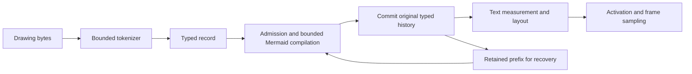
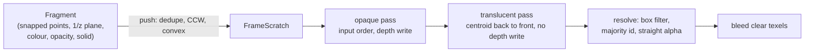
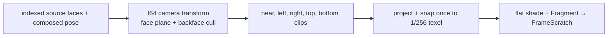

# Scene v1

`kumochi-scene` is the shared, synchronous drawing format. It depends on neither
GPUI nor tokio. The brain parses model JSON; the shell decodes the same validated
types from postcard. The brain's drawing reducer owns canonical scene state; preparation is
synchronous and host-independent, and rendering is not wired yet.



## Records

A drawing call is `{"records":[begin, step, ..., end]}`. Each record is externally
tagged, for example:

```json
{"begin":{"v":1,"scene":"demo","surface":"overlay","alt":"Two connected nodes"}}
```

```json
{"step":{"id":"first","put":[{"diagram":{"id":"d","box":[40,60,880,420]}},{"node":{"id":"a","in":"d","label":"First"}}]}}
```

```json
{"end":{}}
```

The version, scene id, surface and alternative text are required. Steps have a
required id, optional `say`, empty-by-default `put`, `set` and `remove` lists, and
`start` defaulting to `"speech"`. `put` is bounded to 856 operations (600 objects
plus 256 tracks); `set` and `remove` each allow at most 600 entries. Other starts are `"now"` and
`{"after":"earlier-step","ms":200}`. Ordering and reference checks belong to
the scene-state validator, not the typed parser.

`put` accepts `line`, `arrow`, `path`, `shape`, `text`, `callout`, `highlight`,
`diagram`, `node`, `edge`, `table`, `row`, `chart`, `series`, `anim`, `mermaid`,
`view3d` and `solid`.
Wire objects require model ids: there are no generated `_1` aliases. Mermaid
compilation preserves source node and named-group ids and privately generates the
root, anonymous-group and edge ids.
Ids contain 1–40 ASCII letters, digits, underscores, dots or hyphens. Host handles
are a separate, opaque `u32` identity.

Points are logical pixels of the inline scene's `size` or the overlay display.
Anchors are `[x,y]` or `{"ref":"object-id"}`. Coordinates must be finite and
within ±20,000. Chart data uses finite f64 values instead of coordinate-bounded
numbers. Composed transforms and domain-specific ranges are admission checks.
Screen/capture anchors are absent, not ignored.

### 3D records

Scene admission validates and charges the following records (see 3D admission). Until shell
views can prepare them, the brain's one drawing ingress calls `refuse_three_dimensional`, which
refuses the first `view3d`, `solid`, `pos3` track or `rot3` track as `Unsupported` at `put[i]`
(`shortcut:`, removed in slice 5 PR 6). `pos3` and `rot3`
use three-component keys; existing tracks retain their existing key types.

| Record | Fields and decode bounds |
|---|---|
| `view3d` | Required `id`; optional `box`, `camera`, `light`, `spin`; `orbit` defaults to true. |
| `camera` | Optional `yaw`, `pitch` (−85..=85°), `dist` (0.001..=20,000), `fov` (10..=120°), `target` (three coordinates). No camera defaults are applied here. |
| `light` | Optional `dir` (three coordinates, not all zero), `ambient` (0..=1). |
| `solid` | Required `in`, `id`, `shape`; shape fields below; optional `pos`, `rot`, `scale`, `segments`, `attach`, `label`, `info`, `color`, `opacity`. Sizes and scale are 0.001..=20,000; `r2` also allows zero on decode; integer `segments` is 3..=48; `opacity` is 0..=1; `label` and `info` allow 400 Unicode scalars. |

`spin` is −360..=360°/s. Every numeric input must be finite; free coordinates,
including rotations, targets, directions, outlines and paths, use the existing
±20,000 coordinate bound. Decode bounds apply in JSON and postcard, regardless of shape.

`rot` uses degrees about x, then y, then z: `Rz·Ry·Rx` on column vectors,
followed by uniform `scale`, then `pos`. An attached child's transform is applied
before its parent's. This does not change the 2D `rotate` convention. Three-dimensional
space is right-handed with y up. A lathe's `[radius,y]` profile runs from lower y
towards higher y for outward winding; reversing the profile reverses the surface.
Lathe ends are open, without caps; with back-face culling the inside is invisible.

A decoded solid is not yet valid geometry. `Solid::geometry()` checks required
fields first, then rejects unused shape fields (including `segments` on a box or an extrusion),
then checks counts and radius relations:

| Shape | Used geometry fields |
|---|---|
| `box` | Required three-component `size`. |
| `sphere` | Required `r`. |
| `cylinder` | Required `r`, `h`. |
| `cone` | Required `r`, `h`; optional `r2` defaults to zero. |
| `torus` | Required `r`, `r2`, with 0.001 ≤ `r2` < `r`. |
| `extrude` | Required `points` (3..=64), `depth`. |
| `lathe` | Required `points` (2..=512), with nonnegative radii in the first component. |
| `tube` | Required `path` (2..=512), `r2` ≥ 0.001. |

Empty and omitted lists are equivalent: a required empty list is `MissingField`,
and an unused empty list is accepted. Non-empty unused lists are `UnknownField`.
All lists decode at most 512 points; extrude counts above 64 are
`OverBudget(PathPoints)`. Degeneracy checks belong to tessellation sizing.
The new enum tags are append-only; changing these positional postcard structs
later requires an explicit wire-version decision, not rewritten goldens.

### 3D tessellation sizing

`three::size::triangles` validates one decoded solid and returns its candidate
triangle capacity without allocating. This count does not depend on world transforms.
Triangle generation is a separate module; sizing alone does not establish world-space
representability. Admission charges this count (see 3D admission).

Let n be `segments` (default 24), k the retained outline count, p the retained
profile count and q the retained path count:

| Shape | Candidate triangles | At n = 3 / n = 48 |
|---|---|---|
| box | 12 | 12 / 12 |
| sphere | 20·4ᴸ | 20 / 1,280 |
| cylinder | 4n − 4 | 8 / 188 |
| cone, top zero | 2n − 2 | 4 / 94 |
| cone, top positive | 4n − 4 | 8 / 188 |
| torus | 2n² | 18 / 4,608 |
| extrude | 4k − 4 | 252 at k = 64 |
| lathe, open | 2n(p − 1) | 24,000 at n = 48, p = 251; 49,056 at p = 512 |
| tube, capped | 2n(q − 1) + 2(n − 2) | 49,148 at n = 48, q = 512 |

Sphere levels are L = 0 at n = 3–5, 1 at 6–11, 2 at 12–23 and 3 at 24–48.
Capacity counts use saturating u32 arithmetic; decoded bounds keep the largest
count at 49,148. Sizing allows counts over the triangle budget; admission refuses them.
Lathe axis bands include candidates with coincident vertices, not just nonzero triangles.

The shared numeric policy is `three::REL = 1e-6` and
`dist_eps(radius) = REL × max(radius, 0.001)`. The local radius is half the diagonal
of the shape's AABB, not a distance from the origin. Tube bounds include the tube
thickness; lathe bounds include the revolved radii. Calculations use f64; the shared
source-area cutoff is `dist_eps²`. Transforms compose f64 affine matrices and check
finiteness after narrowing points to f32. Sub-ulp distortion is accepted because the
camera's near-plane precision floor bounds its screen size.
Consecutive points strictly closer than `dist_eps` merge against the last retained
point. Closing outline duplicates merge by the same rule. An origin offset in an
outline or path does not alter the radius or tolerance.

Sizing refuses a merged outline with fewer than three points, absolute twice-area
below `dist_eps²`, self-intersections, nonadjacent touches or overlapping edges.
A redundant collinear outline vertex is accepted. Profiles and paths need two
retained points; a lathe needs a retained off-axis point. A tube turn with unit
tangent dot product strictly below `−1 + REL` is refused. These failures are typed
`MeshError::Degenerate` at `points` or `path`; shape validation errors keep their
original typed field and code. Scene admission converts these errors into
`ErrorCode::Degenerate` at sanitized paths.

### 3D admission

A `view3d` is a root object and at most one lives in a scene, a pending removal included;
its `box`, like a 2D box, needs a positive width and height.
A `solid` names its view with `in`, and `attach` names an earlier solid (lower revision, or
the same revision and a lower slot) in the same view; attachment counts toward depth 16 and a
removal that would orphan an attached solid fails with `Orphans`. Only solids own `info`,
`pos3` and `rot3`; a view owns no `color`; 2D tracks and `ref` anchors to 3D objects are
refused. Admission sizes each solid with `three::size::triangles` and `three::size::reach`
(the farthest local vertex from the solid's origin) and never tessellates: that runs off
the admission path. Outline checks do run here, and they grow with the square of the point
count, so an extrude outline holds at most 64 points (`MAX_EXTRUDE_POINTS`); draw a smoother
profile with a lathe, or split a detailed shape into several extrudes. A step holds at most
2,304 outline points in all (36 full outlines), so the outline checks of one step stay under
1 ms on Rez; 42 full outlines reached 1 ms p99 there.

| Budget | Limit | Error |
|---|---|---|
| Views | 1 per scene | `OverBudget(Views)` |
| Solids | 160 per scene | `OverBudget(Solids)` |
| Triangles | 24,000 per scene and across visible scenes | `OverBudget(Triangles)` |
| Moving view | 6,000 triangles in a view with any `pos3` or `rot3` track | `OverBudget(MovingTriangles)` |
| Outline points | 2,304 extrude outline points per step (36 full outlines) | `OverBudget(OutlinePoints)` |

Like 2D charges, the scene charges (solids, triangles and the moving view) recompute from the
after, pending and changed versions, so a removed solid releases its triangles only at
retirement and a refusal moves no counter. The outline budget is not a retained charge: it
counts only the extrude outlines in the step being admitted.

**Coordinate bound.** 3D admission refuses a solid unless the sum of its chain's translation
lengths, plus its scaled reach, is at most 20,000. Each link adds its `pos` length and its
`pos3` envelope, both multiplied by the ancestors' composed scale; summing lengths ignores
cancellation, so a parent at x = 15,000 with a child at local x = −15,000 is refused. The
`pos3` envelope is the largest length of any key and, for `spring`, of each key pair's
overshoot endpoint `b + (b − a) × SPRING_OVERSHOOT` (and `a + (a − b) × SPRING_OVERSHOOT`
with `yoyo`), where the first pair starts at rest. It is taken over every charged version of
the solid, so a replacement cannot hide an earlier envelope before it retires.
Rotation preserves lengths and adds nothing. Non-finite compositions fail with
`TransformOverflow`, the bound with `OutOfRange`.

**Stop.** A 3D object never re-roots: after a cut it survives only when its view and its whole
attachment chain survive.

### 3D tessellation

`three::Transform` composes f64 affine transforms. Each canonical local vertex has
one expression and one narrowing path to world-space f32. Periodic indices wrap
before trigonometry; cap and seam vertices reuse those expressions. Sphere midpoint
endpoints have a canonical order on their f32 bits. Spheres subdivide an icosahedron;
extrudes ear-clip CCW outlines; tubes use bisected path tangents and parallel-transported
frames, initially using the axis least aligned with the first tangent.

Generation refuses non-finite world vertices, distinct local vertices that narrow
to the same world point, and retained triangles whose narrowed points have zero
area. It never rebases coordinates. Any source triangle with area below `dist_eps²`
is refused too, except coincident-vertex candidates at lathe axis bands, which are
dropped and counted. A successful result satisfies `written + dropped == triangles`.
A thin solid can therefore be refused rather than rendered with missing caps.
Representability does not guarantee analytic area accuracy: the world f32 lattice
can change lengths substantially near large translations. Sub-ulp distortion is accepted
because the camera's near-plane precision floor bounds its screen size.

The caller owns the output and cancellation flag. `Full` means the candidate count
does not fit beyond the existing prefix and appends nothing. `Cancelled` and
`Degenerate` can leave appended triangles; callers save the original length and
truncate back after failure. Cancellation is checked at entry, throughout vertex
checks, during ear clipping, per emitted triangle and before success.

Large scratch buffers belong to the caller's `MeshScratch`. `MeshScratch::new()` allocates
collision keys (384 KiB), tube frames and tangents (36 KiB), and sphere vertices/faces
(about 23 KiB) once. `build` borrows that scratch and never grows its private boxed buffers.
Only small retained-index and ear-clipping arrays remain on the stack. No build allocates
once the caller has constructed scratch and reserved its output.

### 3D raster

`three::raster` fills one view's straight-alpha BGRA texels and a u8 solid id per texel from
convex screen polygons. It has no GPUI: the shell wraps the colour as an image.



- **Coverage.** Vertices are in 1/256 texel. `FrameScratch::push` removes duplicate and collinear
  vertices, makes the loop counter-clockwise in y-down space and keeps it only if strictly convex;
  a collapsed or reflex loop is discarded and counted. Edge functions are exact i64 with the
  top-left rule, so polygons with identical shared endpoints cover each sample exactly once.
  Coordinates stay within ±2^21 (4,096 texels plus a 4,096-texel guard band), keeping every
  edge function under 2^45.
- **Depth.** The plane gives 1/z over texel coordinates, evaluated in f64 and narrowed to f32; it
  must be finite and positive at every vertex. Keys clear the 3 lowest mantissa bits and compare
  strictly, so depths in one 8-ulp bin (about 1e-6 wide) tie and the earlier input wins. That is
  a bin, not a tolerance: depths one ulp apart across a bin boundary don't tie, so coplanar
  stability rests on PR 4 building shared planes identically.
- **Translucency.** Polygons under opacity 1 are sorted farthest first by their centroid's camera
  depth (ties by input order) with an in-place sort, depth-tested against opaque samples and
  blended source-over in premultiplied 8-bit as `(s·α + d·(255 − α) + 127) / 255`. They never
  write depth or split. One at authored opacity 0.5 or more writes its solid id, so the id is
  the last qualifying layer in that order, not necessarily the nearest surface. Interpenetrating
  translucent solids can blend in the wrong order (`shortcut:`, OSC-242).
- **Samples.** Motion frames take one sample at the texel centre; rest frames take four on a
  rotated grid at (−1/8, −3/8), (3/8, −1/8), (−3/8, 1/8) and (1/8, 3/8) from the centre and
  box-resolve them. A texel's id is the most frequent sample id, background included, with ties
  to the id whose first sample is lowest.
- **Bands and work.** A frame renders in 32-row bands, so only a band's depth, colour and id
  samples are resident: `BandScratch::new(width)` reserves 1,152 bytes per column once. A
  `ScreenPoly` is 84 bytes, plus an 8-byte sort key. Cancellation is polled per polygon, every
  65,536 sample tests and per resolved and bled row, because a band doesn't bound work.
- **Bleed.** Each clear texel takes the colour of its first covered neighbour (left, right, up,
  down), keeping alpha 0, so a scaled image doesn't fringe under straight-alpha filtering.

Nothing allocates once the caller holds the scratch, band and target. Targets are 1 to 4,096
texels per axis; anything else, or a band narrower than the target, is `RasterError::Size`.

### 3D camera and frames

`three::camera` owns validated numeric camera and light state. The camera defaults to yaw 30°,
pitch 20°, vertical fov 40°, distance three bounding radii and the centre of the **world-space 3D
bounds**, not the layout rectangle. Authored distance is retained, including inside geometry.
Orbit applies −0.4° per horizontal logical pixel and +0.4° per vertical pixel, clamps pitch to
±85° and distance to 1.2–6 radii. These feel values are provisional. Camera inputs must be finite,
distance positive and fov 10–120°. Eye and angle-derived basis stay in f64, so a tiny camera
distance at a translated target never relies on subtracting a rounded f32 eye.

`three::frame::frame` takes borrowed indexed `Solid`s, each with shared local vertices, source
`Face`s, a theme-resolved colour/opacity and a composed sampled f64 `Transform`. Preparation must
preserve original vertex indices and one stable three-vertex plane anchor per source face across
its tessellations; triangle soup alone cannot satisfy those contracts. A face's triangles tessellate
one source plane before f32 vertex rounding. The caller composes attachments before the call;
the frame transforms vertices at the sampled pose rather than rebuilding geometry. This input is
the seam for later preparation, not a live shell host or a new admission path.



The near distance is `max(0.05·distance, 1e-4·radius, 8·ulp(largest world coordinate)·focal_px)`.
Focal length uses the exact internal raster height; the floor itself is a world-space distance. It
keeps one f32 world-coordinate ulp below 1/8 texel at the nearest drawn depth. It also prevents
approaching translated content arbitrarily closely: at coordinate 20,000 and height 1,440 with
40° fov, it is about 30.9 world units. Nothing closer is drawn or writes an id.

Clipping uses camera-space halfspaces, including the homogeneous equivalents of the four
projected guard edges. That is perspective-equivalent to projecting then clipping, but keeps
all intersections in f64 camera coordinates. Planes always apply near, left, right, top, bottom.
An edge's endpoint order is the original solid vertex index, then lexicographic coordinates for
equal indices; generated endpoints inherit the lower index. Intersections clamp the f64 parameter
to [0,1], and on-plane endpoints are included once without an extra intersection. Consecutive and
closing exact duplicates are removed before projection; raster push removes snapped duplicates
and collinearity. Eight inline vertices suffice: three plus at most one per plane. No clip or
output write grows a buffer.

The reciprocal-depth plane is derived **once per source face**, in f64, then narrowed once and
shared by every triangle. This makes a source face's depth independent of its triangulation,
including across the raster's 8-ulp key boundaries. It is not a general tolerance between
unrelated nearly coplanar faces. Flat shading uses
`ambient + (1 − ambient)·max(0, normal·−light_dir)`, default direction (−1,−2,−1), ambient 0.35.
The translucent key is the clipped polygon vertices' mean camera z, not a per-solid key.

The frame refuses more than 160 solids or 24,000 triangles, invalid indices, non-finite geometry,
invalid opacity or sizes outside 1–4,096 per axis. Numeric failures include unrepresentable depth
planes; raster push checks positive finite depth at the snapped vertices. Cancellation polls at
each face and every 1,024 vertex/index/triangle visits. Any error clears the whole output; the
host must retain its previous displayed frame. Frame construction allocates nothing with reserved
`FrameScratch`. Shell integration and publication remain staged.

### 3D picking

`three::pick::DisplayedFrame` owns the completed raster's ids and `FrameState`: geometry revision,
camera, composed sampled pose per solid, frozen `Mapping` and solid-index-to-`Handle` map. Parts
carry existing host handles, not user labels; handles retain their original commit identities.
Construction checks the exact width × height id length, at most 160 matching poses/parts and
every one-based solid id. That scan visits every id, so the raster worker builds the frame, not
the UI thread. Background is 0. There are no mutable accessors; retirement consumes
the frame with `into_parts` to return the id allocation for reuse.

`Mapping` snapshots the logical destination origin/extent, effective DPI (physical pixels per
logical pixel) and exact integer raster dimensions, each 1–4,096. Rectangle ends must be finite
and greater than their origins; extents and DPI must be finite and positive. `pick(&frame, at)`
takes a pointer in that same logical coordinate space. It rejects non-finite pointers and points
outside the half-open rectangle, then uses `(at - origin) / extent × texels` **per axis**.
DPI is not applied twice. Integer rounding can make the two ratios different, including in
scaled and half-resolution motion frames. A labelled id returns `Part(handle)`, an unlabelled id
returns `Blocked` and background returns `Miss`. A pick performs no allocation or ray traversal.

Ids already encode raster coverage and opacity: an opaque unlabelled solid blocks, material
below authored opacity 0.5 passes, and 0.5 blocks. Near-clipped geometry has no id. Rest chooses
the most frequent of four sample ids, background included, with ties won by the lowest first
sample index. Translucent ids follow the last qualifying polygon in the approximate painted
centroid order, **not necessarily the nearest geometric surface** (OSC-242). A pick within one
**internal texel** of an edge, mapped separately through both frozen axis ratios and including
bilinear filtering, can differ from an exact ray. This is not a one-display-pixel tolerance.
The scaled pointer/oracle fixtures reuse the frame's independent f64 ray oracle and omit only
that edge neighbourhood and the declared 1e-6 relative depth ambiguity.

The host must publish the same image and `DisplayedFrame` together at accepted paint, not on
worker completion. Until then picks read the old pair, even if the desired camera, pose, DPI,
rectangle or geometry revision changed. A skipped, failed, stale or superseded paint cannot
advance picking. Unique ownership keeps the displayed ids unavailable for worker writes; the
other buffer can belong to the running job or ready candidate, never both. Host job admission,
image lifetime and the actual paint transaction belong to PR 6/10, not this scene primitive.

JSON decoding enables exact float round trips: a stored and reloaded typed step must retain
the original f64 chart values, rather than changing a final bit during recovery.

All relative timing fields, including delays, entrances, edge flow, after-step
offsets and animation key times, are milliseconds in 0–60,000. `Ms` validates on
both routes and `checked_add` returns none if a sum exceeds that cap. `at_word` denotes an estimated offset within a synthetic speech
segment, not real-audio alignment. Optional style values are left to preparation;
for example, an omitted diagram direction can use the inline surface's downwards
default instead of imposing the overlay's direction at parse time.

## Strict decoding and errors

`parse_record` consumes exactly one JSON record of at most 32 KiB. Unknown fields,
unknown operations, duplicate fields, invalid ids, unsupported versions, non-finite
numbers and excess text/list lengths fail. Text counts Unicode scalar values, not
UTF-8 bytes; overlong content is never truncated. Bounded lists reject the excess
element before decoding or storing it.

Path data (`d`) and Mermaid source (`src`) use `Source`, not display `Text`.
Each is capped at 8 KiB of UTF-8 bytes (`MAX_SOURCE_BYTES`); the path figure comes
from S1, while the Mermaid figure is a starting cap. Admission's shared SVG preflight
enforces the 512-command path limit. Source Debug exposes byte length only.

The mixed-syntax types (`Start`, `Anchor`, `Color`, cells, chart points and key
values) use JSON visitors only when `is_human_readable()` is true. Their binary
branches use declaration-order enum tags and the same validated payload types and
constructors. RGB payloads are restricted to 24 bits in both formats. There are no
untagged enums, flattened fields or omitted binary struct fields.

Postcard enum declaration order is **append only**: never reorder variants or
insert a new variant before an existing one. Golden-byte tests pin every enum's
tags, including the private mixed-syntax representations, because steps will be
persisted and replayed. Version is the literal integer 1, not an enum index.

Decode paths come from `serde_path_to_error`, filtered through known schema field
names and array indices. Unknown model keys never become diagnostic path text.
Only fixed custom-error tokens and serde diagnostic prefixes are inspected to
choose an `ErrorCode`; the parser's original message is discarded. `StepError`
uses `MissingField` for absent required fields and appends only an allowlisted
field name to its path. `UnknownOp` denotes only an unknown record/op tag;
unknown vocabulary values and invalid numeric values are `OutOfRange`.
`StepError`'s `Display` and `Debug` contain only the path and code. `tool_text` may include a
known step id when replying to its model, but never the rejected field value.
`Text`, `Source` and `WireId` expose lengths only; `Finite`, `Number`, `Rgb`, `Ms`, `Cell` and
`Point` redact values, while `Step`, `Frame` and `FrameItem` summarize counts, hiding
timings, repeat counts and word offsets along with drawing values. Do not trace records,
serialize drawing content into logs, or trace a model-facing tool reply.

## Admission and identity

`SceneState::begin` validates positive optional canvas dimensions. `CallState`
guards one call's begin/step/end order; a new call gets a fresh guard and must
repeat the stored header with typed equality. Ending a call does not end its scene.

`admit` resolves references against earlier surviving objects plus every object
declared in the same step, independent of put order. `start.after` must name an
earlier kept step, never one dropped by a cut. Admission rejects cycles, missing
or wrongly typed parents/endpoints, properties the target does not own, invalid
track values/times, and removals that orphan a surviving dependant. Only `draw`
has kind-specific track ownership checks so far; a `set` or `anim` targeting an object
removed by that same step fails as `UnknownRef`. The motion layer defines the
remaining property rules. Admission expands bounded Mermaid sources before checking
the executable candidate; callers still submit and persist the original typed step.

Ids, including dropped or removed ids, stay reserved for the scene's lifetime.
An identical typed step id is a no-op even after its step was dropped; a conflicting
payload is an error. The 64-step cap counts all lifetime commits, not just kept
steps. Rejecting admission consumes neither ids, revisions nor global generations.

`Admission::New` owns a checked candidate. The caller persists it before calling
`commit` and serializes all scene/global mutations across that boundary. Commit
checks scene identity, global-context identity, scene revision, its own mutation
stamp and global generation in O(1); `StaleAdmission` is its only error and changes
nothing. Admission computes charges without mutating either state; commit installs
them. A scene bound to one budget rejects mutations through a different instance.

A handle encodes `(original_revision << 10) | expanded_put_slot`: revisions are
one-based, slots are zero-based, and animation slots are not compacted away.
Neither Stop nor append renumbers old handles. The returned commit index is
zero-based over lifetime commits. Handle decoding rejects zero/unused revisions
and slots beyond the 856-operation bound.

### Bounded Mermaid flowcharts

`{"mermaid":{"in":"d","src":"flowchart LR\nA[Start] --> B[Done]"}}`
adds a self-contained flowchart inside diagram `d`. The target may be declared later
in the same step, but it must be a diagram, not another container. The parser consumes
the complete source, including its suffix; it never commits a valid prefix.

The D1 subset accepts `flowchart` and `graph`, TB/TD/BT/LR/RL directions, box,
round, pill, diamond, circle and cylinder nodes, chains and spaced `&` fan-out,
normal/open/dotted/thick labelled links with no, end or both arrowheads, nested
subgraphs and whole-line `%%` comments. Subgraphs may set their own direction;
otherwise it inherits from the nearest diagram. Source order determines node
first-mention order and edge fan-out order.

The first closing subgraph that references a node owns it, including edge-only
references. A later declaration does not move it. Repeated declarations in the same
scope update its label and shape; explicitly shaped or labelled declarations in
different scopes are refused. Bare membership mentions are references, not
redefinitions. A quoted multiword header creates a fresh anonymous group; a quoted
one-word header keeps its valid source id. Reopening a named group is unsupported.

Symbolic directions and BR, minimum-length links, edge ids, group endpoints,
other shapes or heads, configuration, styling, interactions, HTML, entity codes,
Mermaid Markdown strings and non-WireId identifiers return `Unsupported` rather
than disappearing. Unknown header words, including misspellings, and refused
statement-leading id bytes also return `Unsupported`; D1 does not distinguish
an unknown diagram kind from a typo. Malformed or truncated D1 syntax returns `Malformed`, including
an `import` after an otherwise valid graph. Text and source limits remain enforced;
labels such as `click style direction end` and `1<2` are ordinary text. `<br>` stays
unsupported rather than becoming a line break.

Each source expands in place into a boxless root, parent-first groups, first-mentioned
nodes and source-ordered edges. A bounded deterministic allocator skips every id
reserved by the scene or declared or referenced anywhere in the step, including
source group ids, parents, anchors, edge endpoints and animation, set and remove
targets. A generated object cannot satisfy an otherwise dangling reference.
All expanded objects and operations count once against the ordinary scene and step
caps before handles are constructed. The 48-node and 96-edge caps apply to each
diagram after membership and edge ownership are resolved, not to the whole source.

A header-only chart is accepted and costs its one empty boxless root; it draws nothing.
An explicitly blank node label, quoted or unquoted, stays empty rather than falling
back to its id. The node still occupies its normal shape and counts against the budget.

The original `Step` remains authoritative for duplicate identity, `SceneState::step`,
`PreparedStep::step` and recovery. A private executable step and slot-origin map drive
admission, preparation and motion. Syntax errors name the original
`put[i].mermaid.src`; generated-slot errors map there too, while root-target errors
name `.mermaid.in` and shifted plain-operation errors retain their original indices.
Whole-scene budget failures can still name the root. Replaying original records
recompiles the same handles and private drawing facts without a wire-format change.

Private group titles, reversed direction and link paint travel beside the executable
step, not in new wire fields. A title is text on its group's own handle, so it is
not another child or object and survives ordinary updates and retained-handle cuts.
Its measured width is capped at 180 logical pixels. For content bounds C and title
size L, the title band has width `max(C.width, L.width)` and reserves
`L.height + 16` pixels above C. A rounded, unfilled frame encloses the band and
contents with 8 pixels of padding, using the theme's line color at 1 pixel width.
The title is centred inside its top inset. The final bounds pass resizes both the
frame and title placement when members change. Untitled structural diagrams stay
frameless, so anonymous layout wrappers do not introduce unexplained boundaries.

This parser is a reduced port of Pele's flowchart lexer/parser, with its MIT notice
and pinned revision in `THIRD-PARTY-NOTICES.md`. Unsupported families are deliberate
differences, not claims of full Mermaid or upstream-suite compatibility.

The ignored `measure_whole_scene_removal_admit` test measures the complete
admission call for 600 existing text objects and 600 removals, including the
metadata-map clone and semantic checks. It uses five warm-ups and 128 samples;
fixture construction and candidate destruction are outside the timed interval.
Build `--release --test state_followups --no-run` below normal priority, acquire
the shared measurement lock and wait for 30 seconds without cargo/rustc, then run
that executable with `--exact measure_whole_scene_removal_admit --ignored
--nocapture --test-threads=1` at normal priority. Results belong in the PR/report,
not this page. This is an admission measurement, not a frame or end-to-end latency.

## Stop and recovery

`StopCut.activated` is the revision activated **through**, not a count of kept
steps. Zero returns `Cleared` without resetting revision only before anything was
shown; afterward it is rejected, and a user clear uses `clear`. Stop first undoes all
unactivated steps' removals, then drops their objects and retains exactly the
revealed handles in the activated prefix. A retained object whose dependency was
discarded becomes detached. This can leave a node, row or series without its parent,
or an edge without an endpoint. Its live placed geometry stays frozen; A5 must
prepare incrementally through the log so recovery obtains that pre-cut placement.
Dropped steps keep their ids and original revisions; their future sets/removals
are no longer replayed as active work.

The recovery log contains **every original committed step**, interleaved in commit
order with **every effective StopCut**. A Stop keeping everything adds no entry.
There is at most one effective cut per newly committed revision, so there are at
most 64 steps and 64 cuts. This is not a normalized checkpoint or a final cut
applied to a filtered step list: after Stop drops an unfinished dependant, an
append may legally remove its old target. Replaying the dependant without its
intervening cut would wrongly reject that removal.

`SceneState::replay` uses the same admission, commit and Stop transitions and
requires each original revision in order, including dropped steps. Recovery's
kept prefix is considered activated; its removals are retired. The selected global
budget strategy is **validate the combined final replayed result once**, rather
than replay independent scenes against unrelated historical peaks. The budget
layer implements this through `SceneState::replay_all`, returning the restored
scenes and their shared budget atomically. The shell's layout-aware counterpart,
`layout::recover_all`, returns an outcome per scene instead (see Preparation).
Standalone `replay` returns an unbound scene; its next mutation must install its
entire remaining charge. During replay,
each commit releases removal/replacement charges without advancing the activated
bound, so a later `Stop(1)` still works after replaying steps 1 and 2. Undo metadata
stays available until actual activation or a cut.

At runtime the shell retires removals at activation; the brain calls `retire`
only on StepShown or retires the kept prefix on Stop. Repeated retirement is a
no-op. Preparation failure stops the scene with the same cut: it keeps activated
objects, drops the failed step and every queued successor, and restores their
removals. A first-step failure cuts at zero and clears. The host accepts no further
steps for that scene in the current call, persists the cut, and activates no later
queued segment. A later call can continue the kept scene after that cut. This needs
no separate failed-step event and leaves the 64-step/64-cut bound unchanged.

An already-cut scene is left alone on a later Esc; a user clear goes through
`clear`, not a second effective cut. `clear` is terminal and idempotent; its
separate host clear event removes the scene from the visible recovery set.
Prepared display residency is not an admission input.

## Caps

Admission enforces the logical caps below, independently of prepared residency.
`SceneState::usage` and `GlobalBudget::usage` report the installed charges. A pending
removal still counts until the shell activates it or the brain receives StepShown.
