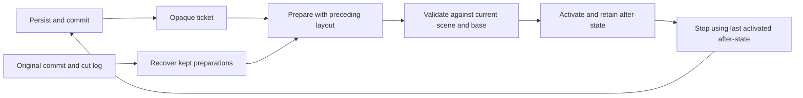

# Scene v1

`kumochi-scene` is the shared, synchronous drawing format. It depends on neither
GPUI nor tokio. The brain parses model JSON; the shell decodes the same validated
types from postcard. There is no renderer or scene-state caller yet; preparation is synchronous and host-independent.

## Records

A drawing call is `{"records":[begin, step, ..., end]}`. Each record is externally
tagged, for example:

```json
{"begin":{"v":1,"scene":"demo","surface":"overlay","alt":"Two connected nodes"}}
```

```json
{"step":{"id":"first","put":[{"diagram":{"id":"d","box":[40,60,880,420]}},{"node":{"id":"a","in":"d","label":"First"}}]}}
```

```json
{"end":{}}
```

The version, scene id, surface and alternative text are required. Steps have a
required id, optional `say`, empty-by-default `put`, `set` and `remove` lists, and
`start` defaulting to `"speech"`. `put` is bounded to 856 operations (600 objects
plus 256 tracks); `set` and `remove` each allow at most 600 entries. Other starts are `"now"` and
`{"after":"earlier-step","ms":200}`. Ordering and reference checks belong to
the scene-state validator, not the typed parser.

`put` accepts `line`, `arrow`, `path`, `shape`, `text`, `callout`, `highlight`,
`diagram`, `node`, `edge`, `table`, `row`, `chart`, `series`, `anim` and `mermaid`.
Addressable objects require model ids: there are no generated `_1` aliases.
Ids contain 1–40 ASCII letters, digits, underscores, dots or hyphens. Host handles
are a separate, opaque `u32` identity.

Points are logical pixels of the inline scene's `size` or the overlay display.
Anchors are `[x,y]` or `{"ref":"object-id"}`. Coordinates must be finite and
within ±20,000. Chart data uses finite f64 values instead of coordinate-bounded
numbers. Composed transforms and domain-specific ranges are admission checks.
Screen/capture anchors and all 3D operations are absent, not ignored.

All relative timing fields, including delays, entrances, edge flow, after-step
offsets and animation key times, are milliseconds in 0–60,000. `Ms` validates on
both routes and `checked_add` returns none if a sum exceeds that cap. `at_word` denotes an estimated offset within a synthetic speech
segment, not real-audio alignment. Optional style values are left to preparation;
for example, an omitted diagram direction can use the inline surface's downwards
default instead of imposing the overlay's direction at parse time.

## Strict decoding and errors

`parse_record` consumes exactly one JSON record of at most 32 KiB. Unknown fields,
unknown operations, duplicate fields, invalid ids, unsupported versions, non-finite
numbers and excess text/list lengths fail. Text counts Unicode scalar values, not
UTF-8 bytes; overlong content is never truncated. Bounded lists reject the excess
element before decoding or storing it.

Path data (`d`) and Mermaid source (`src`) use `Source`, not display `Text`.
Each is capped at 8 KiB of UTF-8 bytes (`MAX_SOURCE_BYTES`); the path figure comes
from S1, while the Mermaid figure is a starting cap. Admission's shared SVG preflight
enforces the 512-command path limit. Source Debug exposes byte length only.

The mixed-syntax types (`Start`, `Anchor`, `Color`, cells, chart points and key
values) use JSON visitors only when `is_human_readable()` is true. Their binary
branches use declaration-order enum tags and the same validated payload types and
constructors. RGB payloads are restricted to 24 bits in both formats. There are no
untagged enums, flattened fields or omitted binary struct fields.

Postcard enum declaration order is **append only**: never reorder variants or
insert a new variant before an existing one. Golden-byte tests pin every enum's
tags, including the private mixed-syntax representations, because steps will be
persisted and replayed. Version is the literal integer 1, not an enum index.

Decode paths come from `serde_path_to_error`, filtered through known schema field
names and array indices. Unknown model keys never become diagnostic path text.
Only fixed custom-error tokens and serde diagnostic prefixes are inspected to
choose an `ErrorCode`; the parser's original message is discarded. `StepError`
uses `MissingField` for absent required fields and appends only an allowlisted
field name to its path. `UnknownOp` denotes only an unknown record/op tag;
unknown vocabulary values and invalid numeric values are `OutOfRange`.
`StepError`'s `Display` and `Debug` contain only the path and code. `tool_text` may include a
known step id when replying to its model, but never the rejected field value.
`Text` and `WireId` debug formatting exposes lengths only. Do not trace records,
serialize drawing content into logs, or trace a model-facing tool reply.

## Admission and identity

`SceneState::begin` validates positive optional canvas dimensions. `CallState`
guards one call's begin/step/end order; a new call gets a fresh guard and must
repeat the stored header with typed equality. Ending a call does not end its scene.

`admit` resolves references against earlier surviving objects plus every object
declared in the same step, independent of put order. `start.after` must name an
earlier kept step, never one dropped by a cut. Admission rejects cycles, missing
or wrongly typed parents/endpoints, properties the target does not own, invalid
track values/times, and removals that orphan a surviving dependant. Only `draw`
has kind-specific track ownership checks so far; a `set` or `anim` targeting an object
removed by that same step fails as `UnknownRef`. The motion layer defines the
remaining property rules. Mermaid expansion must run before admission; it remains
unsupported until A8.

Ids, including dropped or removed ids, stay reserved for the scene's lifetime.
An identical typed step id is a no-op even after its step was dropped; a conflicting
payload is an error. The 64-step cap counts all lifetime commits, not just kept
steps. Rejecting admission consumes neither ids, revisions nor global generations.

`Admission::New` owns a checked candidate. The caller persists it before calling
`commit` and serializes all scene/global mutations across that boundary. Commit
checks scene identity, global-context identity, scene revision, its own mutation
stamp and global generation in O(1); `StaleAdmission` is its only error and changes
nothing. Admission computes charges without mutating either state; commit installs
them. A scene bound to one budget rejects mutations through a different instance.

A handle encodes `(original_revision << 10) | expanded_put_slot`: revisions are
one-based, slots are zero-based, and animation slots are not compacted away.
Neither Stop nor append renumbers old handles. The returned commit index is
zero-based over lifetime commits. Handle decoding rejects zero/unused revisions
and slots beyond the 856-operation bound.

The ignored `measure_whole_scene_removal_admit` test measures the complete
admission call for 600 existing text objects and 600 removals, including the
metadata-map clone and semantic checks. It uses five warm-ups and 128 samples;
fixture construction and candidate destruction are outside the timed interval.
Build `--release --test state_followups --no-run` below normal priority, acquire
the shared measurement lock and wait for 30 seconds without cargo/rustc, then run
that executable with `--exact measure_whole_scene_removal_admit --ignored
--nocapture --test-threads=1` at normal priority. Results belong in the PR/report,
not this page. This is an admission measurement, not a frame or end-to-end latency.

## Stop and recovery

`StopCut.activated` is the revision activated **through**, not a count of kept
steps. Zero returns `Cleared` without resetting revision only before anything was
shown; afterward it is rejected, and a user clear uses `clear`. Stop first undoes all
unactivated steps' removals, then drops their objects and retains exactly the
revealed handles in the activated prefix. A retained object whose dependency was
discarded becomes detached. This can leave a node, row or series without its parent,
or an edge without an endpoint. Its live placed geometry stays frozen; A5 must
prepare incrementally through the log so recovery obtains that pre-cut placement.
Dropped steps keep their ids and original revisions; their future sets/removals
are no longer replayed as active work.

The recovery log contains **every original committed step**, interleaved in commit
order with **every effective StopCut**. A Stop keeping everything adds no entry.
There is at most one effective cut per newly committed revision, so there are at
most 64 steps and 64 cuts. This is not a normalized checkpoint or a final cut
applied to a filtered step list: after Stop drops an unfinished dependant, an
append may legally remove its old target. Replaying the dependant without its
intervening cut would wrongly reject that removal.

`SceneState::replay` uses the same admission, commit and Stop transitions and
requires each original revision in order, including dropped steps. Recovery's
kept prefix is considered activated; its removals are retired. The selected global
budget strategy is **validate the combined final replayed result once**, rather
than replay independent scenes against unrelated historical peaks. The budget
layer implements this through `SceneState::replay_all`, returning the restored
scenes and their shared budget atomically. Standalone `replay` returns an unbound
scene; its next mutation must install its entire remaining charge. During replay,
each commit releases removal/replacement charges without advancing the activated
bound, so a later `Stop(1)` still works after replaying steps 1 and 2. Undo metadata
stays available until actual activation or a cut.

At runtime the shell retires removals at activation; the brain calls `retire`
only on StepShown or retires the kept prefix on Stop. Repeated retirement is a
no-op. Preparation failure stops the scene with the same cut: it keeps activated
objects, drops the failed step and every queued successor, and restores their
removals. A first-step failure cuts at zero and clears. The host accepts no further
steps for that scene in the current call, persists the cut, and activates no later
queued segment. A later call can continue the kept scene after that cut. This needs
no separate failed-step event and leaves the 64-step/64-cut bound unchanged.

An already-cut scene is left alone on a later Esc; a user clear goes through
`clear`, not a second effective cut. `clear` is terminal and idempotent; its
separate host clear event removes the scene from the visible recovery set.
Prepared display residency is not an admission input.

## Caps

Admission enforces the logical caps below, independently of prepared residency.
`SceneState::usage` and `GlobalBudget::usage` report the installed charges. A pending
removal still counts until the shell activates it or the brain receives StepShown.
Pending replacements reserve each object's maximum expanded cost and the union of
its property owners, rather than charging the same identity twice. Retirement,
Stop and terminal `clear` return charges exactly once.

Table rows charge padded cells. Charts charge every data point, reject invalid log
domains and non-finite stacked sums, and reserve generated data motion. Diagram
groups reserve their generated position glide; entrances and edge flow also count
as motion owners. Repeated finite animations, including delay, must fit 60 seconds;
infinite repeat remains bounded by the later scene deadline. A7 supplies that clock
and the remaining property-ownership rules.

The private SVG walker accepts M/L/H/V/Q/C/Z, absolute or relative, including implicit
repetitions. It validates coordinates and counts commands before vertices exist.
Quadratic and cubic second differences determine power-of-two subdivision counts at
0.25 logical-pixel tolerance after conservative composed scale bounds. Preparation uses
the same walker and subdivision function when producing vertices. Procedural curves,
rounded rectangles, ellipses, cylinder caps, pie arcs and chart axes have shared
segment reservations in `path.rs`; generated output must stay within them.
Transform checks compose conservative scale, translation and rotation envelopes down
the parent graph, including spring overshoot, and reject overflow or scale underflow.
Composed scales must be normal positive floats and at most 64, even when layout has
not measured the object's dimensions yet. Preparation must still check measured bounds.
These envelopes can reject near-cap combinations whose extrema never coincide.
Detaching an object preserves its inherited bounds so later admissions cannot forget
its path cost or transform basis. This is budget metadata, not placed geometry: layout
still prepares stepwise through the ordered log and validates measured output.
Prepared residency remains the preparation layer's separate limit.

| Resource | Per object/scene | Global across visible scenes |
|---|---|---|
| Encoded input | 32 KiB/record, 512 KiB/call, JSON depth 16 | — |
| Text and ids | 400 Unicode scalars/text, 40 ASCII characters/id | — |
| Path/Mermaid source | 8 KiB UTF-8/source | — |
| Steps | 64 | — |
| Step lists | 856 puts, 600 changes, 600 removals | — |
| Live objects, including pending removals | 600 | 1,500 |
| Diagram | 48 nodes, 96 edges | — |
| Table | 8 columns × 40 rows | 4,000 cells |
| Chart | 8 series × 500 points, 40 categories | 20,000 marks |
| Path | 512 points, 4,096 flattened segments | 20,000 segments |
| Motion | 256 tracks, 32 keys/track, 60 s/track and after last activation | — |
| Object graph | Depth 16 | — |
| Coordinates | Finite, absolute value ≤20,000 after composition | — |
| Prepared residency | Charged at preparation, independent of admission | 64 MiB |
| Decoded images | Reserved for capture/image support | 64 MiB |
| Visible scenes | — | 4 |

`limits.rs` also reserves architecture §4.4's slice-5 constants: 160 solids,
24,000 triangles per scene/globally, 48 curved segments, and BSP limits of
4,000,000 classifications, depth 64 and twice the input triangle count in
fragments. No 3D vocabulary or geometry is implemented here.

## Preparation

`geom` provides logical-pixel points and rectangles, including finite, capped-corner
checks. The structs themselves are plain geometry, not a validated input boundary.
`theme` resolves typed palette tokens and RGB colors using the owned rendering spike's
palette. Host foreground/accent overrides do not change fixed named colors.

`display` defines immutable prepared primitives and handle-tagged items. Polygon and
polyline vertices use shared slices; painters can share prepared primitives instead
of cloning text or path storage. Debug output summarizes counts, not drawing content
or vertex arrays. A7 supplies sampled frames. `TextMeasure` supplies the same shaping sizes
used by the host painter. It is fallible and must return deterministic finite,
nonnegative dimensions for the same text/style/wrapping inputs. Preparation calls it
in deterministic order and rejects failed or invalid measurements atomically. No
painter or motion sampler is implemented yet.

`layout::diagram::layout` is the owned S1 layered-layout port: insertion-order DFS breaks
cycles, longest paths determine ranks, and four barycenter sweeps order each rank.
It returns rectangles in input order and has no scene, clock, activation or rendering
dependency. The initial batch is every node in the first step adding nodes to a
diagram. Later additions use free slots without moving existing node-local rectangles.
Inline defaults to downwards flow at the host's narrow width (360 logical pixels by
default); overlay defaults to rightwards flow. Explicit diagram direction and bounds
win. Inline `begin.size` overrides host dimensions when present.

Port mapping: S1's `geom::{Vec2, Rect}`, `Theme::color` and diagram `layout` become
`geom::{Vec2, Rect}`, `Theme::resolve` and `layout::diagram::layout`. The two S1 diagram
tests retain their names (`chain_ranks_left_to_right_and_survives_cycles` and
`siblings_stack_across_the_flow`). Invalid edge indices and self-loops are still ignored
by this pure algorithm; admission rejects invalid references before preparation.
Deliberate differences are typed colors instead of string parsing and a fallible layout
result for excess node/edge counts, unsafe measured dimensions or generated coordinates
outside the scene cap. Empty input, singleton placement, deterministic exact-cap output
and those failure boundaries have additional tests.
Outside that pure port, node sizing is smaller, the rank gap is fixed, edges use
quadratic routing, and wide initial batches are not scaled to fit; A8's visual gate
will decide these differences from S1.

### Inputs, publication and cuts

Each `Committed` carries an opaque `Preparation` ticket. Its sizing facts contain
only the composed scales of new paths and paths whose segment count changed;
there is no cloned scene, budget snapshot or pending-charge input. Commit captures
these facts before preparation can lag behind a later ancestor track. That later
step retessellates affected paths without changing an older prepared result.
The admitted input, recovery-log event and ticket share an `Arc<Step>`; its JSON and
postcard representations remain the original step payload, without another wrapper.



`PrepareInput::new` joins the ticket with the immediately preceding `LayoutState`,
host surface and theme. `prepare` resolves primitives, text, callouts, highlights,
nodes and edges, then validates measured/generated bounds and conservative motion
envelopes against ±20,000 before publishing. It checks cancellation before publication.
Charts remain unsupported until the chart layer of A6. `PreparedStep` contains owned display changes,
activation-time removals, generated glides and an immutable `after` layout. Nothing
mutates an earlier picture. The host calls `PreparedStep::validate` against the current
scene and predecessor immediately before accepting the result.

A diagram gets at most one generated position glide per step, targeting its last
resting position plus the shift. A7 supplies the sampled start at activation and
compiles at most two keys. An explicit same-step position track wins; nodes without
a diagram parent never receive a group glide. All shifted output remains coordinate-
checked, including motion extrema rather than only the final resting rectangle.

The live host retains the last activated `after` layout. On Stop it discards queued
preparations and calls `LayoutState::cut` on that retained state, using SceneState's
authoritative survivor handles and parents after semantic reference pruning. A detached survivor absorbs
its ancestor's static and final activated transforms, including generated glides and
opacity. No per-revision layout undo deltas or persisted geometry are needed.
A cut fences both old results and old predecessor states, even when a result's
objects survive the cut.
Resting transforms currently scale, rotate, then translate by `pos + (x, y)`;
A7 must confirm this composition against its sampler.

`layout::recover` shares semantic replay's ordered traversal. Every original step
and effective cut is semantically validated, but layout skips any step dropped by
its first following cut. Thus a deterministically failing dropped preparation cannot
block recovery. A failing kept preparation returns its revision in `RecoveryError`;
the host applies the ordinary failure cut before that revision. B4 owns the total
recovery time budget.

`resident_bytes` estimates new primitive/vertex payload plus the full layout index
for every result, including entries for unchanged objects. Older shared geometry is
excluded from that result's new-payload charge. The index estimate does not include
all referenced heap storage, and summing result estimates is not an exact retained
or recovered-scene total. Preparation rejects a single estimate over 64 MiB; B4
must complete retained/queued accounting and enforce the global residency cap,
independently of logical admission.

The ignored `measure_prepare_six_hundred_text_updates` test prepares a color update
to 600 existing text objects, using fixed deterministic measurement rather than GPUI.
Five warm-ups precede 64 timed preparations; fixture construction, admission, input
assembly and result destruction are outside the timer. Build the release `layout`
test below normal priority, then run its executable at normal priority under the
exclusive Rez lock after 30 seconds without cargo/rustc. Main had no preparation
pipeline, so there is no before speedup baseline. Results are not painter, frame,
real-font or end-to-end timings.

### Tables

`layout::table` ports S1's fitted column widths and number formatting into preparation.
Only rows present in this prepared prefix participate. Natural widths shrink text
columns first, then numeric columns; wrapped measurement determines header and row
heights. Explicit alignments win, otherwise a column containing only numeric cells
aligns right. Text, booleans and padded blank cells align left. Missing cells are
rendered blank; excess cells and alignments are rejected by admission, never truncated.
Numbers have grouped thousands and at most two decimal places; an extreme finite
number uses scientific notation if grouped output would exceed the display-text cap.

A table's explicit box supplies its origin and available width; content determines
its height, as in S1. Without a box it uses the host viewport's origin and width.
Empty tables still prepare their header and background. Adding, updating or removing
a row rebuilds that table's current geometry at the new step's activation, without
changing an earlier prepared picture. A detached row keeps its placed columns and
absorbed ancestor transform, including when later cell/color updates arrive.

The S1 tests `numbers_are_grouped_rounded_and_trimmed` and
`alignment_defaults_and_explicit_override` retain their names. Preparation replaces
S1's draw-time measurement and entrance progress; A7 owns sampling. No source data is
silently clipped to a table cap. The ignored
`measure_prepare_table_at_column_and_row_caps` fixture rebuilds one table with eight
columns, forty rows and 400 characters per cell using deterministic measurement.
It follows the exclusive-lock release timing method above, not a real-font/frame test.

## Incremental drawing input

`Tokenizer::next(&mut rest)` consumes a delta through at most one closed record
and leaves the exact unconsumed suffix in `rest`. Parse its borrowed bytes into
an owned `Record` before awaiting persistence; the next call clears and reuses
the same buffer. There is no callback, record queue or accumulated-text reparse.
Drain each supplied delta until `None`, then provide the next delta. At EOF call
`finish`: a missing record close or envelope tail is `Truncated`.

The outer object must contain exactly one `records` key and an array of record
objects. Escaped spellings of that key work; repeated keys and additional keys
fail. A leading byte-order mark (BOM) and invalid UTF-8 outside strings are rejected.
Whitespace, nested objects/arrays, JSON number/literal syntax, split UTF-8,
escapes and paired UTF-16 surrogate escapes are handled incrementally. Duplicate
fields inside a record remain the typed parser's responsibility.

The tokenizer counts bytes before buffering: at most 512 KiB for the whole
envelope and 32 KiB from each record's opening brace through its closing brace.
Surrounding array whitespace is charged only to the drawing. Container depth is
at most 16, including the envelope object and records array. One 32 KiB buffer is
allocated at construction; scanning and record delivery allocate nothing further.
`Malformed { at }` reports the zero-based drawing byte offset of the first invalid byte.
Every syntax, size, depth or truncation error is terminal. There is no newline
resynchronization, and trailing non-whitespace after the envelope fails. Earlier
records may already have been emitted, so callers retain their committed prefix.
Tokenizer and closed-record Debug formatting never prints buffered bytes.

### Tokenizer measurement method

The ignored `measure_tokenizer` test uses a 512 KiB drawing with 21 typed-valid
records: a begin, a step creating 64 text objects, 18 steps updating their
400-character text, and an end. Trailing whitespace fills the exact drawing cap.
It runs five warm-ups and 64 timed drawings for each of 40-byte and 4 KiB deltas.
Reported MB/s uses decimal megabytes; ns/delta includes draining emitted records.
Fixture construction and initial buffer allocation are outside the timed region.
A separate thread-local counter checks allocation, zeroed allocation and
reallocation, including an instrumentation sanity test; it observes only the
calling test thread. Main had no drawing tokenizer, so the before baseline is
“none,” not an invented speedup.

Build the release tests below normal priority before acquiring the shared
measurement lock. On Rez, after 30 seconds without cargo/rustc, run at normal
priority with the lock held:

```text
nice -n 10 cargo test -p kumochi-scene --release --no-run
cargo test -p kumochi-scene --release -- --ignored --nocapture --test-threads=1
```
