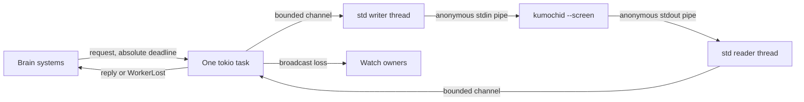
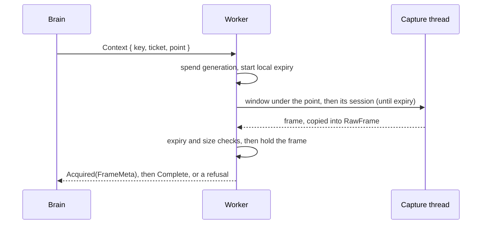

# Screen worker

`kumochid --screen` installs its separate screen log and location-only panic hook before serving
stdin/stdout. It runs the hold protocol's loop (`screen/actor.rs`, below). Request contents and panic payloads never enter logs;
transport failures and foreign errors are numeric codes, not foreign error strings.



The supervisor is the shared one in `supervise`, which also runs the speech worker (see
[voice.md](voice.md), "The speech worker"); this page gives the screen kind's numbers. The task
owns the process, pending replies, request ids and crash history. The last request handle
closing stops it. Pipe threads own their file ends; they end when their channels close and the
worker terminates. The worker inherits exactly two handles through an explicit handle list and is
created inside the brain job, never a run job. Closing the brain job kills it.

Frames use the protocol's 256 KiB data cap before allocation. A request and a reply each carry
serialized body bytes in ordered chunks starting at zero, with one request id throughout, under
64 KiB per screen request and 4 MiB per reply [guess]. A worker that reads a broken request exits.
Unknown ids, gaps, duplicates, empty chunks, chunks after completion, malformed or truncated frames,
trailing bytes and EOF all lose the worker. Sixteen pending requests and sixteen queued frames per
channel bound pressure [guess]; overload fails fast rather than buffering more work. A hostile
worker can therefore make the brain hold up to 16 × 4 MiB of partial replies, plus 16 queued
256 KiB frames, for at most one deadline.

A request can also be streamed (`request_stream`): the worker sends several whole replies under
one id, and the kind's `is_terminal` reply ends it. A plain request requires one terminal reply;
an intermediate reply to it is a protocol break. Every reply of today's screen and speech kinds
is terminal, so they get one reply as before.
A request takes at most 16 messages. A stream also takes at most 12 MiB of serialized replies in
total, counted on every chunk before it is stored, partial messages included; a plain request
keeps its kind's cap. Going over either bound loses the worker, and so does any reply after the
terminal one, whose id is no longer pending. A stream queues 4 whole replies for its reader
[guess]. A reader that falls behind gets `WorkerLost` after the replies already queued: the
supervisor keeps the id and discards its replies until the terminal one or the
deadline. Closing a stream does not itself lose the worker, but its deadline still can.
No reply extends the stream's absolute deadline. A loss ends each stream after the replies it had
already queued. Dropping a stream doesn't tell the
worker yet; the screen kind sends its Drop control with the capture streams that come next.
A hostile worker can make the brain hold up to 16 × 12 MiB of streamed replies for one deadline.

Each request carries its caller's absolute deadline, including queue time; a hold's screen work
stays within the 1.5 s screen budget (`MAX_TTL`) [guess], and fixtures pass their own.
A loss fails all pending operations and requests worker termination. The supervisor then waits
off the async thread, up to 2 s [guess], for the process to exit, and broadcasts
`Exit { generation, confirmed }` and then the loss's `Generation`: the first worker is 0 and each
respawn the next, and every reply names the generation that sent it. `WorkerLost` alone is not
confirmation that the native process exited. The loss broadcast is the one recovery boundary.
Requests that arrive while the exit is confirmed wait in the queue under their absolute deadlines,
as during a respawn, so a caller that retries at once after a failed request isn't refused; the
replacement serves them after the loss. Outside crash backoff, a request made after the loss also
reaches the next worker without a retry. An exit that isn't seen in 2 s is fatal. The supervisor
marks every handle refused before it broadcasts that loss, starts no worker beside one that may
still run, and ends; held requests and every request from then on get `ExitUnconfirmed`
(`WorkerLost::ExitUnconfirmed`, `SpeechError::ExitUnconfirmed`).
The first
two losses respawn immediately; a third within 60 s waits 0.2 s, then 1 s and 5 s for later losses
[guess]. Requests during backoff fail fast. During an in-flight respawn, requests wait for the new
worker under their original absolute deadline; a failed spawn immediately fails its queued callers.
Respawns are serialized and run off the async thread, so process creation cannot delay delivery
of `WorkerLost`; only the first spawn, at startup, runs on it, before anything is served. A loss
after the last handle has closed doesn't respawn, so shutdown can't start a worker in a closing job. Loss history expires at exactly 60 s.

Debug builds accept one-request fault fixtures and `KUMOCHI_SCREEN_FAULT=hang|crash|garbage|panic|exit`.
The environment switch applies on the first request of every respawn, and `exit` before serving; neither path exists in a
release worker. Windows UI Automation supplies the element operation; OCR is not connected.

The macOS platform equivalent is `posix_spawn` file actions for stdio and a process-group kill;
it remains unimplemented and unverified.

## Local shell exclusion

Presence owns a never-published local transaction in `presence/exclusion.rs`; the lease and
its cleanup rules are in `presence/exclusion/machine.rs`, with no GPUI. No production
caller acquires it, and it cannot send HoldRecognized, Include, a ticket or a capture request.
The one private acquisition path snapshots exact native affinity before changing the dock,
hit proxy, status panel, typing panel, threads panel, settings panel and drawing overlay.
Absent lazy panels have no pixels; their create/re-show hooks exclude them after the existing
owner stores the hidden window and before placement can show it. A failed hook leaves the
new window hidden. The zero-area taskbar host and Explorer-owned UI are outside this claim.

Drawing keeps the overlay's `Visibility` recovery lifecycle, paint scratch and paint notices.
Its GPUI surface adapter attaches the drawing receipt before show, including a replacement
window. New drawing windows start capture-allowed because production holds are dormant;
a future activation must acquire the shared exclusion owner before announcing a hold and
retain its receipts until authoritative native retirement, not restore them on key release.

The transaction reads all present prior values before mutation. A failed getter grants nothing;
a failed setter rolls back every potentially changed slot, including that setter's slot.
Rollback and final restoration continue after an error, retaining failed receipts and refusing
another acquisition until cleanup succeeds or the exact original instance is confirmed destroyed.
Receipts keep the original GPUI handle or native owner and a destruction witness, never a delayed
HWND as identity. A recycled native number cannot inherit an old window's snapshot. Failed GPUI
updates retain debt; they are not proof of destruction. Destruction is witnessed by WM_NCDESTROY
or a successful native-owner DestroyWindow, not by pointer-capture loss or owner Drop.

One weak-owner timer carries the full session/input/checked lease-generation key. Its three-second
cleanup is safe only because this local transaction never authorized a native acquisition.
CaptureDone/Failed travel with the actual reader's connection generation; Presence checks its live
session and input before treating them as local cleanup hints. They do not establish native drain.
Connection loss and direct session replacement revoke before accepting another session, retaining
failed cleanup debt; quit attempts bounded cleanup without waiting on a worker or pipe.
No local cleanup sends ExclusionLapsed, so queue acceptance cannot be mistaken for retirement.

Future published grants require both authoritative fencing of every pending/late stage and native
source drain or confirmed worker exit before restoration. Expiry, cancellation, a queued lapse,
link loss and the name of a terminal message prove neither. An already accepted frame keeps its
normal capture lifetime. At most one published lifetime may use a session/CaptureFor pair; an
exposed input cannot be re-leased, and no replacement is allowed over restoration debt. Input
allocation and actual coordinator/worker retirement are later integration work, not implemented
by this dormant transaction. Source regressions do not establish compositor timing or pixel privacy.

## Capture under a ticket

A hold's `Context { key, ticket, point }` takes one frame of the window under `point` into the
worker's `RawFrame` and answers `Acquired(FrameMeta)`, then `Complete`, or a refusal; **pixels
never cross the pipe**. Only the hold's seal exports one image (below).

- **Authority.** `TicketWire` can only be built inside the brain; the hold client mints one per
  capture. The shell's exclusion lease keeps Kumochi's windows out of the frame; the worker can't
  prove that a lease is live.
- **Local validity.** The worker starts the ticket's `ttl_ms` at receipt on its own monotonic
  clock. It refuses at exactly `ttl_ms` and accepts a millisecond before, checks again right
  before starting the capture session, stops waiting at expiry, and discards a frame that
  completes at or after it. This is a local bound, never a renewed grant: the brain keeps its
  ticket's original deadline and drops a late reply.
- **Spent generations.** Every generation at or below the highest one this worker has seen is
  refused (`Reused` when equal, `Stale` when lower), and a failed or refused capture still spends
  its generation. A respawned worker starts empty; the brain's single-use tickets guard across
  workers, and a lost worker's requests are failed, never replayed.
- **Frame validity.** No empty side and no side over 8,192 px. The held image is invalidated
  before every attempt and becomes valid only after a complete copy whose size equals the captured
  window, before expiry. A smaller frame shrinks the logical length, so an old tail is never part
  of the image, while the CPU buffer keeps its allocation for equal or smaller frames after
  warm-up. That says nothing about COM or GPU allocations, which happen per capture. Releasing the
  frame zeroes the buffer's whole capacity with `zeroize` and frees it; the next capture
  allocates afresh.
- **Windows.** One D3D11 device for the worker's life, created on the capture thread's first
  capture, after `GraphicsCaptureSession::IsSupported`. A no there refuses the capture as
  `Unsupported`; an error asking is a fault like any other, and either way the next capture asks
  again. Per ticket: a WGC item for the window, a one-buffer free-threaded pool and a session
  with the cursor off. Border suppression is best-effort: Windows can accept it and still draw its
  yellow border on screen. Frames and the map poll at 1 ms, and a result that is ready at or
  after expiry is released and refused, and nothing late is published. Frame, session and pool
  close once the GPU copy into a staging texture is issued, so the CPU copy runs after capture has
  stopped. All three close on every path; if a close fails the worker
  answers `Fault` and exits, so no capture can keep running. A lost device
  (`DXGI_ERROR_DEVICE_REMOVED`, `_RESET` or `_HUNG`) retires the worker the same way, so the next
  ticket gets a fresh device. Foreign failures are HRESULT codes.
- **macOS.** `SCScreenshotManager` with `desktopIndependentWindow`, not built yet; other platforms
  refuse every capture as `Unsupported`.



## Masking and encoding

The portable pixel path borrows a committed `RawFrame` through `sanitize`. It clips every
`MaskSet` rectangle to the physical display and writes opaque black in place, then lends a
`SanitizedFrame` stamped with the mask generation. An uncommitted frame is refused as stale.
Pixel consumers accept only this sanitized type. Adding a password rectangle bumps the mask
generation; sanitizing again applies all masks idempotently before another encode.

Masks belong to one capture: another capture's mask set is refused as stale. Every sanitized
frame and encoded image carries the capture's mask completeness (`Pending`, `Complete`,
`Partial`, or `Unknown` with an availability reason); an empty set never implies a completed
walk. Both publishing a mask and finishing the walk bump the generation. The first finish wins:
a late `Complete` can't overwrite `Unknown` or `Partial`. Encoded images also
carry their capture id and generation: consumers must never stage a superseded generation.

The platform's write-only `RawFrame::begin` seam remains crate-visible because the adapter
fills it, but invalidates the image before lending its buffer. Read access to a committed image
is restricted to `screen/` through `image_mut` and `sanitize`; sanitized fields are private.
Rust's visibility rules enforce this boundary; no test checks it.

The overview uses exact area weights (a box filter), rounding channel averages to the nearest
byte with halves upward. It fits within 1280×720, preserves the aspect ratio to integer-pixel
rounding, and never enlarges. The focus crop clips to the display, then centres a native-pixel
window within that intersection, capped at 1024×576; it never scales. Empty intersections are
refused. Both encode RGB JPEG at quality 85 through `image`, with no platform encoder.

`CaptureTransform` carries the display origin, DPI, overview size and optional crop rectangle.
Overview coordinates scale per axis to physical desktop pixels; logical coordinates subtract
the display origin and multiply by 96/DPI. Inverse overview mapping rounds to the nearest pixel
(halves away from zero). Crop coordinates add the crop origin. Coordinate spaces have distinct
protocol types; physical-to-overview mapping refuses points outside the display. External
floating-point coordinates must be validated as finite by their first parser. Image Debug
output contains only dimensions, byte counts and mask generations,
and encoding errors expose only a fixed numeric code, never pixels or foreign error text.

Only a hold's seal calls them, and the shell doesn't send screen holds yet. Nothing here captures
another frame.

## Regional OCR

`screen/ocr.rs` accepts only `SanitizedFrame`. Sanitizing records the exact clipped physical
rectangles it painted at that generation; these, not a later independent mask list, filter OCR
words. `OcrRegion` comes from the focus crop's `CaptureTransform` or a readable completed
`ElementTree` window belonging to that capture. Regions clip to the captured display; empty
intersections are refused. There is no display source or fallback, but a maximized window is
valid even when its bounds equal the display.

The portable trigger uses fewer than 20 nonempty named elements [guess], or the exact native
class `Chrome_RenderWidgetHostHWND` of the **focused element's HWND**, not the top-level window.
A6 supplies that metadata and integrates the operation; A5 adds no UIA reads or production
request/reply route. OCR remains disconnected from the worker and exports no content.

One bounded channel (capacity one) feeds a dedicated OS thread. Only that thread creates its
MTA apartment, English WinRT OCR engine, BGRA8 bitmap and recognition operation; no native object
crosses threads. Regional rows retain the capture's BGRA order without a channel swap.
Missing English or a native failure returns fixed `Unavailable`, never foreign
error text. macOS has no adapter yet. The only pixel copy is the selected sanitized region.
Before allocating a native bitmap, oversized regions scale aspect-preservingly to
`OcrEngine::MaxImageDimension`, without enlargement. Small text can be lost at that scale;
tiling is deferred until integration measurements or a user's misses justify it.

Pending masks are refused before recognition. Results retain capture, generation and mask
completeness, including `Partial` and `Unknown`; neither claims full protection. Native floating
word bounds scale back to the region, round outward, clip, and translate to desktop physical
coordinates before any mask intersection. Any intersecting word is removed **before** caps of
2,000 words and 32,768 UTF-8 bytes [guesses]. Byte truncation preserves scalar boundaries and is
reported explicitly. After completion the caller re-locks the shared `MaskSink`; changed capture
or generation (or poison) discards all words and returns content-free `Superseded`. A6 must still
admit only current generations when publishing.

Admission, response and final mask-lock waits observe cancellation, channel EOF and the same
absolute deadline. Pixel copying checks between rows; native operation polling and word extraction
observe the shared stop flag and deadline. An aborted caller retires that recognizer, so a late
reply cannot revive it. A native failure also stays failed for that recognizer's lifetime.
Drop does not join or forcibly kill the native thread; native cancellation
is cooperative and a hung call remains contained by the killable screen worker. A6 owns worker
retirement. All carriers have content-redacted Debug, and errors contain fixed kinds only.

Offline fixtures use synthetic pixels and fake engines, including a blocked engine with a newly
published mask. They cover trigger boundaries, region provenance/clipping, maximized windows,
one pixel over the engine maximum, outward inverse geometry, mask filtering before both caps,
Unicode bounds, completeness, supersession, every caller wait's cancellation/EOF/deadline, closed
engine channels, fixed unavailability, and sentinel-safe diagnostics. They never read real windows,
capture the desktop or run native OCR. An ignored, manually named Windows smoke test checks
that the real recognizer accepts a blank synthetic BGRA bitmap and returns zero words.
It never runs in CI. Real-region recognition and timing need a separately scheduled check.

## Deadline evidence on Rez

CI uses the injected-clock deadline fixture, not a scheduler-speed assertion. Build the integration
binary first with `CARGO_PROFILE_DEV_DEBUG=line-tables-only CARGO_PROFILE_TEST_DEBUG=line-tables-only
nice -n 10 cargo test -p kumochi-brain --test screen --no-run`. Then acquire `runs/measuring.lock`,
wait for no cargo or rustc processes for 30 s (restart on any), and run at normal priority:

```bash
binary=$(ls -t target/debug/deps/screen-*.exe | head -n 1)
"$binary" --exact hang_uses_one_absolute_deadline_and_kills_all_pending_work --ignored --nocapture
```

Remove the lock afterward. The strict fixture asserts 1,500–1,600 ms and prints the measured time;
record Rez's scale with that result.

## The worker's loop

`screen/actor.rs` is the worker's protocol and loop: `kumochid --screen` runs it, and the brain
starts its one screen worker through the hold client. The loop creates a dedicated capture producer; that thread constructs, uses and drops
its non-Send capturer, resolving the window under the hold's point and capturing that window
alone. Only the sole-owned
`RawFrame` and content-free result identity move back to the actor. Capture and UIA each reserve
one completion slot until taken; their nonblocking wakes may coalesce in the bounded inbox.
The actor checks the slots after every event and nearest-expiry/deadline wake.

The Context stream emits only acquisition metadata and completion. Worker-local Drop,
Retire and expiry revoke publication before clearing the frame and mask state. A returning image
is scrubbed/freed rather than published, and a late element tree is taken and discarded. Disposal
acknowledgement waits for both native jobs to finish; stuck or retiring native work cannot
acknowledge. At most 16 controls may wait for disposal, matching the inbox cap; the seventeenth
gets a fixed Busy refusal. Repeated release is idempotent and retains no release history.
Each request is owned by a hold: its shell connection's epoch, then its gesture, ordered in that
order. The worker keeps one high-water retirement fence and refuses any request at or below it, so
a hold with no thread yet still has an identity, and one Retire covers every earlier hold.

The current allocation is zeroized before growing, releasing or dropping a RawFrame. The tests
observe synthetic bytes immediately after scrubbing and before freeing; a plain-fill replacement
remains observationally equivalent in that seam, so optimizer resistance relies on `zeroize`.
The brain's side is the hold client below. OCR and Supersede remain A6c.

## Window under the pointer (dormant)

A screen hold captures one window, not the display. `Capturer::pointer_window` resolves the
window a click at the hold's point would land on, and `Capturer::capture_window` takes one frame
of that window alone, so whatever is stacked above it stays out of the image. Only a hold's
`Context` calls them, and the shell doesn't send screen holds yet.

On Windows the walk reads the top-level z-order from the point. It skips windows whose
rectangle or window region leaves out the point, before it opens any process, then Kumochi's own
windows (the worker, the connected shell and Kumochi images: the same rule the element walk
uses), hidden and cloaked windows, and click-through windows: layered ones with
`WS_EX_TRANSPARENT` or zero constant alpha. `WS_EX_TRANSPARENT` alone doesn't let clicks
through, so such a window is taken like any other. A disabled window is still the target, which
`WindowFromPoint` wouldn't give. Reaching the desktop (`Progman`, `WorkerW`) means `NoWindow`.
The target is that window's `GA_ROOT`.

A layered window drawn by `UpdateLayeredWindow`, or colour-keyed, lets clicks through its
transparent pixels, and no other process can read which those are. For one at the point, the
walk asks `WindowFromPoint`. If the hit is that window, it's the target; if the hit is a window
below it in the z-order, the walk skips it. A hit anywhere else (a window above it that the walk
skipped, such as Kumochi's, or none) says nothing about the drawn window, and `WindowFromPoint`
skips disabled windows, so in those cases the walk refuses with `Ambiguous` rather than capture
a blank overlay or the window under it. The probe saw no message sent to the drawn window's
process, and no wait while that process was hung.

Before any pixels, the target is refused when it's minimised, cloaked, Kumochi's, elevated (a
process the worker can't open counts as elevated; for a UWP frame the hosted core window's
process is checked too) or capture-protected by display affinity. The resolved `Target` keeps the
window, its pid, a second identity word (the creating thread on Windows), its DPI and its extended
frame bounds, which are the frame's origin and size. Capture creates a `GraphicsCaptureItem` for
the window, checks the same identity again, and requires the item's size to equal the frame
bounds. The window closing, being minimised, cloaked or capture-protected, or any change to its
identity, frame or DPI before the pixels are read, refuses with `WindowChanged`; so does an item
that can't be created for a window that has since changed. Every failed capture zeroes and frees
the frame before it returns (`RawFrame::fill`).

`platform::windows::window::tests::native_window_probe` is an ignored native check over sentinel
windows owned by a second test process (the worker's own windows count as Kumochi's). It covers
the occluder, click-through, disabled, region and drawn-overlay cases, the desktop stop, the
frame origin against a password edit, and the refusals, including a window that changes after
the walk. It opens topmost windows on the main display for a few seconds, so run it on an idle Windows
desktop:

```
cargo test -p kumochi-brain --lib native_window_probe -- --ignored --exact --nocapture
```

## Sealing a hold's image (dormant)

A hold's `Context` carries the hold's point. The
capture thread resolves the window under it and captures that window alone. A refusal or a fault
answers that hold only: there is no screen for it, and the same capturer serves the next hold.
Only `Retire` ends the worker.

A hold walks with `Walk { key }`: the same walk as `Elements` on the captured window, but the
tree stays in the worker for the seal's masks, and only `Walked(key, Completeness)` comes back,
so no window text reaches the brain.

After the element walk, `Seal` hands out the hold's one image as a `ScreenContext`: the frame
masked and encoded as an overview JPEG, with its `CaptureTransform`. It seals only when the
hold's one walk read the captured window itself (its window and process) and found every
password mask, and refuses with `Unmasked` otherwise. Then, before masking, it checks on the
serve thread that the window is still the one captured: the same process and creating thread,
frame and DPI, and not minimised, cloaked or capture-protected. Anything else refuses with
`WindowChanged`. A closed window fails that check at once. The frame is scrubbed and freed
whatever the answer, so a second `Seal` is `Stale`.

The check's limit: a window destroyed and replaced between the capture and `Seal` by another
with the same handle value, process, creating thread, frame and DPI would pass. Handle values are
said to carry a reuse counter, which isn't documented. Off Windows, no window is ever unchanged.

The JPEG is capped at 2 MiB (`JPEG_CAP`), a guess until real windows are measured. The encoder
writes into one buffer allocated at the cap, so growth never copies it, and an image over the cap
refuses with `TooLarge`; it is never downscaled further. `TooLarge`, `Unmasked` and
`Ambiguous` are ordinary refusals.

The JPEG's bytes are user content. `ScreenContext` zeroes them on drop and its Debug prints only
the byte count and size. The encoder's buffers (the resampled RGB and the JPEG) are zeroed on
drop, errors included. Nothing writes the bytes to a log, a file or a store.

**Copies of a reply.** A screen reply can carry window text or the image, so the screen worker
and the brain keep no copy of one they don't zero:

- The worker writes with `write_sized`: the message is sized first and serialized into one
  zeroing buffer of that size, and its frames, each up to 262,080 body bytes, are encoded into
  one zeroing buffer that fits the largest, so nothing grows. It writes to an unbuffered stdout
  (`platform::raw_stdout`, a duplicate of the handle), not the standard library's line buffer.
- The brain reads the screen kind's replies with `Zeroed`: each frame into a zeroing buffer of
  its own length, and each chunk's body, read as one byte string into a buffer of exactly its
  length, into a `ZeroedBody`, which zeroes itself when dropped. So a chunk is zeroed wherever
  it ends: once copied, refused for no pending request or over budget, unsent by the reader
  thread, or still queued when a worker is lost. A frame that fails to decode partway leaves no
  partly filled copy. A reply of several chunks is put together in one zeroing buffer allocated
  at the 4 MiB reply cap when its first chunk arrives, so it never grows; each such reply pays a
  4 MiB clear when it's dropped. A reply of one chunk is decoded from that chunk.
- `ScreenContext`'s JPEG is sent as one byte string, the same bytes as before, and received
  with one exact allocation. A received context is registered for dump exclusion like the
  worker's.

Speech replies and the shell pipe keep their plain framing (`Assembly`, `write_message`).

What's beyond reach: the kernel's pipe buffers between the worker and the brain, the TLS
library's buffers of plaintext not yet sent, the socket's buffers (ciphertext), and paging,
since no buffer is page-locked.

On Windows, a frame's pixel buffer and the sealed JPEG are each registered with
`WerRegisterExcludedMemoryBlock` while they hold content. That keeps the block out of Windows
Error Reporting's reports only: not out of dumps a debugger or another tool takes, nor out of a
system memory dump, and a process can register only a limited number of blocks. A frame's buffer
stays registered while it's reused and is unregistered once zeroed, before it's freed. The JPEG is
registered once encoding finishes, and the resampled RGB never is; both live only for the encode.
In the brain only the decoded `ScreenContext` is registered: a reply's frame buffer, chunk body
and 4 MiB assembly buffer aren't excluded while they hold it, which lasts until it's decoded.
The registration is in-process only. When Windows refuses it, capture carries on, and that
buffer's contents can appear in an error report written while it holds them.

Chromium's control view can miss a rendered page's fields. Every `Chrome_RenderWidgetHostHWND`
element the walk passes through starts a page, and each page needs 20 named elements of its own
among those the walk stored; otherwise the masks are `Partial` and the hold doesn't seal. A page
first reached after the walk's element or byte cut has none stored, so it's `Partial` too, and a
large page the walk cuts short refuses for now. The threshold is a guess until a real page is
measured.

## The brain's hold client (dormant)

`screen/client.rs` is the brain's side of the worker's loop, for one hold's frame. The brain
starts its one screen worker with `HoldClient::start` and gives the client to screen holds. A
worker that can't start doesn't stop the brain: screen holds get no client, so the gate reads
`Unsupported` for the session, and voice holds go on as before. Only a screen hold's task calls
the client, and the shell doesn't send screen holds yet. It speaks to the worker through the
shared supervisor as its own kind, `Holds`, with the screen worker's argument and caps, the
actor's messages and the zeroing reply reader. The image gate takes the platform's
`WINDOW_CAPTURE` as well as the client, so off Windows it reads `Unsupported` even though the
client starts.

Whether this system can capture a window is the worker's answer, not the brain's. The worker
asks when it opens its capturer, on a hold's first capture, and a no comes back as the
`Unsupported` refusal. That hold ends `NotReady`, with no image and no line beyond what
`NotReady` gives. The brain then clears its window capture flag until the brain restarts, across
shell reconnects, and sends the gate once as `Off(Unsupported)`. Nothing turns the flag back on,
so a settings write, a catalog change or a worker restart leaves it off. Until that first hold
the gate reads `On` on a system that can't capture. The brain doesn't ask itself because its
start-up runs on the process's main thread (a current-thread runtime under `block_on`): a WinRT
call there joins that thread to the process's implicit MTA, and nothing in the brain process
picks a COM apartment today. UI Automation and OCR run in the screen worker. A cold ask also
costs about 27 ms in a dry run (debug build, not under the measuring lock), which only a screen
hold pays this way.

- **`context(owner, point, until)`** mints a fresh capture id and a ticket whose number is above
  every earlier one (a worker refuses a number it has already spent), minted under the fence's
  lock so tickets reach the worker in order, with `ttl_ms` set to the time left until `until`
  but never over `MAX_TTL`, a random nonce and the connected shell's pid. It streams
  `Acquired`, then `Complete`, and returns the `Held` frame with the worker generation that
  holds it.
- **`walk(held)`** and **`seal(held)`** answer only when that same generation replies, for that
  same key. Anything else is `Lost`: a replacement holds nothing. A `Sealed` for another key is
  dropped, which zeroes it.
- **Fences across respawn.** The worker's retirement fence ends with its process, so the client
  keeps its own: `retire(owner)` raises it first, and a `context` for a hold at or below it is
  refused `Stale` without being sent.
- **Release waits and termination.** `retire(owner, holder, until)` returns once the worker answers
  `Released` for that owner, from the holder or a later generation, or any answer from a later
  generation, since a later worker means the holder's exit was seen. A worker that answers anything else may still hold a frame, and so
  may the holder when the supervisor can't take the retire (a full queue, a loss), so that worker
  is ended and its confirmed exit is the release. An unconfirmed exit, or neither by `until`, is `Unreleased`;
  the worker's own ticket expiry still clears the frame.

There's no brain-side `Drop`. A hold that closes normally sends `Retire`. One that closes without
it (a panic, an aborted task, a dropped `context`) leaves its frame to the ticket's expiry, which
`context` caps at the screen budget (`MAX_TTL`, 1.5 s). So `Unreleased` means only that the release
wasn't shown, and callers never treat it as fatal.

**The hold's screen part** (`runtime/hold/screen.rs`) is `None` for a voice hold. A
`HoldRecognized` goes through the voice hold's admission first, so it's refused, or admitted as a
hold, exactly as a voice hold would be; one that repeats a voice hold's gesture is refused and adds
no part to that hold. Then the image gate is checked again, on the default model,
with the brain's worker client standing in for capture: the shell's `On` may be out of date. If
it's open, the part starts at `Waiting` and its task starts; otherwise `CaptureFailed` releases
the shell's exclusion lease and the hold goes on as voice, with no line for the model. When the
thread's own choice is read, the gate runs once more on it, and a closed gate closes the part with
its own reason: `ModelCantSee` for a model that can't be sent images, `NotReady` for no catalog or
no choice, and no line at all (`Discarded`) when the user switched screen holds off. The frame is
retired and any image zeroed either way. The gate opens only on the default model, so a thread pinned
to a model that can see goes voice-only while the default can't: a known limit.

The task runs `context`, `walk` and `seal` within the screen budget (`MAX_TTL`). It never
touches the part. Each answer comes back as a `ScreenEvent` keyed by the hold and the worker
generation, on a channel the brain's hold loop selects beside audio and decoding:
- `Held` fills in the part's generation, and sends `CaptureDone`, which releases the lease. A
  capture that ends without a frame sends `CaptureFailed` instead.
- `Sealed` makes a waiting part with the same generation `Ready`. `Closed` gives it the class
  of the answer that ended it.
- Anything for a hold that isn't pending, a part that isn't `Waiting` or another generation is
  dropped: an image zeroes, and a `Held` is retired on the worker that holds it.

Every closer sets the part's stop flag. The task checks it before `walk` and before `seal`, and
retires its frame instead of going on. A refusal after `Held` retires before it's reported, so the
worker never keeps a frame for a part that has ended. A lapse of the part's own lease before its
frame is captured closes it as `NotReady`, since a later frame can't be said to exclude Kumochi's
windows; after `CaptureDone`, or for any other lease, a lapse is ignored.

| Class | Worker answers |
|---|---|
| `NotReady` | `Expired`, `Unsupported` (which also turns screen holds off until the brain restarts, below), `Busy`, a fault, a loss or the deadline, a lapsed lease, or still `Waiting` when the words are; `Reused` too, with a `debug_assert`, because only a brain bug sends it |
| `NothingThere` | `NoWindow` |
| `CantShare` | `Minimized`, `Cloaked`, `Elevated`, `Protected`, `Excluded` |
| `Unreadable` | `Unmasked`, `Ambiguous` |
| `TooLarge` | `TooLarge`, and `Invalid`, which a window over 8,192 pixels on a side gets |
| `Changed` | `WindowChanged`, `DisplayChanged`, `Stale` |
| `ModelCantSee` | none: the thread's own model failed the gate |

Every way a hold ends reaches the part through one of two places:
- the hold's invalidation, which covers cancel and Esc, a turn, an Ask, `ShellLost`, a model or
  default change, a delete, a connection change, hold-to-talk off, a timeout and session loss;
- taking the hold.

A `Waiting` part may still hold a frame in the worker, so closing it leaves `Closed(NotReady)` and
spawns `retire` with the worker that captured, if one answered. A `Ready` part closed this way
becomes `Discarded`: its context drops, which zeroes it. Closing is idempotent, so a hold that's
invalidated and then taken sends one `Retire`. When the transcript is ready, the part is handed to
the run before the hold is taken: a waiting part closes first, a ready context moves into the run's
image with its dump registration and no copy, and a closed part's class goes with the run (engines.md,
"A held run's screen"). A `debug_assert` in the hold's `Drop` fails tests when a hold ends with its
part still `Waiting` or `Ready`.

## Portable element data and walk

The control-view data and walk run under capture authority on a bounded reader thread.
On Windows, the source creates `CUIAutomation8` in that thread's MTA, with 100 ms connection
and transaction timeouts. A control-view walker builds a per-node cache of name, control type,
physical bounds and password/offscreen flags. Password and offscreen names are not fetched
from that cache. Root handles are checked for top-level visibility and ownership before the UIA
lookup, and the native window owner is checked again after it. The worker and the
connected shell are excluded by pid, with Kumochi process-image names also excluded by the
portable policy. Other platforms return E_NOTIMPL. In production only a hold's `Walk` runs it;
nothing sends `Elements`.

One pre-order walk retains at most 512 elements, depth 16, 128 characters per name and 60,000
bytes of element JSON (commas and the reply envelope are additional). The byte cap usually binds
first. A cut records Elements, Depth, Bytes,
Budget or Provider; a hard stop replaces an earlier Depth cut. Capture-scoped ids (`c12.e7`)
carry physical desktop and window-relative rectangles from the same cached properties. Names
never appear in Debug or errors. Each name is copied once at its exact length, its JSON size is
counted against the byte cut without building the JSON, and it's zeroed when its element, or the
walk's node properties, drop. So the tree's own strings leave no window text behind. The platform's
strings aren't covered: UIA's `BSTR`, and `name()`'s conversion on Windows, which collects
`decode_utf16` into a `String` that grows. Names outside the captured display are empty. Password names are discarded, their rectangles are published
immediately, and password subtrees are never descended into.

A source validates the root window and pid and returns its owning pid; the portable layer rejects
roots off the captured display and excludes Kumochi's process-image names case-insensitively for
every target, including Foreground. Each capture owns a fresh mask sink with its capture id,
generation and completeness. Publishing a rectangle and the first finish both advance generation.
After a Bytes or Elements text cut, mask-only discovery continues on the remaining stack, using
at most 2,048 additional reads [guess] and the same deadline. Finishing that discovery can leave masks
Complete despite the text cut. Depth skips, provider failures, deadline/read-cap exhaustion and
password rectangles with a zero side leave masks Partial, retaining all published rectangles.
Unavailability is Unknown. Elevated, Busy, Excluded and NoWindow mean masks are unknown, never that nothing
needs masking: image consumers must withhold or flag those frames, not call them fully masked.

Offline fake-source fixtures cover exact limits, Unicode names, provider/budget cuts, relative
geometry, excluded roots and password/descendant sentinels. Reader fixtures use real threads and
clocks, but never read real windows or measure platform calls. There is no cancel operation yet;
worker authority and late/hung-thread handling are described below.

The ignored owner-run UIA smoke/timing checks require explicit `UIA_TEST_HWND` and
`UIA_TEST_PID` values; they never select the foreground or launch an application. An
outside-repo wrapper owns the fixture or newly launched Settings process and its cleanup.
The `test-support` feature exposes `WindowSession` and `WindowProbe` for a release worker
that measures the actual bounded reader, serializes the complete tree in memory and discards it.
Cold samples use separate worker processes and UIA objects; warm samples retain one process
and discard its first walk. The first check gap includes lazy UIA setup; a walk with no checks
reports its entire duration as both the longest unchecked gap and the tail. The harness reports only
structural counts and timings: text and mask reads, navigation-call count, deadline-check count,
the longest interval between deadline checks, and the tail interval from the last check to
completion. It never reports window names, element text, rectangles or captured content.
The first walk is timed separately through the bounded reader, including lazy UIA initialization;
the second walk uses the same initialized source. Initialization remains lazy until measurement
justifies changing it. A COM guard balances initialization even if later setup fails or unwinds.
The source's root pid is the native window owner's pid, matching foreground pinning, not the UIA
provider process, which can differ for hosted UWP content. The second ignored check verifies
that contract for the explicitly supplied Settings root. Live checks belong only to an
owner-approved session; short unlocked dry runs do not qualify as timing measurements.

## Capture-scoped element operation

`Walk { key }` and `Elements { key, target }` spend the held frame's walk once, including refused
or unavailable attempts. Another hold's key is Stale and spends nothing; a second attempt for the
held capture is Reused. Each new `Context` drops authority and installs a fresh mask sink before
checking its ticket, so refused captures leave no walkable frame and late writes reach only the
old sink.

A `Context` pins the window it resolved under the pointer: its top-level window, pid and physical
rectangle. Foreground walks use that pin; explicit Window targets carry a pid too. Portable walks
reject a root whose pid differs from that hint as NoWindow; the source must also recheck native
root visibility and ownership before reading. A walk must start before both ticket expiry and
frame arrival + 250 ms [guess]; its deadline is the earliest of those two and start + 120 ms [guess].

One disposable thread constructs and owns the non-Send platform source. Both channels have one
slot, sends never block, and jobs/replies carry capture ids. `begin` hands the thread a job
without waiting and `poll` takes its completion. A `begin` while a job is pending, even one
whose completion landed and wasn't taken, retires the reader rather than queue a second job or
drop that completion, so the reply slot never fills. The reader opener takes a wake that the
thread calls after each completion lands; it never blocks, and a dropped wake leaves the
completion in its slot for `poll`; the actor's loop is the listener. The window is resolved on
the capture side, never on this thread, so a stuck walk can't delay the next capture. The actor
waits for a walk until its cooperative deadline plus 200 ms (100 ms connection + 100 ms
transaction timeouts), then ends the worker. A dead thread or poisoned sink replies Busy and
retires. Drop never joins the provider thread.

A reader-opener failure does not discard a successfully acquired frame. Its walk publishes
Unknown(Busy) and reports the numeric fault, and the worker keeps serving holds without element
reads until it's replaced: the actor opens its reader once. The reader thread discards a failed
source initialization and retries it for the next walk; a successfully initialized source stays on
that thread. Neither retry replays a spent walk or renews capture authority.

The hold client accepts only a `Walked` answer for its own hold from the worker that holds the
frame. Refusals pass through; any other answer is a loss. There is no cancel operation yet;
new captures replace authority and the mask sink, and worker termination tears down stuck threads.
No live window is read by the fake-source tests; they do not verify native UIA behavior or timing.
