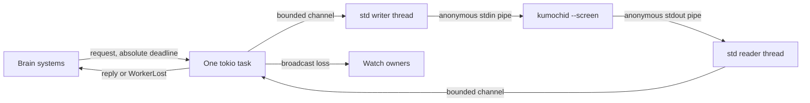

# Screen worker

`kumochid --screen` installs its separate screen log and location-only panic hook before serving
stdin/stdout. It currently answers Ping only. Request contents and panic payloads never enter logs;
transport failures and foreign errors are numeric codes, not foreign error strings.



The task owns the process, pending replies, request ids and crash history. The last request handle
closing stops it. Pipe threads own their file ends; they end when their channels close and the
worker terminates. The worker inherits exactly two handles through an explicit handle list and is
created inside the brain job, never a run job. Closing the brain job kills it.

Frames use the protocol's 256 KiB data cap before allocation. A reply carries serialized body bytes
in ordered chunks starting at zero, with one request id throughout, under 4 MiB per reply [guess].
Unknown ids, gaps, duplicates, empty chunks, chunks after completion, malformed or truncated frames,
trailing bytes and EOF all lose the worker. Sixteen pending requests and sixteen queued frames per
channel bound pressure [guess]; overload fails fast rather than buffering more work.

Each request has one 1.5 s absolute deadline [guess], including queue time; fixtures can inject it.
A loss terminates the worker, fails all pending operations and broadcasts `WorkerLost`. The first
two losses respawn immediately; a third within 60 s waits 0.2 s, then 1 s and 5 s for later losses
[guess]. Requests during backoff fail fast. During an in-flight respawn, requests wait for the new
worker under their original absolute deadline; a failed spawn immediately fails its queued callers.
Spawns are serialized and run off the async thread, so process creation cannot delay delivery of
`WorkerLost`. Loss history expires at exactly 60 s.

Debug builds accept one-request fault fixtures and `KUMOCHI_SCREEN_FAULT=hang|crash|garbage|panic`.
The environment switch applies on the next request of every respawn; neither path exists in a
release worker. No capture, UI Automation or OCR is implemented here yet.

The macOS platform equivalent is `posix_spawn` file actions for stdio and a process-group kill;
it remains unimplemented and unverified.

## Deadline evidence on Rez

CI uses the injected-clock deadline fixture, not a scheduler-speed assertion. Build the integration
binary first with `CARGO_PROFILE_DEV_DEBUG=line-tables-only CARGO_PROFILE_TEST_DEBUG=line-tables-only
nice -n 10 cargo test -p kumochi-brain --test screen --no-run`. Then acquire `runs/measuring.lock`,
wait for no cargo or rustc processes for 30 s (restart on any), and run at normal priority:

```bash
binary=$(ls -t target/debug/deps/screen-*.exe | head -n 1)
"$binary" --exact hang_uses_one_absolute_deadline_and_kills_all_pending_work --ignored --nocapture
```

Remove the lock afterward. The strict fixture asserts 1,500–1,600 ms and prints the measured time;
record Rez's scale with that result.
