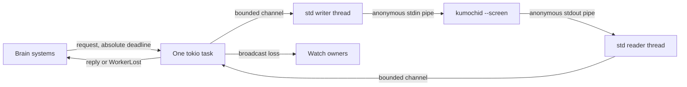
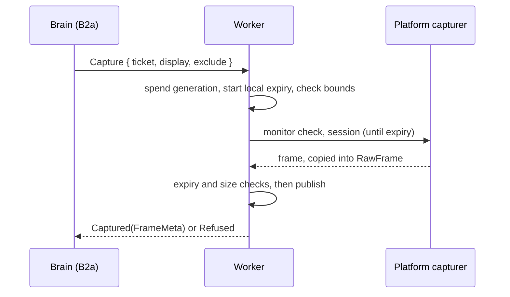

# Screen worker

`kumochid --screen` installs its separate screen log and location-only panic hook before serving
stdin/stdout. It answers Ping and Capture (below). Request contents and panic payloads never enter logs;
transport failures and foreign errors are numeric codes, not foreign error strings.



The supervisor is the shared one in `supervise`, which also runs the speech worker (see
[voice.md](voice.md), "The speech worker"); this page gives the screen kind's numbers. The task
owns the process, pending replies, request ids and crash history. The last request handle
closing stops it. Pipe threads own their file ends; they end when their channels close and the
worker terminates. The worker inherits exactly two handles through an explicit handle list and is
created inside the brain job, never a run job. Closing the brain job kills it.

Frames use the protocol's 256 KiB data cap before allocation. A request and a reply each carry
serialized body bytes in ordered chunks starting at zero, with one request id throughout, under
64 KiB per screen request and 4 MiB per reply [guess]. A worker that reads a broken request exits.
Unknown ids, gaps, duplicates, empty chunks, chunks after completion, malformed or truncated frames,
trailing bytes and EOF all lose the worker. Sixteen pending requests and sixteen queued frames per
channel bound pressure [guess]; overload fails fast rather than buffering more work. A hostile
worker can therefore make the brain hold up to 16 × 4 MiB of partial replies, plus 16 queued
256 KiB frames, for at most one deadline.

Each request has one 1.5 s absolute deadline [guess], including queue time; fixtures can inject it.
A loss terminates the worker, fails all pending operations and broadcasts `WorkerLost`. The first
two losses respawn immediately; a third within 60 s waits 0.2 s, then 1 s and 5 s for later losses
[guess]. Requests during backoff fail fast. During an in-flight respawn, requests wait for the new
worker under their original absolute deadline; a failed spawn immediately fails its queued callers.
Respawns are serialized and run off the async thread, so process creation cannot delay delivery
of `WorkerLost`; only the first spawn, at startup, runs on it, before anything is served. A loss
after the last handle has closed doesn't respawn, so shutdown can't start a worker in a closing job. Loss history expires at exactly 60 s.

Debug builds accept one-request fault fixtures and `KUMOCHI_SCREEN_FAULT=hang|crash|garbage|panic`.
The environment switch applies on the next request of every respawn; neither path exists in a
release worker. No UI Automation or OCR is implemented here yet.

The macOS platform equivalent is `posix_spawn` file actions for stdio and a process-group kill;
it remains unimplemented and unverified.

## Capture under a ticket

`Capture { ticket, display, exclude }` takes one frame of one physical display into the worker's
`RawFrame` and answers `Captured(FrameMeta)` or `Refused`; **pixels never cross the pipe**. A4
encodes them and A6 decides what leaves the worker; nothing here sends them anywhere, and there's
no operation that reads or exports them.

- **Authority.** `TicketWire` can only be built inside the brain, and B2a's ticket book is the only
  minter: from a recognized hold or an Include send, under a live exclusion lease. Until B2a
  lands, nothing in production sends `Capture`. `Exclusion::KumochiWindows` is a declaration the
  caller makes because it holds the shell's lease, not proof of one.
- **Local validity.** The worker starts the ticket's `ttl_ms` at receipt on its own monotonic
  clock. It refuses at exactly `ttl_ms` and accepts a millisecond before, checks again right
  before starting the capture session, stops waiting at expiry, and discards a frame that
  completes at or after it. This is a local bound, never a renewed grant: the brain keeps its
  ticket's original deadline and drops a late reply.
- **Spent generations.** Every generation at or below the highest one this worker has seen is
  refused (`Reused` when equal, `Stale` when lower), and a failed or refused capture still spends
  its generation. A respawned worker starts empty; the brain's single-use tickets guard across
  workers, and a lost worker's requests are failed, never replayed.
- **Frame validity.** Bounds are checked before anything is allocated: no empty side, no side over
  8,192 px, no edge outside `i32`. The held image is invalidated before every attempt and becomes
  valid only after a complete copy whose size equals the requested display, before expiry. A
  smaller frame shrinks the logical length, so an old tail is never part of the image, while the
  CPU buffer keeps its allocation for equal or smaller frames after warm-up. That says nothing
  about COM or GPU allocations, which happen per capture.
- **Windows.** One D3D11 device for the worker's life, created on the first capture on the serve
  thread. Per ticket: the monitor must have exactly the requested physical bounds
  (per-monitor-v2 DPI awareness), then a WGC item, a one-buffer free-threaded pool and a session
  with the cursor off. Border suppression is best-effort: Windows can accept it and still draw its
  yellow border on screen. Frames and the map poll at 1 ms, and a result that is ready at or
  after expiry is released and refused, and nothing late is published. Frame, session and pool
  close once the GPU copy into a staging texture is issued, so the CPU copy runs after capture has
  stopped. All three close on every path; if a close fails the worker
  answers `Fault` and exits, so no capture can keep running. A lost device
  (`DXGI_ERROR_DEVICE_REMOVED`, `_RESET` or `_HUNG`) retires the worker the same way, so the next
  ticket gets a fresh device. Foreign failures are HRESULT codes.
- **macOS.** `SCScreenshotManager` with Kumochi excluded from the content filter, not built yet;
  other platforms answer `Fault` with `E_NOTIMPL`'s code.
- The supervisor's `capture` accepts only a `Captured` for its own capture id and display, maps
  `Refused` through, and treats any other reply as `WorkerLost`.



## Deadline evidence on Rez

CI uses the injected-clock deadline fixture, not a scheduler-speed assertion. Build the integration
binary first with `CARGO_PROFILE_DEV_DEBUG=line-tables-only CARGO_PROFILE_TEST_DEBUG=line-tables-only
nice -n 10 cargo test -p kumochi-brain --test screen --no-run`. Then acquire `runs/measuring.lock`,
wait for no cargo or rustc processes for 30 s (restart on any), and run at normal priority:

```bash
binary=$(ls -t target/debug/deps/screen-*.exe | head -n 1)
"$binary" --exact hang_uses_one_absolute_deadline_and_kills_all_pending_work --ignored --nocapture
```

Remove the lock afterward. The strict fixture asserts 1,500–1,600 ms and prints the measured time;
record Rez's scale with that result.

## Portable element data and walk

The control-view data and walk are implemented independently of the worker operation; A3a2
connects them to capture authority and a bounded reader thread, and A3b supplies Windows UIA.
Nothing in production calls the walk yet, and no new worker operation is served by this layer.

One pre-order walk retains at most 512 elements, depth 16, 128 characters per name and 60,000
bytes of element JSON. The byte cap usually binds first. A cut records Elements, Depth, Bytes,
Budget or Provider; a hard stop replaces an earlier Depth cut. Capture-scoped ids (`c12.e7`)
carry physical desktop and window-relative rectangles from the same cached properties. Names
never appear in Debug or errors. Password names are discarded, their rectangles are published
immediately, and password subtrees are never descended into.

A source validates the root window and pid and returns its owning pid; the portable layer rejects
roots off the captured display and excludes Kumochi's process-image names case-insensitively for
every target, including Foreground. Each capture owns a fresh mask sink with its capture id,
generation and completeness. Publishing a rectangle and finishing
the walk both advance generation. A full walk is Complete unless a password rectangle has a zero
side, which leaves masks Partial while retaining that rectangle. A cut is Partial, and unavailability
is Unknown. Elevated, Busy, Excluded and NoWindow mean masks are unknown, never that nothing
needs masking: image consumers must withhold or flag those frames, not call them fully masked.

Offline fake-source fixtures cover exact limits, Unicode names, provider/budget cuts, relative
geometry, excluded roots and password/descendant sentinels. No real window or platform timing
is exercised by these tests. Cancellation, worker authority and late/hung-thread handling belong
to A3a2/A6 rather than this portable walk.
