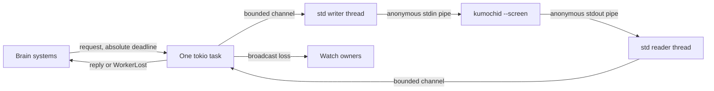
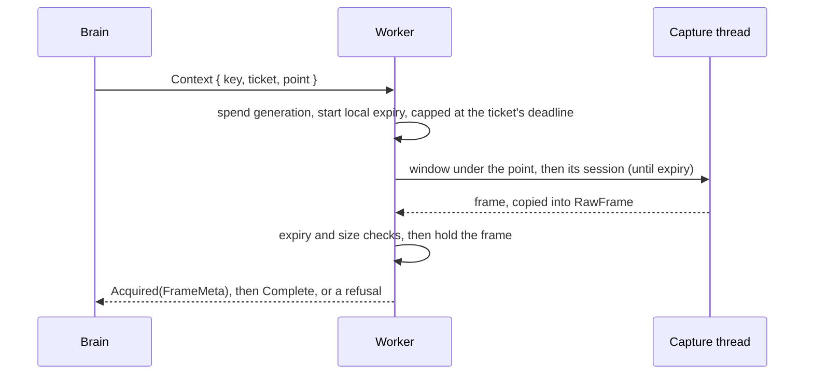

# Screen worker

`kumochid --screen` installs its separate screen log and location-only panic hook before serving
stdin/stdout. It runs the hold protocol's loop (`screen/actor.rs`, below). Request contents and panic payloads never enter logs;
transport failures and foreign errors are numeric codes, not foreign error strings.



The supervisor is the shared one in `supervise`, which also runs the speech worker (see
[voice.md](voice.md), "The speech worker"); this page gives the screen kind's numbers. The task
owns the process, pending replies, request ids and crash history. The last request handle
closing stops it. Pipe threads own their file ends; they end when their channels close and the
worker terminates. The worker inherits exactly two handles through an explicit handle list and is
created inside the brain job, never a run job. Closing the brain job kills it.

Frames use the protocol's 256 KiB data cap before allocation. A request and a reply each carry
serialized body bytes in ordered chunks starting at zero, with one request id throughout, under
64 KiB per screen request and 4 MiB per reply [guess]. A worker that reads a broken request exits.
Unknown ids, gaps, duplicates, empty chunks, chunks after completion, malformed or truncated frames,
trailing bytes and EOF all lose the worker. Sixteen pending requests and sixteen queued frames per
channel bound pressure [guess]; overload fails fast rather than buffering more work. A hostile
worker can therefore make the brain hold up to 16 × 4 MiB of partial replies, plus 16 queued
256 KiB frames, for at most one deadline.

A request can also be streamed (`request_stream`): the worker sends several whole replies under
one id, and the kind's `is_terminal` reply ends it. A plain request requires one terminal reply;
an intermediate reply to it is a protocol break. Every reply of today's screen and speech kinds
is terminal, so they get one reply as before.
A request takes at most 16 messages. A stream also takes at most 12 MiB of serialized replies in
total, counted on every chunk before it is stored, partial messages included; a plain request
keeps its kind's cap. Going over either bound loses the worker, and so does any reply after the
terminal one, whose id is no longer pending. A stream queues 4 whole replies for its reader
[guess]. A reader that falls behind gets `WorkerLost` after the replies already queued: the
supervisor keeps the id and discards its replies until the terminal one or the
deadline. Closing a stream does not itself lose the worker, but its deadline still can.
No reply extends the stream's absolute deadline. A loss ends each stream after the replies it had
already queued. Dropping a stream doesn't tell the
worker yet; the screen kind sends its Drop control with the capture streams that come next.
A hostile worker can make the brain hold up to 16 × 12 MiB of streamed replies for one deadline.

Each request carries its caller's absolute deadline, including queue time; a hold's screen work
stays within the 1.5 s screen budget (`MAX_TTL`) [guess], and fixtures pass their own.
A loss fails all pending operations and requests worker termination. The supervisor then waits
off the async thread, up to 2 s [guess], for the process to exit, and broadcasts
`Exit { generation, confirmed }` and then the loss's `Generation`: the first worker is 0 and each
respawn the next, and every reply names the generation that sent it. `WorkerLost` alone is not
confirmation that the native process exited. The loss broadcast is the one recovery boundary.
Requests that arrive while the exit is confirmed wait in the queue under their absolute deadlines,
as during a respawn, so a caller that retries at once after a failed request isn't refused; the
replacement serves them after the loss. Outside crash backoff, a request made after the loss also
reaches the next worker without a retry. An exit that isn't seen in 2 s is fatal. The supervisor
marks every handle refused before it broadcasts that loss, starts no worker beside one that may
still run, and ends; held requests and every request from then on get `ExitUnconfirmed`
(`WorkerLost::ExitUnconfirmed`, `SpeechError::ExitUnconfirmed`).
The first
two losses respawn immediately; a third within 60 s waits 0.2 s, then 1 s and 5 s for later losses
[guess]. Requests during backoff fail fast. During an in-flight respawn, requests wait for the new
worker under their original absolute deadline; a failed spawn immediately fails its queued callers.
Respawns are serialized and run off the async thread, so process creation cannot delay delivery
of `WorkerLost`; only the first spawn, at startup, runs on it, before anything is served. A loss
after the last handle has closed doesn't respawn, so shutdown can't start a worker in a closing job. Loss history expires at exactly 60 s.

Debug builds accept one-request fault fixtures and `KUMOCHI_SCREEN_FAULT=hang|crash|garbage|panic|exit`.
The environment switch applies on the first request of every respawn, and `exit` before serving; neither path exists in a
release worker. Windows UI Automation supplies the element operation; OCR is not connected.

The macOS platform equivalent is `posix_spawn` file actions for stdio and a process-group kill;
it remains unimplemented and unverified.

## Local shell exclusion

Presence owns the exclusion transaction in `presence/exclusion.rs`; the lease and
its cleanup rules are in `crates/shell-core/src/presence/exclusion/machine.rs`, with no GPUI.
Its one production caller is a screen hold's release (`Presence::release_screen` in
`presence/voice.rs`): the lease is taken when the keys come up, after the standing notice was
asked once more, and its generation goes to the brain in `ScreenRelease` with the counter
reading taken once the last surface was excluded (`acquire_stamped`). It sends no Include,
ticket or capture request.
The native callback's delivery (`presence/gesture.rs`) applies its effects inside the dock
window's update and runs its intents when that update has ended. GPUI takes a window out of its
table while updating it, so an acquisition made inside the dock's update can't reach the dock
and is refused. A hold refused its lease goes on voice only, and its line says "Screen not
included: the screen wasn't ready".
The acquisition path snapshots exact native affinity before changing the dock,
hit proxy, status panel, typing panel, threads panel, settings panel and drawing overlay.
Absent lazy panels have no pixels; their create/re-show hooks exclude them after the existing
owner stores the hidden window and before placement can show it. A failed hook leaves the
new window hidden. The zero-area taskbar host and Explorer-owned UI are outside this claim.

Drawing keeps the overlay's `Visibility` recovery lifecycle, paint scratch and paint notices.
Its GPUI surface adapter attaches the drawing receipt before show, including a replacement
window. A drawing window made while no lease is in force starts capture-allowed; one made or
shown under a lease is excluded before it shows. Receipts are restored when the lease ends,
never on key release.

The transaction reads all present prior values before mutation. A failed getter grants nothing;
a failed setter rolls back every potentially changed slot, including that setter's slot.
Rollback and final restoration continue after an error, retaining failed receipts and refusing
another acquisition until cleanup succeeds or the exact original instance is confirmed destroyed.
Receipts keep the original GPUI handle or native owner and a destruction witness, never a delayed
HWND as identity. A recycled native number cannot inherit an old window's snapshot. Failed GPUI
updates retain debt; they are not proof of destruction. Destruction is witnessed by WM_NCDESTROY
or a successful native-owner DestroyWindow, not by pointer-capture loss or owner Drop.

One weak-owner timer carries the full session/input/checked lease-generation key and ends the
lease after three seconds. CaptureDone/Failed travel with the actual reader's connection
generation; Presence checks its live session and input before releasing the lease on one. An
answer that matches no lease, such as one arriving after a lapse or for an older gesture,
releases nothing, so it can't release a newer lease. They do not establish native drain.
Connection loss and direct session replacement revoke before accepting another session, retaining
failed cleanup debt; quit attempts bounded cleanup without waiting on a worker or pipe.

The shell remembers the generation a sent `ScreenRelease` named until that capture answers.
While it is remembered, the first time that lease stops protecting capture sends
`ExclusionLapsed` with that generation, once: from its timer, from a surface that can't be
covered, or from any other revoke, including one that leaves restoration debt and so keeps the
lease. A lease the brain never saw tells nothing and is released at once: one whose acquisition
failed, whose release the runs model refused, or whose `ScreenRelease` couldn't be sent. The brain
closes a hold whose lapse arrives before its frame was captured as NotReady, and ignores a lapse
after `CaptureDone` or for another lease ([the hold client](#the-brains-hold-client)).

Known limits. Restoration isn't tied to native source drain or worker exit: the timer restores
at three seconds whatever the worker is doing, and only the lapse keeps a later frame out of a
turn. A lapse is a queued message, so it bounds what the brain keeps, not when Windows stops
compositing a restored surface. An already accepted frame keeps its normal capture lifetime, and
no replacement lease is allowed over restoration debt. A revoke that runs inside a covered
window's own update, such as a drawing frame on the dock or a button in a panel, can't restore
that window; its receipt stays as debt until the timer's cleanup, at most three seconds later.
If a hold tries to take a lease while that debt remains, it goes on as voice and says the
screen wasn't included. The conversation's capability note is not a promise for that hold.
Source regressions do not establish
compositor timing or pixel privacy; the dock, bubble and proxy cases are checked in a capture
session on Rez.

## Capture under a ticket

A hold's `Context { key, ticket, point }` takes one frame of the window under `point` into the
worker's `RawFrame` and answers `Acquired(FrameMeta)`, then `Complete`, or a refusal; **pixels
never cross the pipe**. Only the hold's seal exports one image (below).

- **Authority.** `TicketWire` can only be built inside the brain; the hold client mints one per
  capture. The shell's exclusion lease keeps Kumochi's windows out of the frame; the worker can't
  prove that a lease is live.
- **Local validity.** The brain stamps the grant when it first sets the deadline, before the
  capture task is queued. The worker starts the ticket's `ttl_ms` at receipt on its wake clock,
  capped by `deadline_qpc`, the authoritative deadline on the platform's shared monotonic clock.
  A stamp that can't be read or isn't later than now is refused at admission. After admission, the
  worker rechecks the stamp on waking, before dispatching native capture, and before accepting a
  frame or returning a tree or sealed image. Expiry takes precedence over a still-current
  nonfatal capture result, but does not replace an explicit Drop, Retire or supersession or
  keep a worker alive when native cleanup cannot be proven. The brain rechecks before acting on a
  held frame and before installing a sealed image; a late reply retires the holder and drops any
  JPEG through its zero-on-drop owner. Once accepted, an image doesn't expire. Local waits can
  end sooner, but must not renew the grant or let a pause in the wake clock extend it.

  Windows uses QPC ticks. macOS uses continuous nanoseconds
  (`clock_gettime_nsec_np(CLOCK_MONOTONIC_RAW)`), so native and Rosetta processes do not exchange
  architecture-dependent ticks. A suspend spends the grant. This supports only the ticket clock;
  macOS doesn't capture yet and doesn't read shell input age. Verify suspend and resume
  before enabling capture. The producer passes the original stamp and its reader with the local
  bound to both adapter methods. Windows uses the conservative projection on its QPC-backed
  `Instant` for the start and wait checks, without changing the draw/exclusion clock. Each retry
  sleeps for 1 ms and may wake later due to scheduling. An expired wake does not issue another
  probe, and a result that crosses the deadline during a probe is released. The deadline does not
  bound wake-up, an in-flight call, or teardown time. An adapter whose wake clock pauses during
  sleep must recheck the stamp before issuing native sampling and at its waits, including after
  wake, and stop or retire if it can't establish cleanup. Linux has no shared deadline clock and
  leaves the stamp zero.
- **Spent generations.** Every generation at or below the highest one this worker has seen is
  refused (`Reused` when equal, `Stale` when lower), and a failed or refused capture still spends
  its generation. A respawned worker starts empty; the brain's single-use tickets guard across
  workers, and a lost worker's requests are failed, never replayed.
- **Frame validity.** No empty side and no side over 8,192 px. The held image is invalidated
  before every attempt and becomes valid only after a complete copy whose size equals the captured
  window, before expiry. A smaller frame shrinks the logical length, so an old tail is never part
  of the image, while the CPU buffer keeps its allocation for equal or smaller frames after
  warm-up. That says nothing about COM or GPU allocations, which happen per capture. Releasing the
  frame zeroes the buffer's whole capacity with `zeroize` and frees it; the next capture
  allocates afresh.
- **Windows.** One D3D11 device for the worker's life, created on the capture thread's first
  capture, after `GraphicsCaptureSession::IsSupported`. A no there refuses the capture as
  `Unsupported`; an error asking is a fault like any other, and either way the next capture asks
  again. Per ticket: a WGC item for the window, a one-buffer free-threaded pool and a session
  with the cursor off. Border suppression is best-effort: Windows can accept it and still draw its
  yellow border on screen. Frames and the map poll at 1 ms, and a result that is ready at or
  after expiry is released and refused, and nothing late is published. Frame, session and pool
  close once the GPU copy into a staging texture is issued, so the CPU copy runs after capture has
  stopped. All three close on every path; if a close fails the worker
  answers `Fault` and exits, so no capture can keep running. A lost device
  (`DXGI_ERROR_DEVICE_REMOVED`, `_RESET` or `_HUNG`) retires the worker the same way, so the next
  ticket gets a fresh device. Foreign failures are HRESULT codes.
- **macOS.** The capturer opens on macOS 14 and later, after capability checks only: the OS version
  first, then ScreenCaptureKit, loaded at runtime with a handle kept for the process's life, then
  the classes and selectors its captures use. Anything missing refuses `Unsupported`. The brain
  doesn't link ScreenCaptureKit, so it still launches on older systems. Opening reads no grant and
  captures nothing. Display capture is built but not active, because the Mac worker route stays
  unavailable; window capture isn't built, so it refuses with the trait's defaults. Other
  platforms refuse every capture as `Unsupported`.
- **macOS display capture.** It maps every active display onto physical pixels as Quartz points
  times one integer scale, so DPI is 96 times that scale. Mirroring, a fractional or mixed scale,
  a fractional rectangle, overlapping displays, or a point on no display refuses `Layout`. In
  order, it checks the nonzero stamp, the display's size (`Invalid` over 8,192 pixels, before
  anything is allocated), the shell's process (`Excluded` when it's unknown), then the deadline
  and the grant (`CGPreflightScreenCaptureAccess`, which never prompts; `NotPermitted` when it
  says no). The query for shareable content is prepared first and admitted on the deadline right
  before it's sent. All ScreenCaptureKit work happens inside that query's callback: a stop check,
  the display matched by ID and its whole frame in points, an exact filter leaving out the one
  application with the shell's process (`Excluded` when it can't be built), then the grant. The
  screenshot is prepared, and only then do the deadline check and the `Live` to `Committed`
  exchange run, right before `captureImage`. That orders Kumochi's own steps; it can't control
  when the system runs the request. Native work on each side runs inside an autorelease pool.
  The screenshot's completion and the content callback each finish one phase, and only the
  second sends the capture thread its one result: an owned `CGImage` or a numeric code.
  ScreenCaptureKit's user-declined error, matched on its domain and code, refuses
  `NotPermitted`; no error text is kept. The capture thread waits in slices of at most 20 ms,
  checking the deadline, whose stamp keeps counting through sleep, before each slice and on
  every result. At expiry it moves `Live` to `Stopped` if nothing is committed, then waits up to
  200 ms on the continuous clock for the chain to finish, and takes a result only while that
  clock still reads inside the grace. Otherwise it answers `Retire`. After the image arrives,
  the same display must still be under the point with the same bounds, or it refuses
  `DisplayChanged`. The image is checked for size and format, then the frame is cleared and the
  image copied over all of it as premultiplied BGRA. Drawing reports no failure, so only those
  checks can refuse. The seal accepts only the display that capture sampled, still at the same
  bounds and DPI, so a same-sized display moved into its place doesn't pass.
- **Keeping Kumochi out of a display frame differs by platform.** On Windows the frame must be
  drawn after the exclusion stamp, as described under "Display under a point". On macOS (built,
  not active) the stamp only has to be nonzero, and the frame comes through a content filter that
  excludes exactly the application whose process is the connected shell's. When that process can't
  be identified or the filter can't be built exactly, the capture refuses `Excluded` before any
  screenshot. The screenshot is requested only after the stamp, but Apple's documentation for
  `captureImage(contentFilter:configuration:completionHandler:)` says only that it captures a
  single frame from a stream as an image. It doesn't say when the frame is sampled, so request
  order alone doesn't prove the frame was composed after the stamp; the native gate has to check
  that.



## Masking and encoding

The portable pixel path borrows a committed `RawFrame` through `sanitize`. It clips every
`MaskSet` rectangle to the physical display and writes opaque black in place, then lends a
`SanitizedFrame` stamped with the mask generation. An uncommitted frame is refused as stale.
Pixel consumers accept only this sanitized type. Adding a rectangle bumps the mask generation;
sanitizing again applies all masks idempotently before another encode. A hold's seal passes an
empty mask set, so nothing is painted. The walk, mask and OCR code has no production caller and
waits for the study after P3 (OSC-775).

Masks belong to one capture: another capture's mask set is refused as stale. Every sanitized
frame and encoded image carries the capture's mask completeness (`Pending`, `Complete`,
`Partial`, or `Unknown` with an availability reason); an empty set never implies a completed
walk. Both publishing a mask and finishing the walk bump the generation. The first finish wins:
a late `Complete` can't overwrite `Unknown` or `Partial`. Encoded images also
carry their capture id and generation: consumers must never stage a superseded generation.

The platform's write-only `RawFrame::begin` seam remains crate-visible because the adapter
fills it, but invalidates the image before lending its buffer. Read access to a committed image
is restricted to `screen/` through `image_mut` and `sanitize`; sanitized fields are private.
Rust's visibility rules enforce this boundary; no test checks it.

The overview uses exact area weights (a box filter), rounding channel averages to the nearest
byte with halves upward. It fits within 1280×720, preserves the aspect ratio to integer-pixel
rounding, and never enlarges. The focus crop clips to the display, then centres a native-pixel
window within that intersection, capped at 1024×576; it never scales. Empty intersections are
refused. Both encode RGB JPEG at quality 85 through `image`, with no platform encoder.

`CaptureTransform` carries the display origin, DPI, overview size and optional crop rectangle.
Overview coordinates scale per axis to physical desktop pixels; logical coordinates subtract
the display origin and multiply by 96/DPI. Inverse overview mapping rounds to the nearest pixel
(halves away from zero). Crop coordinates add the crop origin. Coordinate spaces have distinct
protocol types; physical-to-overview mapping refuses points outside the display. External
floating-point coordinates must be validated as finite by their first parser. Image Debug
output contains only dimensions, byte counts and mask generations,
and encoding errors expose only a fixed numeric code, never pixels or foreign error text.

Only a hold's seal calls them, with an empty mask set. Nothing here captures another frame.

## Regional OCR

Nothing in production calls OCR; like the walk and masks, it waits for the study after P3
(OSC-775). `screen/ocr.rs` accepts only `SanitizedFrame`. Sanitizing records the exact clipped physical
rectangles it painted at that generation; these, not a later independent mask list, filter OCR
words. `OcrRegion` comes from the focus crop's `CaptureTransform` or a readable completed
`ElementTree` window belonging to that capture. Regions clip to the captured display; empty
intersections are refused. There is no display source or fallback, but a maximized window is
valid even when its bounds equal the display.

The portable trigger uses fewer than 20 nonempty named elements [guess], or the exact native
class `Chrome_RenderWidgetHostHWND` of the **focused element's HWND**, not the top-level window.
A6 supplies that metadata and integrates the operation; A5 adds no UIA reads or production
request/reply route. OCR remains disconnected from the worker and exports no content.

One bounded channel (capacity one) feeds a dedicated OS thread. Only that thread creates its
MTA apartment, English WinRT OCR engine, BGRA8 bitmap and recognition operation; no native object
crosses threads. Regional rows retain the capture's BGRA order without a channel swap.
Missing English or a native failure returns fixed `Unavailable`, never foreign
error text. macOS has no adapter yet. The only pixel copy is the selected sanitized region.
Before allocating a native bitmap, oversized regions scale aspect-preservingly to
`OcrEngine::MaxImageDimension`, without enlargement. Small text can be lost at that scale;
tiling is deferred until integration measurements or a user's misses justify it.

Pending masks are refused before recognition. Results retain capture, generation and mask
completeness, including `Partial` and `Unknown`; neither claims full protection. Native floating
word bounds scale back to the region, round outward, clip, and translate to desktop physical
coordinates before any mask intersection. Any intersecting word is removed **before** caps of
2,000 words and 32,768 UTF-8 bytes [guesses]. Byte truncation preserves scalar boundaries and is
reported explicitly. After completion the caller re-locks the shared `MaskSink`; changed capture
or generation (or poison) discards all words and returns content-free `Superseded`. A6 must still
admit only current generations when publishing.

Admission, response and final mask-lock waits observe cancellation, channel EOF and the same
absolute deadline. Pixel copying checks between rows; native operation polling and word extraction
observe the shared stop flag and deadline. An aborted caller retires that recognizer, so a late
reply cannot revive it. A native failure also stays failed for that recognizer's lifetime.
Drop does not join or forcibly kill the native thread; native cancellation
is cooperative and a hung call remains contained by the killable screen worker. A6 owns worker
retirement. All carriers have content-redacted Debug, and errors contain fixed kinds only.

Offline fixtures use synthetic pixels and fake engines, including a blocked engine with a newly
published mask. They cover trigger boundaries, region provenance/clipping, maximized windows,
one pixel over the engine maximum, outward inverse geometry, mask filtering before both caps,
Unicode bounds, completeness, supersession, every caller wait's cancellation/EOF/deadline, closed
engine channels, fixed unavailability, and sentinel-safe diagnostics. They never read real windows,
capture the desktop or run native OCR. An ignored, manually named Windows smoke test checks
that the real recognizer accepts a blank synthetic BGRA bitmap and returns zero words.
It never runs in CI. Real-region recognition and timing need a separately scheduled check.

## Deadline evidence on Rez

CI uses the injected-clock deadline fixture, not a scheduler-speed assertion. Build the integration
binary first with `CARGO_PROFILE_DEV_DEBUG=line-tables-only CARGO_PROFILE_TEST_DEBUG=line-tables-only
nice -n 10 cargo test -p kumochi-brain --test screen --no-run`. Then acquire `runs/measuring.lock`,
wait for no cargo or rustc processes for 30 s (restart on any), and run at normal priority:

```bash
binary=$(ls -t target/debug/deps/screen-*.exe | head -n 1)
"$binary" --exact hang_uses_one_absolute_deadline_and_kills_all_pending_work --ignored --nocapture
```

Remove the lock afterward. The strict fixture asserts 1,500–1,600 ms and prints the measured time;
record Rez's scale with that result.

## The worker's loop

`screen/actor.rs` is the worker's protocol and loop: `kumochid --screen` runs it, and the brain
starts its one screen worker through the hold client. The loop creates a dedicated capture producer; that thread constructs, uses and drops
its non-Send capturer, resolving the window under the hold's point and capturing that window
alone. Only the sole-owned
`RawFrame` and content-free result identity move back to the actor. Capture and UIA each reserve
one completion slot until taken; their nonblocking wakes may coalesce in the bounded inbox.
The actor checks the slots after every event and nearest-expiry/deadline wake.

The Context stream emits only acquisition metadata and completion. Worker-local Drop,
Retire and expiry revoke publication before clearing the frame and mask state. A returning image
is scrubbed/freed rather than published, and a late element tree is taken and discarded. Disposal
acknowledgement waits for both native jobs to finish; stuck or retiring native work cannot
acknowledge. At most 16 controls may wait for disposal, matching the inbox cap; the seventeenth
gets a fixed Busy refusal. Repeated release is idempotent and retains no release history.
Each request is owned by a hold: its shell connection's epoch, then its gesture, ordered in that
order. The worker keeps one high-water retirement fence and refuses any request at or below it, so
a hold with no thread yet still has an identity, and one Retire covers every earlier hold.

The current allocation is zeroized before growing, releasing or dropping a RawFrame. The tests
observe synthetic bytes immediately after scrubbing and before freeing; a plain-fill replacement
remains observationally equivalent in that seam, so optimizer resistance relies on `zeroize`.
The brain's side is the hold client below. OCR and Supersede remain A6c.

## Window under the pointer

A screen hold captures one window, not the display. `Capturer::pointer_window` resolves the
window a click at the hold's point would land on, and `Capturer::capture_window` takes one frame
of that window alone, so whatever is stacked above it stays out of the image. Only a hold's
`Context` calls them.

On Windows the walk reads the top-level z-order from the point. It skips windows whose
rectangle or window region leaves out the point, before it opens any process, then Kumochi's own
windows (the worker, the connected shell and Kumochi images: the same rule the element walk
uses), hidden and cloaked windows, and click-through windows: layered ones with
`WS_EX_TRANSPARENT` or zero constant alpha. `WS_EX_TRANSPARENT` alone doesn't let clicks
through, so such a window is taken like any other. A disabled window is still the target, which
`WindowFromPoint` wouldn't give. Reaching the desktop (`Progman`, `WorkerW`) means `NoWindow`.
The target is that window's `GA_ROOT`.

A layered window drawn by `UpdateLayeredWindow`, or colour-keyed, lets clicks through its
transparent pixels, and no other process can read which those are. For one at the point, the
walk asks `WindowFromPoint`. If the hit is that window, it's the target; if the hit is a window
below it in the z-order, the walk skips it. A hit anywhere else (a window above it that the walk
skipped, such as Kumochi's, or none) says nothing about the drawn window, and `WindowFromPoint`
skips disabled windows, so in those cases the walk refuses with `Ambiguous` rather than capture
a blank overlay or the window under it. The probe saw no message sent to the drawn window's
process, and no wait while that process was hung.

Before any pixels, the target is refused when it's minimised, cloaked, Kumochi's, elevated (a
process the worker can't open counts as elevated; for a UWP frame the hosted core window's
process is checked too) or capture-protected by display affinity. The resolved `Target` keeps the
window, its pid, a second identity word (the creating thread on Windows), its DPI and its extended
frame bounds, which are the frame's origin and size. Capture creates a `GraphicsCaptureItem` for
the window, checks the same identity again, and requires the item's size to equal the frame
bounds. The window closing, being minimised, cloaked or capture-protected, or any change to its
identity, frame or DPI before the pixels are read, refuses with `WindowChanged`; so does an item
that can't be created for a window that has since changed. The worker always attempts to remove the
window's close handler after a capture attempt. Failure to remove it retires the worker and doesn't
replace an earlier terminal capture failure. Every failed capture zeroes and frees the frame
before it returns (`RawFrame::fill`).

`platform::windows::window::tests::native_window_probe` is an ignored native check over sentinel
windows owned by a second test process (the worker's own windows count as Kumochi's). It covers
the occluder, click-through, disabled, region and drawn-overlay cases, the desktop stop, the
frame origin against a password edit, and the refusals, including a window that changes after
the walk. It opens topmost windows on the main display for a few seconds, so run it on an idle Windows
desktop:

```
cargo test -p kumochi-brain --lib native_window_probe -- --ignored --exact --nocapture
```

## Display under a point

`Capturer::capture_display` takes one frame of the monitor nearest a point, with the pointer
drawn. It reads the monitor's bounds and effective DPI, makes a capture item for that monitor,
refuses `DisplayChanged` unless the item's size equals the bounds, and returns the bounds with
the frame. The worker's `Display { key, ticket, point, excluded, ink }` request runs it, beside
`Context`, under the same ticket rules: an expired, reused or stale ticket refuses as it does for
`Context`. The hold client's `display` sends it for a screen hold's release (below).

Only the shell's exclusion lease keeps Kumochi's windows out of a display frame, and exclusion
takes effect when Windows next redraws. So the capture takes `excluded`, the performance-counter
stamp the shell reads once every exclusion setter has succeeded, and accepts only a frame drawn
at least two compositor redraws later, rounded up. A frame's draw time is when it's presented:
on Rez a frame arrives 0.4 to 3 ms before its stamped draw time [measured], so a frame stamped a
single redraw later can come from a composition that began at about the exclusion stamp. The
second redraw costs 7 ms at 144 Hz. A redraw is the compositor's refresh period
(`DwmGetCompositionTimingInfo`), or 100 ms [guess] when that can't be read. The session doesn't
start before the counter passes that time. A frame drawn earlier (its `SystemRelativeTime`, in
100 ns on the counter's clock) is released and the next one taken, until the deadline refuses
`Expired`. A zero stamp is refused `Expired` too.

The held frame remembers what it shows: a window, as `Context` resolved it, or a display with
its bounds and DPI. `Seal` checks a window as before. For a display it reads the monitor that
covers those bounds now (`MonitorFromRect`) and requires the same bounds and DPI; a moved,
rescaled or vanished monitor refuses `DisplayChanged`. A display has no later identity to lose,
so that is the whole check.

`ink` is the pointer's path over the hold, at most 2,048 points in physical desktop pixels; a
longer one refuses `Invalid` and still spends the ticket. It's held with the frame, and the seal
paints it (`screen/ink.rs`) on the scaled RGB image before the JPEG encode, so the line is the
same width on any monitor. Each segment maps both ends per axis without refusing points off the
image, in 64-bit floats, and colours only pixels inside it, so a segment that leaves the image
is painted up to the edge. The line is 3 pixels of pink with a 1-pixel white edge on each side
[guess]. A path of fewer than two points paints nothing. `ScreenContext` carries the painted
pixels' bounding rectangle in image pixels, left out of its `Debug`, as `InkBounds`, whose
`Debug` prints no numbers. The brain reads it through `ScreenContext::ink`, which returns it only
when it is non-empty and lies inside the image, so a bad worker answer reaches no model line.

### Slice 6 release-capture gate

The hold takes one picture of the display under the pointer at release and paints the pointer
path into it before sealing.

| Original gate | Shipping behavior and evidence |
| --- | --- |
| Context ready within 250 ms | Passed at warm p95 for the release-to-ready interval measured below. |
| Anchor follows a moving window and hides on scroll, reflow or close | Retired: the pointer path is part of a still image, not an anchor tracking a window or element. Screen marks have separate lifetime and native placement checks. |
| No capture without a ticket | The hold only arms on recognition. An eligible release issues a ticket; the worker validates and spends it before starting capture. `a_screen_hold_arms_at_recognition_and_captures_the_display_at_release`, `a_release_runs_the_gate_the_stamps_and_the_path_before_any_capture` and `generations_at_or_below_the_high_water_mark_stay_spent` cover that boundary. |
| Hung capture worker | `a_hung_display_capture_lets_the_words_go_at_the_release_budget` leaves a real hold's display request unanswered. At 1.5 s the exact decoded words enter the run without the picture, before worker exit is confirmed. Separately, `injected_deadline_does_not_restart_for_queued_work` drives the supervisor's deadline, fails pending work and checks that a replacement answers. |
| Media budget with tool images | Retired: the hold exposes no capture tools or staged overview/crop/element fallback. It supplies one capped JPEG and keeps only a picture-send status in history, so there are no stored pixels to recover after a crash. |

On 2026-11-21, a quiet Windows release run at `df07c09a` on one 2560×1440 display at 100%
scale timed the Brain's `ScreenRelease` handler through admission of the inked, sealed JPEG.
After one excluded warmup, all 50 warm captures succeeded: p50 104.3 ms, p95 **172.5 ms** against
the 250 ms bound, max 253.8 ms. The first capture on each of ten fresh workers had p95 374.8 ms.
The gate is warm p95, not a cold or maximum bound. The interval includes the worker pipes,
capture, ink and seal.
It excludes physical key-up, Shell IPC and exclusion setup, speech decoding and provider time.
No images were retained. The separate owner placement and native key-up checks still apply.

## Sealing a hold's image

A hold's `Context` carries the hold's point. The
capture thread resolves the window under it and captures that window alone. A refusal or a fault
answers that hold only: there is no screen for it, and the same capturer serves the next hold.
Only `Retire` ends the worker.

A hold's picture is sent as captured. The hold doesn't walk the window's elements, and nothing
in its picture is looked for, painted over or refused for what it shows: Kumochi doesn't hide
passwords or other sensitive content in it.

`Seal` hands out the hold's one image as a `ScreenContext`: the frame encoded as an overview
JPEG, with its `CaptureTransform`. Before encoding, it checks on the serve thread that the window
is still the one captured: the same process and creating thread, frame and DPI, and not
minimised, cloaked or capture-protected. Anything else refuses with `WindowChanged`. A closed
window fails that check at once. The frame is scrubbed and freed whatever the answer, so a
second `Seal` is `Stale`.
