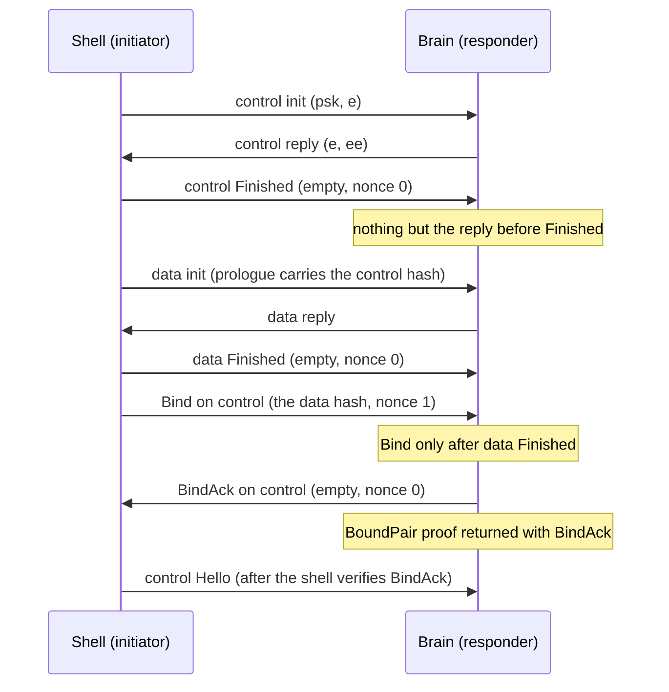

# The session (Mac connection core)

On the Mac, the shell starts the brain as its child and the two talk over two inherited socket
pairs: a control leg and a data leg. `crates/session` is the portable core of that connection:
both roles' handshake and binding state machines, and the record sealer and opener that carry
today's frames. It does no I/O. The Mac brain's record stream below does that over tokio, but
nothing in the product calls it yet. Windows keeps its pipes and capability check and doesn't link
the crate.

## Protocol

Each leg runs `Noise_NNpsk0_25519_ChaChaPoly_BLAKE2s` (snow 0.10.0). The pattern has no static key
on either side. The PSK is the group secret: 32 bytes the brain generates fresh on every start and
the shell reads back. Every leg uses a fresh ephemeral key on each side.

The prologue is `u8 len ‖ SESSION_LABEL ‖ u8 version=1 ‖ u8 channel ‖ u8 leg`. Channel 0 is
Release and 1 is Dev. The adapter must refuse the Gate identity when selecting the channel; the
crate has no Gate wire value. Leg 0 is control and 1 is data, and the data leg appends the
control handshake's 32-byte hash. A different secret,
channel, leg or control hash fails that leg's init, the first message the brain reads on it.

Every message is a big-endian `u16` length, then the bytes. Each phase allows exactly one
length; any other is refused before the body is read.

| Phase | Direction | Plaintext | Length |
|---|---|---|---|
| init (each leg) | shell to brain | empty | 48 |
| reply (each leg) | brain to shell | empty | 48 |
| Finished (each leg) | shell to brain | empty | 16 |
| Bind (control) | shell to brain | data hash, 32 | 48 |
| BindAck (control) | brain to shell | empty | 16 |
| Application | either | 1 to 65,519 | 17 to 65,535 |

Each state is consumed by its one step, so the order is fixed by type. A fresh responder answers
a replayed init with a fresh ephemeral, so a recorded Finished won't authenticate. A second init
on the same pair is refused by length.

## Records and frames

A frame (today's 4-byte header and postcard payload) goes out as maximally sliced records: a
65,515-byte payload fits one record, 65,516 need two, a full control frame takes two and a full
data frame five. The opener keeps frame boundaries:

- An empty application record is refused.
- A second envelope before the pending record body is refused.
- A record belongs to one frame; one that crosses the frame's end is refused.
- The header may be split anywhere, even 1+3. It is checked against the leg's cap as soon as it is
  complete, before anything from that record is delivered. A header that declares zero passes on
  to the existing decoder.
- The end of the stream inside a record or a frame is `Truncated`.

## Nonces and the record limit

When a leg's handshake finishes, its transport state is split once into one `Sealer` and one
`Opener` per direction. Neither is `Clone`, and split is their only constructor, so every counter
starts there. The same owners seal and open Finished, Bind and BindAck and then move into
application use, so the first application nonces are:

| Leg | Shell to brain | Brain to shell |
|---|---|---|
| control | 2 (after Finished 0 and Bind 1) | 1 (after BindAck 0) |
| data | 1 (after Finished 0) | 0 |

A record is sealed once. The sealer keeps its bytes and write offset, so a short write resumes
from `unwritten()` without sealing again, and a second seal while bytes are unwritten is refused.
After retirement, both `unwritten()` and `advance()` return `Retired`; that is different from
a successful write that left no bytes pending.

Each direction of each leg may carry at most 2^32 records, confirmation and binding records
included. That is an operational limit, not a claim about the cipher's bounds. The next seal or
open past it fails as `Exhausted`. There is no rekey, no wrap and no resumed record.

## Failure

Every refusal is terminal. In each process, the first failure of any state or owner retires the
whole attempt. New record operations on either leg or direction observe retirement, even when
their input would otherwise be valid. The core cannot recall bytes it already handed out or
serialize an operation already past its retirement check. On a fatal cause, the stream adapters
must shut both sockets, discard pending output, and neither decode nor dispatch an in-flight
delivery.

## The bound-pair proof

`BoundPair` exists only once the brain has verified Bind and sealed BindAck. The one step that does
both, `BrainAwaitsBind::receive`, returns the proof together with BindAck's bytes and the four
owners. The proof has no public constructor and isn't `Clone`, and `is_for` answers only for
openers of its own pair, so it can't vouch for another pair. The brain writes BindAck before it
reads control Hello. The shell gets its owners only from verifying BindAck.

## Key material (beta exception OSC-1047)

Kumochi makes no claim of secure erasure. The owner accepted that the Noise library doesn't wipe
its key copies for the beta only (OSC-1047). It must be re-decided before 1.0 and before any
remote or static pairing. snow keeps the PSK, the ephemeral private keys, DH outputs, the chaining
key, handshake keys and the transport keys in memory it frees or overwrites without wiping, and
moves leave copies on the stack. Those can remain in freed memory, in registers and in pages the OS
manages.

What this crate does about its own buffers, under the exception's conditions:

- It never builds with a static key, and each attempt's keys are fresh.
- Its copy of the group secret is overwritten with zeros as soon as the data leg's handshake state
  is built from it, or when the attempt ends earlier by refusal or drop. A rejected envelope
  wipes the copy before returning, even if its handshake state is still live.
- Opened plaintext is overwritten with zeros when its `Delivery` drops, when a record is refused,
  and when the opener drops. The opener also clears its saved header bytes after parsing,
  upon refusal, and when it drops. The sealer's record buffer is overwritten with zeros when
  it drops.

That limits how long these buffers hold their bytes. It doesn't remove copies the compiler or the
library made.

## The brain's record stream (dormant)

`crates/brain/src/platform/macos/stream.rs` moves one leg's records over tokio I/O. It takes the
`Sealer` and `Opener` the handshake already advanced, so application nonces carry on from the table
above. The four adapters of a pair share one `watch` cell, the pair cell that
`runtime::terminal::Terminal` reads. Nothing creates a pair or a cell outside tests yet.

- `RecordReader` implements `AsyncRead`, so the existing frame readers (`ipc::read`,
  `ipc::read_sized`) work on it unchanged. It holds at most one record: its ciphertext while it
  arrives, then its plaintext in the same buffer, wiped as it's read and on drop. Short or
  interrupted reads keep their offsets, and a read future dropped mid-record loses nothing.
- `RecordWriter` has no `AsyncWrite`. Its only write is `write_frame`, which takes exactly one frame
  (a header that declares the rest, within the leg's cap) and sends it as maximally sliced records,
  sealing the next record only after the last one is fully written. Short or interrupted writes
  resume from `unwritten()`.
- **The whole-frame guard.** `write_frame` arms a guard before the first seal. Dropping the pending
  future latches refusal immediately, even between records. Dropping it before the first poll
  changes nothing. An ordinary transport error ends the write without latching refusal, but the
  writer refuses any attempt to use it again.
- **Refusals set the cell first.** A session refusal (authentication, length, cap, a record that
  crosses its frame, `Exhausted`, `Retired`), the end of the stream inside an envelope, a record or a
  frame (`Truncated`), reusing a writer whose frame was cut off, or bytes that aren't one frame,
  set the cell and only then return the error (`io::ErrorKind::InvalidData`, carrying a
  content-free `Refusal`). Every poll of every adapter reads the cell first. Once it's set, neither
  leg reads, opens, hands out buffered plaintext or writes again.
- **Ordinary loss isn't a refusal.** The end of the stream between frames reads as end of file, and
  a transport error (reset, broken pipe, a zero-length write) comes back as it came. Neither touches
  the cell.

Activation must change the three places that write frames today: `write_control` and `write_data`
in `runtime/mod.rs`, and `send` in `ipc.rs`, which writes the greeting replies and Welcome. The Mac
must use `write_frame` for the whole encoded frame at each call site. When an ordinary loss has
already stopped writes, the runtime must keep any pending writer futures alive without polling
them through the final disposition checks and control grace. Dropping them earlier would turn
teardown into refusal and suppress the ordinary-loss drain. After disposition is settled the
entry drops both legs. This cut doesn't change runtime wiring. The full C-7 proof needs both the
brain's adapter and the shell's blocking adapter, which arrives in I1e-2.

## The instance item (dormant)

The brain stores each start's capability as one data protection Keychain item, and the shell reads
it. Nothing calls this yet: parent-bound startup wires it in later. Only the Dev edition has an item.
Release and Gate builds refuse with `NotAdmitted` before any call, until release packaging
provisions their identifiers.

- **One selector.** `crates/storage/src/platform/macos/instance.rs` holds it: a generic password
  in the group `P.<AppleIds::DEV.instance_group>`, with the instance service and account, the data
  protection keychain, not synchronizable, and `kSecUseAuthenticationUI` set to Fail on every add,
  copy, update and delete. The update payload holds the value alone. The item is
  `AfterFirstUnlockThisDeviceOnly`. There's no LocalAuthentication and no login-keychain fallback.
- **Admission per role.** Before any item call, the process's own `com.apple.application-identifier`
  must be exactly `P.<its role's id>`, with a non-empty prefix and no wildcard, and its
  `keychain-access-groups` must list `P.<instance group>`. Whether the OS honours the claims is
  proved only by a signed run.
- **One protection check.** An existing item (on a duplicate add) and the readback both pass only
  with that exact protection class and no access control. Anything else refuses with no update and
  no delete. The readback must hold exactly 32 bytes, and only the brain compares them, in constant
  time, with its own.

## What this crate doesn't do

No sockets, I/O, async or OS code; no Keychain; no READY byte, deadline or socket shutdown; no Hello
or Welcome checks; no product callers. The brain's adapter above does the I/O and owns the write
guard. It creates no listener or connection and isn't for remote or static pairing.

## Tests

The vectors come from a separate implementation of the same Noise protocol, written from the Noise
specification and these wire rules rather than from snow or this crate. With fixed test ephemerals,
the tests check every handshake message, confirmation and binding record, and the first
application record in each direction against them. The fixed ephemerals reach snow only on test
builds.
