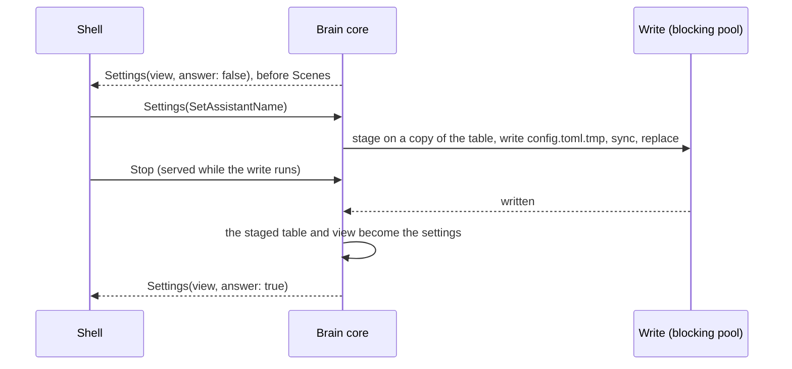

# Settings

The brain owns the user's settings and keeps them in `config.toml`, in the `Kumochi` folder
under `%APPDATA%` (`Kumochi Dev` for debug builds, so a dev build never touches an install).
The shell shows them and asks for changes; it never reads the file.

| Key | Type | Default |
|---|---|---|
| `assistant_name` | 1–24 characters | `Kumo` |
| `user_name` | 1–24 characters, or absent | absent (unset) |
| `onboarded` | boolean | `false` |

**Names** follow one rule, checked by `AssistantName` and `UserName` in `crates/protocol` on
both sides: trimmed, 1–24 Unicode scalar values, one line, with no control characters and no
U+2028 or U+2029. A name that breaks the rule fails to decode, so a shell sends only names it has
checked. An empty user name is `None`, never an empty name. Their `Debug` prints a length, and
nothing logs a name, a value from the file, or the TOML parser's messages.

## Changes

- At most one write is in flight, off the core loop, so a slow disk never delays Stop or Pong.
  Changes that arrive meanwhile wait and are applied in order.
- Each change gets exactly one `Settings` with `answer: true` back, in order, while the
  connection that sent it lasts. A refused or failed change gets the unchanged view, so the
  shell's field goes back to what's saved. A `Settings` with `answer: false` answers nothing: it's
  the connection's first frame, or the settled settings after a change another connection sent.

## Across connections and Quit

A change the brain has read is written even if its shell is gone: the queue keeps moving while
no shell is connected, and Quit and close write what's left before they end.

- **A later connection** gets the settings as saved so far, then, as each earlier connection's
  change is saved, the settled settings with `answer: false`. An earlier change's refusal is only
  logged. So a new shell's own changes are answered only by `answer: true`, and nothing from a
  gone shell can pass for one.
- **Quit** writes the queue within its one absolute deadline (2 s from the accepted Quit). A
  change still unsaved then is logged by count, with no value. The runtime then shuts down
  without waiting for a write stuck on a slow disk, so Quit still ends on time. The process may
  end mid-write; `config.toml` stays whole because it's only ever replaced, and that change is
  lost.
- **Close** (the shell gone for good, or from another build) does the same within 2 s.
- A change becomes the settings only once the file is replaced, so a failed write changes
  neither memory nor disk. A leftover `config.toml.tmp` is never read; the next write overwrites
  it.
- Keys this build doesn't know survive every write, so a newer build's settings outlive a
  downgrade.

## When the file is bad

- **Missing:** the defaults, and the first change creates it.
- **A known key with a bad value:** that key reads as its default and stays in the file as it is
  until the user sets it.
- **Unreadable or not TOML:** the brain runs on the defaults and refuses every change, so the file
  is never overwritten. Repair or delete it, then restart Kumochi.
- **No absolute `%APPDATA%`:** the defaults, and changes are refused.
