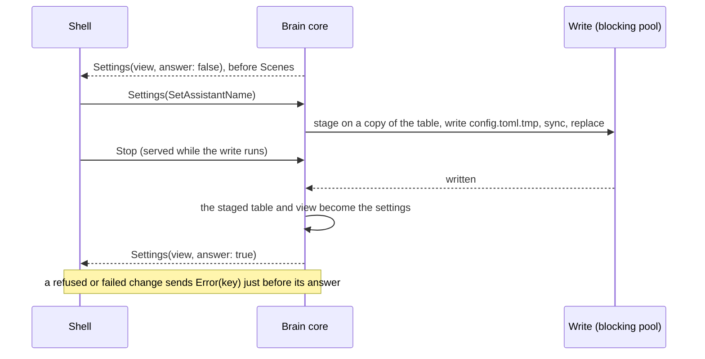

# Settings

The brain owns the user's settings and keeps them in `config.toml`, in the `Kumochi` folder
under `%APPDATA%` (`Kumochi Dev` for debug builds, so a dev build never touches an install).
The shell shows them and asks for changes; it never reads the file.

## Shell editor

The status panel's **Settings…** opens a retained window, the tasks panel's size and anchored
with the same work-area clamping. Kit's tabs expose **General** and an empty **Accounts**
placeholder. `shell/settings.rs` owns the plain drafts, validation, per-field saving and errors;
`presence/settings.rs` owns the window and session sends, and `presence/settings_view.rs`
owns the retained Kit inputs and subscriptions. The shell's UI thread never waits for a save.
The plain model also retains the brain notice across reconnects and fences incoming settings
by connection generation before changing any draft, save slot or saved view.

Enter or blur validates with the protocol's name types and queues the change. An unchanged
normalized name sends no operation, including inline renames. While saving, that field is readonly and says Saving…;
the other field remains usable. A refused save restores its authoritative value and keeps its
inline error until that field changes again. Cancelling an edit restores the last received
value without sending it. The user-name field maps blank input to `None`.

Every accepted field operation, including an inline assistant rename from Tasks, enters one
FIFO. Only `answer: true` consumes its head and clears that field's saving state. The preceding
`UserError` belongs to that head; `answer: false` updates saved values but never completes an
operation. Errors remain after the refused answer. An answer to another field cannot erase
them. A successful retry of the field that produced the dock notice clears that notice and
its full typing-panel explanation; an unsolicited view or reconnect does not. The dock shows
only **Check settings**, not recovery prose inside its small pill. The full explanation remains
beside the field and in the typing panel. A new turn also clears the retained typing/dock notice.
Disconnect drops all in-flight slots; the replacement connection must first supply its view
before new saves are available. A late answer from another generation is ignored.

Settings stays visible when deactivated. With Settings focused, Esc stops work, then clears a
drawing, then cancels the active field edit; another Esc dismisses. The close button and
Settings… again also dismiss it. Opening the typing panel or Tasks, or moving the dock, uses
the same dismissal path: save an active edit as a blur would, hide the window, and use the
existing platform presence functions to restore the previous foreground when still owned.
No additional platform-specific code is needed. See [panels](panels.md#settings-panel) and
the [user guide](../user/settings.md).

## Config keys

| Key | Type | Default |
|---|---|---|
| `assistant_name` | 1–24 characters | `Kumo` |
| `user_name` | 1–24 characters, or absent | absent (unset) |
| `onboarded` | boolean | `false` |

**Names** follow one rule, checked by `AssistantName` and `UserName` in `crates/protocol` on
both sides: trimmed, 1–24 Unicode scalar values, one line, with no control characters and no
U+2028 or U+2029. A name that breaks the rule fails to decode, so a shell sends only names it has
checked. An empty user name is `None`, never an empty name. A name's `Debug` prints a length, and
nothing logs a name, a value from the file, or the TOML parser's messages. Every `SettingsView`
also names `main_thread`, the store's main thread, whose row the shell labels with
`assistant_name`. The shell uses the latest received settings for that label, falling back to
`protocol::constants::DEFAULT_ASSISTANT_NAME` before any `SettingsView`, including in search
results and the input-target label. An inline rename of Kumo sends `SetAssistantName` and
keeps the previous displayed name until the next `SettingsView`; it never edits the empty
stored title. A settings update preserves the draft, keyboard focus, viewed task, input
target and selection revision, so saving a name never switches conversations.

## Changes

- At most one write is in flight, off the core loop, so a slow disk never delays Stop or Pong.
  Changes that arrive meanwhile wait and are applied in order.
- Each change gets exactly one `Settings` with `answer: true` back, in order, while the
  connection that sent it lasts. A refused or failed change gets an `Error` first
  (`ConfigUnreadable` for a bad file, otherwise `SettingsRefused`), then the unchanged view, so
  the shell's field goes back to what's saved. An `Error` only ever comes just before an
  `answer: true` view. A `Settings` with `answer: false` answers nothing: it's
  the connection's first frame, or the settled settings after a change another connection sent.

## Across connections and Quit

A change the brain has read is written even if its shell is gone: the queue keeps moving while
no shell is connected, and Quit and close write what's left before they end.

- **A later connection** gets the settings as saved so far, then, as each earlier connection's
  change is saved, the settled settings with `answer: false`. An earlier change's refusal is only
  logged: it sends no `Error` and no view. So a new shell's own changes are answered only by `answer: true`, and nothing from a
  gone shell can pass for one.
- **Quit** writes the queue within its one absolute deadline (2 s from the accepted Quit). A
  change still unconfirmed then is logged by count, with no value. The runtime then shuts down
  without waiting for a write stuck on a slow disk, so Quit still ends on time. That save is
  unconfirmed, not lost: the write may still finish before the process exits. Either way
  `config.toml` is the whole old file or the whole new one, because it's only ever replaced.
- **Close** (the shell gone for good, or from another build) gives the settings the same 2 s
  budget. Its waits for ended runs and for the store each keep their own 2 s, so closing as a
  whole can take longer.
- A change becomes the settings only once the file is replaced, so a failed write changes
  neither memory nor disk. A leftover `config.toml.tmp` is never read; the next write overwrites
  it.
- Keys this build doesn't know survive every write, so a newer build's settings outlive a
  downgrade.

## When the file is bad

- **Missing:** the defaults, and the first change creates it.
- **A known key with a bad value:** that key reads as its default and stays in the file as it is
  until the user sets it.
- **Unreadable or not TOML:** the brain runs on the defaults and refuses every change, so the file
  is never overwritten. Repair or delete it, then restart Kumochi.
- **No absolute `%APPDATA%`:** the defaults, and changes are refused.
