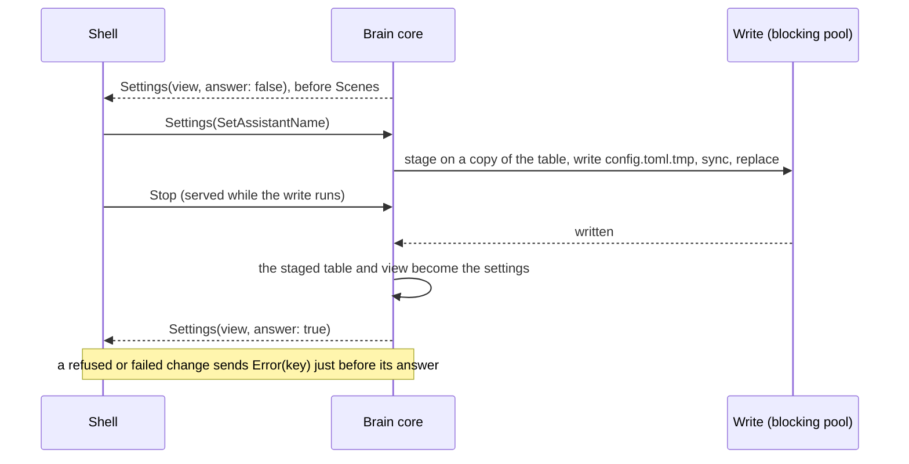

# Settings

The brain owns the user's settings and keeps them in `config.toml`, in the `Kumochi` folder
under `%APPDATA%` (`Kumochi Dev` for debug builds, so a dev build never touches an install).
The shell shows them and asks for changes; it never reads the file.

The brain resolves this folder through `platform::config_dir`, implemented in its Windows
module. It reads `APPDATA` and requires an absolute path, just as the local data folder requires
an absolute `LOCALAPPDATA`. Missing, empty or relative roots never fall back to the working
directory.

## Shell editor

The status panel's **Settings…** opens a retained window, the tasks panel's size and anchored
with the same work-area clamping. Kit's tabs expose **General** and **Accounts**.
`shell/settings.rs` owns the plain drafts, validation, per-field saving and errors;
`presence/settings/window.rs` owns the window and session sends; `presence/settings/mod.rs`
owns the shared view frame, retained Kit inputs and subscriptions. `general.rs` and `accounts.rs`
compose their tabs without another settings entity. The shell's UI thread never waits for a save.
The plain model also retains the brain notice across reconnects and fences incoming settings
by connection generation before changing any draft, save slot or saved view.

Enter or blur validates with the protocol's name types and queues the change. An unchanged
normalized name sends no operation, including inline renames. While saving, that field is readonly and says Saving…;
the other field remains usable. A refused save restores its authoritative value and keeps its
inline error until that field changes again. Cancelling an edit restores the last received
value without sending it. The user-name field maps blank input to `None`.

Every accepted field operation, including an inline assistant rename from Tasks, enters one
FIFO. Only `answer: true` consumes its head and clears that field's saving state. The preceding
settings error (`SettingsRefused` or `ConfigUnreadable`) belongs to that head; any other
`UserError` is a general brain notice and never fails a pending save. `answer: false` updates
saved values but never completes an operation. Errors remain after the refused answer. An answer to another field cannot erase
them. A successful retry of the field that produced the dock notice clears that notice and
its full typing-panel explanation; an unsolicited view or reconnect does not. The status panel shows
only **Check settings**, not recovery prose, until the dock's peek returns. The full explanation remains
beside the field and in the typing panel. A new turn also clears the retained typing/dock notice.
Transport errors clear on a view from the current connection, never on a stale view. An inline
rename refuses with saving, offline or retry feedback without adding an error to a Settings
field. Cancelling a field while its save is in flight leaves that draft and save intact.
Disconnect drops all in-flight slots; the replacement connection must first supply its view
before new saves are available. A late answer from another generation is ignored.

The **Max frame rate** radio group sends its choice at once and checks the newest queued choice
right away, before the brain answers. Its slot in the FIFO belongs to no field, so its answer
completes no field and its refusal marks none. Choosing the current value sends nothing.
See [frame rate](frame-rate.md).

Settings stays visible when deactivated. With Settings focused, Esc stops work, then clears a
drawing, then cancels the active field edit; another Esc dismisses. The close button also
dismisses it. The status panel is hidden while Settings is open; close Settings to reach Retry
there (Retry is also in the dock's native menu). General has Quit on the same guarded shutdown
path as the tray. Opening the typing panel or Tasks, or choosing a tray position, uses the same
dismissal path: save an active edit as a blur would, hide the window, and use the
existing platform presence functions to restore the previous foreground when still owned.
Local validation or send errors keep **Settings not saved** on the dock even after dismissal.
The retained draft and inline error remain available on reopening; correcting or cancelling
the edit clears the local indicator. General brain errors use **Needs attention**, not
**Check settings**.
No additional platform-specific code is needed. See [panels](panels.md#settings-panel) and
the [user guide](../user/settings.md).

## Dock position and taskbar preference

`DockPosition` travels in the settings snapshot and uses nine snake-case names in TOML.
The brain persists it through the same atomic save path as names. `show_in_taskbar` is a
saved boolean, false by default. General exposes its checkbox. The shell applies the effective
taskbar choice after an admitted pick, an accepted snapshot/answer, or a refused change.

General's three-by-three picker reads the model's effective dock choice. Its change uses the
same send path as the tray but placement without dismissal, keeping Settings attached to the
dock. The version/build row displays `protocol::BUILD_ID`; Kit's Clipboard control copies
that same value. Its click handler writes the configured value to the clipboard and shows a
check icon for two seconds. A headless interaction test reads the copied contents; native
keyboard behavior remains unverified.

Taskbar choices use the existing answer FIFO, with a distinct slot kind. The newest unfailed
pending choice wins until an answer supplies the saved value. The checkbox is unavailable
without an authoritative view. Failed admission leaves the selection unchanged and General
explains the failure; no taskbar intent is replayed after disconnect. A successful taskbar
answer clears only a taskbar refusal, not a name, frame-rate or dock-position refusal.

On Windows, `platform/windows/taskbar.rs` owns a separate unowned zero-area window at the
primary monitor origin. It uses `WS_POPUP | WS_SYSMENU` and exactly
`WS_EX_APPWINDOW | WS_EX_NOACTIVATE`, a display-name constant and the shared stock icon.
`SW_SHOWNA` shows it without focus; turning the choice off destroys it. No existing window's
styles or dock proxy change. GPUI's Windows options do not expose this taskbar policy.
Active/restore/minimize messages open the existing status panel; Close requests the same
idempotent Quit as the tray. Move, Size and Maximize are consumed so they cannot bring the
window into view; all other system commands retain the OS's default handling, including
screen saver, monitor power and keyboard shortcuts. `TaskbarCreated` hides/shows the same HWND for
Explorer to rediscover. Native refusal leaves the desired preference intact and adds a
localized General/status notice, separate from backend save errors. Disconnect leaves the
last applied native state until a new authoritative snapshot arrives.

The mechanism follows Microsoft's documented APPWINDOW/NOACTIVATE rules, not calibrated
taskbar observations: UIA and MSAA both failed an ordinary-window positive control. Native
window lifecycle tests are ignored in ordinary gates and require an approved window turn.
Actual button visibility, click, Alt-Tab's blank preview, taskbar Close and Explorer restart
remain owner installed-build checks. macOS activation policy is not implemented.

A tray pick moves the dock immediately and joins the settings answer FIFO when admitted.
While disconnected or the control queue is full, the model retains only the newest unsent
pick. Every current-generation snapshot attempts to flush it. The effective position is the
unsent pick, then the newest queued dock choice, then the saved position; older answers
cannot pull the dock back from a newer choice. Disconnect retains an unanswered dock setter
for replay, which is safe because it is absolute. A replacement snapshot already containing
that replayed value suppresses the redundant write. An explicit same-value pick still writes,
so the user can replace an invalid stored value that loaded as the default.

A refused answer restores the saved position unless a newer intent remains, and never
replays that refused intent. A successful answer clears a refusal only for the same setting
kind, independent of its value. Settings answers stay pipe-ordered and generation-fenced.
Snapshot restoration uses placement without panel dismissal; tray choices retain the usual
dismissal behavior. The existing layout and native placement interfaces are unchanged.
After a placement lands, open surfaces follow the new anchor without changing visibility,
focus or size. A moved anchor ends any active screen selection because its input geometry is
no longer current. Under `--gate-observer`, snapshots leave the launch seed unchanged so
the observer's recorded target remains valid; persistence and replay still work normally.

## Accounts

`shell/accounts.rs` retains the authoritative AccountView inside Settings. It never invents
SigningIn or SigningOut, and queues no operations for reconnect. Accepted operations disable
account controls until the next current-session view; a failed send leaves the state intact
and explains the failure inline. Errors survive their first following view, even when that
view changed. A later different view, an accepted operation or disconnect clears the error.
The snapshot and errors are fenced by connection generation, not by a settings answer FIFO.

`presence/settings/accounts.rs` renders the snapshot with recovery taking precedence over plan
status. Busy can Retry to acquire the account after the other session exits. Local sign-out
cleanup and remote confirmation are independent: Running shows no remote warning; Refused
and NotDurable say “hasn't confirmed yet”; only SignedOut says “didn't confirm”.

Sign out opens a Kit confirmation through `confirmation.rs`, with Cancel explicitly focused
and generic Enter-to-confirm disabled. Acceptance rechecks the session and state before
sending SignOut. Leaving SignedIn, disconnecting, switching tabs or hiding Settings closes
the confirmation. Kit restores focus; a removed trigger falls back to the Settings region.
Manage usage uses the fixed protocol URL and GPUI open_url through a keyboard-capable Base
Link. No new platform adapter or credential access is added.

### Accounts presentation

Accounts separates its provider/identity header, status, recovery details and actions.
Sign out stays content-width in a separate actions row. Cleanup failures emphasize the
local saved-sign-in risk under “On this computer”; an unconfirmed remote outcome remains
secondary under “At OpenAI”. A stuck cleanup says “Sign-out needs attention”, not that it
is still progressing. Backlog errors have a short lead and separate recovery/expiry help;
new sign-in is disabled while that error is retained, without disabling Retry.

The shell's theme module installs persistent light/dark palette overrides after Kit init.
Light danger text and solid danger buttons use the darker semantic danger palette; dark
danger is unchanged. Links retain a distinct blue palette across mode changes.

### Offline Accounts captures

Debug builds accept `--accounts-fixture=<state> --quit-after-ms=<1..120000>` and optional
`--accounts-appearance=light|dark|large|constrained`. For example, run `target/debug/kumochi.exe
--accounts-fixture=refused-unconfirmed --accounts-appearance=light --quit-after-ms=5000`
after building the shell. Fixed states cover waiting/offline, signed-out/unconfirmed,
signing-in/busy, enabled/no-email/declined/unavailable, retry/sign-in-again, signing-out,
refused/refused-unconfirmed, not-durable/not-durable-unconfirmed, confirmation and backlog.
`general-error` opens General with a locally rejected empty assistant name, for checking
the semantic danger palette outside Accounts. The invalid draft never sends an operation.

The fixture branches before normal startup: no instance lock, capability/credential read,
brain/link, presence observer, Raw Input or global Escape registration. It opens the real
SettingsView over synthetic snapshots with no Presence owner. Account commands cannot send;
Manage usage is inert. State and appearance flags reject missing, mistyped or duplicate
values; the fixture requires a bounded quit deadline and quits automatically. The module,
snapshot factory and fixture-only view state are excluded from release builds, which refuse
the fixture flags. These renders prove UI states, not real authentication or credential cleanup.
`constrained` keeps the normal 768×544 logical window while using 24 px base text, rather
than growing the window with the text. The existing Settings content region owns scrolling.

## Config keys

| Key | Type | Default |
|---|---|---|
| `assistant_name` | 1–24 characters | `Kumo` |
| `user_name` | 1–24 characters, or absent | absent (unset) |
| `onboarded` | boolean | `false` |
| `max_frame_rate` | 30, 60, 72, 120 or 144, or absent | absent (Automatic) |
| `default_model` | a table: `model` (a model slug) and `effort` (`Low` to `Max`), or absent | absent until a catalog is read |
| `dock_position` | `top_left`, `top_center`, `top_right`, `middle_left`, `center`, `middle_right`, `bottom_left`, `bottom_center` or `bottom_right` | `top_center` |
| `show_in_taskbar` | boolean | `false` |

`default_model` is the model a thread with no choice runs on. Only the brain sets it today, with
`SettingsOp::SetDefaultModel` under epoch 0, which no connection has, so a shell hears only the
settled `SettingsView` (see [accounts](accounts.md#model-catalog)). A bad value reads as unset.

**Names** follow one rule, checked by `AssistantName` and `UserName` in `crates/protocol` on
both sides: trimmed, 1–24 Unicode scalar values, one line, with no control characters and no
U+2028 or U+2029. A name that breaks the rule fails to decode, so a shell sends only names it has
checked. An empty user name is `None`, never an empty name. A name's `Debug` prints a length, and
nothing logs a name, a value from the file, or the TOML parser's messages. Every `SettingsView`
also names `main_thread`, the store's main thread, whose row the shell labels with
`assistant_name`. The shell uses the latest received settings for that label, falling back to
`protocol::constants::DEFAULT_ASSISTANT_NAME` before any `SettingsView`, including in search
results and the input-target label. An inline rename of Kumo sends `SetAssistantName` and
keeps the previous displayed name until the next `SettingsView`; it never edits the empty
stored title. A settings update preserves the draft, keyboard focus, viewed task, input
target and selection revision, so saving a name never switches conversations.

## Changes

- At most one write is in flight, off the core loop, so a slow disk never delays Stop or Pong.
  Changes that arrive meanwhile wait and are applied in order.
- Each change gets exactly one `Settings` with `answer: true` back, in order, while the
  connection that sent it lasts. A refused or failed change gets an `Error` first
  (`ConfigUnreadable` for a bad file, otherwise `SettingsRefused`), then the unchanged view, so
  the shell's field goes back to what's saved. An `Error` only ever comes just before an
  `answer: true` view. A `Settings` with `answer: false` answers nothing: it's
  the connection's first frame, or the settled settings after a change another connection sent.

## Across connections and Quit

A change the brain has read is written even if its shell is gone: the queue keeps moving while
no shell is connected, and Quit and close write what's left before they end.

- **A later connection** gets the settings as saved so far, then, as each earlier connection's
  change is saved, the settled settings with `answer: false`. An earlier change's refusal is only
  logged: it sends no `Error` and no view. So a new shell's own changes are answered only by `answer: true`, and nothing from a
  gone shell can pass for one.
- **Quit** writes the queue within its one absolute deadline (2 s from the accepted Quit). A
  change still unconfirmed then is logged by count, with no value. The runtime then shuts down
  without waiting for a write stuck on a slow disk, so Quit still ends on time. That save is
  unconfirmed, not lost: the write may still finish before the process exits. Either way
  `config.toml` is the whole old file or the whole new one, because it's only ever replaced.
- **Close** (the shell gone for good, or from another build) gives the settings the same 2 s
  budget. Its waits for ended runs and for the store each keep their own 2 s, so closing as a
  whole can take longer.
- A change becomes the settings only once the file is replaced, so a failed write changes
  neither memory nor disk. A leftover `config.toml.tmp` is never read; the next write overwrites
  it.
- Keys this build doesn't know survive every write, so a newer build's settings outlive a
  downgrade.

## When the file is bad

- **Missing:** the defaults, and the first change creates it.
- **A known key with a bad value:** that key reads as its default and stays in the file as it is
  until the user sets it.
- **Unreadable or not TOML:** the brain runs on the defaults and refuses every change, so the file
  is never overwritten. Repair or delete it, then restart Kumochi.
- **No absolute `%APPDATA%`:** the defaults, and changes are refused.

## Claude Code

`[claude_code] enabled = false` in `config.toml` turns Claude Code's discovery off: the brain
finds nothing and starts no `claude`, and the view is `TurnedOff`. A missing section or key
leaves it on; any other value there, or a file that can't be read, turns it off, since it may
have said so. It's read once at startup, so a change needs a restart. It signs nothing out and
deletes nothing.
