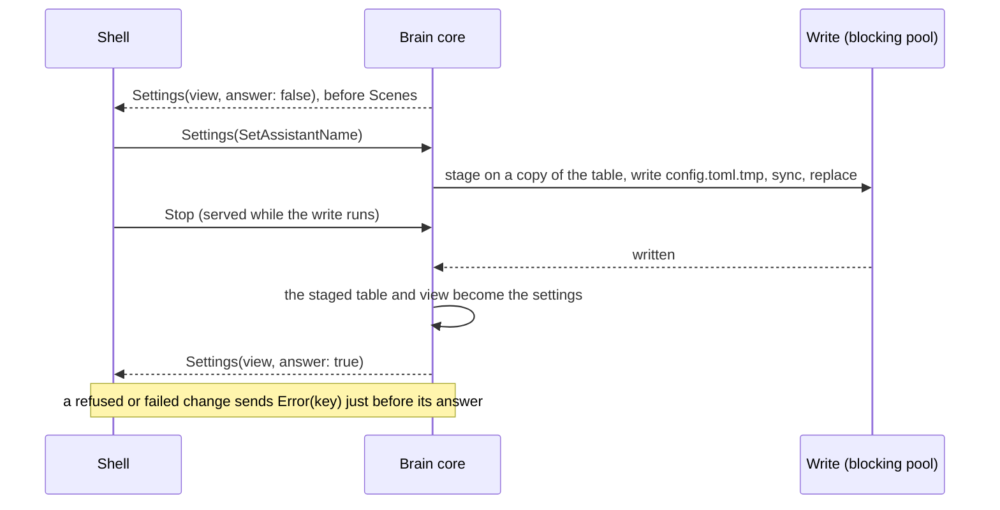

# Settings

The brain owns the user's settings and keeps them in `config.toml`, in the `Kumochi` folder
under `%APPDATA%` (`Kumochi Dev` for debug builds, so a dev build never touches an install).
The shell shows them and asks for changes; it never reads the file.

The brain resolves this folder through `platform::config_dir`, implemented in its Windows
module. It reads `APPDATA` and requires an absolute path, just as the local data folder requires
an absolute `LOCALAPPDATA`. Missing, empty or relative roots never fall back to the working
directory.

## Shell editor

Accounts also composes Claude Code through `presence/settings/claude.rs`. The plain
`claude_accounts.rs` reducer owns only session-fenced snapshots, pending commands and whether
the Connect guidance is expanded. A new connection must supply its snapshot before commands
are enabled; a stale generation cannot change the row. An enqueue never changes the displayed
connection state. A failed send stays visible until an explicit successful retry.

The first Connect action expands the managed-policy notice and manual sign-in guidance without
sending an operation. Only the second action sends Connect. Discovery's authoritative `Finding`
state removes that action until a settled SignedOut snapshot arrives. Disconnect uses the shared
Cancel-first confirmation and rechecks the session and allowed operation when confirmed.
No login URL, code or credential contents reach the shell. See [Claude Code](claude-code.md).

The status panel's **Settings…** opens a retained window, the tasks panel's size and anchored
with the same work-area clamping. Kit's tabs expose **General**, **Accounts**, **Voice** and **Privacy**.
`shell-core/settings.rs` owns the plain drafts, validation, per-field saving and errors.
`shell-core/settings/saves.rs` routes a save through the current link and returns redraw and
follow-up decisions; the host executes the native effects, such as revoking screen consent before
a save or following the microphone choice after a successful enqueue. `presence/settings/window.rs`
owns the window; `presence/settings/mod.rs` owns the shared view frame, retained Kit inputs and
subscriptions. `general.rs` and `accounts.rs` compose their tabs from Core's choice rows and account
status lines without another settings entity. The shell's UI thread never waits for a save.
The plain model also retains the brain notice across reconnects and fences incoming settings
by connection generation before changing any draft, save slot or saved view.
Taskbar reselects return a no-op, distinct from a refused send, so the host doesn't show a
failure or clear an existing notice when no change was requested.
A current link refusal also returns a dock rollback as soon as the optimistic choice changes,
so native placement doesn't wait for a settings snapshot that can be lost on disconnect.

**Model** (`shell-core/settings/model.rs`): Presence hands each `DataToShell::Models` catalog to
the settings model, which keeps one per connection that has an engine (ChatGPT, and Claude Code
once it lists models) and drops them on disconnect. Core builds the choices, selection and Fluent
labels; General draws one radio per choice and asks Core to send
`SetDefaultModel` with the newest choice's wanted effort on the same connection, else `Low`.
The brain resolves ChatGPT's actual request effort at admission; this layer doesn't rewrite
the saved choice to match the catalog.

Enter or blur validates with the protocol's name types and queues the change. An unchanged
normalized name sends no operation, including inline renames. While saving, that field is readonly and says Saving…;
the other field remains usable. A refused save restores its authoritative value and keeps its
inline error until that field changes again. Cancelling an edit restores the last received
value without sending it. The user-name field maps blank input to `None`.

Every accepted field operation, including an inline assistant rename from Tasks, enters one
FIFO. Only `answer: true` consumes its head and clears that field's saving state. The preceding
settings error (`SettingsRefused`, `ConfigUnreadable` or `VoiceUnavailable`) belongs to that head; any other
`UserError` is a general brain notice and never fails a pending save. `answer: false` updates
saved values but never completes an operation. Errors remain after the refused answer. An answer to another field cannot erase
them. A successful retry of the field that produced the dock notice clears that notice and
its full typing-panel explanation; an unsolicited view or reconnect does not. The status panel shows
only **Check settings**, not recovery prose, until the dock's peek returns. The full explanation remains
beside the field and in the typing panel. A new turn also clears the retained typing/dock notice.
Transport errors clear on a view from the current connection, never on a stale view. An inline
rename refuses with saving, offline or retry feedback without adding an error to a Settings
field. Cancelling a field while its save is in flight leaves that draft and save intact.
Disconnect drops all in-flight slots; the replacement connection must first supply its view
before new saves are available. A late answer from another generation is ignored.

The **Max frame rate** radio group sends its choice at once and checks the newest queued choice
right away, before the brain answers. Its slot in the FIFO belongs to no field, so its answer
completes no field and its refusal marks none. Choosing the current value sends nothing.
See [frame rate](frame-rate.md).

The Voice tab adds SpeechInput's existing `SetSttUnload` preference to the same settings FIFO.
One idle-policy write may be pending; its requested radio stays selected with Saving… while
further choices are disabled. Only its ordered `answer: true` settles it. An unsolicited view
does not complete it; a refusal restores the authoritative choice and remains visible until
a successful retry of that setting. A failed enqueue never changes the saved value. Disconnect
clears pending policy and voice status, and generation checks reject late snapshots.

**Speak answers aloud** uses the same FIFO with `SetTalkBack`. It saves on toggle, including
when leaving Settings, and a refused write restores the saved value. Like the other voice
preferences, it can be set before a model is installed and does not install one. Legacy
receives the saved answer on the same connection. On a queued pair the toggle is refused
while a turn is reserved, a hold is unsettled, or a reply is still active. The user can try
again when idle; there is no deferred save. A successful offer closes new turn and capture
admission until the ordered answer. A changed answer for that save ends the pair and
reconnects without counting as a connection loss; Settings reads the next pair's saved value.
Hiding or removing the exact active reply's thread ends its control side, but the pair still
waits for the reply's data end and any speaking quiet receipt before allowing a change.

The control reader forwards `Voice.speech_input` to the settings model with its connection
generation instead of dropping the whole Voice view. Status comes only from that snapshot,
not the selected policy. SpokenReplies installation status is not shown. The existing backend
owns all idle timing and physical-release ordering; this UI adds no timer, microphone or hold
behavior.

The speech-input model row exposes only the default Parakeet setup operations. NotInstalled
offers Install, either Failed state offers Retry (which can fetch again), and Unloaded offers
Load using the backend's installed-file reload path. All three send `InstallVoice(SpeechInput)`.
Verifying, Downloading and Loading offer the existing global `CancelVoiceInstall`. Adjacent
Fluent help and the button's accessible name explain that cancellation covers all pending voice
setup, keeps installed files and cannot stop some loading/finishing work, including startup.
There are no SpokenReplies setup controls, model selection, removal or automatic hold actions.

The row captures the accepted Voice generation with the specific action. Immediately before
enqueue, the Settings-window owner checks the current Session against that generation, and
the model requires an authoritative Settings view, unchanged action eligibility and no pending
speech request. An old Load cannot become a download-capable Retry, and an old same-action
callback cannot target a replacement connection. Disconnect clears speech state/generation and
pending requests; none is replayed. The shared settings FIFO keeps refusal/send feedback
separate from authoritative model failure keys. Unsolicited or stale settings cannot settle a
request, and unrelated successes cannot clear its refusal. Pending disables only model requests,
not idle-policy writes. Its ordered answer settles just that request slot, never changes model
state and never proves cancellation or physical release; an accepted cancel can remain Loading
or become Ready. Only generation-fenced Voice snapshots update the displayed model state.

Settings keeps a named tab selection for recovery openers, keyboard navigation, and the selected
content. Only the Kit tab bar takes a numeric selection and reports a clicked index.
Scoped Ctrl+Tab and Ctrl+Shift+Tab actions cycle the four tabs through `select_tab`, wrapping
in either direction and returning focus to the Settings frame, whose border shows that focus.
The pinned Kit tabs are not keyboard focus targets. Tab and Shift+Tab reach the selected tab's
controls in normal order; Space activates a focused radio. Switching tabs retains drafts and
uses the existing finish-edit/focus path, without changing Escape dispatch.
If an authoritative update removes the focused control, a retained focus-lost subscription
uses GPUI's surviving-ancestor target, falling back to the Settings frame. Ordinary focus moves
and Voice updates do not request focus; asynchronous removal preserves the Settings key context.

Settings stays visible when deactivated. With Settings focused, Esc stops work, then clears a
drawing, then cancels the active field edit; another Esc dismisses. The close button also
dismisses it. The status panel is hidden while Settings is open; close Settings to reach Retry
there (Retry is also in the dock's native menu). General has Quit on the same guarded shutdown
path as the tray. Opening the typing panel or Tasks, or choosing a tray position, uses the same
dismissal path: save an active edit as a blur would, hide the window, and use the
existing platform presence functions to restore the previous foreground when still owned.
Reopening Settings from chat recovery selects the action's tab without resetting a pending
edit. The ordered answer settles it as usual, including restoring the saved name and showing
the error on refusal.
Every one of those closes, a hold's start included, also cancels a `ChatGPT` or Claude Code
sign-in that Settings' own buttons started and that hasn't ended (`settings_chatgpt` and
`settings_claude`, with the marks and rules of [onboarding](onboarding.md#rules), but no
adoption after a restart).
A sign-in started from chat isn't Settings', so it's never cancelled here.
Local validation or send errors keep **Settings not saved** on the dock even after dismissal.
The retained draft and inline error remain available on reopening; correcting or cancelling
the edit clears the local indicator. General brain errors use **Needs attention**, not
**Check settings**.
No additional platform-specific code is needed. See [panels](panels.md#settings-panel) and
the [user guide](../user/settings.md).

## Dock position and taskbar preference

`DockPosition` travels in the settings snapshot and uses nine snake-case names in TOML.
The brain persists it through the same atomic save path as names. `show_in_taskbar` is a
saved boolean, false by default. General exposes its checkbox. The shell applies the effective
taskbar choice after an admitted pick, an accepted snapshot/answer, or a refused change.

General's three-by-three picker reads the model's effective dock choice. Its change uses the
same send path as the tray but placement without dismissal, keeping Settings attached to the
dock. The version/build row displays `protocol::BUILD_ID`; Kit's Clipboard control copies
that same value. Its click handler writes the configured value to the clipboard and shows a
check icon for two seconds. A headless interaction test reads the copied contents; native
keyboard behavior remains unverified.

Taskbar choices use the existing answer FIFO, with a distinct slot kind. The newest unfailed
pending choice wins until an answer supplies the saved value. The checkbox is unavailable
without an authoritative view. Failed admission leaves the selection unchanged and General
explains the failure; no taskbar intent is replayed after disconnect. A successful taskbar
answer clears only a taskbar refusal, not a name, frame-rate or dock-position refusal.

On Windows, `platform/windows/taskbar.rs` owns a separate unowned zero-area window at the
primary monitor origin. It uses `WS_POPUP | WS_SYSMENU` and exactly
`WS_EX_APPWINDOW | WS_EX_NOACTIVATE`, a display-name constant and the shared stock icon.
`SW_SHOWNA` shows it without focus; turning the choice off destroys it. No existing window's
styles or dock proxy change. GPUI's Windows options do not expose this taskbar policy.
Active/restore/minimize messages open the existing status panel; Close requests the same
idempotent Quit as the tray. Move, Size and Maximize are consumed so they cannot bring the
window into view; all other system commands retain the OS's default handling, including
screen saver, monitor power and keyboard shortcuts. `TaskbarCreated` hides/shows the same HWND for
Explorer to rediscover. Native refusal leaves the desired preference intact and adds a
localized General/status notice, separate from backend save errors. Disconnect leaves the
last applied native state until a new authoritative snapshot arrives.

The mechanism follows Microsoft's documented APPWINDOW/NOACTIVATE rules, not calibrated
taskbar observations: UIA and MSAA both failed an ordinary-window positive control. Native
window lifecycle tests are ignored in ordinary gates and require an approved window turn.
Actual button visibility, click, Alt-Tab's blank preview, taskbar Close and Explorer restart
remain owner installed-build checks. macOS activation policy is not implemented.

A tray pick moves the dock immediately and joins the settings answer FIFO when admitted.
While disconnected or the control queue is full, the model retains only the newest unsent
pick. Every current-generation snapshot attempts to flush it. The effective position is the
unsent pick, then the newest queued dock choice, then the saved position; older answers
cannot pull the dock back from a newer choice. Disconnect retains an unanswered dock setter
for replay, which is safe because it is absolute. A replacement snapshot already containing
that replayed value suppresses the redundant write. An explicit same-value pick still writes,
so the user can replace an invalid stored value that loaded as the default.

A refused answer restores the saved position unless a newer intent remains, and never
replays that refused intent. A successful answer clears a refusal only for the same setting
kind, independent of its value. Settings answers stay pipe-ordered and generation-fenced.
Snapshot restoration uses placement without panel dismissal; tray choices retain the usual
dismissal behavior. The existing layout and native placement interfaces are unchanged.
After a placement lands, open surfaces follow the new anchor without changing visibility,
focus or size. A moved anchor ends any active screen selection because its input geometry is
no longer current. Under `--gate-observer`, snapshots leave the launch seed unchanged so
the observer's recorded target remains valid; persistence and replay still work normally.

## Accounts

`shell/accounts.rs` retains the authoritative AccountView inside Settings. It never invents
SigningIn or SigningOut, and queues no operations for reconnect. Accepted operations disable
account controls until the next current-session view; a failed send leaves the state intact
and explains the failure inline. Errors survive their first following view, even when that
view changed. A later different view, an accepted operation or disconnect clears the error.
The snapshot and errors are fenced by connection generation, not by a settings answer FIFO.

`presence/settings/accounts.rs` renders the snapshot with recovery taking precedence over plan
status. Busy can Retry to acquire the account after the other session exits. Local sign-out
cleanup and remote confirmation are independent: Running shows no remote warning; Refused
and NotDurable say “hasn't confirmed yet”; only SignedOut says “didn't confirm”.

Sign out opens a Kit confirmation through `confirmation.rs`, with Cancel explicitly focused
and generic Enter-to-confirm disabled. Acceptance rechecks the session and state before
sending SignOut. Cancel, Esc and Confirm release the dialog's ownership; a refused open never
takes it. Leaving SignedIn or disconnecting retires and closes the owned confirmation even if
focus has moved outside it. An outside focus target stays put; otherwise Kit restores focus, and
a removed trigger falls back to the Settings region. Switching tabs or hiding Settings also
retires the confirmation before closing it. Sign out can open again during a previous dialog's
exit: accessible Click actions stay with the button's own one-shot decision, so a stale action
can't click through to the replacement.
Manage usage uses the fixed protocol URL and GPUI open_url through a keyboard-capable Base
Link. No new platform adapter or credential access is added.

### Accounts presentation

Accounts separates its provider/identity header, status, recovery details and actions.
Sign out stays content-width in a separate actions row. Cleanup failures emphasize the
local saved-sign-in risk under “On this computer”; an unconfirmed remote outcome remains
secondary under “At OpenAI”. A stuck cleanup says “Sign-out needs attention”, not that it
is still progressing. Backlog errors have a short lead and separate recovery/expiry help;
new sign-in is disabled while that error is retained, without disabling Retry.

The shell's theme module installs persistent light/dark palette overrides after Kit init.
Light danger text and solid danger buttons use the darker semantic danger palette; dark
danger is unchanged. Links retain a distinct blue palette across mode changes.

### Offline Accounts captures

Debug builds accept `--accounts-fixture=<state> --quit-after-ms=<1..120000>` and optional
`--accounts-appearance=light|dark|large|constrained`. For example, run `target/debug/kumochi.exe
--accounts-fixture=refused-unconfirmed --accounts-appearance=light --quit-after-ms=5000`
after building the shell. Fixed states cover waiting/offline, signed-out/unconfirmed,
signing-in/busy, enabled/no-email/declined/unavailable, retry/sign-in-again, signing-out,
refused/refused-unconfirmed, not-durable/not-durable-unconfirmed, confirmation and backlog.
`general-error` opens General with a locally rejected empty assistant name, for checking
the semantic danger palette outside Accounts. The invalid draft never sends an operation.

The fixture branches before normal startup: no instance lock, capability/credential read,
brain/link, presence observer, Raw Input or global Escape registration. It opens the real
SettingsView over synthetic snapshots with no Presence owner. Account commands cannot send;
Manage usage is inert. State and appearance flags reject missing, mistyped or duplicate
values; the fixture requires a bounded quit deadline and quits automatically. The module,
snapshot factory and fixture-only view state are excluded from release builds, which refuse
the fixture flags. Valid Accounts fixtures bypass ordinary logging. If diagnostic flags are invalid
and the shell log can be opened, it records one fixed reason with no argument values before exiting.
These renders prove UI states, not real authentication or credential cleanup.
`constrained` keeps the normal 768×544 logical window while using 24 px base text, rather
than growing the window with the text. The existing Settings content region owns scrolling.

## Config keys

| Key | Type | Default |
|---|---|---|
| `assistant_name` | 1–24 characters | `Kumo` |
| `user_name` | 1–24 characters, or absent | absent (unset) |
| `onboarded` | boolean | absent: `true` for a profile in use at start, else `false` |
| `onboarding_from` | `welcome`, `your_name`, `accounts` or `shortcut` | absent or invalid: `welcome` |
| `max_frame_rate` | 30, 60, 72, 120 or 144, or absent | absent (Automatic) |
| `default_model` | a table: `connection` (`ChatGpt`, `ClaudeCode` or `AnthropicKey`; absent means `ChatGpt`), `model` (a model slug) and `effort` (`Low` to `Max`, any case), or absent | absent until a catalog is read, or until Claude Code is the only connection |
| `dock_position` | `top_left`, `top_center`, `top_right`, `middle_left`, `center`, `middle_right`, `bottom_left`, `bottom_center` or `bottom_right` | `top_center` |
| `show_in_taskbar` | boolean | `false` |
| `[voice] talk_back` | boolean | `false` |
| `[voice] stt_unload` | `kept`, `15m` or `1h` | `kept` |
| `[voice] hold_to_talk` | boolean | `true` |
| `[voice] show_screen` | boolean | `true`, or `false` when `screen_holds` was refused |

**Onboarding** is owed while `onboarded` reads `false`. With no `onboarded` key, a profile
already in use counts as onboarded: at start the account's first load is a signed-in ChatGPT
account, or the store has ever issued a run. The brain works this out once, before any shell is
served, so a later sign-in or a write of another setting never changes it. `FinishOnboarding`
writes `onboarded = true` and removes `onboarding_from`; `onboarded = false` asks for onboarding
again. `CompleteOnboardingStep` stores the step after the one completed in `onboarding_from`,
only when that is further than the stored one; completing `shortcut` changes nothing.

**Voice settings** live in a `[voice]` table. `SetTalkBack`, `SetSttUnload` and `SetHoldToTalk` save
`talk_back`, `stt_unload` and `hold_to_talk` through the same queue and atomic save as every other change, and
`SettingsView` is their only wire home. A bad value, or a `voice` key that isn't a table, reads
as the default and stays on disk until the user sets that key. Setting one where `voice` isn't
a table replaces it with a table. Every other key in the table survives each write, including
`installed` and `removing`, which the voice installer owns. Both list parts by their folder
names, `speech-input` and `spoken-replies`. A part in both counts as removing. Start-up loads each
installed part, and an install adds its part to `installed` under epoch 0 once it has loaded (see
[voice](voice.md#the-installer)).

Missing `hold_to_talk` uses the named on-by-default choice; a present value of the wrong type
fails closed to off without rewriting the file. Its setter changes no other voice preference.

`show_screen` is whether a hold may also show the model a picture of the screen, taken when the
hold is released. `SetShowScreen` saves it. It has its own key so that `screen_holds`, a choice
about the window under the pointer, is never read as consent to the whole screen. A file
without `show_screen` reads as `DEFAULT_SHOW_SCREEN`, on, with one exception: someone who
refused the window's picture isn't switched to the whole screen unasked, so a `screen_holds`
that is stored off, or isn't a boolean and so reads as off, makes a missing `show_screen` off
too. A value of the wrong type reads as off, and so does a file that can't be read. The Privacy
tab's checkbox sends the op (`presence/settings/privacy.rs`); `screen_holds` keeps its key, and
no interface sets it any more. `ScreenHolds` speaks for `show_screen`
([ipc](ipc.md#screen-holds)). The brain checks it when a screen hold is recognized, released and run, and turning it
off withdraws every run's screen picture, as turning `screen_holds` off withdraws every window
image ([engines](engines.md)).

`removing` names a removal that hasn't finished. At start-up, before anything is served, the
brain deletes each listed part's folder under `%LOCALAPPDATA%\<product>\models` and then queues a
write that takes the part out of `removing`, under epoch 0 like the default model. Every
folder from the drive's root down to `models` stays open while the part is deleted, and the
deletion never follows a reparse point: a junction or link on the way, or a folder another
account could change, deletes nothing and leaves the part listed. A folder
that's already gone counts as deleted. A folder that can't be deleted stays listed, so the next
start tries again. An unknown name is never deleted, and stays in the list. A removal at run time
deletes the same way (see [voice](voice.md#remove)).

`InstallVoice` and `CancelVoiceInstall` are answered accepted when they reach the front of the
queue, with nothing written by the op itself (see [voice](voice.md#install-and-cancel)).
`RemoveVoice` is answered by its removal intent's write (see [voice](voice.md#remove)). All three
are refused when there's no models folder: each is staged in queue order like any change, then
refused with `Error(VoiceUnavailable)` and its one
`Settings` answer, with nothing written. The refusal comes after the config read, so while
`config.toml` is unreadable they're answered `ConfigUnreadable` like every other change.

`default_model` is the model a thread with no choice runs on. The brain's automatic repairs use
`SettingsOp::SetDefaultModel` under epoch 0, which no connection has, so a shell hears only the
settled `SettingsView` (see [accounts](accounts.md#model-catalog)). Explicit user changes remain
unconditional; queued epoch-0 repairs recompute against the latest committed choice and catalog
at the write boundary, so they cannot replace an acknowledged choice on another connection. A
repair with nothing left to write, or whose recompute lands on the other connection's half,
changes nothing, pending holds included.
The raw table reads as absent, valid or invalid intent. A table missing only `connection` means
ChatGPT. An unknown effort keeps the connection and model, displays Medium and wants Low at
execution without rewriting the table. ChatGPT still resolves that Low against the catalog.
A malformed table that names ChatGPT or no connection, or a value
that isn't a table, reads as absent with an `invalid setting` warning, so the next catalog read
repairs it. A table naming another connection that doesn't decode (an unknown or mistyped
connection, a missing or bad model or effort) is invalid intent: it has no display choice, and
catalog repair and unrelated settings writes leave it as it is. Until the file is fixed, on a thread
without its own saved choice a typed run ends with `ModelUnavailable` and Open Settings, or
`SignInNeeded` while signed out, as it does while `config.toml` is unreadable; a hold ends with
`ChoiceChanged` after recognition, and title and summary jobs stop quietly. An invalid
`default_model` is never rewritten; remove the key to reset it.

**Names** follow one rule, checked by `AssistantName` and `UserName` in `crates/protocol` on
both sides: trimmed, 1–24 Unicode scalar values, one line, with no control characters and no
U+2028 or U+2029. A name that breaks the rule fails to decode, so a shell sends only names it has
checked. An empty user name is `None`, never an empty name. A name's `Debug` prints a length, and
nothing logs a name, a value from the file, or the TOML parser's messages. Every `SettingsView`
also names `main_thread`, the store's main thread, whose row the shell labels with
`assistant_name`. The shell uses the latest received settings for that label, falling back to
`protocol::constants::DEFAULT_ASSISTANT_NAME` before any `SettingsView`, including in search
results and the input-target label. An inline rename of Kumo sends `SetAssistantName` and
keeps the previous displayed name until the next `SettingsView`; it never edits the empty
stored title. A settings update preserves the draft, keyboard focus, viewed task, input
target and selection revision, so saving a name never switches conversations.

## Changes

- At most one write is in flight, off the core loop, so a slow disk never delays Stop or Pong.
  Changes that arrive meanwhile wait and are applied in order.
- Each change gets exactly one `Settings` with `answer: true` back, in order, while the
  connection that sent it lasts. A refused or failed change gets an `Error` first
  (`ConfigUnreadable` for a bad file, `VoiceUnavailable` for an installer op, otherwise
  `SettingsRefused`), then the unchanged view, so
  the shell's field goes back to what's saved. An `Error` only ever comes just before an
  `answer: true` view. A `Settings` with `answer: false` answers nothing: it's
  the connection's first frame, or the settled settings after a change another connection sent.

## Across connections and Quit

A change the brain has read is written even if its shell is gone: the queue keeps moving while
no shell is connected, and Quit and close write what's left before they end.

- **A later connection** gets the settings as saved so far, then, as each earlier connection's
  change is saved, the settled settings with `answer: false`. An earlier change's refusal is only
  logged: it sends no `Error` and no view. So a new shell's own changes are answered only by `answer: true`, and nothing from a
  gone shell can pass for one.
- **Quit** writes the queue within its one absolute deadline (2 s from the accepted Quit). A
  change still unconfirmed then is logged by count, with no value. The runtime then shuts down
  without waiting for a write stuck on a slow disk, so Quit still ends on time. That save is
  unconfirmed, not lost: the write may still finish before the process exits. Either way
  `config.toml` is the whole old file or the whole new one, because it's only ever replaced.
- **Close** (the shell gone for good, or from another build) gives the settings the same 2 s
  budget. Its waits for ended runs and for the store each keep their own 2 s, so closing as a
  whole can take longer.
- A change becomes the settings only once the file is replaced, so a failed write changes
  neither memory nor disk. A leftover `config.toml.tmp` is never read; the next write overwrites
  it.
- Keys this build doesn't know survive every write, so a newer build's settings outlive a
  downgrade.

## When the file is bad

- **Missing:** the defaults, and the first change creates it.
- **A known key with a bad value:** that key reads as its default and stays in the file as it is
  until the user sets it.
- **Unreadable or not TOML:** the brain runs on the defaults and refuses every change, so the file
  is never overwritten. Repair or delete it, then restart Kumochi. `onboarded` reads `true`
  here, and with no absolute `%APPDATA%`, so a file Kumochi can't save never asks for onboarding.
- **No absolute `%APPDATA%`:** the defaults, and changes are refused.

## Tuning

`[tuning.<group>]` tables override built-in limits (`config/tuning.rs`). Each group is a
typed struct built from a table of limits: key, default and range, with the unit in the key
(`_s`, `_count`). `Config::load` reads them once, so a change needs a restart, and nothing
writes them; the settings writer keeps them like any key it doesn't own. A file that doesn't
parse gives every group its defaults, as for every other key.

- **Wrong type** (not a non-negative integer): that key's default.
- **Out of range:** the nearer edge, in every build. Wider Dev-only ranges are for harmless
  values only and arrive with the first such key; budgets that bound requests, spending or
  privacy never widen.
- **Inconsistent group:** every key in the group takes its default, so a group is never half
  applied.
- **Logs** name only keys this build owns. Unknown keys are counted, never named, because a key
  can hold anything.

`[tuning.github]` holds the filing and listing budgets. A filing (`issues::transport::Control`)
gets one deadline, `filing_s`, at creation, shared by every request and retry in it, and
counts up to `filing_requests_count` requests, refusing the next without dispatching it. A
reservation is never refunded and a create that may have been sent is never resent. Local
settlement (`runtime/issues.rs`) may finish after the deadline, so a terminal write never loses
whether a create went out. A filing makes its listing's requests plus four (the user, two match
pages and the create), so the group
needs `filing_requests_count >= listing_requests_count + 4` and `listing_s <= filing_s`.
`repositories::fetch` takes the listing pair; review rearms use `filing_s` too.

`[tuning.model]` rides on `ModelClient` (`with_tuning`), so the ChatGPT engine and each Anthropic
Messages post use it; image and marks checks and API-key checks keep the built-in waits.
`send_s` can only shorten the existing upload timeout so it stays below the coordinator's
shortest send-grant deadline. A group with `content_idle_s` below `idle_s` takes its defaults.
`[tuning.runs]` supplies the coordinator and Claude Code lane: the round and call counts only
lower the compile-time ceilings `MAX_ROUNDS` and
`MAX_CALLS` (the engine's attempt budget is sized from `MAX_ROUNDS`), and `wall_clock_s` and
`finding_wait_s` replace `WALL_CLOCK` and `FINDING_WAIT`, which stay the defaults. The direct
send lease always outlasts the upload timeout. A held send still uses the remaining Claude Code
launch time plus its fixed teardown allowance, under the fixed outer cap.

`[tuning.oauth]` is copied into the ChatGPT account lane at startup. The local sign-in window
and refresh request cannot outlast their built-in limits. Refresh and revocation both bound
HTTP setup and network work under one absolute deadline. The nondecreasing backoffs must sum to less
than that budget, or all OAuth keys use their defaults. Token validation, shutdown settlement
and the number of retry attempts are unchanged.

`[tuning.tokens]` goes to the account lanes at startup. The lead can only shorten, and GitHub
still computes the smaller of its lead and half the token's remaining lifetime.
`[tuning.drawing]` supplies the draw controller and the readiness and scene-clear timers.
The first retry cannot be longer than the cap, and draw counts only lower the existing ceilings.
`[tuning.context]` supplies the page reader and compaction threshold. `reread_bytes` caps new
history reads and older reference excerpts; recall replay still checks saved selections against
the fixed record and request limits. `summary_input_bytes` limits the background compaction
input estimate (JSON-escaped strings plus fixed overhead), not inline rewriting or exact
provider request bytes. See [tuning](../user/tuning.md) for the examples the docs test checks.

## Claude Code

`[claude_code] enabled = false` in `config.toml` turns Claude Code's discovery off: the brain
finds nothing and starts no `claude`, and the view is `TurnedOff`. A missing section or key
leaves it on; any other value there, or a file that can't be read, turns it off, since it may
have said so. It's read once at startup, so a change needs a restart. It signs nothing out and
deletes nothing.
