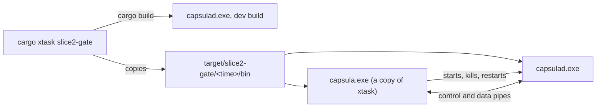

# The slice 2 gate

`cargo xtask slice2-gate` checks slice 2's promises against the real dev brain, with no shell
window and no mouse or keyboard input. It runs on Rez, at normal priority, on a quiet machine.

## How it runs

- The brain serves only the `capsula.exe` beside its own executable (see [ipc](ipc.md)), so the gate
  copies the brain and itself, renamed `capsula.exe`, into a fresh folder and runs the scripted
  client from that copy. The client reads the instance capability from Credential Manager and
  sends `Hello` on both pipes, as the shell does.
- Each item gets its own `%LOCALAPPDATA%` folder and fixture script (`CAPSULA_FIXTURE`, dev builds
  only), so items never share a store and the developer's dev store is never touched. The gate
  refuses to start while any `capsula.exe` or `capsulad.exe` runs, because a dev brain would hold
  the session's pipes.
- The client answers `Ping`, grants credit for each data frame it takes, and records every frame
  with the instant its reader thread took it. Its data reader can pause, take frames one at a
  time, or keep reading while it withholds credit.
- It prints a table of verdicts and numbers and writes it to `report.md` in the gate's folder.
  `cargo xtask slice2-gate <words>` runs only the items whose names contain them.

## The items

| Item | What the client does | Pass |
|---|---|---|
| Esc against a non-reading shell | Stops reading data during a stream, sends `Stop`; 20 times | `Stop` written to `RunState Interrupted` read at p95 under 50 ms [guess]; every run stored `interrupted(stop)`, never `view_stalled` |
| Esc against a saturated data writer | The same, reading but granting no credit while the fixture streams its 1 MiB text budget | As above, with the whole credit window taken before `Stop` |
| Replacement run after Esc | `Stop` then `TextSubmit` within 1 ms, 10 times in a row | The new run's id is higher; the old run's last state is `Interrupted`, and its `RunEnd` precedes the new run's data with nothing of it after |
| Late closed step after Stop refused | Stops a run whose fixture finishes a `late` step on cancel | One `StepCommit` (the one before `Stop`); the late label is in no table, FTS or file |
| Kill mid-run, then recover | `TerminateProcess` after two committed steps and later text, then restarts | The run is `failed(crash)`; both steps and the text stored with them are kept, the text after them isn't |
| Reconnect with a multi-chunk drawing while Stop arrives | Draws 4 full scenes, reconnects, takes one chunk, sends `Stop` and `ClearDrawing`, then reconnects again | Every installed scene is complete at its last chunk; the next connection doesn't name the cleared scene and the others are unchanged |
| §6.4 deletion on fixture data | Plants a marker in a thread's title, user text, assistant text and step label, deletes it, kills and restarts the brain | The purge's whole result (no row, no `purge_pending`, no purge file); the marker is in no raw file (`.db`, `-wal`, `-shm`, logs; UTF-8, any case), no table and no FTS match, while a kept thread's marker is found |
| Esc on the real key in the real shell | Not run | Needs an input session on the desk (OSC-132) |

- `Stale` is the brain's own verdict and isn't on the pipe, so the late-step item checks its effects.
- shortcut: one scene can't reach three snapshot chunks today (32 KiB target, at most 64 steps of
  256 B), so the reconnect item's chunks span four scenes; chunking inside a scene is covered by
  the brain's recovery tests. Use one scene once slice 4's steps are bigger.
- Retrieval, summaries and Claude Code also hold thread content; slices 3 and 8 add them to the
  deletion item.
- The brain is a dev build, because only dev builds read `CAPSULA_FIXTURE`, so its timings are
  slower than a release brain's would be.
