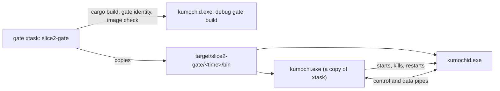

# The slice 2 gate

`slice2-gate` checks slice 2's promises against the real brain, with no shell window and no mouse
or keyboard input. It runs on Rez, at normal priority, on a quiet machine, as the gate identity
(see [the gate identity](gate-identity.md)):

```bash
cargo run --release --package xtask --features kumochi-protocol/gate-identity -- slice2-gate [<words>]
```

## How it runs



- The brain serves only the `kumochi.exe` beside its own executable (see [ipc](ipc.md)), so the gate
  copies the brain and itself, renamed `kumochi.exe`, into a fresh folder and runs the scripted
  client from that copy. The client reads the instance capability from Credential Manager and
  sends `Hello` on both pipes, as the shell does.
- Each item gets its own local and roaming folders, passed as the override pair
  (`KUMOCHI_GATE_LOCALAPPDATA`, `KUMOCHI_GATE_APPDATA`), under the gate run's root
  `slice2-<time>` (see [the gate identity](gate-identity.md)), with Claude Code off, and its own fixture script (`KUMOCHI_FIXTURE`, debug builds only), so items
  never share a store or settings. A brain still names its pipes, its instance capability, its
  Credential Manager entries and its Claude Code lane folder by identity rather than by the
  environment, which is why the gate runs as `Kumochi Gate`, one gate run at a time, and deletes
  what its brains left when it ends: see [the gate identity](gate-identity.md).
- The client answers `Ping`, grants credit for each data frame it takes, and records every frame
  with the instant its reader thread took it. Its data reader can pause, take frames one at a
  time, or keep reading while it withholds credit.
- An owned live check can use the same readers in projected mode. Each open pipe must belong
  to the held child before its Hello; the control pipe is checked before the capability is read.
  An early open waits for capability publication, and a refused capability is never sent
  again. A replacement must be observed before retrying the handshake. One absolute
  deadline bounds the handshake, reads and writes. If the Windows event wait expires before
  that deadline, the client waits again on the same pending transfer, without renewing the
  allowance. The frame and byte caps count admitted
  post-handshake frames, including ignored frames; each reader can have decoded one extra
  frame bounded by its pipe's per-frame maximum (64 KiB control, 256 KiB data, plus
  headers). Frames are reduced to facts before queuing. Truncation isn't a clean pipe end.
  Projected data timing uses the read stamp; the slice 2 gate still timestamps after credit.
- It prints a table of verdicts and numbers and writes it to `report.md` in the gate's folder.
  `slice2-gate <words>` runs only the items whose names contain them.
- `slice2-gate --inner` is internal: it is how the copy runs the items, and it starts brains
  without the run lock, the process check or the cleanup. The outer gate passes it the run's root
  and run id. Before it writes anything, the copy refuses a brain beside it that isn't a Gate image,
  and admits the root only when it sits directly in `kumochi-gate-runs`, every folder from the
  volume root down to it holds, its `gate-run` file carries that run id, and a gate run has
  published a line naming exactly that root and id and holds its published lock, so an older
  run's root is refused while another run is on, even while that run recovers it. Each item's folder is created new, never reused, and the report goes to the
  folder the copy runs from. Never run it by hand.

## The items

| Item | What the client does | Pass |
|---|---|---|
| Esc against a non-reading shell | Stops reading data during a stream, sends `Stop`; 20 times | `Stop` written to `RunState Interrupted` read at p95 under 50 ms [guess]; every run stored `interrupted(stop)`, never `view_stalled` |
| Esc against a saturated data writer | The same, reading but granting no credit while the fixture streams 17 deltas of 61,000 B inside the 1 MiB text budget | As above. Before each `Stop`, the frames taken leave no room in the credit window, and the fill frames still unsent (fixture count minus taken, times the observed frame size) are over the brain's 512 KiB data-queue cap |
| Replacement run after Esc | `Stop` then `TextSubmit` within 1 ms, 10 times in a row | The new run's id is higher; the old run's last state is `Interrupted`; nothing of the old run arrives after its `RunEnd`, which precedes the new run's data. Old-run frames read after `Interrupted` are counted, not failed |
| Late closed step after Stop refused | Stops a run whose fixture finishes a `late` step on cancel | One `StepCommit` (the one before `Stop`); the late label is in no table, FTS or file |
| Kill mid-run, then recover | `TerminateProcess` after two committed steps and later text, then restarts | The run is `failed(crash)`; both steps and the text stored with them are kept, the text after them isn't |
| Reconnect with a multi-chunk drawing while Stop arrives | Draws 4 full scenes, reconnects, takes one chunk, sends `Stop` and `ClearDrawing`, then reconnects again | `Scenes` names 4 distinct whole drawings (committed = revision = 64). Applying chunks by the shell's rules (a scene installs only at its last chunk, with exactly its committed steps; a chunk at another revision spoils it for the connection; more steps than committed is an overrun; a scene cleared locally or not named never installs), exactly the 3 uncleared scenes install, each with the fixture's 64 steps; the cleared one is absent after the clear and after every later chunk; nothing is left short of its last chunk. The next connection names the same 3, unchanged, and installs them whole |
| §6.4 deletion on fixture data | Plants a marker in a thread's title, user text, assistant text and step label, deletes it, kills and restarts the brain | The purge's whole result (no row, no `purge_pending`, no purge file); the marker is in no raw file (`.db`, `-wal`, `-shm`, logs; UTF-8, any case), no table and no FTS match, while a kept thread's marker is found |
| Esc on the real key in the real shell | Not run | Needs an input session on the desk (OSC-132) |

- The two pipes aren't ordered with each other, so frames already in the data pipe can arrive after
  the control pipe's `Interrupted`. The gate's replacement criterion is the wire order the protocol
  promises, nothing of the old run after its `RunEnd`; the shell's fence that drops those late
  frames when it applies them is covered by its unit tests.
- The client applies recovery chunks by the shell's rules and checks them against the fixture's
  known drawings. The real shell's install logic is covered by its unit tests, as its fence is.
- `Stale` is the brain's own verdict and isn't on the pipe, so the late-step item checks its effects.
- Every pipe write, and the wait for `Welcome`, is bounded; a stuck transfer is cancelled and
  waited for before its buffer goes. The brain build is killed, with everything it started, after
  40 minutes, and the whole gate, with its brains, after another 20; a `taskkill` that fails is
  reported with the process it left. It builds a debug brain from either xtask profile, since only a
  debug brain plays fixture scripts.
- A brain whose kill fails isn't waited on, which would never return: the gate keeps its handle,
  ends it after its item with `taskkill`, waits for it to exit, and fails that item. It only ever
  ends brains it started and still holds, so no other process can match, even with a reused id.
- shortcut: one scene can't reach three snapshot chunks today (32 KiB target, at most 64 steps of
  256 B), so the reconnect item's chunks span four scenes; chunking inside a scene is covered by
  the brain's recovery tests. Use one scene once slice 4's steps are bigger.
- The deleted and kept markers start with letters no fixture word starts with (`qgone…` and
  `zkept…`). FTS5 stores a term after the first on an index page only as what it adds to the term
  before it, so a marker sharing a prefix with its neighbour would never appear whole in the raw
  bytes, and a stale one would pass the scan.
- Retrieval, summaries and Claude Code also hold thread content; slices 3 and 8 add them to the
  deletion item.
- The brain is a debug build, because only debug builds read `KUMOCHI_FIXTURE`, so its timings are
  slower than a release brain's would be.
