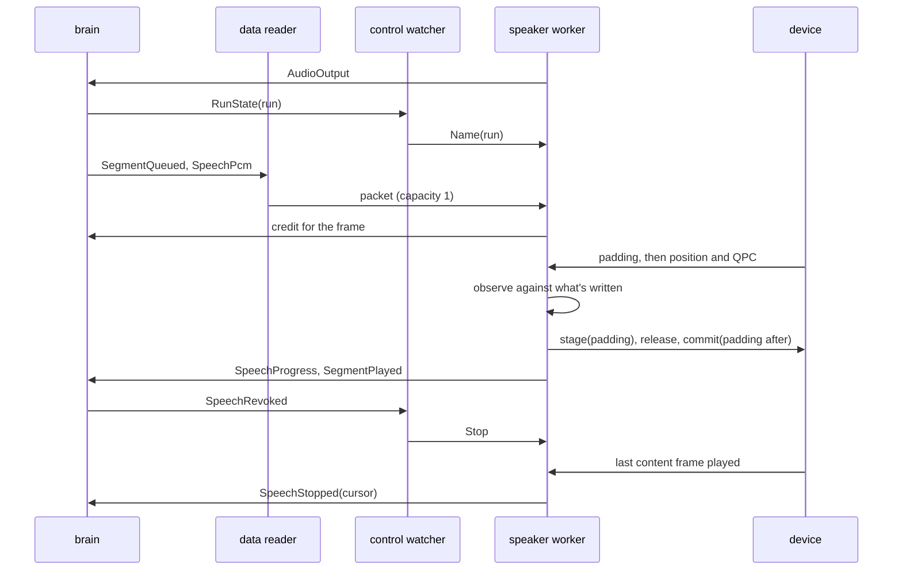

# The speaker

The internal queued CPAL path does not change normal startup or the legacy test opener. Its owning
worker can open a paused float stream at the default endpoint rate and feed bounded 24 kHz
mono packets. It converts on the worker through `kumochi-audio`, which also serves brain
speech and microphone input, then fills a preallocated pool of device-format blocks. The
callback takes only atomically published blocks and fills silence without waiting for the
worker. The fixed single-producer/single-consumer rings return slot IDs for reuse.
Closing either the backend handle or the transport cancels the callback. Backend
destruction starts only after cancellation; a later callback writes silence. Worker-side retirement retains the pool and rings
until the backend actually destroys its callback closures, then wipes and frees them off
the audio thread. At most one pool may be live or awaiting retirement; if a backend never
releases its closures, that pool stays retained and new opens are refused. The worker clears
converter history at close and scrubs blocks as they become exclusively owned while waiting.
The callback checks an atomic fence before each bounded copy. A denied copy ends that
callback's copying without retrying. Stop discards ready blocks and ramps the last sample
to silence in at most 5 ms. Source observations cover copied
speech only; their positions follow the converter's device-frame phase, not how much
source it accepted. The callback publishes those observations into a bounded ring. It
latches the last non-silent frame independently, including the ramp; missing timing stays
unknown. Neither filler nor the ramp advances the source cursor.

The `speaker::queued` state keeps one bounded source queue per run. Admission or stale
discard returns ingress byte credit once; consumption or discard frees source capacity.
An old logical output generation reaching the worker cannot take a sequence slot; the link
rejects queued frames from a mismatched output owner. Timed commands settle the prior playback interval before changing
eligibility: Pause keeps fractional virtual time, and Stop settles only due evidence before
discarding and never admits more input. Stale open results do not settle the clock.

The queued worker has a separate retirement report for the brain's synthesis window.
Each segment reports cumulative retired samples and its validated final in order,
including virtual or discarded samples. Only the contiguous heard prefix contributes
to heard history or the Stop cursor. Reported retirement neither releases a drawing
binding nor confirms a quiet tail. A retiring worker retains its report sink through
a confirmed future quiet deadline; an unknown tail never produces a quiet receipt.
The sink accepts or refuses each report in order. Refusal keeps the accepted prefix,
closes ingress, and stops the owner, which signals report failure once. It attempts
no more reports and makes no quiet claim.
The legacy opener and reports are unchanged.

Only contiguous, generation-matched observations on a live route can extend the heard
prefix. Loss keeps the last settled prefix; delivery time cannot prove pending estimates.
The handed-off uncertain interval is consumed as unheard, leaving app-only PCM queued.
A gap or observation overflow immediately fences further staging and presentation on that
route, including across timed commands. The owner can then retire it with the real callback
handoff boundary, or Stop can discard the queue without the handoff boundary. Stale
observations don't request recovery. Virtual pacing never crosses the first unheard gap
in heard history. Finality after Stop still requires every applicable generation-specific
tail proof and the latest known deadline. Two unresolved device tails refuse another
physical open, but virtual pacing continues.

Stop is sticky and bypasses the bounded command mailbox. The owner handles commands
before admitting ingress, and a terminated owner reports disconnection, not backpressure.
Open, play, pause and stream destruction run on a separate backend thread. One process-wide
slot is held from before device discovery until the native stream is destroyed, so a stuck
backend can't start more native opens. If Stop closes the gate during discovery, a late
successful open is dropped without starting playback. If playback admission wins the race,
Stop still fences the callback's source. Callback work and route notifications wake the owner.
A native resume must return within the existing 200 ms stall interval, even if
callbacks continue. Callback activity refreshes the deadline only for staged speech
outside a pending resume. A stall fences the old route and allows virtual pacing
without waiting for the device call to return or starting a second stream.
Loss, an invalid observation, or overflow enters the same fenced recovery path. A
reroute replaces the stream instead of assuming that old endpoint timing still applies.
An xrun rechecks refill readiness on every tick, even without new ingress.
Only an authoritative typed RunState starts this worker on an internally selected queued pair.

The queued link keeps its authenticated pair in the existing output owner. This does not reserve a
legacy tail, grant capture, or accept turns before the matching registration receipt. Ending or withdrawing
that pair drops its run input before aborting both pipes and closing both writer mailboxes.
A worker's exact known-tail stop report can still pay its local quiet debt after disconnection.
It cannot send that old receipt to another pair. A live pair needs the report queued before
admitting another turn; a refused live report ends the pair. After an earlier retirement report
is refused, the original worker can observe its fenced callback for at most 500 ms without
feeding audio or sending another report. That local proof doesn't release the device permit;
the backend still owns disposal. Unknown tails still block replacement. An
absolute startup deadline ends the same pair even while control traffic continues. Ordinary
launch still selects Legacy; there is no user-facing queued selector or fallback.

`kumochi_shell_core::speaker` owns one connection's output device: it keeps the run's queued
speech, writes it to the device, and decides from the device's own clock which samples played.
The brain still owns what is spoken and when a run ends ([voice.md](voice.md)). The speaker
only reports what played and when its output is quiet.

**Dormant.** Nothing opens a speaker in a normal launch. `link::prepare` attaches no
`Opener`, so no connection sends `AudioOutput` and no run gets a reply; link tests pin that.
Every link has an output owner, but without an opener each session is `Quiet { NoOpener }`,
so a held gesture's capture inhibit pauses nothing, and nothing claims a microphone yet.
Slice 7's half-duplex change (D) enables output.

## Pieces

| Piece | File | Owns |
| --- | --- | --- |
| `Clock` | `speaker/clock.rs` | the device epoch, the ledger, the deadline and what counts as played |
| `Engine` | `speaker/engine.rs` | the 20 s arena, up to 256 segments, runs, stops, pauses and the reports |
| `Worker`, `Speaker`, `Input` | `speaker.rs` | the bounded channels to the worker; credit; spent buffers; the shared `serve` loop; teardown |
| `Tail` | `speaker/tail.rs` | one generation's sequence-locked record of what it owes |
| Windows adapter | `platform/windows/speaker.rs` | the WASAPI stream, its thread, its event and the platform results |
| Link | `link.rs` | routing speech frames, run names, revokes and the speaker's reports on one connection |
| `OutputOwner` | `link/output.rs` | each session's output, every generation's tail until it settles, talk-back off, the capture inhibit |

## The device seam

An adapter drives a pinned stream through the shared `Engine`, which keeps the `Clock`.
Everything else is shared and tested offline against a fake device clock
(`speaker/clock_tests.rs`, `speaker/engine_tests.rs`).

- `begin(frequency, origin)` once, with the position read before the first write. A second
  epoch, or a zero frequency, freezes it.
- `observe(Observation { position, frequency, host_time, host_frequency, precise, service })`
  comes first in each pass, so a reading is checked against what was written before the refill.
- `stage(out, unread) -> Staged` writes mono samples for the next device frames into the
  adapter's scratch and consumes nothing; `unread` is the padding read before it. While the
  `Staged` lives the engine takes nothing else. `Staged::commit(unread, released)` applies it
  once the native release succeeded at `released`, with the padding read after it, or `None`
  when that read failed; dropping it takes nothing back.
- `Staged::release(put, unread)` gives back the native buffer the staged frames were copied
  into. Its last look at the session's revocation, right before `put` makes the native release,
  picks the kind: silent once the link let go, committed as filler with the same checks when the
  padding after it reads, taking nothing staged, or content, committed with the release time `put` returns and the
  padding read after it. That look is the in-flight
  boundary: a revoke after it can't recall the buffer, whose content is then owed like any
  other, and nothing promises silence for a release already under way. A content release whose
  `put` fails may have exposed it, so the clock is unplaced for good; `Staged::abandon` says the
  platform lent no buffer, so nothing staged reached the device.
- `Device` is what an adapter's started stream does: `wait` for its next period, `service`
  (observe, then stage and release) and `stop`. `serve(worker, engine, device)` is the one loop
  every adapter runs: wait, take commands and frames, service, send reports. A fault or a
  withdrawal retires the stream: it plays out what was written until the clock is quiet, faults
  or 500 ms [guess] pass, is stopped and let go, and the worker goes on without a device,
  answering stops and crediting frames until the link lets go.

## What played means

- **Frames.** A device frame is `(position − origin) × rate / frequency`. The ledger is a fixed
  ring of 64 intervals of written frames, each tagged with a segment and its count before it,
  or as filler. An interval enters the ledger only at commit.
- **Played** is what the observed position has passed. It is never what was written, and never
  what the padding implies. The cursor is a count, not an index: A[0..3), filler[3..103),
  B[103..105) gives A:3 at frames 3 and 103, then B:1 at 104.
- **Content and filler.** Speech samples equal to zero are content. Silence written while
  waiting for audio or a resume is filler, and filler never counts.
- **Continuity.** Before a refill, a device holding none of the frames written so far may already
  have run dry, so nothing more is released. After it, `unread` is how many written frames the
  device held, these included. If none of the earlier ones were left, the device may have run
  dry before the write landed and played silence nothing mapped, so the clock freezes instead of
  counting anything after it.
- **Released but unplaced.** Once a release succeeds its content is owed, whether or not the
  clock can place it. When the continuity check fails or the padding read after the release
  fails, the ledger never takes the frames, and the clock is never quiet again, so no pause goes
  quiet and no stop is answered on its account. A fault after the last content frame played
  stays quiet, and a stage that was never released takes nothing.
- **The deadline.** While written frames are unplayed, a trusted advance must come within 200 ms
  [guess] of the last advance, or of the release that left frames outstanding when none were; a
  refill while frames wait doesn't renew it. Both times are on the adapter's own monotonic clock
  (`service` and the release time), never on the device's times; the epoch's first reading pins
  the host time units. A reading whose host time repeats the last one is no advance even if its
  position moved: it neither counts nor renews the deadline, though a position past the last
  frame written still freezes. Readings that stay imprecise can't hold it off either,
  and an advance that comes after the deadline is refused.
- **Freezes.** These freeze the clock for good and withdraw the output with
  `AudioOutputUnavailable`, once: a position or host time that goes backward (half a frame
  included), a position before the origin or past the last frame written, a missed deadline, a
  device that may have run dry, a full ledger, a changed, repeated or missing epoch, host time
  units other than the first reading's, a failed device call, speech from the brain that can't
  be true, or reports the brain left unread past their bound. A single imprecise reading never
  counts and never freezes.
- **Withdrawal.** `Withdraw` (talk-back off) and every freeze withdraw the output once: unwritten
  speech is discarded, only silence is written, later frames are stale and credited, and
  `AudioOutputUnavailable` goes out. The clock runs on, so a stop is still answered once what
  was written has played.

## Dormant segment gate

A hold blocks native staging and virtual pacing at one segment, not its predecessor.
Releasing it does not catch up elapsed hold time. Discard keeps PCM ingress in sequence
and returns its credit, but skips the discarded source in head order without marking it
heard. Later PCM for that segment cannot restart it.

The worker applies a hold before it stages the segment. A step fence discards an
unstaged line without touching the device; accepting the first source packet for
staging commits the line, even if the callback hasn't taken it. The eight transport
blocks hold about 160 ms of source, but staging is not a time bound: a committed
line can wait seconds during a pause and play on resume unless its run is stopped
or replaced. No opener or production caller enables this gate yet.

## Dormant drawing conductor

The dormant drawing conductor decides only an assignment's audio gate and picture timing.
The presenter supplies readiness and fences, the worker supplies actual handoff and the
current physical route's source span, the link reports worker absence, and the brain supplies
synthesis finals. It doesn't infer submission from staged or virtually consumed samples.
Preparation allows sound without waiting for visual eligibility; after a 250 ms hold the
whole line is allowed and the picture takes silent timing. On rebuild, an unshown speech
step has 250 ms to receive a handoff from the new route before taking silent timing.
A route rebuild mid-line ends speech-following for that shown step; it takes authored
timing immediately. A shown or fenced step can't show again. Step-level Drop uses the
staging commitment above. These defaults aren't measured. The dormant worker now uses
one reducer and the session clock supplied by its caller. It reads the keyed view and
applies the matching hold before feeding source, services hold and rebuild deadlines on
its own wake, and publishes one keyed picture. An accepted first handoff on the current
route predicts onset; shown motion is authored and later progress doesn't publish a level.

A sticky end publishes independently of timing. An end before visual eligibility can
carry Wait: it releases the audio binding while the presenter keeps the step. Retiring
unheard source never produces a played terminal; an earlier gap doesn't prevent a
later fully heard segment from ending. A fully retired unheard line takes silent
fallback even when a device opens as virtual pacing exhausts it. Retirement still
keeps the existing rebuild grace. Ready PCM arms the hold during a pending device
open, so expiry can release it to virtual pacing without another packet.
Missing owner, backend startup failure and worker exit
are reported to the future link, which supplies keyed Unavailable. Unit 4 must ensure
the worker has seen the matching binding before forwarding that assignment's first PCM,
for example by using the keyed picture as acknowledgment. An unresolved assignment is
not unassigned. No link or opener uses this adapter yet.

## Reports

All go out on the connection's control queue, in order. The announcement comes first.

- `AudioOutput { rate, generation }` is the engine's first report, so a withdrawal can never
  overtake it.
- `SegmentPlayed` goes out once per segment, in order, when its total is known and has played.
  An empty segment counts at 0, and a final that arrives late is reported from what already
  played.
- `SpeechProgress` reports the playing segment at most every 250 ms, timed at the reading. An
  unread progress report is replaced by a newer one.
- `SpeechStopped { run, cursor }` answers a revoke (or a local Stop) only once every content
  frame written for the run has played. One frame short is not quiet. The cursor names the
  latest segment reported played or crossing, at its verified count. After A:3 and an empty
  B:0 it is B:0, which the brain accepts and whose heard point stays A:3. A device loss with
  written frames unverified withholds the answer. Each run's stop is answered once within the
  last 8 [guess] answers. A repeat past them is answered again, maybe with no cursor, and the
  brain ignores it for a run already final. Stops come out of order, so an older run's first
  stop is still answered, and a floor of run ids can't stand in for that memory.
- `AudioOutputUnavailable { generation }` goes out on the first freeze.
- **Bound.** At most 512 reports wait unread: every segment's receipt and as many again. Past
  that the brain isn't reading, and the worker ends, whatever faulted first, rather than grow
  the queue or drop a receipt in silence. The first fault stays the diagnostic.

## The tail

Each output generation's engine publishes a `Tail`: a sequence lock over one
`Snapshot { exposed, played, flight, quiet, flags, spoken }`, in device frames of its one clock epoch.
Only the engine writes it, on the worker thread, with no lock or allocation; a reader never
waits, and a read that overlaps a write returns nothing.

- `exposed` is the end of the content committed to the device, `played` the verified frontier,
  `flight` the content end of a release under way (0 for none), and `quiet` the latest pause
  serial that went quiet.
- `spoken` is the run whose content the last successful content release committed (0 for
  none). The stage reads the device's run once per buffer that holds content, and only the commit
  publishes it, so filler keeps it and a flight, an abandoned buffer or a silent or failed release
  never sets it. A stop of that run or a newer one, the seal and the release clear it; an older
  stop leaves it. A buffer staged for one run commits before a `Name` or `Stop` queued meanwhile
  applies, because the staged buffer holds the engine.
- Flags: `UNKNOWN` once content may have reached the device unplaced (a continuity gap, a failed
  padding read, a failed release), `SEALED` once withdrawn, `FAULT` once the clock froze, and
  `RELEASED` once the stream was stopped and let go, so nothing more can be released.
- `owed()` holds while anything is in flight, unknown, or exposed and not yet played. A live
  generation that caught up owes nothing now but may still speak, so only `RELEASED` or a gone
  writer ends its tail ([the output owner](#the-output-owner)).
- The worker wakes the output owner through a capacity-1 channel when the quiet serial, the flags
  or `owed()` changed. Its thread wakes it once more after the worker, engine and device are
  gone, on return or unwinding, when nothing can write the tail again.

## Runs, fences and pauses

- **Admission.** Only the run control named last may start playing; until it's named its frames
  are held, uncredited. The run already playing may finish its own audio after a newer name. An
  older run that was never named last is dropped and credited, and a held run isn't released
  because a larger one was named.
- **One run owns the device.** A newer run's frames are held, uncredited, until the old run
  has been stopped and gone quiet, or has played and reported everything. A revoke that
  arrives after the old run gave way is answered with its last cursor. A revoke for a run
  never seen is answered at once with no cursor.
- **Fences.** A stop fences its run and every older one: their later frames, and PCM for
  another output generation, are dropped and credited. A stop is a command the worker applies at
  its next pass, not a native cancel: frames released before it still play and count. Only the
  session's revocation is read at the release decision.
- **Pause and resume.** `pause(serial)` closes admission. The tail's `quiet` names the serial once
  every content frame written before it has played. `resume(serial)` withdraws that pause, quiet or
  not, and speech goes on at the first unwritten sample, with no skip or repeat.
- **Steps.** Every segment plays in order. Holding a step's narration until its drawing is
  shown, and dropping a failed scene's audio, come with the speech timeline (E).

## Bounds

- **Validation.** Segments are announced in order, at most 256. Chunk sequences start at 0
  with no gap or repeat, and nothing follows a final. A final's `last` equals the segment's
  total, at most 30 s. The arena plays in segment order, so a segment's audio is accepted only
  once every earlier segment has its final; the brain sends one segment's audio at a time.
  Audio goes no more than two segments ahead of the first unreported one, while empty finals
  and announcements may come any time. Anything else freezes the speaker.
- **Memory.** The arena holds 20 s at the device rate (7,680,000 bytes at 192 kHz). Twenty
  seconds plus one sample unplayed is refused, counting content already in the device and not
  yet played, but a long segment streamed at playback pace fits.
- **Credit.** A frame is credited once, when it's kept or dropped, never when it plays. Long
  playback releases the brain's window through progress.
- **Channels.** Frames go through a capacity-1 channel. A reader waiting on a busy worker gives
  up once the link lets go. Commands go through a queue of 16 that never waits: a full queue
  is refused, and the caller ends the connection. The worker applies at most 16 commands a
  pass and takes data only once none is left, so data can't pass a fence. Its reports go out
  only once the output owner accepted the speaker: `launch` returns one only when its device
  started within the wait, and `opened` accepts it after its fence, so a device that starts late
  or a speaker the link lets go announces nothing.

## Privacy and teardown

- **No content in diagnostics.** No sample or text is logged; `Data`'s Debug shows lengths
  only.
- **What is zeroed.** Decoded samples: in the arena as they're written to the device and when
  they're discarded, and the whole arena on drop; in a `Packet` however it's let go; in a kept
  or dropped frame's buffer, which goes back to the reader zeroed when the return channel has
  room or is freed by the worker, already zeroed; and in the adapter's scratch and byte buffers
  after each write and on drop. Audio that arrives with no speaker is zeroed and credited, and
  never reaches the UI.
- **What isn't.** The transport's framed bytes and the data reader's buffer, which predate the
  speaker, and the device's own copy of what it was given.
- **Teardown.** Dropping the `Speaker` revokes it and waits up to 1 s [guess] for its thread to
  finish, then leaves it. A revoked worker stages only silence, and a buffer whose release decision
  sees the revoke goes back silent; one decided before it is owed, as above.

## The link

- **Opening.** A link with an `Opener` opens one speaker per connection, and only once the
  connection's threads run, `Connected` reached the UI and no quit is under way. The output
  owner reserves its generation and ledger slot before `Connected`, and fences it before its
  reader starts. A speaker that fails to open, opens too late, or whose open returns after Quit
  began or the session was lost, leaves the session working without output and announces
  nothing: the owner accepts a speaker, so its reports go out, only once it's fenced. It reads
  Quit and the session's permit in the same locked step, and Quit and session loss pass through
  that lock once set, so a cancellation after the link's own check still refuses the speaker.
- **Routing.** The data reader hands `SegmentQueued` and `SpeechPcm` to the speaker instead of
  the UI. The control watcher hands it each newly named run from `RunState`, and each
  `SpeechRevoked` as a Stop. A frame whose run control hasn't named is held, uncredited, so
  data that overtakes its `RunState` can't start playback; a revoke that comes first fences it.
  The reader decodes the announcement's start class and logical output generation, but the
  legacy speaker still receives only its run and segment. Without a speaker, `SpeechPcm` is
  zeroed and credited.
- **Failure.** A command the speaker's queue refuses ends the connection, since a lost revoke
  would leave speech playing. Once the owner kept a speaker, the link arms its worker's end:
  when the worker ends for any reason, idle included, it aborts both pipes, so the link notices
  at once and reconnects. A worker that ended before it was armed ends the connection as it's
  armed.
- **Teardown.** The link closes the control queue, so a worker left behind can't keep the
  writer waiting, aborts both pipes, drops the speaker (waiting up to 1 s for its thread), then
  joins its own threads.

## The output owner

`link::output::OutputOwner` is one per link, in its shared state, and the only place that knows
whether a session has an output and whether an earlier generation still owes audio.

- **Output.** Each session's output is `Closed`, `Quiet { epoch, why }`, `Opening(g)`,
  `Live(g)` or `Lost(g)`. `why` is `NoOpener` (every normal launch), `Off`, `Refused` or
  `Retired`. Each no-output stretch gets a fresh epoch, so its `OutputKey` never matches an
  earlier session's.
- **The link thread's three calls.** `begin(session, abort)` before `Connected`: with an opener
  and talk-back on it reserves a ledger slot and the next generation and publishes `Opening`;
  otherwise the session is `Quiet`. `opened(g, speaker)` once the open returned and before the
  reader starts: a speaker opened after talk-back went off is withdrawn first, and one that can't
  take that command is handed back for the link to drop, which ends the session. Under a held
  inhibit it's paused under the inhibit's serial instead, so no speech reaches the device. `end(session)`
  first in teardown lets go of the speaker's queue and the session's abort; the ledger keeps the
  tail.
- **The ledger.** Four entries, each a generation and its `Tail`. A fifth unresolved generation
  is refused before it opens: the session goes on as `Quiet { Refused }` and every entry stays.
- **Settling.** Every lock reads each pending tail. An entry is clean when its writer is gone or
  its stream was released, and nothing is owed; terminal when something is owed then, or when the
  clock faulted with something owed. A live generation that caught up is never settled, since it
  can still speak. An opening generation isn't settled until `opened` applied its outcome, so a
  stream that retired before its open returned keeps its entry and settles at the next lock,
  leaving the session `Quiet { Retired }` or `Lost`, never live without its entry. A clean live
  generation leaves its session `Quiet { Retired }`; a terminal one leaves it `Lost`, and a
  terminal entry stays until restart.
- **Talk-back off.** `withdraw()` sends `Withdraw` to a live speaker, fences an opening one when
  it opens, and later sessions get none. The stream retires; the worker stays on without a
  device, answering stops and crediting frames, and the session goes on.
- **Stop.** `stop(session, run)` queues a speaker `Stop` on that session only, and never waits:
  contention is `Busy`. Presence calls it only after the brain's `Stop` or `StopScenes` for that
  run was queued (`send_stop`), so speech never stops for a stop the brain wasn't told; a refused
  brain send ends that session and stops no speech. Presence keeps the stops a busy owner refused
  in order and offers the front one again every millisecond, up to ten offers in all (a policy,
  not a measured bound); a later stop waits behind it. When the offers run out, that session
  ends. Both ends go through one path (`end_session`), as does any refused drawing control (for
  example `StopScenes`, `StepFailed`, `SceneFailed`, `SceneSkipped` or `ClearDrawing`): it
  closes the session at once (`Session::close`), then finishes the pipe abort and the owner's
  barrier on the background executor, since that barrier takes the owner's lock; that is one
  logical end, though a speaker `Stop` already queued may still reach `end_session` again,
  harmlessly. Closing is session-scoped: a send made through that session (controls, data, held
  deletes, credit) that checks after the close is refused, an owed `VoiceHoldStopped` stays owed
  and is replayed on the next connection, and nothing received for it can open the microphone.
  It is a check, not a barrier: a send already past its check still goes out, and work already
  queued to the writers is not recalled. Three link-wide sends don't take a session and skip the
  check: Quit (`tell_quit`, which also tries the held deletes first, since a brain never told
  Quit relaunches the shell), the gesture cancel (`cancel_input_gesture`), and the replay of an
  owed stop on a new connection.
- **Spoken runs.** `spoken(session)` reads the live output's tail without waiting and returns its
  `spoken` run: positive evidence the run is speaking, even after the device drained, since a
  pause can drain it while the run still has unwritten speech. A busy owner or a tail
  mid-publish is no evidence, and with no opener no run is ever spoken. A hold takes the spoken
  run when its `Warm` is applied and, at recognition, stops it if it is still the run Esc would
  stop: fenced locally, kept stopped until both its endings are in so its late scenes are
  skipped (a run the presenter showed before its first `RunState` included, whichever of its
  endings came first), the brain's `Stop` queued, then the speaker's. A refused brain send ends the
  connection and opens no hold. The control reader names runs with `Name` as before and takes
  no owner lock.
- **The capture inhibit.** One per link, held by a voice gesture so the microphone never records
  the speaker. `acquire(gesture)` takes it and pauses a live speaker under a fresh serial; it
  never waits, so contention is `Busy` and the gesture's gate retries ([voice.md](voice.md)). `transfer` moves it to a
  new gesture before a microphone is bound; `bind_mic` binds it, once, to that gesture's
  microphone generation. `end` cancels a bound microphone; the inhibit outlives the session.
- **Claims.** `claim(token, session)` names the session's current `OutputKey` and checks it.
  `start_mic(claim)` checks again and, in the same step, claims the bound microphone's single
  start; `collect(claim, mic, running)` checks again and lets it collect on its receipt, only
  when `mic` runs the bound generation itself: another gate's microphone with the same gesture
  number is refused. So a claim can't be reused after its output moved on. A claim is refused while the open is still
  `Opening`, while another generation owes (`Debt`) or any tail is terminal, and on a live
  generation that isn't quiet under the inhibit's serial or ever exposed content
  (`Unqualified`: D1 qualifies no echo-safe route). A session with no output claims its
  no-output epoch.
- **Retiring the inhibit.** `retire(token, how)` needs proof on the bound generation: `NoMic`
  when none was bound, `Unstarted` when it never started (the owner discards it), `Retired` when
  its gate shows it finished. A refused proof hands the token back, so a later valid one still
  retires it. Retiring resumes the speaker. Only the voice dispatcher retires, and never while a
  speaker `Stop` is still pending, so a resume can't overtake it.
- **Never blocking.** Each section under the owner's lock is short. Opens, joins, pipe aborts and a
  speaker's last drop happen after it. A command the speaker's queue refuses drops the output to
  `Lost` and aborts the session's pipes, after the lock.
- **Wakes.** `changes()` is a capacity-1 channel; workers and the owner wake it on every change,
  and the speaker thread's final wake guarantees a settled tail is seen without polling. A live
  claim that reads its tail mid-publish gets `Busy`, and no later wake is promised for it: D2
  rechecks it within an attempt budget of three, with a 10 ms timer as the fallback wake, or
  denies the gesture.
  `view()` gives the key, why there's none, and whether a tail is still retiring or terminal.

## Windows

`platform/windows/speaker.rs` is the only Windows piece: one event-driven, shared-mode WASAPI
stream on the default output, on its own thread with its own COM apartment.

- **Format.** It writes the engine's mix format without resampling: 16-bit PCM or 32-bit float,
  one to eight channels. Its WAVE parser is shared with the microphone, but capture still
  accepts only one or two channels and doesn't use the speaker mask. Mono and stereo receive
  the same sample in every lane as before. Larger layouts need a consistent extensible mask
  with front left and right. Those two lanes receive the sample, and all others stay zero.
  A mix rate that isn't a multiple of 50 Hz, such as 11,025 Hz, still gets no output. The adapter
  sizes its byte buffer from the device's frame width at open; every clock and stop count is
  still in frames, regardless of how many lanes each frame has.
- **Passes.** The stream is the adapter's `Device`, run by the shared `serve` loop. Each pass reads the padding and the clock, observes, then tops the device up to
  two periods. Samples are staged, written into the adapter's own byte buffer, then copied into
  the native buffer between `GetBuffer` and `ReleaseBuffer`, so no Rust slice is ever made
  over native memory. `Staged::release` decides the flags after the copy, right before
  `ReleaseBuffer`: once the speaker is revoked the buffer goes back with
  `AUDCLNT_BUFFERFLAGS_SILENT` and, when the padding after it reads, is committed as filler, so
  the clock still maps the device's position past it while the stream drains. A content release is committed with
  the time it succeeded, read before the padding, and that padding is `unread`; if the read fails
  the frames are still owed. Both scratch buffers are
  zeroed after each write and on drop.
- **Readings.** `IAudioClock::GetPosition` gives the position and a 100 ns QPC time, so
  `host_frequency` is 10 MHz, and the engine converts it to the wire's QPC ticks with
  `QueryPerformanceFrequency`. `S_FALSE` maps to `precise: false`, because the `windows`
  wrapper's `.ok()` would turn it into success. `service` is the time since the stream opened.
- **Waits.** Each pass waits for the stream's event for at most 20 ms. A failed wait, or any
  failed device call, is `Fault::Lost`. A one-period buffer that shows no padding at a period
  boundary looks like a device that ran dry and is withdrawn; that timing isn't supported.
- **Opening and teardown.** Opening waits up to 2 s [guess] for the stream to say it runs; past
  that the connection goes on without output, after the speaker's normal bounded teardown (up to
  1 s more), and a stream that starts later is never accepted, so it announces nothing.
  Only one speaker thread runs at a time, so one still tearing down never
  overlaps a new stream. The event is created before the client, and every value that can fail
  (the period, the lead, the QPC frequency, the buffers) is settled before the client, its
  services and the event move into the stream, so on every path the client and its services are
  released before the event closes. Teardown stops the stream,
  releases its interfaces, closes its event and leaves COM on its own thread. A failed stop is
  logged; the tail's verdict comes from what played, never from the stop's result. A
  `GetBuffer` that lends nothing abandons the stage.
- **No capture.** It opens no capture or loopback endpoint and listens for no endpoint changes;
  a pinned stream sees its own loss.

## Not here yet

- Check 4, the isolated endpoint session that compares this clock with an independent endpoint
  reference and measures startup, stop and revoke latency, is pending. Nothing here measures
  native timing or what was audible.
- The `Played` snapshot and per-segment crossing times come with the conductor (E).
- What the user sees when the device is lost mid-reply is D's decision. Today a withheld
  `SpeechStopped` lets the brain's 2 s quiet timeout end the connection.
