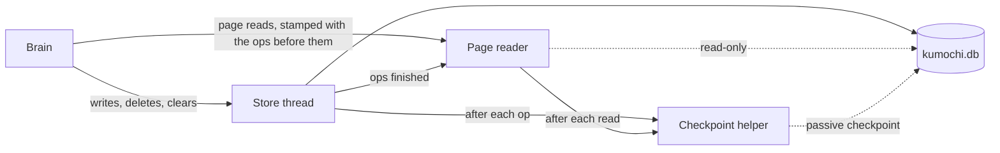

# The store

The brain keeps threads, their events and runs in one SQLite file,
`%LOCALAPPDATA%\<product>\kumochi.db`, through `rusqlite` with SQLite and FTS5 built in. Only the
brain opens it. The code is `crates/brain/src/store/`.

## Settings

| Pragma | Why |
|---|---|
| `journal_mode=WAL` | Readers don't block the writer, so a purge can copy the file while it serves. A store that refuses WAL doesn't open |
| `synchronous=FULL` | Every commit is durable, so "saved" means the transaction committed |
| `foreign_keys=ON` | Rows can't point at a missing thread or run |
| `secure_delete=ON` | Deleted rows are overwritten with zeros, not left in freeblocks or free pages. Stale cell copies in the gaps a page rebuild leaves are out of its reach, so the purge replaces the file (see below) |
| `temp_store=MEMORY` | Statement journals, which hold the pages a delete removes, never spill to `%TEMP%` |
| `wal_autocheckpoint=0` | A commit never copies the WAL into the file itself; the checkpoint helper does that off the store thread (see [Page reads and checkpoints](#page-reads-and-checkpoints)) |

## Tables

| Table | Holds |
|---|---|
| `threads` | Title, timestamps, `state` (`live` or `deleting`), `deletion_generation`, `kind` (`main` or `thread`), `title_source` (`words`, `model` or `user`), and the nullable `model` and `effort`. `AUTOINCREMENT`, so a deleted thread's id never comes back for a new thread that late work could be mistaken for |
| `runs` | One per user turn: thread, `state` (`active`, `done`, `interrupted`, `failed`), reason, timestamps. `AUTOINCREMENT`, so a run id is never issued twice, even after the thread holding the highest one is deleted |
| `events` | Thread, run, kind (`user`, `assistant_text`, `scene_step`, `revealed`, `scene_begin`, `scene_cleared`, `scene_cut`), searchable `text`, JSON `body`. A trigger refuses updates. An event's run must be an active run of the same thread, so a late completion after a run ends is refused; scene clears, v1 cuts and the `revealed` of a late Stop are written without one |
| `events_fts` | FTS5 over `events.text`, kept by triggers, with FTS5's `secure-delete` on so a deleted row's entries leave the index at once. A deleted term can still survive whole as an `events_fts_idx` separator key until the purge rebuilds the index (see below) |
| `purge_pending` | One row while a deletion's purge is owed, written in its second transaction and cleared only after the purge finishes |

The coordinator issues thread and run ids itself, above `high_water()` (the highest ids in
`sqlite_sequence`, deleted ones included), and the store refuses any id that isn't new. A whole
user turn (a new thread when there is one, the run, and the user's text) is one transaction.

Later slices add assets, sends, the tool ledger, actions, summaries and cleanup jobs, each as a
new migration. Migrations are numbered by `PRAGMA user_version`, run forward only, one
transaction each, and a brain refuses a file whose version is newer than it knows.

**Scenes** are events, so they need no migration. A run's first step writes `scene_begin`, whose
event id is the `SceneId`; `AUTOINCREMENT` keeps it unique even after a deletion, and a
rolled-back id is never seen because no id leaves the brain before its commit. Each `scene_step`
body names its `scene`, `index` and `label`, and `scene_cleared`'s body names its `scene`. A
clear is one immediate transaction, so a busy store makes it wait rather than fail. At start,
after the recovery scan, one read rebuilds the visible set (see [processes](processes.md)) from
live threads only: a step that doesn't decode is skipped and logged by row id, never its
content. The threads panel's pages leave `scene_begin` and `scene_cleared` out.

Search takes the user's words as one quoted phrase, so FTS5 query syntax in them is plain text,
and never returns a thread being deleted.

### Typed v1 drawings

`store/drawing.rs` keeps typed drawings separate from the staged labelled placeholders above.
A typed `scene_begin` stores the immutable header and layout version in `body`; its first
`scene_step` is in the same transaction. Later steps carry the scene id, lifetime revision,
layout version and original typed step. An effective `scene_cut` stores the authoritative
activated bound and finished handles. Identical cut retries are idempotent. All these rows
have NULL `text`: drawing content never enters FTS or a page's text, and pages omit cut metadata.
Every drawing SQL or JSON failure becomes a fixed, source-free error, never a parser diagnostic.

The canonical reducer is the single writer and validates admission and cuts. The store checks
run/thread membership, first-step name reservation, the encoded-body cap and retry identity
by scene/revision; appends and cuts do not reload or replay earlier drawing content. A new
scene's first step waits for every earlier typed clear to commit, including a failed user
clear or eviction, so recovery never has to hide an uncleared visible scene to fit the cap.

Recovery reads the newest four uncleared scenes of live threads and their full ordered logs,
then replays the survivors together against one global budget. A corrupt, oversized,
unsupported or invalid scene is omitted whole, logged by row id only and cleared durably;
other scenes still recover and drawing recovery never prevents the brain from starting.
If the query itself fails, typed intake stays unavailable until restart and Quit reports
incomplete: the brain cannot claim it cleared a visible set it never read.
A row whose scene id cannot be read affects only candidate scenes in its own thread that
began before it. A durable zero cut excludes its
scene even if a crash prevented the following clear transaction. Names remain reserved in
the thread's history after a clear or eviction. Reads cap each body at 8 MiB, each lifetime
log at 128 entries and its aggregate bodies at 32 MiB. SQLite's `octet_length` checks a stored
body's byte length before materializing it for JSON checks or copying it into Rust. Typed storage is
decoded directly rather than through the model's 32 KiB record parser: canonical JSON can
expand a legal record. Numeric decoding preserves exact f64 round trips.

## The main thread, titles and model choices

Schema 3 adds four `threads` columns, each with `ADD COLUMN`, so no table is rebuilt and older
rows read as `thread` and `words` with no model:

| Column | Holds |
|---|---|
| `kind` | `main` for Kumo's thread, `thread` for a task. A unique partial index allows one `main`. It keeps these two values for good: changing a `CHECK` rebuilds the table, so later facts (origin, parent, archive) get their own nullable columns |
| `title_source` | Who wrote the title: `words` (the first turn's first line, from `BeginTurn`), `model` or `user` |
| `model`, `effort` | The thread's model slug and effort as free text, both set or both null (a `CHECK`). They're checked against the catalog per run, so a catalog change never needs a migration, and a page carries a stored choice even once the catalog drops it. An effort this build doesn't know (an older build's `minimal`, or a newer build's) reads as no choice, so one row never fails a page; a slug no build wrote still does |

- **The main thread** is created by the recovery scan when it's missing, after unfinished
  deletions and before `high_water()` is read, as one statement of its own. A start cut short
  before it commits leaves no row, and the next start creates it. `Store::main_thread()` reads its
  id, which the coordinator and every `SettingsView` carry. Its stored title stays empty: the shell
  labels its row from the assistant's name in the settings it received, so one name lives in one
  place. Nothing deletes it.
- **Titles.** `SetTitle` changes only a live task, never the main thread. A user title replaces
  any title. A model title applies only while `title_source` is still `words` and the deletion
  generation is the one it names, so a model title that arrives after a rename, a hide or a
  removal changes nothing. A later `BeginTurn` on an existing thread never touches its title or
  source. Neither a rename nor a model choice moves the thread in the list.
- **Model choice.** `SetModel` stores a live thread's `model` and `effort`; a hidden or missing
  thread changes nothing.
- **Deletion and the purge.** The four columns live in the `threads` row, so deleting a task's row
  removes them with it, and the purge's `VACUUM INTO` copy carries the kept rows' columns over
  unchanged. No table is added, so `store::delete`'s table list and the remnants scan need nothing
  new. A test plants a renamed title and a model slug, deletes, purges, scans every file's bytes
  and restarts: neither survives, and a kept task keeps its choice.

## Page reads and checkpoints

The [threads panel](panels.md) reads bounded thread, ranked search, and newest-first event pages
on the page reader: a thread beside the store thread with its own read-only, query-only
connection (`temp_store=MEMORY` too). So a long search never holds up a write queued behind
it. Each read is one autocommit statement, finished before returning, so no snapshot outlives it.
Reads neither stop the purge's copy nor postpone it: a page request never reaches the store
thread's queue, so it doesn't reset the quiet deadline an owed purge waits for.

A read waits until the store thread has finished every op queued before it, failed and empty
ones included, so it sees the thread a turn just created. Ops queued after it may show too: a
delete can overtake an older read, which the shell's revision fences already handle. The reply
goes back on the brain's input channel as before, so the epoch fence and held-page limits are
unchanged.

Commits never checkpoint. After every op and every read, the checkpoint helper, a thread with its
own read-write connection, runs a passive checkpoint, which never waits on the writer or a
reader. Frames a reader still needs are left in the WAL; the helper retries after 50 ms, doubling
up to 1 s [guess], and again as soon as a read ends. This takes the WAL copy off commits; it
doesn't bound the WAL while a long read holds a snapshot.



The reader's and the helper's connections each sit in a slot, open lazily and never create the
file. The swap holds both slots, their connections closed, from before its checkpoint until the
store has reopened (below), so neither opens the old file. While the store is unavailable after a
failed reopen, page reads fail and checkpoints wait. Closing the store lets queued ops and reads
finish, then closes the reader, the helper and the store, in that order, so the store's
connection is the last to close; nothing blocks the caller meanwhile. If the store thread
panics, waiting reads fail and both side connections close for good.

## Deleting a thread

`Store::delete` runs one `DeleteThread`. It reads the thread's state and newest run first, so
`last_run` still names that run once its rows are gone. A failure before the first transaction
commits answers `NotHidden` and leaves the thread live. A failure after it answers `Hidden`, and
the next start finishes the deletion. A thread that's already gone answers `Removed`. Only the
error's kind is logged.

How long the store thread spends on one delete, the thread's stand-in captures included
(`measure_big_delete`, release build on Rez, 20 samples a store, then 5 after a reader let go):

| Store | p50 / p95 / worst | After a reader held the WAL | WAL held |
|---|---|---|---|
| 46 MiB | 7.4 / 7.7 / 9.7 ms | 8.6 / 11.4 / 12.3 ms | 52.5 MiB |
| 232 MiB | 18.3 / 18.7 / 19.7 ms | 39.2 / 45.9 / 51.9 ms | 215.1 MiB |
| 515 MiB | 26.3 / 29.1 / 29.4 ms | 28.0 / 28.1 / 29.5 ms | 187.2 MiB |
| 984 MiB | 45.1 / 47.5 / 54.6 ms | 44.8 / 44.9 / 49.6 ms | 316.4 MiB |

Commits don't checkpoint, so a commit after a reader let go no longer copies the WAL that reader
held: before that change the right-hand column was 24, 89, 97 and 156 ms. The measurement opens
the store alone, with no checkpoint helper, so nothing copies the WAL between samples and it grows
larger than it would in the brain.

Besides the store thread, the live store has two readers: the page reader, whose one-statement
reads a write never waits for, and the purge's copy. A write never commits under the copy's
snapshot: before any write the store thread stops the copy and waits until it
has let go of the live store, and nothing more of the copy. Letting go means two things: its drain
has finished its checkpoint on the helper's connection, which stays open for the helper, and its
snapshot's own read-only connection has closed. The copy takes the helper's connection before it
holds off writes, so a write never waits for a checkpoint the helper is running.

`measure_delete_during_a_purge` holds the real copy, sends a delete, waits until that delete has
stopped the copy and is waiting for it, queues a turn behind it, and then releases the copy. It
times both from the release, so it counts the copy's own stop and close but not the hold. The copy
is held just before its drain's checkpoint, which can't be stopped, or inside `VACUUM INTO` once
some of the snapshot is on disk. Every held attempt ended stale. Release build on Rez, 5 samples
in each phase; typical, then worst:

| Store | Delete, drain | Delete, inside the snapshot | Turn behind it, worst | Delete with nothing running, worst |
|---|---|---|---|---|
| 46 MiB | 3.1–6.1, 8.2 ms | 4.7–5.3 ms | 10.6 ms | 9.8 ms |
| 232 MiB | 4.5–4.9, 18.7 ms | 6.6–7.1 ms | 19.7 ms | 21.1 ms |
| 515 MiB | 3.0–3.2, 8.5 ms | 4.6–5.1 ms | 9.4 ms | 18.5 ms |
| 984 MiB | 3.0–3.2, 20.1 ms | 4.9–5.3 ms | 31.4 ms | 11.5 ms |

Each store's first drain sample was a slow one: 8.2, 18.7, 8.5 and 8.1 ms. The only other slow
sample was the fifth at 984 MiB, 20.1 ms, with its turn at 31.4 ms. The rest stay within a few
milliseconds of an ordinary delete.

A write queued behind a page read no longer waits for it (`measure_page_reads`, release build on
Rez, 30 rounds; medians, worst in brackets):

| Store | Common-word search | BeginTurn behind it, store thread reading | On the page reader |
|---|---|---|---|
| 46 MiB | 62.2 (65.4) ms | 63.9 (69.7) ms | 0.9 (1.2) ms |
| 232 MiB | 315.4 (355.0) ms | 332.4 (362.8) ms | 1.1 (16.5) ms |
| 515 MiB | 62.3 (69.9) ms | 66.8 (82.9) ms | 0.9 (1.3) ms |
| 984 MiB | 57.9 (60.5) ms | 65.4 (79.7) ms | 0.9 (1.2) ms |

A write behind an events page went from 93–101 ms to 0.8 ms (worst 7.4 ms), against 0.8 ms with no
read ahead of it.

```mermaid
sequenceDiagram
  participant S as Store thread
  participant H as Purge helper
  participant DB as kumochi.db
  S->>DB: tx 1: state=deleting, deletion_generation+1
  Note over S: hidden from lists and search, takes no new runs or events
  S->>S: stop the thread's producers (later slices)
  S->>DB: tx 2: delete events (and FTS rows), runs, thread; purge_pending=1
  Note over S: no live thread's run active, no op for 200 ms
  S->>H: copy
  H->>DB: read-only: VACUUM INTO kumochi.db.purge-snapshot
  H->>H: on the snapshot: purge_pending=0, FTS rebuild, optimize
  H->>H: VACUUM INTO kumochi.db.purge-clean, remove the snapshot, sync
  H-->>S: copied
  S->>DB: no change since the snapshot? TRUNCATE checkpoint, close
  S->>DB: link kumochi.db as purge-old, move purge-clean over kumochi.db, reopen
  S->>H: remove
  H->>DB: delete purge-old (and any copy left)
  H-->>S: removed: purge done
```

The foreign keys have no cascade, so the second transaction names every table and fails if it
misses one, rather than leaving rows behind. Deleting the rows isn't enough on its own, as the
CAPS-22 review found, because two kinds of copy survive secure-delete:

- **Page gaps.** When SQLite rebuilds a b-tree page it repacks the cells but never zeroes the gap
  between the cell pointers and the content, so an old copy of a moved cell can stay there after
  the row is deleted.
- **FTS5 separator keys.** `events_fts_idx` keeps a prefix of each leaf page's first term, often
  the whole term, and secure-delete removes it only when the page loses its last term.

So the second transaction also records a **purge** as owed. The purge replaces the file with a
clean copy, built off the store's thread so turns and runs don't wait for it:

1. **Snapshot.** A helper thread first drains the WAL: a passive checkpoint on the checkpoint
   helper's connection, taken before the copy holds off writes and so never beside the helper's
   own checkpoint, copies the WAL into the file without
   waiting on the writer or holding it up, so the swap's checkpoint later finds little to copy.
   The drain must copy all of it before the copy goes on: a reader still holding part of the WAL
   makes the attempt stop and back off, so a long reader defers the purge. Then it opens the file
   read-only and runs `VACUUM INTO` into `kumochi.db.purge-snapshot`. A WAL reader never holds
   the writer, so the store keeps serving.
2. **Clean.** On the snapshot it clears the `purge_pending` row, runs FTS `rebuild`, which
   rewrites the index from the remaining events and so drops the deleted terms' separator keys,
   then `optimize`, which merges the rebuilt index into one segment. Without `optimize`, FTS5's
   first merges after a rebuild stalled single store ops for up to about 180 ms at 232 MiB on Rez.
3. **Compact.** `VACUUM INTO` writes the snapshot into fresh pages in
   `kumochi.db.purge-clean`, so no gap or free page the rebuild left keeps an old key. The
   snapshot is removed and the result synced.
4. **Swap**, on the store thread. Unless its connection changed something since the snapshot
   started, it takes the page reader's and the helper's connections, closing them, then
   TRUNCATE-checkpoints the WAL so no committed data lives only there, closes the
   file and checks that no WAL is left that SQLite could replay onto the new file. Then it
   hard-links `kumochi.db` as `kumochi.db.purge-old`, moves the copy over `kumochi.db` with
   `MoveFileExW(MOVEFILE_REPLACE_EXISTING | MOVEFILE_WRITE_THROUGH)`, which returns only once
   the move is on disk, and reopens. `kumochi.db` names a whole store at every instant. The
   link keeps the old file's data alive, so the move only drops a name: without it the move
   itself freed the old file, about 0.12 ms per MiB on Rez (115 ms at 984 MiB). If the move
   fails, the extra name is removed at once, which is cheap while `kumochi.db` still holds the
   data.
5. **Remove**, on a helper. `purge-old` still holds the deleted rows' bytes, so the purge isn't
   done until it's deleted, along with any copy an attempt didn't use. Deleting the old store
   takes as long as freeing its space (about 60 ms at 515 MiB, 110 ms at 984 MiB on Rez), and
   ops keep running meanwhile. `purge-old` is never opened through SQLite, and it's kept while
   `kumochi.db` is missing, since it may then be the only copy. The removal counts as done only
   once a fresh check finds none of the files: a file another process holds with delete sharing
   can keep its name after its deletion succeeds, until that process closes it. Rez's NTFS
   removes the name at once.

**What store work waits for.** Only the swap stops the store thread: 7–21 ms from 46 MiB to
984 MiB on Rez, 5 purges each (`measure_purge`, release build). During a copy ops share the disk
with it. The worst op during a copy was 6 ms at 46 MiB, 19 ms at 515 MiB and 25 ms at 984 MiB,
plus one op of 60 ms at 232 MiB whose other four purges stayed under 7 ms. With no purge running
the worst was 1–6 ms. A deletion a reader kept in the WAL is copied into the file by the helper
or the drain, not by the swap on the store thread: with a tenth of the store deleted behind a
reader, 19–124 MiB of WAL, the swap took 8–20 ms, because its TRUNCATE still frees a large WAL
file. Draining it apart first took 10–182 ms, and ops meanwhile took at most 6 ms
(`measure_swap_after_a_held_reader`). Commits never copy that WAL. These are measurements on
Rez's NVMe drive, not a bound for
slower disks. On a volume without hard links (FAT, some network shares) the move falls back to
freeing the old file itself, so the swap grows with the store again.

The purge is cleanup that can be retried:

- **One job at a time.** A copy and a removal never run together, so a removal can't delete a
  later copy's file, and a copy starts only once every purge file is gone.
- **A copy runs only while no run is active.** No live thread may have an `active` run; a
  thread whose deletion keeps failing doesn't count, since its runs never write again. An owed
  purge found at start is tried at once, and after a write the thread waits until none has come
  for 200 ms [guess]. A write sets the copy's stop flag before it runs, and the swap throws away a
  copy made before a write, so no write is lost. A removal runs during runs too, and ops don't
  stop it.
- **A ready swap goes first.** Once a copy is ready, the page reader and the helper start
  nothing new until the swap is done or given up. The store thread retries every 50 ms while the
  read or checkpoint running finishes, for up to 2 s [guess], and keeps serving writes; a write
  ends the wait, since the copy is then stale.
- **It needs room.** A copy starts only if the volume has twice the store's size free (its pages
  in the WAL included) plus 256 MiB [guess] for foreground writes; otherwise it waits like a
  failed try. Until the removal, the old store keeps its space.
- **It backs off.** A copy an op made stale, a drain a reader cut short, a swap a reader
  blocked past that wait, a move that failed, too little room, a file that can't be deleted and any SQLite or
  file error leave the purge owed. Each leaves the old file serving, except a reopen that fails
  after the move worked, which leaves the store unavailable until it opens again (below). The
  next try waits 1 minute [guess], doubling up to 30 minutes [guess], so short turns spaced just
  far enough apart can't make it copy the store again and again. A finished purge resets the
  wait. Once nothing is owed the thread sleeps until an op arrives.
- **A failed reopen recovers.** If the store can't be reopened after the move, it's unavailable:
  every op fails rather than write anywhere else. Before each op, and on each retry, the thread
  opens the file again, never creating it, and reads `purge_pending` only from a file it opened.
- **It's retried at start.** The row survives a crash, and so do the purge's files, which count as
  owed even when the row is gone: a crash after the move leaves the clean store and
  `purge-old`. The store thread removes them on its helper as soon as it starts, before any copy;
  opening the store never deletes anything. A `purge-old` beside a missing `kumochi.db` stops
  the start instead of creating an empty store. Recovery only reports an owed purge. Closing the
  store stops a running copy without waiting for it.
- **It costs disk, not memory.** `VACUUM INTO` writes straight to its file, with no in-memory
  temporary database.

A test ports CAPS-22's remnants scan: it writes 100 threads one event per transaction and
deletes 30 of them, first checking that their FTS keys survive until a rebuild and that, on a
copy of the file, a deleted cell survives a rebuild in a page gap. Then it purges and scans the
bytes of every file in the store's folder: after the swap it finds them only in `purge-old`, and
after the removal nowhere, with the store open and after closing it. It also checks every
`events_fts_idx` key. It fails if the purge skips the rebuild or replaces nothing. A smaller
test covers the compact step: a snapshot with a freed row's bytes still in it comes out clean
with its live rows kept, which a plain move of the snapshot would fail.

Beyond what deleting rows can reach: SSD wear levelling, the disk clusters a removed or
truncated file frees (`purge-old`, the snapshot, the WAL), Volume Shadow Copy restore points,
backups and the pagefile.

## Recovery at start

The shell crash guard also uses durable `scene_cleared` events before relaunch (see
[runs](runs.md#shell-crash-containment)). These remove recovery membership, not typed history.
A failed acknowledgement or the guard's 2 s deadline cannot authorize launch. Clear debt is
only held in the running brain; after brain exit a failed clear may need another crash cycle.

Drawing recovery warnings name only native row ids, never JSON or SQL error content. Recovery
tests capture those warnings and isolate a corrupt scene from the other three. The aggregate
32 MiB body limit is tested at exactly the limit and one byte over with individually valid
bodies below 8 MiB, independently of the per-body limit.

The brain opens the store and runs the recovery scan before it serves any shell:

- threads left `deleting` by a crash between the two transactions finish deleting. One that fails
  again is logged by id, stays hidden, and is retried at the next start, so it can't stop the brain;
- runs still `active` in live threads become `failed` with reason `crash`, keeping what they
  committed;
- an owed purge is reported, and the store thread runs it once no run is active;
- the main thread is created if it's missing, before the high-water ids are read.

The "store recovered" log line carries only counts and flags: crashed runs, finished and failed
deletions, and whether the purge is still owed.

shortcut: two sessions of the same user run two brains on one store, and the second's recovery
fails the first's live runs. That needs Windows Server or multi-session Windows, so a
per-session store or a lock waits until Kumochi supports them.
