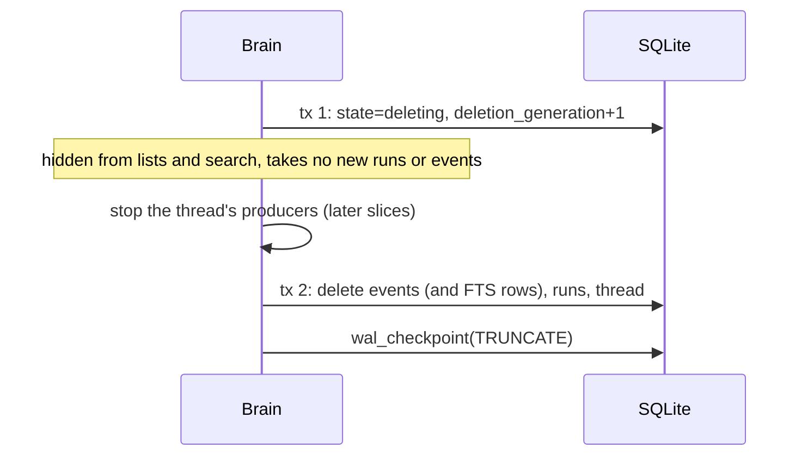

# The store

The brain keeps threads, their events and runs in one SQLite file,
`%LOCALAPPDATA%\<product>\capsula.db`, through `rusqlite` with SQLite and FTS5 built in. Only the
brain opens it. The code is `crates/brain/src/store/`.

## Settings

| Pragma | Why |
|---|---|
| `journal_mode=WAL` | Readers don't block the writer, and the checkpoint after a delete truncates the WAL. A store that refuses WAL doesn't open |
| `synchronous=FULL` | Every commit is durable, so "saved" means the transaction committed |
| `foreign_keys=ON` | Rows can't point at a missing thread or run |
| `secure_delete=ON` | Deleted rows are overwritten with zeros, not left in freeblocks or free pages. Stale cell copies in the gaps a page rebuild leaves are out of its reach (see below) |
| `temp_store=MEMORY` | Statement journals, which hold the pages a delete removes, never spill to `%TEMP%` |

## Tables

| Table | Holds |
|---|---|
| `threads` | Title, timestamps, `state` (`live` or `deleting`) and `deletion_generation`. `AUTOINCREMENT`, so a deleted thread's id never comes back for a new thread that late work could be mistaken for |
| `runs` | One per user turn: thread, `state` (`active`, `done`, `interrupted`, `failed`), reason, timestamps. `AUTOINCREMENT`, so a run id is never issued twice, even after the thread holding the highest one is deleted |
| `events` | Thread, run, kind (`user`, `assistant_text`, `scene_step`), searchable `text`, JSON `body`. A trigger refuses updates. An event's run must be an active run of the same thread, so a late completion after a run ends is refused |
| `events_fts` | FTS5 over `events.text`, kept by triggers, with FTS5's `secure-delete` on so a deleted row's entries leave the index at once. A deleted term can still survive whole as an `events_fts_idx` separator key (see below) |

Later slices add assets, sends, the tool ledger, actions, summaries and cleanup jobs, each as a
new migration. Migrations are numbered by `PRAGMA user_version`, run forward only, one
transaction each, and a brain refuses a file whose version is newer than it knows.

Search takes the user's words as one quoted phrase, so FTS5 query syntax in them is plain text,
and never returns a thread being deleted.

## Deleting a thread

The foreign keys have no cascade, so the second transaction names every table and fails if it
misses one, rather than leaving rows behind. The checkpoint copies the WAL into the main file and
truncates it to zero bytes, so the zeroed pages replace the old ones in both. A reader holding an
older snapshot blocks the checkpoint; then `finish_delete` returns `Deletion::Pending` instead of
reporting the deletion finished, and the next start's recovery retries the checkpoint.

What deletion covers today: the deleted rows themselves, in the main file, the WAL and the FTS
leaves. A test plants a marker in a thread's title, user text, assistant text and step body,
deletes the thread, and scans the raw `.db`, `-wal` and `-shm` bytes for it. What it doesn't
cover yet, found by the CAPS-22 review:

- **Page gaps.** When SQLite rebuilds a b-tree page it repacks the cells but never zeroes the gap
  between the cell pointers and the content, so an old copy of a moved cell can stay there after
  the row is deleted.
- **FTS5 separator keys.** `events_fts_idx` keeps a prefix of each leaf page's first term, often
  the whole term, and secure-delete removes it only when the page loses its last term.

The marker test is too small to split a page or span two FTS leaves, so it can't see either.
shortcut: a purge PR in slice 2, landing before PR 7 makes deletion reachable, runs FTS
`rebuild`, `VACUUM` and another TRUNCATE checkpoint after the second transaction, and tests at
a scale that reaches both.

Beyond what deleting rows can reach: SSD wear levelling, the disk clusters a truncated WAL
frees, Volume Shadow Copy restore points, backups and the pagefile.

## Recovery at start

The brain opens the store and runs the recovery scan before it serves any shell:

- threads left `deleting` by a crash between the two transactions finish deleting. One that fails
  again is logged by id, stays hidden, and is retried at the next start, so it can't stop the brain;
- runs still `active` in live threads become `failed` with reason `crash`, keeping what they
  committed;
- the WAL is checkpointed again, in case a reader blocked the last one. If a reader blocks this
  one too, the deletions it finished count as pending, not finished.

The "store recovered" log line carries only the counts: crashed runs and finished, pending and
failed deletions.

shortcut: two sessions of the same user run two brains on one store, and the second's recovery
fails the first's live runs. That needs Windows Server or multi-session Windows, so a
per-session store or a lock waits until Capsula supports them.
