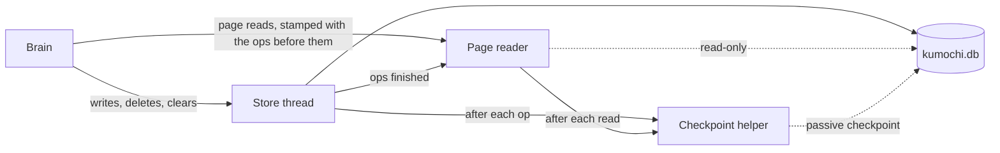

# The store

The brain keeps threads, their events and runs in one SQLite file,
`<product>\kumochi.db` in the local application data root (`LOCALAPPDATA` in a release build, the
admitted override or the Known Folder in Gate and debug builds; see [architecture](architecture.md)), through `rusqlite` with SQLite and FTS5 built in. Only the
brain opens it. The code is `crates/brain/src/store/`.

On macOS the default path is `<Application Support>/<product>/kumochi.db`, beside the
configuration file. The shared OS lookup ignores `HOME` and refuses if it can't provide an
absolute path. Computing it doesn't open the database or create the folder. The native
runtime and direct file-logging startup remain refused.

Linux and macOS unit tests use the shared purge swap at an explicit scratch path. The macOS
root must be private, sandbox-confined and single-writer. The adapter uses the same file
publication barrier as [settings](settings.md) and the OS's caller-available blocks for the
purger's capacity check. Darwin's `statfs` supplies wide counters; only its two explicit
unsupported-link errors permit the direct replacement fallback. An uncertain publication stops
the test process before reopen or alias cleanup. Windows sharing-mode tests stay Windows-only.
No non-Windows production store startup, swap or capacity fallback is enabled.
On Linux, direct file-logging startup returns `NativeRuntime` before resolving a data path.

## macOS shell-file admission

On macOS the shell's instance lock and file logger use these primitives: startup takes the lock
in the admitted product folder, then starts the logger in the same storage.

The macOS shell-file primitives admit an OS-discovered Support candidate without
creating its ancestors. The read-only anchor walk independently requires local, ownership-enforced
APFS volumes; product/log directories and private files cannot cross the Support volume. Legacy
`hold_chain` still refuses every device crossing. Private directories require current UID/0700;
regular files require current UID/0600, one link, the same ACL/identity inspection, and checked
no-follow/nontruncating relative acquisition. Opaque lock/log owners retain their admitted
ancestors, expose no file/descriptor/path escape, and logs support shared-reference append writes.
Creation/open I/O errors are distinct from failed privacy/type/ACL/identity admission.

Retention consumes at most 256 total entries, isolates an exact prefix/date namespace, excludes
the supplied current log by identity, and reports skips/removals/incomplete scans. It checks
each Darwin record's bounds before reading its name and terminator from the held stream.
Ancestor admission failures propagate separately from candidate skips in both retention phases.
Concurrent missing/busy/unsafe/replaced candidates are skipped, without a rotation lock or mandatory new
Darwin unlink flags. Held-directory deletion remains name-based with a check-to-unlink race under
the trusted OS/owning-UID boundary. Neither seven-file retention nor latency is guaranteed.
These primitives do not certify the real anchor or native races, make kernel operations cancelable, or establish a deployment floor or durable flush guarantee.

## Settings

| Pragma | Why |
|---|---|
| `journal_mode=WAL` | Readers don't block the writer, so a purge can copy the file while it serves. A store that refuses WAL doesn't open |
| `synchronous=FULL` | Every commit is durable, so "saved" means the transaction committed |
| `foreign_keys=ON` | Rows can't point at a missing thread or run |
| `secure_delete=ON` | Deleted rows are overwritten with zeros, not left in freeblocks or free pages. Stale cell copies in the gaps a page rebuild leaves are out of its reach, so the purge replaces the file (see below) |
| `temp_store=MEMORY` | Statement journals, which hold the pages a delete removes, never spill to `%TEMP%` |
| `wal_autocheckpoint=0` | A commit never copies the WAL into the file itself; the checkpoint helper does that off the store thread (see [Page reads and checkpoints](#page-reads-and-checkpoints)) |

## Tables

| Table | Holds |
|---|---|
| `threads` | Title, timestamps, `state` (`live` or `deleting`), `deletion_generation`, `kind` (`main` or `thread`), `title_source` (`words`, `model` or `user`), and the nullable `model` and `effort`. `AUTOINCREMENT`, so a deleted thread's id never comes back for a new thread that late work could be mistaken for |
| `runs` | One per user turn: thread, `state` (`active`, `done`, `interrupted`, `failed`), reason, timestamps. `AUTOINCREMENT`, so a run id is never issued twice, even after the thread holding the highest one is deleted. Since version 6, a spoken run's heard point ([voice](voice.md#a-spoken-run)): `heard_segment`, `heard_sample` and `heard_text`, all NULL (unknown) or all set. Since version 8, `screen` records only a screen hold's outcome, never picture bytes or the recipient. A held picture starts as `pending_attached` (window) or `pending_screen` (screen). Neither shows a mark, even in an ended run. Before the first send carrying that picture gets a transport grant, the store commits the corresponding `granted_*` class and the coordinator rechecks admission. A write attempt settles it as `attached` or `screen`; those marks never change. A send proved unsent restores pending if the same picture may still go, or clears it or records the applicable omission (`withdrawn` or `model_cant_see`). Other omissions (`not_ready`, `nothing_there`, `cant_share`, `unreadable`, `too_large`, `changed`) are written with the turn. If an authorization is still unsettled, terminal history shows a conservative mark and recovery converts it to the sent class. Recovery clears all pending classes instead. This can over-report if Kumochi exits after the authorization commits but before the first write or its unsent settlement commits. Unknown or NULL values show no mark; older builds also don't recognize the new authorization classes. Since version 10, `protected`: set in the transaction of each scene step the run writes, 1 once a step came from a run whose request carried a picture or a protected digest, 0 while every step was public. NULL for a run that wrote no step and every older run; NULL and 1 keep its scenes from every model after a restart |
| `events` | Thread, run, kind (`user`, `assistant_text`, `scene_step`, `revealed`, `scene_begin`, `scene_cleared`, `scene_cut`, `task_deleted`, and a model round's `output_item` and `tool_result`, whose JSON `body` holds the native item with its connection, or the call id and its result, with no searchable text), searchable `text`, JSON `body`. A trigger refuses updates. An event's run must be an active run of the same thread, so a late completion after a run ends is refused; scene clears, v1 cuts and the `revealed` of a late Stop are written without one. A `task_deleted` note goes in Kumo's thread with no run and no text: it keeps no title, so a deleted task's name still leaves the files with it |
| `events_fts` | FTS5 over `events.text`, kept by triggers, with FTS5's `secure-delete` on so a deleted row's entries leave the index at once. A deleted term can still survive whole as an `events_fts_idx` separator key until the purge rebuilds the index (see below) |
| `purge_pending` | One row while a deletion's purge is owed, written in its second transaction and cleared only after the purge finishes |
| `summaries` | Compaction's summaries: thread, `first_event`, `last_event`, `text`, the nullable `model` (none for the fixture), `created_ms`. Derived, so no full-text index: search finds the raw events, which stay. Inserted only while the thread is live in the deletion generation the summary was read in, so a delete during compaction stores nothing; the builder reads the newest. A deleted task's summaries go in the deletion's second transaction, and the purge clears their leftover copies like the events'. Version 4 |
| `tool_calls` | The tool-call ledger ([tools](tools.md)): one row per committed call, keyed by run, `route` (`model`, or `mcp:` and the launch id) and the caller's id, with the tool, a SHA-256 of the parsed arguments and the tagged result, capped at 65,536 bytes (not characters). Written in the same transaction as the call's own write, and only while the run's thread is live. A history result holds references, never text, and nothing here is indexed. A deleted task's rows go in the deletion's second transaction. Version 5 |
| `actions` | Issue actions ([issues](issues.md)): thread, `version`, the `stage` as JSON tagged by `kind`, the bound `repo`, `account_id` (canonical decimal text) and `account_login`, the exact `title` and `body`, the offered `approval`, the last `consumed` revision, `uncertain` and `created_ms`. `AUTOINCREMENT`, so a draft id is never issued twice. A deleted thread's actions go in the deletion's second transaction. Version 7 |
| `approval_mark` | One row: the highest approval revision ever issued. Deletion and purges never touch it, so no revision is issued twice. Version 7 |

The coordinator issues thread and run ids itself, above `high_water()` (the highest ids in
`sqlite_sequence`, deleted ones included), and the store refuses any id that isn't new. A whole
user turn (a new thread when there is one, the run, and the user's text) is one transaction.
`create_task` reserves its id first, raising the threads row of `sqlite_sequence` in a commit of
its own, so the id is issued before its task exists; a purge's copy keeps `sqlite_sequence`, so
a reservation with no row behind it outlives a purge and a restart ([tools](tools.md)).

Later slices add assets, sends and cleanup jobs, each as a
new migration. Migrations are numbered by `PRAGMA user_version` and run forward only, and a
brain refuses a file whose version is newer than it knows.

The ordinary open migrates to version 13, all pending migrations in one transaction, so a crash
leaves the file at the version it had. Version 12 makes the ChatGPT cutoff table ordinary, and
13 changes no schema: builds from before the profile's writer lock know at most 12, so they
refuse the file instead of writing history without the lock. A file that the recovery
operation took to 12 already has the table and its rows, and moves to 13 alone. A separate,
explicit ChatGPT repair operation can establish a cutoff only with a still-locked replacement
binding, on a store the ordinary open has already migrated. Its immutable tag row commits on
its own, taking the last issued thread and run IDs from SQLite's
sequences, including deleted IDs. A ceiling below a surviving ID or a missing sequence for
existing rows refuses establishment. History keeps one writer: the vault's link is bound once,
when the store thread starts, to the owner of the store ordinary startup opens, and Establish,
its Check and every later confirmation are requests that owner serves on that store in order.
Startup builds the vault before that thread runs, so until then the link refuses every request.
Shutdown releases the link before the store closes, since the store thread ends only once nothing
can queue for it. What the link already queued is still served, and a released link never binds
again. No call takes a store,
path or earlier result. Because the cutoff commits on the writer's own connection, a purge copy
taken before it is stale and isn't swapped in. The purge's `VACUUM INTO` copy keeps every table,
so the cutoff row (a tag and two IDs, no conversation content) carries over, and after a swap the
Check reads the replacement file. A Check refuses an absent or invalid row for the expected tag
or a connection still inside a transaction. Ordinary open never creates a cutoff or uses one to
unlock a replacement. The binding is spent once a commit is attempted, or when the writer's
answer is lost, so a lost row is never reseeded. Establish returns a receipt of the exact row it
wrote. The vault refuses to queue it once the repair attempt is stopped, but a stop that lands
after that check can still leave a written row; its context is then refused at the
establishment's own claim, so the writer doesn't check for a stop itself. A stop that lands after
that claim doesn't undo it: the establishment may still commit. The credential authority marks the context established only when a fresh Check reads
exactly that row, and each confirmation reads the row again. The history and authority files
share no installation binding, so nothing here compares one; that belongs to the local profile
work. A byte-identical copy of the right file put in its place by a process running as the same
user is outside this design's trust model and isn't detected.
Earlier history stays available locally. A read that carries the established cutoff reads that
row again in the same snapshot, refuses when it is missing, invalid or different, and keeps to
it: a run that began before the cutoff is refused, and context, summaries, drawings, deletion
notes, recall, titles and compaction see only threads created after it. A new run in an older
thread sees only its own turn. The coordinator carries the cutoff on every read for the
recovered connection and sends only bodies read to it ([runs](runs.md#availability)). Cutoff
requests take no page-read stamp, but the vault learns the cutoff only after it commits, so a read
sent once the coordinator knows it always finds the row. Nothing reports a recovered connection
at startup yet, so the replacement stays unavailable.

A recovered connection is told by its cutoff row for its tag, not by the version. A
compile-time assert keeps the current version above 12.

Version 13 stops an earlier build from opening the store, not one that already has it open. An
old Brain still running in another Windows session without the lock (its vault had not opened
yet) can keep writing beside the new one, even after the move to 13, and its purge can then swap
in a copy that misses the new Brain's commits. Close Kumochi in every session before upgrading.

**Scenes** are events, so they need no migration. A run's first step writes `scene_begin`, whose
event id is the `SceneId`; `AUTOINCREMENT` keeps it unique even after a deletion, and a
rolled-back id is never seen because no id leaves the brain before its commit. Each `scene_step`
body names its `scene`, `index` and `label`, and `scene_cleared`'s body names its `scene`. A
clear is one immediate transaction, so a busy store makes it wait rather than fail. At start,
after the recovery scan, one read rebuilds the visible set (see [processes](processes.md)) from
live threads only: a step that doesn't decode is skipped and logged by row id, never its
content. The threads panel's pages leave `scene_begin` and `scene_cleared` out.

Search takes the user's words as one quoted phrase, so FTS5 query syntax in them is plain text,
and never returns a thread being deleted.

### Typed v1 drawings

`store/drawing.rs` keeps typed drawings separate from the staged labelled placeholders above.
A typed `scene_begin` stores the immutable header and layout version in `body`; its first
`scene_step` and its selected `scene_cleared` rows are in the same immediate transaction.
Each clear uses its victim's own thread. Any failed insertion or commit rolls back all rows;
a commit whose reply is lost is reconciled by recovery, never by retrying the call. The dying
memory/shell need not match the committed set before disconnect. Later steps carry the scene id, lifetime revision,
layout version and original typed step. A screen scene's steps are stored without their boxes,
under its stamped header ([tools](tools.md), screen scenes). An effective `scene_cut` stores the authoritative
activated bound and finished handles. Identical cut retries are idempotent. All these rows
have NULL `text`: drawing content never enters FTS or a page's text, and pages omit cut metadata.
Every drawing SQL or JSON failure becomes a fixed, source-free error, never a parser diagnostic.

The drawing write doesn't append reply text. Round and outcome writes keep unspoken narration
in order with surrounding assistant text. Model draw narration uses the existing
`assistant_text` kind; its `body` can carry the provider call ID for native replay.

The canonical reducer is the single writer and validates admission and cuts. The store checks
run/thread membership, first-step name reservation, the encoded-body cap and retry identity
by scene/revision; appends and cuts do not reload or replay earlier drawing content. A new
scene's first step waits for every earlier typed clear to commit, including a failed user
clear. Replacement/cap eviction itself is atomic with the first step, so recovery never has
to hide an uncleared visible scene to fit the cap.

Turn context doesn't read drawings from the store. When a build starts, the coordinator asks
the drawing reducer for the thread's `Drawings on screen` line and passes it with the build,
so headers and objects come from one place at one moment: a step still in the store isn't
listed, and a cleared scene leaves the line at once. A committed step the shell then can't
prepare stays listed until its failure cut arrives. Each visible scene of the thread, oldest
first, gives its complete begin header and its surviving objects as `[id, kind]` in put
order, never step content, positions or labels. The pairs of every scene share one 8 KiB cap,
a comma each. Scenes take room newest first, each from its newest object back to the first
pair that doesn't fit, so an older scene may still list small pairs after a newer one ran out.
A scene that lists fewer than it holds adds `"more"`, the count left out. The reducer renders
a public line and a line per recipient of a stamped scene, each with its own cap. A scene is
stamped, whatever its surface, when a run whose request carried a picture or a protected
digest drew it. Once the build knows the turn's model, it chooses a stamped line only for the
exact route, sign-in generation and model slug the material was sent to, and only with a
positive image fact. An unknown or mixed scene recipient gets no metadata. A scene restored
after a restart is public only when every run that began it or wrote a step into it has
`protected = 0`. This does not filter user or
assistant prose, including screen-step narration re-read by recall or compaction, or same-account
native ChatGPT replay, whose stored arguments can retain object ids and whose size-error result
can contain picture dimensions. The line goes after Local time in the
current user item, and the empty `[]` line overrides stale references after
Esc. The complete rendered item, including outer JSON escaping, counts against the ordinary
request bound; the line's `Debug` shows only its length, and it is never logged.

Recovery reads the newest four uncleared scenes of live threads and their full ordered logs,
then replays the survivors together against one global budget. A corrupt, oversized,
unsupported or invalid scene is omitted whole, logged by row id only and cleared durably;
other scenes still recover and drawing recovery never prevents the brain from starting.
If the query itself fails, typed intake stays unavailable until restart and Quit reports
incomplete: the brain cannot claim it cleared a visible set it never read.
A row whose scene id cannot be read affects only candidate scenes in its own thread that
began before it. A durable zero cut excludes its
scene even if a crash prevented the following clear transaction. Names remain reserved in
the thread's history after a clear or eviction. Reads cap each body at 8 MiB, each lifetime
log at 128 entries and its aggregate bodies at 32 MiB. SQLite's `octet_length` checks a stored
body's byte length before materializing it for JSON checks or copying it into Rust. Typed storage is
decoded directly rather than through the model's 32 KiB record parser: canonical JSON can
expand a legal record. Numeric decoding preserves exact f64 round trips.

## The main thread, titles and model choices

Schema 3 adds four `threads` columns, each with `ADD COLUMN`, so no table is rebuilt and older
rows read as `thread` and `words` with no model:

| Column | Holds |
|---|---|
| `kind` | `main` for Kumo's thread, `thread` for a task. A unique partial index allows one `main`. It keeps these two values for good: changing a `CHECK` rebuilds the table, so later facts (origin, parent, archive) get their own nullable columns |
| `title_source` | Who wrote the title: `words` (the first turn's first line, from `BeginTurn`), `model` or `user` |
| `model`, `effort`, `connection` | The saved route, model and effort. Version 9 adds `connection` and backfills selected older rows as ChatGPT. Only three unset fields mean no choice; a partial row, invalid slug or unknown connection fails the read rather than falling back to another model. Pages retain the saved route/model independently of sign-in and catalogs; an unknown effort displays Medium without changing the saved row. An unknown connection fails the whole thread list and search read, so a new connection kind needs a schema version that older builds refuse |

`StoredChoice` separates structural decoding from admission. Page display never contacts a provider.
An unknown effort is kept as unknown for execution, which uses the selected model's policy instead
of the page's placeholder. For the currently supported ChatGPT route, the default remains Low;
catalog membership is checked by the coordinator. Context, background-job and hold reads return the
saved or default selection on any connection, and admission decides whether that connection can
answer (runs.md, "Availability"), so nothing on another connection reaches the ChatGPT engine. A
ChatGPT catalog refresh
also preserves an explicit default on another connection. Missing/deleted threads are errors,
not an unset selection. This replaces the old unknown-effort-to-default-model fallback.

- **The main thread** is created by the recovery scan when it's missing, after unfinished
  deletions and before `high_water()` is read, as one statement of its own. A start cut short
  before it commits leaves no row, and the next start creates it. `Store::main_thread()` reads its
  id, which the coordinator and every `SettingsView` carry. Its stored title stays empty: the shell
  labels its row from the assistant's name in the settings it received, so one name lives in one
  place. Nothing deletes it.
- **Titles.** `SetTitle` changes only a live task, never the main thread. A user title replaces
  any title. A model title applies only while `title_source` is still `words` and the deletion
  generation is the one it names, so a model title that arrives after a rename, a hide or a
  removal changes nothing. `SetTitle` answers `TitleSet` with whether it changed the row. The
  title job reads a task's first ask with `Snapshot::first_ask`, which finds nothing once the
  title isn't first words. A later `BeginTurn` on an existing thread never touches its title or
  source. Neither a rename nor a model choice moves the thread in the list.
- **Model choice.** `SetModel` stores a live thread's `connection`, `model` and `effort`; a hidden or missing
  thread changes nothing. The worker answers `ModelSet` only after the write, echoing the
  thread and exact choice with `applied=true` when a live row matched. Hidden, missing or
  unrepresentable ids, failed writes and operations refused before reaching the store answer
  `applied=false`. The coordinator forwards that result as `ThreadModelSet`; a later write
  cannot change an earlier result. Write failures log only fixed text.
- **Deletion and the purge.** The four columns live in the `threads` row, so deleting a task's row
  removes them with it, and the purge's `VACUUM INTO` copy carries the kept rows' columns over
  unchanged. No table is added, so `store::delete`'s table list and the remnants scan need nothing
  new. A test plants a renamed title and a model slug, deletes, purges, scans every file's bytes
  and restarts: neither survives, and a kept task keeps its choice.

## Page reads and checkpoints

The [threads panel](panels.md) reads bounded thread, ranked search, and newest-first event pages
on the page reader: a thread beside the store thread with its own read-only, query-only
connection (`temp_store=MEMORY` too). So a long search never holds up a write queued behind
it. Each read uses one snapshot transaction, finished before returning, so no snapshot outlives it.
Reads neither stop the purge's copy nor postpone it: a page request never reaches the store
thread's queue, so it doesn't reset the quiet deadline an owed purge waits for.

The plain task list and ranked search attach task facts after selecting their rows. In the same
snapshot, an indexed lookup reads each selected task's latest run by ID. Activity is the latest
of the stored thread update, run start and real terminal time; the time written by crash recovery
is excluded. These reads do not update storage or affect the list's ordering keys.

A page marks a user event as failed only if that event's own run is stored as failed.
The existing run-end transaction can save a closed connection cause and delivery proof
in `runs.reason` along with the last events. It distinguishes a request that never left
the app, an explicit rejection before any answer or effect, and an answer that broke off.
History projects the typed values only onto that run's user event, keeping its held-screen
metadata and any partial assistant reply. Older, unknown, and unproven outcomes, including
crashes, stay generic; neither the generic mark nor the screen metadata proves delivery
or a safe retry. The reason stores no provider text or payload. The run end only supplies
these facts when the [original attempt proves them](runs.md#availability). No schema migration
is needed. New page kinds follow the old wire tags; the
[paired build check](ipc.md#the-handshake) runs before any page can cross to another build.

A read waits until the store thread has finished every op queued before it, failed and empty
ones included, so it sees the thread a turn just created. Ops queued after it may show too: a
delete can overtake an older read, which the shell's revision fences already handle. The reply
goes back on the brain's input channel as before, so the epoch fence and held-page limits are
unchanged. Admission creates one two-second absolute end and cancellation owner. The queued
read, accepted-write barrier, side-slot/swap admission and scoped SQLite query share that end.
SQLite checks cooperatively every 1,000 instructions, with no busy wait during the query; handler
or timeout cleanup failure discards the side connection. Session loss cancels queued reads too.

Commits never checkpoint. After every op and every read, the checkpoint helper, a thread with its
own read-write connection, runs a passive checkpoint, which never waits on the writer or a
reader. Frames a reader still needs are left in the WAL; the helper retries after 50 ms, doubling
up to 1 s [guess], and again as soon as a read ends. This takes the WAL copy off commits; it
doesn't bound the WAL while a long read holds a snapshot.



The reader's and the helper's connections each sit in a slot, open lazily and never create the
file. The swap holds both slots, their connections closed, from before its checkpoint until the
store has reopened (below), so neither opens the old file. While the store is unavailable after a
failed reopen, page reads fail and checkpoints wait. Closing the store lets queued ops and reads
finish, then closes the reader, the helper and the store, in that order, so the store's
connection is the last to close; nothing blocks the caller meanwhile. It releases its own
acknowledgement sender before signalling close completion, so that worker cannot keep a reply
receiver open during subsequent purge-file cleanup. Close still does not wait for that cleanup,
and other producers can keep a shared input channel open. The store thread holds a reference to
the profile's writer lock (see [accounts](accounts.md)) until that cleanup ends, so a close the
brain stopped waiting for, or a start that failed after the thread began, never releases the lock
while the thread still has work on the store or its purge files. A test holds the thread after
close and finds the lock still Busy with no other reference left. If the store thread
panics, waiting reads fail and both side connections close for good.

## Deleting a thread

`Store::delete` runs one `DeleteThread`. It reads the thread's state and newest run first, so
`last_run` still names that run once its rows are gone. A failure before the first transaction
commits answers `NotHidden` and leaves the thread live. A failure after it answers `Hidden`, and
the next start finishes the deletion. A thread that's already gone answers `Removed`. Only the
error's kind is logged.

In a historical release build on Rez, deleting a thread with stand-in captures took the times below
(20 samples per store, then 5 after a reader let go):

| Store | p50 / p95 / worst | After a reader held the WAL | WAL held |
|---|---|---|---|
| 46 MiB | 7.4 / 7.7 / 9.7 ms | 8.6 / 11.4 / 12.3 ms | 52.5 MiB |
| 232 MiB | 18.3 / 18.7 / 19.7 ms | 39.2 / 45.9 / 51.9 ms | 215.1 MiB |
| 515 MiB | 26.3 / 29.1 / 29.4 ms | 28.0 / 28.1 / 29.5 ms | 187.2 MiB |
| 984 MiB | 45.1 / 47.5 / 54.6 ms | 44.8 / 44.9 / 49.6 ms | 316.4 MiB |

Commits don't checkpoint, so a commit after a reader let go no longer copies the WAL that reader
held: before that change the right-hand column was 24, 89, 97 and 156 ms. The measurement opens
the store alone, with no checkpoint helper, so nothing copies the WAL between samples and it grows
larger than it would in the brain.

Besides the store thread, the live store has two readers: the page reader, which does not
block writes, and the purge's copy. A write never commits under the copy's
snapshot: before any write the store thread stops the copy and waits until it
has let go of the live store, and nothing more of the copy. Letting go means two things: its drain
has finished its checkpoint on the helper's connection, which stays open for the helper, and its
snapshot's own read-only connection has closed. The copy takes the helper's connection before it
holds off writes, so a write never waits for a checkpoint the helper is running.

`measure_delete_during_a_purge` holds the real copy, sends a delete, waits until that delete has
stopped the copy and is waiting for it, queues a turn behind it, and then releases the copy. It
times both from the release, so it counts the copy's own stop and close but not the hold. The copy
is held just before its drain's checkpoint, which can't be stopped, or inside `VACUUM INTO` once
some of the snapshot is on disk. Every held attempt ended stale. Release build on Rez, 5 samples
in each phase; typical, then worst:

| Store | Delete, drain | Delete, inside the snapshot | Turn behind it, worst | Delete with nothing running, worst |
|---|---|---|---|---|
| 46 MiB | 3.1–6.1, 8.2 ms | 4.7–5.3 ms | 10.6 ms | 9.8 ms |
| 232 MiB | 4.5–4.9, 18.7 ms | 6.6–7.1 ms | 19.7 ms | 21.1 ms |
| 515 MiB | 3.0–3.2, 8.5 ms | 4.6–5.1 ms | 9.4 ms | 18.5 ms |
| 984 MiB | 3.0–3.2, 20.1 ms | 4.9–5.3 ms | 31.4 ms | 11.5 ms |

Each store's first drain sample was a slow one: 8.2, 18.7, 8.5 and 8.1 ms. The only other slow
sample was the fifth at 984 MiB, 20.1 ms, with its turn at 31.4 ms. The rest stay within a few
milliseconds of an ordinary delete.

A write queued behind a page read no longer waits for it. Historical release build on Rez, 30
rounds; medians, worst in brackets:

| Store | Common-word search | BeginTurn behind it, store thread reading | On the page reader |
|---|---|---|---|
| 46 MiB | 62.2 (65.4) ms | 63.9 (69.7) ms | 0.9 (1.2) ms |
| 232 MiB | 315.4 (355.0) ms | 332.4 (362.8) ms | 1.1 (16.5) ms |
| 515 MiB | 62.3 (69.9) ms | 66.8 (82.9) ms | 0.9 (1.3) ms |
| 984 MiB | 57.9 (60.5) ms | 65.4 (79.7) ms | 0.9 (1.2) ms |

A write behind an events page went from 93–101 ms to 0.8 ms (worst 7.4 ms), against 0.8 ms with no
read ahead of it.

```mermaid
sequenceDiagram
  participant S as Store thread
  participant H as Purge helper
  participant DB as kumochi.db
  S->>DB: tx 1: state=deleting, deletion_generation+1, an untitled note in Kumo's thread
  Note over S: hidden from lists and search, takes no new runs or events
  S->>S: stop the thread's producers (later slices)
  S->>DB: tx 2: delete events (and FTS rows), tool_calls, runs, summaries, thread; purge_pending=1
  Note over S: no live thread's run active, no op for 200 ms
  S->>H: copy
  H->>DB: read-only: VACUUM INTO kumochi.db.purge-snapshot
  H->>H: on the snapshot: purge_pending=0, FTS rebuild, optimize
  H->>H: VACUUM INTO kumochi.db.purge-clean, remove the snapshot, sync
  H-->>S: copied
  S->>DB: no change since the snapshot? TRUNCATE checkpoint, close
  S->>DB: link kumochi.db as purge-old, move purge-clean over kumochi.db, reopen
  S->>H: remove
  H->>DB: delete purge-old (and any copy left)
  H-->>S: removed: purge done
```

The foreign keys have no cascade, so the second transaction names every table (`events`, `tool_calls`,
`runs`, the thread's own `summaries`, `threads`) and fails if it misses one, rather than leaving rows
behind. Deleting the rows isn't enough on its own, as the
CAPS-22 review found, because two kinds of copy survive secure-delete:

- **Page gaps.** When SQLite rebuilds a b-tree page it repacks the cells but never zeroes the gap
  between the cell pointers and the content, so an old copy of a moved cell can stay there after
  the row is deleted.
- **FTS5 separator keys.** `events_fts_idx` keeps a prefix of each leaf page's first term, often
  the whole term, and secure-delete removes it only when the page loses its last term.

So the second transaction also records a **purge** as owed. The purge replaces the file with a
clean copy, built off the store's thread so turns and runs don't wait for it:

1. **Snapshot.** A helper thread first drains the WAL: a passive checkpoint on the checkpoint
   helper's connection, taken before the copy holds off writes and so never beside the helper's
   own checkpoint, copies the WAL into the file without
   waiting on the writer or holding it up, so the swap's checkpoint later finds little to copy.
   The drain must copy all of it before the copy goes on: a reader still holding part of the WAL
   makes the attempt stop and back off, so a long reader defers the purge. Then it opens the file
   read-only and runs `VACUUM INTO` into `kumochi.db.purge-snapshot`. A WAL reader never holds
   the writer, so the store keeps serving.
2. **Clean.** On the snapshot it clears the `purge_pending` row, runs FTS `rebuild`, which
   rewrites the index from the remaining events and so drops the deleted terms' separator keys,
   then `optimize`, which merges the rebuilt index into one segment. Without `optimize`, FTS5's
   first merges after a rebuild stalled single store ops for up to about 180 ms at 232 MiB on Rez.
3. **Compact.** `VACUUM INTO` writes the snapshot into fresh pages in
   `kumochi.db.purge-clean`, so no gap or free page the rebuild left keeps an old key. The
   snapshot is removed and the result synced.
4. **Swap**, on the store thread. Unless its connection changed something since the snapshot
   started, it takes the page reader's and the helper's connections, closing them, then
   TRUNCATE-checkpoints the WAL so no committed data lives only there, closes the
   file and checks that no WAL is left that SQLite could replay onto the new file. Then it
   hard-links `kumochi.db` as `kumochi.db.purge-old`, moves the copy over `kumochi.db` with
   `MoveFileExW(MOVEFILE_REPLACE_EXISTING | MOVEFILE_WRITE_THROUGH)`, which returns only once
   the move is on disk, and reopens. `kumochi.db` names a whole store at every instant. The
   link keeps the old file's data alive, so the move only drops a name: without it the move
   itself freed the old file, about 0.12 ms per MiB on Rez (115 ms at 984 MiB). If the move
   fails, the extra name is removed at once, which is cheap while `kumochi.db` still holds the
   data.
5. **Remove**, on a helper. `purge-old` still holds the deleted rows' bytes, so the purge isn't
   done until it's deleted, along with any copy an attempt didn't use. Deleting the old store
   takes as long as freeing its space (about 60 ms at 515 MiB, 110 ms at 984 MiB on Rez), and
   ops keep running meanwhile. `purge-old` is never opened through SQLite, and it's kept while
   `kumochi.db` is missing, since it may then be the only copy. The removal counts as done only
   once a fresh check finds none of the files: a file another process holds with delete sharing
   can keep its name after its deletion succeeds, until that process closes it. Rez's NTFS
   removes the name at once.

**What store work waits for.** Only the swap stops the store thread: 7–21 ms from 46 MiB to
984 MiB in a historical release build on Rez, 5 purges each. During a copy ops share the disk
with it. The worst op during a copy was 6 ms at 46 MiB, 19 ms at 515 MiB and 25 ms at 984 MiB,
plus one op of 60 ms at 232 MiB whose other four purges stayed under 7 ms. With no purge running
the worst was 1–6 ms. A deletion a reader kept in the WAL is copied into the file by the helper
or the drain, not by the swap on the store thread: with a tenth of the store deleted behind a
reader, 19–124 MiB of WAL, the swap took 8–20 ms, because its TRUNCATE still frees a large WAL
file. Draining it apart first took 10–182 ms, and ops meanwhile took at most 6 ms. Commits never
copy that WAL. These are measurements on Rez's NVMe drive, not a bound for slower disks.
On a volume without hard links (FAT, some network shares) the move falls back to
freeing the old file itself, so the swap grows with the store again.

The purge is cleanup that can be retried:

- **One job at a time.** A copy and a removal never run together, so a removal can't delete a
  later copy's file, and a copy starts only once every purge file is gone.
- **A copy runs only while no run is active.** No live thread may have an `active` run; a
  thread whose deletion keeps failing doesn't count, since its runs never write again. An owed
  purge found at start is tried at once, and after a write the thread waits until none has come
  for 200 ms [guess]. A write sets the copy's stop flag before it runs, and the swap throws away a
  copy made before a write, so no write is lost. A removal runs during runs too, and ops don't
  stop it.
- **A ready swap goes first.** Once a copy is ready, the page reader and the helper start
  nothing new until the swap is done or given up. The store thread retries every 50 ms while the
  read or checkpoint running finishes, for up to 2 s [guess], and keeps serving writes; a write
  ends the wait, since the copy is then stale.
- **It needs room.** A copy starts only if the volume has twice the store's size free (its pages
  in the WAL included) plus 256 MiB [guess] for foreground writes; otherwise it waits like a
  failed try. Until the removal, the old store keeps its space.
- **It backs off.** A copy an op made stale, a drain a reader cut short, a swap a reader
  blocked past that wait, a move that failed, too little room, a file that can't be deleted and any SQLite or
  file error leave the purge owed. Each leaves the old file serving, except a reopen that fails
  after the move worked, which leaves the store unavailable until it opens again (below). The
  next try waits 1 minute [guess], doubling up to 30 minutes [guess], so short turns spaced just
  far enough apart can't make it copy the store again and again. A finished purge resets the
  wait. Once nothing is owed the thread sleeps until an op arrives.
- **A failed reopen recovers.** If the store can't be reopened after the move, it's unavailable:
  every op fails rather than write anywhere else. Before each op, and on each retry, the thread
  opens the file again, never creating it, and reads `purge_pending` only from a file it opened.
- **It's retried at start.** The row survives a crash, and so do the purge's files, which count as
  owed even when the row is gone: a crash after the move leaves the clean store and
  `purge-old`. The store thread removes them on its helper as soon as it starts, before any copy;
  opening the store never deletes anything. A `purge-old` beside a missing `kumochi.db` stops
  the start instead of creating an empty store. Recovery only reports an owed purge. Closing the
  store stops a running copy without waiting for it.
- **It costs disk, not memory.** `VACUUM INTO` writes straight to its file, with no in-memory
  temporary database.

A test ports CAPS-22's remnants scan: it writes 100 threads one event per transaction and
deletes 30 of them, first checking that their FTS keys survive until a rebuild and that, on a
copy of the file, a deleted cell survives a rebuild in a page gap. Then it purges and scans the
bytes of every file in the store's folder: after the swap it finds them only in `purge-old`, and
after the removal nowhere, with the store open and after closing it. It also checks every
`events_fts_idx` key. It fails if the purge skips the rebuild or replaces nothing. A smaller
test covers the compact step: a snapshot with a freed row's bytes still in it comes out clean
with its live rows kept, which a plain move of the snapshot would fail.

Beyond what deleting rows can reach: SSD wear levelling, the disk clusters a removed or
truncated file frees (`purge-old`, the snapshot, the WAL), Volume Shadow Copy restore points,
backups and the pagefile.

## Reading an existing database

`store::existing::open` reads a database that must already exist without creating, changing or
removing any of its files, and without migrating or checkpointing. A plain read-only open does
change them: SQLite creates `-wal` and `-shm` beside a cleanly closed WAL database and rewrites
an existing `-shm`. So the opener looks at the files first and picks one mode or refuses:

| Files beside a main file of at least 512 bytes | Mode |
|---|---|
| none | `immutable`: reads only the main file and takes no SQLite lock |
| nonempty `-wal` and `-shm`, no `-journal` | `readonly_shm`: reads the WAL's commits through read-only index handles |
| anything else | `Uncertain`, nothing opened |

A missing main file is `Missing`. Everything else is `Uncertain`, because SQLite would change a
file or read the wrong one:

- a main file shorter than SQLite's smallest page reads as zero pages, and SQLite then deletes
  the WAL beside it;
- an empty WAL or index has its permissions reset to the main file's when SQLite opens it;
- a journal would be replayed, and a WAL or index alone would be created or rebuilt;
- a main file or sidecar that is a link, a reparse point or not a regular file, or on Unix has a
  second hard link, may not be the file SQLite reads, and `immutable` through a link skips the
  target's WAL.

The path goes to SQLite as a `file:` URI with every byte but unreserved ones percent-encoded, so
separators, drive colons and UNC prefixes reach the VFS unchanged.

Nothing calls it yet. It takes the caller's `SessionLock` and returns a connection borrowed from
it, so the lock stays held through SQLite's last use. That excludes only writers that take the
same lock, and `immutable` takes none of its own while the file check happens before the open,
not atomically with it: a WAL removed in between is created again as an empty file. The brain
writes the credential authority and the history store only under that lock, the profile's
writer lock, which it takes before it opens the store. No other connection to that database may
be open in the same process, since SQLite shares one index handle per process. SQLite run as root re-owns the WAL and index to the main
file's owner; Kumochi doesn't run as root. Unit tests compare each file's name, bytes,
permissions and owner before and after: a closed database, a copy left with a live WAL, every
refused case, and on Unix the linked cases. On Windows the VFS also honours `readonly_shm`, but
opens the index with `OPEN_ALWAYS`, so an index removed between the check and the open would be
created there, and a second hard link isn't detected.

### A legacy history store

`store::existing::legacy_history` reads `kumochi.db` through that opener under the same held lock and
returns `LegacyHistory`. Nothing calls it yet. It reads inside `in_folder`: before anything is
opened, the store's own folder must be a folder itself, not a link or reparse point, since the
opener checks only the final file and could otherwise read a store through a redirected folder.
Its identity (volume and file ID on Windows, device and inode on Unix) is taken then, and the
same identity must read at the same path after every lookup, or the result is `Unverified`. So a
lasting rename or replacement of the folder in between, which would make every name under the
path read as not found and look like `Missing`, is refused. A swap restored before the second
read isn't caught: the `SessionLock` holds only its own file, not the folder, so a stable path
through the read is the caller's guarantee, which the existing-profile probes give by holding
the product folder's chain. A held, admitted product folder is likewise the caller's to
establish.

- `KnownSchema(version)`: the file's `user_version` is one this build knows (1 to the newest,
  carried as `version`; below `CURRENT_HISTORY` it still needs a migration), and its schema
  objects (type, name, table and SQL, from `sqlite_schema`) are exactly those the migrations make
  at that version, built in memory to compare. The candidate's catalog is counted first, then
  read once without sorting, each row using up a distinct entry of the small
  expected set, so neither Rust nor a SQLite sorter copies a large foreign catalog. This is schema
  evidence only. It reads no rows, product invariants (such as the `approval_mark` singleton),
  page integrity or binding, so it promises neither an intact store nor a successful open or
  migration, and it isn't the new-format history fact. `quick_check` wouldn't change that: it
  scans the whole file and still passes a store missing a required row.
- `Missing`: the store's own folder exists as a folder and holds no
  main file, no `-wal`, `-shm` or `-journal`, and none of the files a purge leaves (`.purge-old`,
  the snapshot and the clean copy with their sidecars). The folder itself is still a footprint,
  so this isn't an absent profile.
- `Unverified`: everything else. That covers a newer or unversioned schema, any extra or missing
  object, a schema ahead of its version, files the opener refuses, a missing or linked folder, a
  store missing beside something it left, and any failed read.

The profile probe's legacy Matching builds on `KnownSchema(CURRENT_HISTORY)` and a validated
authority and host, so it is schema-level evidence too. Runtime admission (cut 10) must revalidate
the history's invariants before using the store.

Tests cover every known version, a store the brain itself opened, a `VACUUM INTO` copy like a
purge's, each refused change, each leftover, a missing folder, a linked folder whether empty
or holding a known store, and a folder renamed or replaced between the two identity reads, and
check that no file changes.

## Recovery at start

The shell crash guard also uses durable `scene_cleared` events before relaunch (see
[runs](runs.md#shell-crash-containment)). These remove recovery membership, not typed history.
A failed acknowledgement or the guard's 2 s deadline cannot authorize launch. Clear debt is
only held in the running brain; after brain exit a failed clear may need another crash cycle.

Drawing recovery warnings name only native row ids, never JSON or SQL error content. Recovery
tests capture those warnings and isolate a corrupt scene from the other three. The aggregate
32 MiB body limit is tested at exactly the limit and one byte over with individually valid
bodies below 8 MiB, independently of the per-body limit.

The brain opens the store only after it holds the profile's writer lock (see
[accounts](accounts.md)). Under the lock it opens a database that exists without creating it, and
creates one that's missing: the store first, then the credential authority. That covers the
first start, a first start cut short between the two, and the two older layouts below. Neither
is refused, because each comes from an ordinary path, not only from a crash or a deleted file:

- **History without an authority.** Builds from before the authority (#214) issued thread ids and
  never made `credentials.db`. A post-#214 build that couldn't open its vault left the same
  state. The new authority starts signed out. It shares no ids with the store: its generations
  are random. A ChatGPT cutoff already in the store stays inert, because only an authority that
  established it can confirm it. The vault's first open sweeps the older builds' credential names,
  as the upgrade to #214 did.
- **An authority without history.** The dev diagnostics of earlier builds made `credentials.db`
  without a store. A missing store is created empty, unless a purge's old copy beside it shows a
  swap was cut short; then the start stops with `Retired`, as before, so the old copy isn't
  hidden.

The vault and the dev diagnostics never create the authority themselves. The brain then runs the
recovery scan before it serves any shell:

- threads left `deleting` by a crash between the two transactions finish deleting. One that fails
  again is logged by id, stays hidden, and is retried at the next start, so it can't stop the brain;
- runs still `active` in live threads become `failed` with reason `crash`, keeping what they
  committed;
- held pictures without a committed send authorization are cleared; unsettled authorizations
  become conservative sent marks. A known-unsent correction commits with the terminal row
  when it is already known. Failed late corrections are retried by the running writer, but
  are not persisted separately from the correction itself;
- issue sends cut short in live threads end: a Preflight that sent nothing fails, and one that
  may have sent becomes Unknown ([issues](issues.md#recovery));
- an owed purge is reported, and the store thread runs it once no run is active;
- the main thread is created if it's missing, before the high-water ids are read.

The "store recovered" log line carries only counts and flags: crashed runs, finished and failed
deletions, failed and unknown issue sends, and whether the purge is still owed.

shortcut: two sessions of the same user run two brains on one store, and the second's recovery
fails the first's live runs. That needs Windows Server or multi-session Windows, so a
per-session store or a lock waits until Kumochi supports them.
