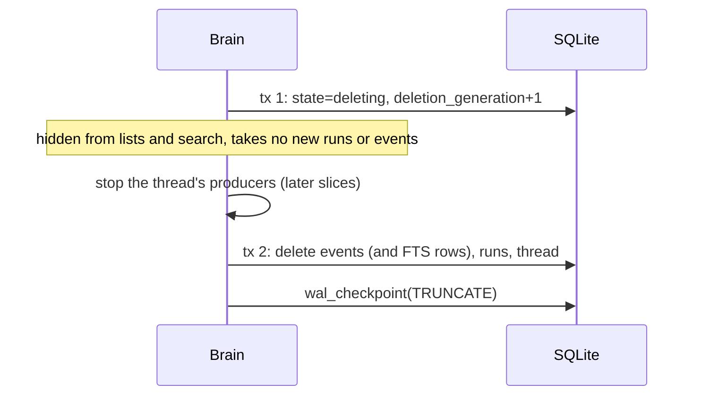

# The store

The brain keeps threads, their events and runs in one SQLite file,
`%LOCALAPPDATA%\<product>\capsula.db`, through `rusqlite` with SQLite and FTS5 built in. Only the
brain opens it. The code is `crates/brain/src/store/`.

## Settings

| Pragma | Why |
|---|---|
| `journal_mode=WAL` | Readers don't block the writer, and the checkpoint after a delete truncates the WAL. A store that refuses WAL doesn't open |
| `synchronous=FULL` | Every commit is durable, so "saved" means the transaction committed |
| `foreign_keys=ON` | Rows can't point at a missing thread or run |
| `secure_delete=ON` | Deleted content is overwritten with zeros, not left in free pages |
| `temp_store=MEMORY` | Statement journals, which hold the pages a delete removes, never spill to `%TEMP%` |

## Tables

| Table | Holds |
|---|---|
| `threads` | Title, timestamps, `state` (`live` or `deleting`) and `deletion_generation`. `AUTOINCREMENT`, so a deleted thread's id never comes back for a new thread that late work could be mistaken for |
| `runs` | One per user turn: thread, `state` (`active`, `done`, `interrupted`, `failed`), reason, timestamps. `AUTOINCREMENT`, so a run id is never issued twice, even after the thread holding the highest one is deleted |
| `events` | Thread, run, kind (`user`, `assistant_text`, `scene_step`, `revealed`), searchable `text`, JSON `body`. A trigger refuses updates. An event's run must be an active run of the same thread, so a late completion after a run ends is refused |
| `events_fts` | FTS5 over `events.text`, kept by triggers, with FTS5's `secure-delete` on so a deleted row leaves the index at once |

The coordinator issues thread and run ids itself, above `high_water()` (the highest ids in
`sqlite_sequence`, deleted ones included), and the store refuses any id that isn't new. A whole
user turn (a new thread when there is one, the run, and the user's text) is one transaction.

Later slices add assets, sends, the tool ledger, actions, summaries and cleanup jobs, each as a
new migration. Migrations are numbered by `PRAGMA user_version`, run forward only, one
transaction each, and a brain refuses a file whose version is newer than it knows.

Search takes the user's words as one quoted phrase, so FTS5 query syntax in them is plain text,
and never returns a thread being deleted.

## Deleting a thread

The foreign keys have no cascade, so the second transaction names every table and fails if it
misses one, rather than leaving rows behind. The checkpoint copies the WAL into the main file and
truncates it to zero bytes, so the content survives in neither. A test plants a marker in a
thread's title, user text, assistant text and step body, deletes the thread, and scans the raw
`.db`, `-wal` and `-shm` bytes for it; it fails without either `secure_delete` setting.

SSD wear levelling, backups and the pagefile are beyond what deleting rows can reach.

## Recovery at start

The brain opens the store and runs the recovery scan before it serves any shell:

- threads left `deleting` by a crash between the two transactions finish deleting. One that fails
  again is logged by id, stays hidden, and is retried at the next start, so it can't stop the brain;
- runs still `active` become `failed` with reason `crash`, keeping what they committed;
- the WAL is checkpointed again, in case a reader blocked the last one.
