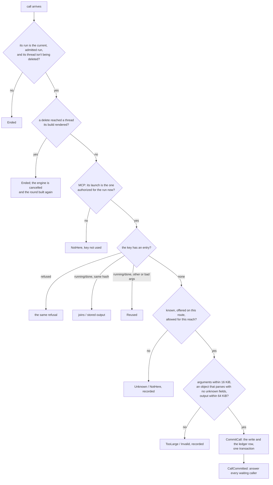

# Tools

A run's model, and later a Claude Code launch over MCP, can call Kumochi's tools. Every call goes
through the dispatcher (`crates/brain/src/dispatch/`), which runs it at most once, from what its
run may reach, and records it in the run's ledger. The coordinator owns the ledger and answers each
call only after the store has acknowledged the call's write.

Slice 3's 13b-2 tool loop and slice 8's C4b-2 MCP listener hand calls to
`Coordinator::tool_call`. No production tool exists yet: 14b adds the history tools, 15 adds
`create_task` and `focus`, and slice 4's B10 adds `draw`'s ledger entry. Until then the test tools
in `dispatch/tests.rs` exercise the path.

## Who made a call

| Type | What it holds |
|---|---|
| `Caller::Model { run, call }` | the model's function call in a run's round, with the provider's call id |
| `Caller::Mcp { run, launch, key }` | an MCP `tools/call`, frozen on arrival with its launch and `CallKey` |

A call's *reach* is not the caller. It comes from the run's thread: Kumo's runs reach every live
task, and a task's run reaches only itself. It never comes from the arguments.

## One call, in order

- **The run.** The coordinator resolves the caller's run first. A call queued by a run that was
  stopped or replaced, even in the same thread, gets `Ended` and touches nothing.
- **Its sources.** A call comes from a response to a build, and that build rendered threads. If a
  delete has reached any of them since, pending or answered, the call gets `Ended`, the engine is
  cancelled and the round is built again once the delete is answered, as for a send the lease
  voids. So a deleted task's text can't reach a write through a call's arguments, even when they
  name no id of it.
- **MCP authority.** `Run::mcp` is the launch the coordinator authorizes for the run right now,
  set at bind and cleared at revoke (C4b-2). The check and the `CommitCall` it allows happen in one
  core-loop step, so a revocation either comes first, and the call is refused, or after the write
  was accepted.
- **The key** is the run, the route (`Model`, or `Mcp` with its launch) and the caller's id. The
  same id on two routes, or under two launches, is two calls.
- **Final per key.** Once the run and the launch check out, everything is recorded against the key,
  refusals included. A retry gets the same answer, a corrected call needs a new id, and a malformed
  retry never changes a running or finished call.
- **The hash** is SHA-256 over the tool's name and the serialized *parsed* struct, so whitespace,
  key order and an omitted default don't change it.
- **One completion rule.** Every first successful call, read-only included, sends one
  `StoreOp::CommitCall` and is answered only on `Input::CallCommitted`. A duplicate while it runs
  joins it. A failed write fails the run as `failed(store)`. An acknowledgement for a run that ended
  confirms storage only. One for a launch no longer authorized answers nobody.

## A round's calls

The model's calls stream in with the round. When the engine finishes the round, the loop hands
each call to the dispatcher in call order, and the round is stored once every call has its
answer: at once for a refusal or a finished call, on `CallCommitted` for a new one. The round's
write holds one result per call, tagged as in [Results](#results), and the next round is built
from the store.

- **Ids.** A round refuses a second call with an id it already has, which fails the run. The same
  id in a later round is the same ledger key: identical arguments get the stored answer with no
  second write, and others get `Reused`.
- **A voided build.** When the first call finds that a delete reached a thread the build rendered,
  the round's calls, items and unstored text are dropped, and the round is built again. Steps the
  response drew and text already on screen stay (a `shortcut:` until B10).
- **Stop.** A stop while a call's write is pending ends the run; the write's late acknowledgement
  is stale, and no round is stored.
- **Failure.** A failed call write fails the run as `failed(store)`. The store reports it as
  `StoreError::Call`, which carries no SQLite text.

## The ledger

The run holds its ledger in memory, and it's dropped with the run. The run's 16-call budget bounds
it, because the loop and the listener charge the budget before dispatch. The store keeps a
`tool_calls` row for each committed call, written in the same transaction as the call's own write
(see [the store](store.md)). Recovery fails a run that was active, so nothing resumes a call from
its row.

## Results

`ToolOutput` is `Text`, `History` or `Error`, stored as tagged JSON: `{"text": …}`,
`{"history": [{"thread", "first", "last"}]}` or `{"error": "unknown tool"}`. A history result is
references only. The context builder re-reads each range from live tasks at every build, and 12b's
admission and send lease fence that request against deletes, so a deleted task's text is never
copied into the ledger or another task.

History tools are **model-only**. MCP gets no schema for them, and the dispatcher refuses them from
`Mcp`, because an MCP reply doesn't pass through a model build's delete fence. Before history is
offered over MCP, C4b-2 must build a bounded, live, reach-filtered read whose source set includes
titles. That read must be materialized fresh on every reply, ledger retries included, and fenced
against deletion and revocation at the reply-write boundary.

## Schemas

Each tool's JSON Schema comes from `schemars` on the same `deny_unknown_fields` struct that parses
its arguments, so the two can't drift, and the schema is closed with `additionalProperties: false`.
`dispatch::schemas(reach, route)` lists what a run is offered on a route.

## Diagnostics

`Caller`, `LedgerKey`, `CommitCall`, `ToolOutput`, `LocalWrite` and `Ledger` print kinds, runs,
lengths and counts only: never arguments, outputs, call ids, keys or launches. A failed write logs a
fixed line.
