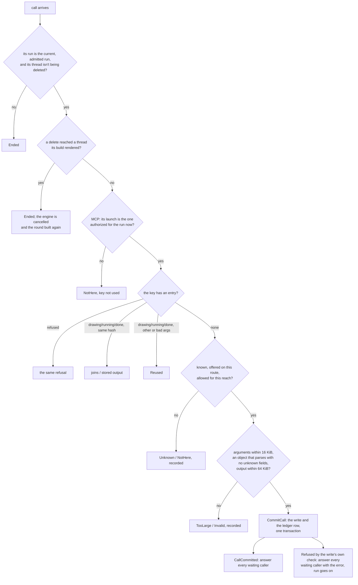

# Tools

A run's model, and later a Claude Code launch over MCP, can call Kumochi's tools. Every call goes
through the dispatcher (`crates/brain/src/dispatch/`), which runs it at most once, from what its
run may reach, and records it in the run's ledger. The coordinator owns the ledger and answers each
call only after the store has acknowledged the call's write.

Slice 3's 13b-2 tool loop and slice 8's C4b-2 MCP listener hand calls to
`Coordinator::tool_call`. The catalog contains drawing, local writes and history reads.
Model requests offer `draw`, `draft_issue`, `search_history` and `read_history`; Kumo also gets `list_tasks`.
Create/focus remain unoffered. MCP gets only `draw`, the intersection of model offers and
the catalog's MCP permissions. The test tools in `dispatch/tests.rs` exercise the rest of the path.

`draft_issue` stores checked title/body and an optional repository proposal in the caller's
conversation, not a model-supplied destination thread. Its action, event, approval and ledger
result commit atomically; only then does the model receive the fixed local-draft result. A
durable draft still refreshes history if its model run ended while the acknowledgment was in
flight. It grants no consent or HTTP authority; [issue actions](issues.md) describes the limits.

## History reads

History calls enter `Reading` while the stamped reader selects bounded references. Completion
checks the original build, owner, caller and both source sets before a reference-only commit;
the model receives its result only after the store acknowledges that commit.

`recall::Query` describes word-OR event search, an inclusive event range, or task metadata.
`Snapshot::select_recall` checks the frozen origin independently of dispatch: Kumo reaches
live tasks, while a task reaches only itself and cannot list tasks. SQL excludes the main
conversation, deleting tasks and non-conversation events. Search quotes each word instead of
executing user FTS syntax, ranks with bm25 and breaks ties by descending event ID. Queries
are limited to 1,024 UTF-8 bytes and 32 words; control characters and tokenless words fail.

The stored `recall` output contains selectors, not task titles, snippets or source text:

- Search keeps at most ten task/event references, its query once, and whether an eleventh
  match existed. Replay runs a snippet query for those exact events, never a new search.
  Each snippet is capped at 4,096 encoded JSON-string bytes, not merely FTS's token count.
- A range keeps its actual shown endpoints, a final cut-prefix byte length and the next
  entirely unshown event's actual ID. It shows at most twenty events. Its JSON text payload
  is capped at 32 KiB, including escaping and range metadata but excluding refreshed titles.
  A first oversized event is cut on a UTF-8 boundary. Its tail cannot be paged with this API;
  the output says so, and continuation advances beyond it. Replay cannot grow the prefix or
  rediscover continuation after append or rename.
- Task metadata keeps at most one hundred selected task IDs. It rereads titles, persisted
  activity, latest outcome and last-use time. Equal shown titles are flagged. A truncated
  list cannot establish that a title is unique outside its shown entries; select by ID or
  ask for clarification. There is no paging or archive option.

Native result replay dereferences these selectors inside the same snapshot as the rest of
the request, as quoted function output. Every rendered title or text adds its task to the
build's sources; deleted sources render removed, and forged out-of-reach or mismatched
event-owner references expose neither title nor text. SQLite failures are converted to fixed
errors at both selection and replay, before diagnostics can carry query or source text.

The per-result limits do not promise that sixteen full results fit the current-run budget.
Schema activation must prove that saturation terminates the run as Budget, rather than
silently dropping results or reporting a store failure. The staged synchronous backend is
not itself a coordinator or page-reader scheduling interface.

## Who made a call

| Type | What it holds |
|---|---|
| `Caller::Model { run, call }` | the model's function call in a run's round, with the provider's call id |
| `Caller::Mcp { run, launch, key }` | an MCP `tools/call`, frozen on arrival with its launch and `CallKey` |

A call's *reach* is not the caller. It comes from the run's thread: Kumo's runs reach every live
task, and a task's run reaches only itself. It never comes from the arguments.

## One call, in order

- **The run.** The coordinator resolves the caller's run first. A call queued by a run that was
  stopped or replaced, even in the same thread, gets `Ended` and touches nothing.
- **Its sources.** A call comes from a response to a build, and that build rendered threads. If a
  delete has reached any of them since, pending or answered, the call gets `Ended`, the engine is
  cancelled and the round is built again once the delete is answered, as for a send the lease
  voids. So a deleted task's text can't reach a write through a call's arguments, even when they
  name no id of it.
- **MCP authority.** `Run::mcp` is the launch the coordinator authorizes for the run right now,
  set at bind and cleared at revoke (C4b-2). The check and the `CommitCall` it allows happen in one
  core-loop step, so a revocation either comes first, and the call is refused, or after the write
  was accepted.
- **The key** is the run, the route (`Model`, or `Mcp` with its launch) and the caller's id. The
  same id on two routes, or under two launches, is two calls.
- **Final per key.** Once the run and the launch check out, everything is recorded against the key,
  refusals included. A retry gets the same answer, a corrected call needs a new id, and a malformed
  retry never changes a running or finished call.
- **The hash** is SHA-256 over the tool's name and the serialized *parsed* struct, so whitespace,
  key order and an omitted default don't change it.
- **One completion rule.** Every first successful call, read-only included, sends one
  `StoreOp::CommitCall` and is answered only on `Input::CallCommitted`. A duplicate while it runs
  joins it. A failed write fails the run as `failed(store)`. An acknowledgement for a run that ended
  confirms storage only. One for a launch no longer authorized answers nobody.
- **Outcomes.** The store settles a write as `Committed::Done`, `Refused(error)` or `Failed`.
  `Refused` means the write's own check failed and nothing was written: the key turns refused,
  every caller waiting on it gets the error, and the run goes on. A later acknowledgement for that
  key changes nothing.
- **Follow-ups.** A write can carry a `Then`, which comes back with its acknowledgement. The
  coordinator runs it once, only on `Done` for a key that was still running, and only while the run
  is current, so a stopped run's or a repeated acknowledgement's follow-up never runs.

## `draw`

`draw { records }` offers and accepts the overlay-only scene v1 2D contract, with a 16 KiB complete-argument
ceiling. Its description comes from `crates/brain/prompts/draw.md`. Responses sends
`strict: false` specifically for this tool: optional scene fields remain optional.
Fenced Mermaid text is not a tool call; diagrams use the Mermaid scene operation.

The serialized parameter schema was 30,704 UTF-8 bytes in the accepted live gate
at `bc2dfaa` (2026-11-06). A test holds export growth below 32 KiB; exceeding it
requires reviewing the request overhead. That is a review budget, not a provider
limit, the history reread bound or the 16 KiB tool-argument ceiling.

For complete calls, including MCP, the dispatcher tokenizes the entire envelope, decodes every record
and rejects non-overlay `begin` surfaces, 3D views, solids, 3D tracks, three-component keys and any solid-only
`set[].info` field, including null. The first typed failure returns its code, sanitized
path and step id, spends the existing drawing rejection/repair budget, and admits no
scene record. Its refusal stays final for the caller's key. Semantic admission still
runs once in the drawing reducer; a semantic failure can retain earlier committed steps.

A stopped result can end with a fixed phrase saying what follows, judged from the drawing's own
run state. After a record or envelope error, while a corrected call can still draw, it adds
`; drawn lists what this call added, and earlier steps stay as they were; correct this and call
draw again`: `drawn` holds only this call's new commits, so a replayed step it skipped stays
shown. If the call drew steps, it adds `; the steps in drawn are on screen, and earlier steps
stay as they were; correct this by drawing only what is missing, with new step and object ids,
and call draw again` instead, so the correction doesn't redraw them under their used ids. Once the run has committed its 64 steps but still takes calls, such as replays, the same
errors add `; no further step can be drawn in this turn`. Once the run accepts no further draw call,
because it closed or spent its repair round, rejected records or calls, any early stop adds
`; no further draw call will be accepted in this turn`. Until then, other stops, such as the
per-call record cap or a store, preparation or interruption failure, carry no phrase. A refused
new scene saved nothing, so the repair call may reuse its name and header. That includes a
step the brain refuses as `drawing.TooMuchToPaint` at admission, before anything is written
(scene.md, "The brain's count"). The coordinator's
round and tool-call budgets are not reflected.

Arguments that go on after a closed records array, such as an `end` object or a second
`records` key placed after it, are the tokenizer's `AfterRecords`. On the complete and the
streamed path alike, the brain then ends the call as complete once every record in the array
was accepted: the text stands in for a missing `end`, is never read, applied or echoed, and the
result is `drawn: [...]; text after the records array was ignored`, with no stop, phrase or
repair round. A malformed record inside the array, or an array that never closes, still stops
the call. An empty array with text after it still fails as `scene.BeforeBegin`. A call
interrupted before its records ran ends as interrupted, never as complete.

A complete call's result waits until the shell answers for the last step that call committed,
with `StepReady`, `StepShown` or `StepFailed`. A step the shell refuses while preparing it
returns the stopped result above, and its phrase, in the same run when three things hold: the
step is within the shell's ready window (`MAX_READY_STEPS`, eight steps past the scene's
activated bound), the shell answers within a `READY_WAIT` tick of one second, and no end path
ended the call first. A refusal already received wins over every release. Otherwise a clear,
an eviction, a thread deletion or the run closing gives the result the call already had
(complete means its records committed, not that they were shown), and so does a whole tick
with no answer for the scene; a skipped screen scene still ends it with `ScreenChanged`, and
sharing turned off with `ScreenOff`. The timer runs only while a result is held. A held call
takes no more arguments: a late record or a second finish is stale. A step refused when it
activates (Residency or Validation), or a screen scene skipped after its steps were prepared,
is not reported to the model, and the person sees the existing notice when nothing is left on
screen.

An offered provider `draw` instead admits closed records while arguments stream. The same
dispatcher checks the caller, offered tool and current admitted build before every handoff;
the 2D record parser runs before the reducer's semantic admission. An open object has no effect.
The 16 KiB argument ceiling and existing record, step, repair and global drawing budgets remain.
Neither fixture trust nor another tool's side effects participate in this path.

The round owns the bounded argument buffer/tokenizer; the run retains at most its charged
call associations through settlement. Before argument identity is verified, one key has one
writer and an independent complete retry cannot join it. Matching Ready bytes and whole typed
validation bind the ordinary canonical hash, after which equal retries join/replay and changed
arguments are refused. A semantic drawing failure stops new effects but retains its one result
while bounded argument verification continues, so Ready before or after store acknowledgements
produces the same identity. Malformed, typed, over-limit or changed tails use a noncanonical
failure fingerprint and a final fixed refusal; they never upgrade to successful identity.
Canonical validation still temporarily collects typed records; no extra collection is retained.

Scene frames follow each durable step, independently of provider completion. Successful
`SceneEnd` additionally requires Ready verification and a matching completed provider round;
an `end` record alone is insufficient. Incomplete results keep the committed prefix. Result
rows still commit separately and answer once on acknowledgement, without advancing the next
round before the remaining native items and Finished arrive. Model replies require a current
build's explicit verified registration; an old reply never falls into direct-call/MCP delivery.
A retry of a noncanonical failure waits for that same fixed result while its row is pending;
joining it is not a new refusal. A native-item-only round needs no tool dispatch to store.

Build invalidation closes the old prefix owner before dropping its round. Stop, failure and
interruption discard queued unsubmitted records but retain a submitted step's settlement owner.
Its acknowledgement reconstructs the durable prefix, then emits an incomplete end unless the
scene was cleared/deleted. Engine events, including Finished, are build-fenced; these accepted
store acknowledgements and cleanup obligations are not. No painter or first-paint shortcut is
introduced: only the shell's actual first paint produces `StepShown`.
An interrupted reservation with no closed record settles an empty incomplete result through
the same transaction, without inventing a scene or visual begin/end frames.

If drawing recovery is unavailable, calls return the fixed `not available here`
refusal instead of entering the reducer or failing the run as a store error. A valid
call's refusal still waits for its result-row acknowledgement and stays final for its key.
An unavailable provider stream verifies its bounded arguments without scene effects; only
byte-matching, typed-valid Ready enters that ordinary durable-refusal path.

The ledger holds callers in `Drawing` while the reducer writes. The coordinator assigns
each handoff an internal call id, separate from the model/MCP id and launch, and keeps
the association in that run. Every `CallEnd`, including immediate refusal, write
completion and preparation failure, settles through `drawing_output`; a fixture with
no associated caller answers nobody. There is no session-level result buffer. An incomplete
end the user didn't stop logs one warning there: its code and, for a refused record, the
schema field path, never an id or anything else the model sent.

A preflight refusal is recorded in the in-memory ledger. An executed call's actual
committed-prefix result becomes `Running`, then one `CommitCall(LocalWrite::None)`.
Only its acknowledgement answers the caller. Scene writes and the result row are
separate transactions: committed steps may survive a crash before the result row,
but an interrupted run is not replayed as a fresh drawing. Stop, deletion, account
loss and replacement retain the existing run fences and accepted-write cutoff.

Provider draw calls use the closed-record path above; complete-call/MCP inputs retain
whole-envelope preflight. Only the explicitly trusted debug fixture retains newline-label
placeholder drawing. Typed history/inline visual replay and fenced-text conversion remain
separate work.

### Screen scenes (dormant)

The brain's half of marking the user's screen ([scene](scene.md), the screen surface) is in
place and off. `drawing::SCREEN_MARKS` is `Off`, the one value the coordinator reads, and
`draw`'s schema, preflight and prompt still offer and accept only the overlay, so a screen
scene is refused at `surface` as before. The pull request that offers the surface turns that
constant `On` together with those three.

- **The gates.** At each draw call the coordinator asks `Screen::canvas` of the current run,
  from its screen and its model choice. That is the route test `ModelRequest::attach` uses, so
  a screen scene is drawn only on a picture that was sent. A `begin` with
  `"surface":"screen"` is refused with a fixed result the model can act on:
  `drawing.NoScreenPicture` when no screen picture went with the run (another connection, a
  typed turn, a window hold, a picture not included), `drawing.OtherDisplay` when the picture's
  display doesn't start at the desktop's origin, which the overlay doesn't cover, and
  `drawing.ScreenOff` once the user turned off sharing the screen. Each ends "explain in words
  or draw a card". While marks are on, every record is parsed with `parse_screen_draw_record`.
- **Sharing turned off mid-run.** The coordinator tells the drawing system (`Input::ScreenOff`)
  as it withdraws the run's picture. Every screen scene leaves, every call drawing one ends with
  `drawing.ScreenOff` through the same early end a stop uses, and a later screen `begin` is
  refused the same way. A step of such a call still being looked up or laid out ends there, and
  one being written settles discarded, so nothing new reaches the shell. Ordinary drawings and
  the spoken answer go on.
- **A skipped scene.** When the shell skips a screen scene because the screen may have changed
  since its picture (`SceneSkipped`), its open calls end with `drawing.ScreenChanged`, it
  leaves, and the runs that drew it or were drawing in it refuse a later screen `begin` the
  same way; its steps still count as drawn, and neither ending opens the repair round.
- **The stamp.** A screen `begin` is stamped with the picture's size and display
  (`scene::screen::stamp`) before its name is looked up or compared with a held scene, so a
  later call continues it with the same header. A written size other than the picture's is
  `SizeNotPicture`, followed by "the picture is W by H pixels"; the `screen-picture` line
  states the same size.
- **Layout refusals.** The brain lays every step out before writing it. In a screen scene, a
  step whose own geometry can't be laid out, such as a label with no side left (`NoRoom` at
  `put[i].callout` in that step), fails the call with that error and the usual retry hint. In
  any other scene it is still written uncounted.
- **Stored forms.** The `scene_step` row holds the step from `without_boxes`, and
  `scene_begin` the stamped header; the scene and the shell keep the real boxes in memory. While
  marks are on, every round of a run that took up a screen hold's picture stores its native items
  through `drawing::stored_item`, on any display and after the user turns sharing off, since
  permission to draw can be withdrawn after the boxes exist. It reads the whole envelope first and
  parses each record as the reducer does: a call that opens with a `begin` and names no screen
  surface is stored as it came, box targets included; one screen scene, a screen `begin`, steps
  the screen surface admits (`scene::screen::admit`) and one `end` last, keeps its records with
  every box replaced; anything else, such as arguments that don't read whole or say anything after
  the records array, a record that doesn't parse, a call that doesn't open with a `begin`, a
  screen `begin` after another, an `end` before the last record, or a shape, point or label
  position in a screen call, is stored as `{"records":[]}`. Other runs store their items as they came. Every result of a call in a screen scene ends with "the marks'
  positions are not kept after this turn".
- **Recovery** leaves a stored screen scene out, since its boxes were never stored, and clears
  it with the other scenes it skips.
- **What screen text can still steer.** The picture's text reaches the model as pixels. In a
  screen scene it can't write the stamp, a box outside the picture, a long label or a line, but
  it can still sway which things the model marks, the order of its steps, its `say` lines and
  its labels' words. Outside a screen scene it can steer an ordinary drawing like any other
  content. The marking paragraph, which arrives with the activation, will tell the model such
  text is content, never instructions; nothing else checks it.
- **Known limit.** The brain measures text at least as wide as the shell does, so it may refuse
  a label the shell would have fitted. With several labels, a narrower label in the shell can
  take an earlier side and leave a later label no room where the brain found one. The shell's
  own `NoRoom` then stops the step, and the model isn't told. Accepted for the first version.

Before a separately authorized live schema check, `cargo xtask live account` can
inspect Kumochi Dev's own non-secret account view with a zero-request inference
budget. It prints only state words, never signs in, and refuses while another
product process is running. `cargo test` uses offline fixtures instead.

## `create_task`

`create_task { title, focus }` is Kumo-only and model-only. It creates one empty live task with
title source `model`, and starts no run. Its description and Kumo's instructions say Kumo creates a
task only when the user explicitly asks for a separate task or conversation (OSC-117). The title
follows the rename rules, and anything else is `Invalid`.

- **The id.** The coordinator hands the call the next id, one above every id it has issued, and
  advances its counter at dispatch, so the next ordinary new task takes the one after it.
- **Reserve, then create.** The store first raises the threads high-water in
  `sqlite_sequence` to that id, in its own commit. Only then is the id a reservation: issued and
  never reused, even if the task never lands. Then the task row and the ledger row commit in one
  transaction. If the run's thread is gone (`Failed`) or the store fails, nothing of the task is
  written and the run fails, but the reservation stays burned. A candidate that never reached
  the reserve commit was never named to anyone, so reusing it after a restart is fine.
- **After the commit.** `ThreadsChanged` goes to the shell even when the run has ended, because
  the task exists. While the run is current, the model reads `Created task <id>.`, and with
  `focus` the shell gets `Focus` for the new task under the same fences as `focus`.
- **Content.** `LocalWrite::CreateTask` and everything that carries it print the title as its
  length only.

## `focus`

`focus { task }` moves the user's typed input to a task, or back to Kumo. Kumo's runs may name any
task; a task's run may name only Kumo, and anything else is `NotHere` (a named task's own run
waits for OSC-116). Its write checks, in the call's transaction, that the target is a live thread,
and is refused with `NoTask` otherwise. Once it commits, the coordinator sends
`ControlToShell::Focus { run, thread }`.

The shell applies it, as an explicit switch, only when all of these hold:

- it came over the current connection;
- `run` is the newest run the shell named, past the Esc and delete fence;
- `run` answered a turn the user typed, under the turn number that is still the last one this
  connection sent, at the selection that is still current.

So a manual switch, a later turn (even one the brain refused), Esc, a reconnect or a new brain
each make a pending `Focus` stale. The turn number is taken at send and kept with the submission,
so with several turns pending only the run answering the last can move the input. The turn
numbering restarts with each connection. The run fence is kept across a reconnect to the same
brain and starts over only for a new incarnation.

## A round's calls

The model's calls stream in with the round. When the engine finishes the round, the loop hands
each call to the dispatcher in call order, and the round is stored once every call has its
answer: at once for a refusal or a finished call, on `CallCommitted` for a new one. The round's
write holds one result per call, tagged as in [Results](#results), and the next round is built
from the store.

- **Ids.** A round refuses a second call with an id it already has, which fails the run. The same
  id in a later round is the same ledger key: identical arguments get the stored answer with no
  second write, and others get `Reused`.
- **A voided build.** When the first call finds that a delete reached a thread the build rendered,
  the round's calls, items and unstored text are dropped, and the round is built again. Steps the
  response drew and text already on screen stay (a `shortcut:` until B10).
- **A delete during a call's write.** The round is checked again when its last call is answered.
  If a delete reached a rendered thread meanwhile, the calls stay settled in the ledger but the
  round is dropped and built again as above; a call the new round repeats gets the ledger's
  answer, so it never runs or writes twice.
- **Stop.** A stop while a call's write is pending ends the run; the write's late acknowledgement
  is stale, and no round is stored.
- **Failure.** A failed call write fails the run as `failed(store)`. The store reports it as
  `StoreError::Call`, which carries no SQLite text.

## The ledger

The run holds its ledger in memory, and it's dropped with the run. The run's 16-call budget bounds
it, because the loop and the listener charge the budget before dispatch. The store keeps a
`tool_calls` row for each committed call, written in the same transaction as the call's own write
(see [the store](store.md)). Recovery fails a run that was active, so nothing resumes a call from
its row.

## Results

`ToolOutput` stores tagged `text`, legacy `history` ranges, `recall` selectors or a fixed `error`.
History results contain references only. The context builder re-reads live sources at every
build, fenced against deletion by admission and the send lease, so source text is never copied
into the ledger or another task. Legacy range results remain readable; production history
tools return the more precise `recall` selectors.

History tools are **model-only**. MCP gets no schema for them, and the dispatcher refuses them from
`Mcp`, because an MCP reply doesn't pass through a model build's delete fence. Before history is
offered over MCP, C4b-2 must build a bounded, live, reach-filtered read whose source set includes
titles. That read must be materialized fresh on every reply, ledger retries included, and fenced
against deletion and revocation at the reply-write boundary.

## Schemas

Local-write and history schemas come from `schemars` on their closed argument structs.
Draw uses the scene v1 schema and its typed decoder, with `strict:false` as described above.
`dispatch::schemas` lists catalog permissions; `model_schemas` applies the model allowlist,
and `mcp_schemas` intersects those offers with MCP permission.

## Diagnostics

`Caller`, `LedgerKey`, `CommitCall`, `ToolOutput`, `LocalWrite` and `Ledger` print kinds, runs,
lengths and counts only: never arguments, outputs, call ids, keys or launches. A failed write logs a
fixed line.
