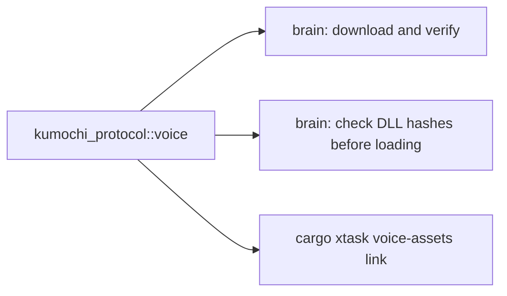
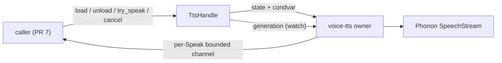
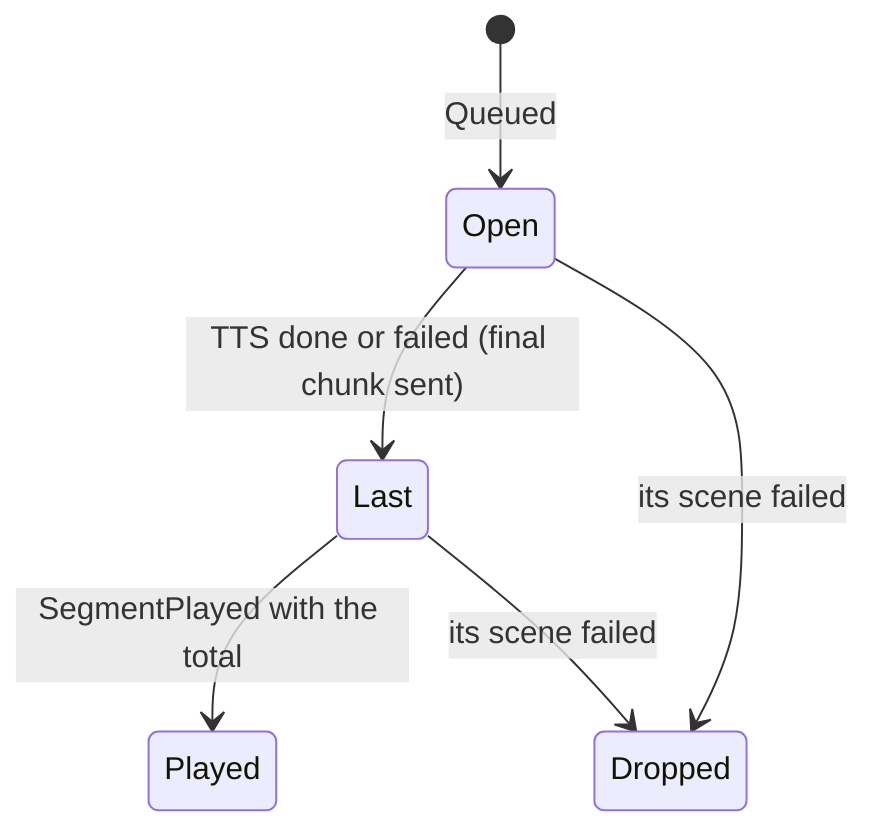
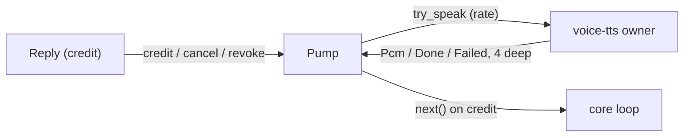
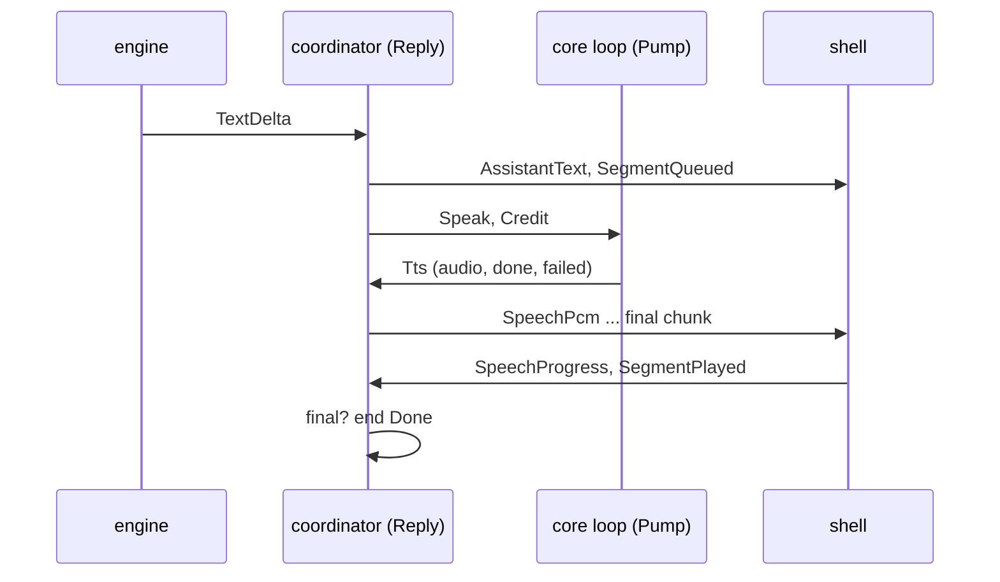
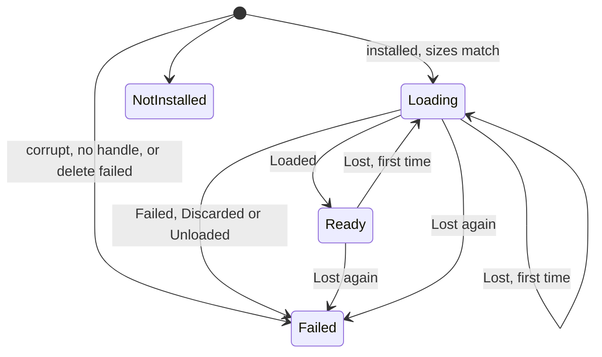
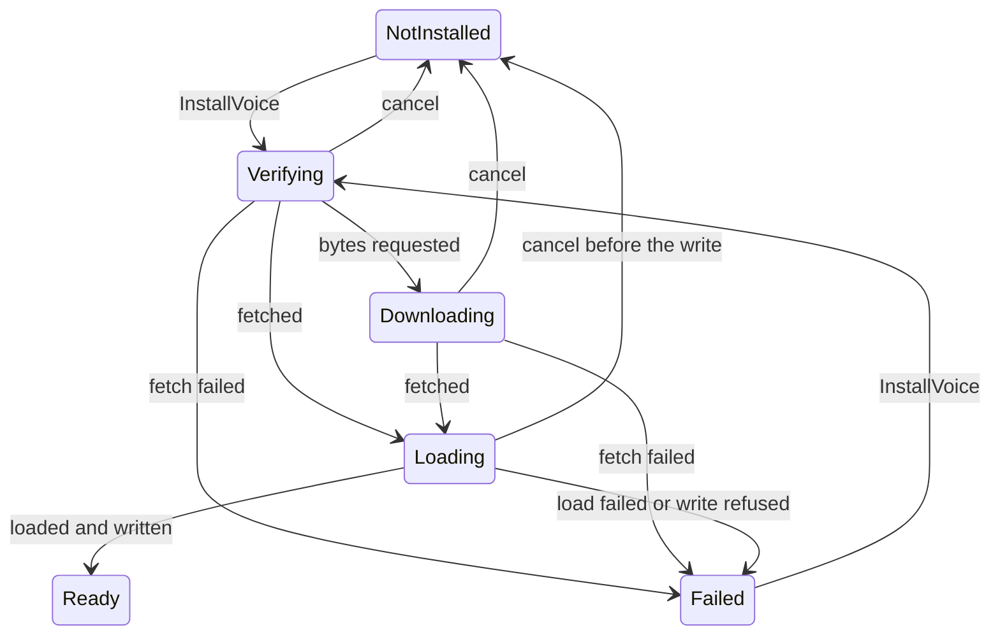
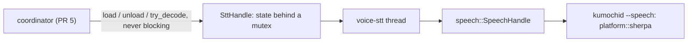
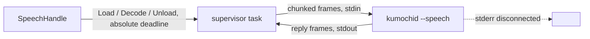

# Voice

Voice is optional. A user installs two parts separately, and each runs locally in the brain:

| Part | Model | Size | License |
|---|---|---|---|
| Speech input | Parakeet TDT 0.6B v3, int8, run through sherpa-onnx | 670 MB | CC-BY-4.0 |
| Spoken replies | Phonon 31M (Q8) with the Juniper voice, run through `ptts` | 65 MB | Apache-2.0 |

Sizes are decimal megabytes of the exact bytes installed.

## The manifest

`kumochi_protocol::voice` is the only list of voice files. Each model file has an immutable
Hugging Face `resolve` URL at a pinned commit, its exact size and its SHA-256. Each native
library has its size and SHA-256. Nothing is unpacked, because every file downloads on its own.



Installed files live in `%LOCALAPPDATA%\<DATA_DIR>\models\<part>\<file>`, where the part folders
are `speech-input` and `spoken-replies`. The native libraries ship beside `kumochid.exe`, and
nothing downloads them.

## Download path

`brain::voice::download::Downloader` installs one part from the pinned manifest. Its caller
supplies the models folder under `platform::data_dir`. Construction makes no request, and
startup never resumes anything automatically. Its only caller is the installer's one fetch,
through the `download::Fetch` seam, which makes a `Downloader` for each fetch, so start-up builds
none. Installing, cancelling and start-up are in [The installer](#the-installer); `RemoveVoice`
is still refused (see [settings](settings.md#config-keys)).

The separate HTTPS client uses the OS trust roots, no proxy, credentials, cookies, Referer or
compression, and `Accept-Encoding: identity`. The first URL and up to five redirects must use
port 443 without userinfo, on `huggingface.co` or a subdomain of `hf.co`; IP literals are refused.
Signed CDN queries never enter diagnostics.

Existing final files are size- and SHA-256-checked; a bad final is removed before any request.
Free space must cover the remaining bytes plus 10%, rounded up. An exclusively locked `.part`
is rehashed before a Range request. A valid 206 appends; 200 replaces the prefix. A bad range
or 416 restarts once. The manifest bounds the stream, even without Content-Length; a 200 with
a different length is rejected before reading its body. Only a complete hash match is synced
and atomically moved into place.

Cancellation, a short body, transport failure, 429, 5xx or a 30-second idle timeout keep the
partial for the next explicit attempt. Size and hash failures delete it. Cancellation also
interrupts prefix hashing. Connecting is bounded to 30 seconds; there is no total download
deadline. Progress carries a phase: `Verifying` while bytes already on disk are hashed, and
`Downloading` from the first request. A phase change is sent at once; byte counts within a phase
are coalesced to at most four updates a second, so a part that's already whole never shows
`Downloading`. Tests use only injected
loopback TLS fixtures; the ignored `measure_download_head` requires explicit permission.

## Spoken replies

`brain::voice::tts` turns text into mono PCM with Phonon 31M (Q8) and the Juniper voice. Phonon makes
24 kHz; each Speak names the output device's rate, and every frame is resampled to it.
One thread, `voice-tts`, owns the model and every open stream. The handle never waits on it.



- **Load:** one load at a time from `models\spoken-replies`, CPU and Q8 weights, seed 42, then a
  short warm-up. A failed load leaves voice output unloaded; nothing retries on its own. Loads
  and unloads carry an ask and are reported the way speech input's are (see
  [Load asks](#load-asks)).
- **A Speak during a load** waits for it, as the one waiting request: it's spoken if the load
  succeeds and gets `NotLoaded` if the load fails. Unload rejects it, and a cancel makes it stale.
  A stale waiting Speak is replaced unanswered by the next one, so a cancel never leaves TTS busy;
  only a waiting Speak of the current generation makes `try_speak` answer busy.
- **Speak:** text is non-empty, NUL-free and at most 1,024 bytes. Each frame is resampled, gets a
  fixed +5.5 dB gain, and is clipped and converted to `i16`. A NaN or infinity fails the segment,
  and so does passing 30 seconds at the Speak's rate. `Done` carries the total sample count at
  that rate.
- **Cancel:** `cancel` moves a generation. The owner checks it before and after each frame, and
  while it waits for room in a full output channel, so it never blocks on a slow consumer.
  Returning drops Phonon's stream, which stops and joins its two workers on the owner thread.
  Dropping the receiver has the same effect. Each Speak has its own channel: on cancel the caller
  drops that receiver, so no old-generation event reaches the next Speak.
- **Unload and shutdown** are state, not queued commands, so a full queue can't hold them up.
  An unload of the wanted ask also cancels and rejects a waiting Speak with `NotLoaded`. Load and warm-up can't be
  interrupted inside Phonon; unload and shutdown take effect when they return.
- **Threads:** xn runs its operators on its own process-wide pool. Voice sizes it to 8 with
  `xn::threadpool::start_pool_with` and checks the width before any inference. It never calls
  `xn::set_num_threads`, which writes the process environment. A pool that comes up short or
  loses a worker keeps voice output unavailable for the rest of the process. The pool's seven
  workers live as long as the process; unload frees the model, not them.
- **Environment:** Kumochi never reads, sets or unsets the process environment for voice. Its
  dependencies read five nonsecret numeric tuning variables themselves: `XN_SPIN_BUDGET`,
  `XN_Q8_REPACK` (xn), `GEMM_PACKED_LHS_CACHE`, `GEMM_PACKED_LHS_CACHE_MB` (xn-gemm) and
  `TOKENIZERS_PARALLELISM` (tokenizers). That's a granted exception until upstream takes explicit
  configuration. Nothing else is allowed: no network, no model hub or cache, and no other app's
  tokens or config.
- **Worker threads:** each stream's two Phonon workers start with `std::thread::spawn`, so a
  refused thread aborts a release brain. Fallible spawns are a follow-up before release.
- **Logs:** the `ptts`, `xn`, `xn_gemm` and `tokenizers` targets are off at every level, since
  their messages can carry paths or text. Errors map to content-free `TtsError` values.

### Segments and the reply

A spoken run has two pure parts. Neither does any I/O; the coordinator's `speech` module wires them in (see **A spoken run** below).

**`voice::segment`** cuts the run's streamed answer into sentences:
- A segment ends at `.`, `!` or `?` followed by whitespace. Past 120 characters, `,`, `;` or `:` followed by whitespace also ends one.
- Past 240 characters the segment is cut at its last whitespace, or on a character boundary inside one long token.
- A mark at the end of a delta waits for the next character, so `3.` then `5` stays `3.5`.
- A step's `say` first ends the text before it, so speech keeps the answer's order.
- The producer's close flushes the tail once. Whitespace on its own is never spoken.

**`voice::reply`** holds one run's speech: its segments, the one TTS is making, the audio the shell holds unplayed, and finality.



- **The window.** At most one Speak is out at a time. A new one goes out only while the unplayed audio is under 20 s and at most two segments lie beyond the playing one.
- **Credit.** The pump reads TTS only on credit, which keeps forwarded audio inside the window. `SpeechProgress` gives credit back as it plays, so a 30 s segment streams through the 20 s window.
- **Chunks.** Audio goes out as it's made, in chunks of at most 100 ms. Every queued segment ends with one empty chunk whose `last` carries the samples sent. TTS reaching `Done`, a failure, a zero-output segment and a failed scene all end a segment that way. Final chunks go out in segment order, so a dropped segment's waits for every earlier one's.
- **Finality.** Speech is final when the producer has closed, nothing is being spoken, and every surviving segment has played. After a revoke it's final once the shell's `SpeechStopped` arrives instead.
- **Revoke.** A revoke stops the run's speech for good, and nothing more goes out for the run, a later scene failure included. A Stop from the shell isn't told back to it; any revoke from the brain sends `SpeechRevoked`. A new output-device generation mid-run revokes too: the text stays, and nothing is replayed at the new rate.
- **Refused reports.** A report that can't be true is refused: an unknown segment, one out of order, a total that isn't the samples sent, a quiet answer nobody asked for, or a quiet cursor that skips a segment whose audio hadn't all gone or falls behind what already played. A late report for a dropped segment is ignored.
- **The stall timer.** Every move of a draining run re-arms it, under a new epoch, and only the latest epoch counts. A repeated or backward progress report, or a scene failure that drops nothing, doesn't re-arm it.
- **Heard point.** It's the furthest played sample, with the answer's byte offset where heard speech ends. A text segment counts as heard to its end only when TTS finished it and all of it played, including by a quiet cursor at its total; one TTS failed counts only to its start. The quiet answer is the last word: later progress and played reports don't move the point.
- **The stored point.** When the run is released (its outcome stored and the shell quiet, or gone), the brain writes the point to the run's row: segment, sample, and the byte offset into the run's answer text. The write is an UPDATE that only moves the point forward and never touches an active or deleted run. It's best effort, and NULL means unknown:
  - a run that played nothing, or whose store write failed, keeps NULL, because its stored text may lack what was heard;
  - a run the store gave up on, or whose thread was deleted, has no point;
  - after a disconnect or Quit, the point is the last one received;
  - a failed write leaves NULL too, and nothing answers it.

### The pump and the resampler

**`voice::pump`** is the brain's one reader of TTS. It holds the current Speak's receiver and
forwards audio only while the run's reply has granted credit, so a full channel parks the TTS
thread, never the core loop.



- **One run at a time.** Only a Speak picks the run: a Speak for another run stops the held one and
  starts over at zero credit. Credit for a run the pump doesn't serve is ignored, so a late grant
  from a replaced run can't take the pump back.
- **Credit** is samples granted minus samples forwarded. A TTS event may overshoot it; at zero, the
  next audio waits, read ahead as the one held event. `Done`, a failure and a closed stream need no
  credit, so a full window never hides a segment's end, but none passes audio still waiting.
  `next` is cancel-safe.
- **Cancel** stops the current Speak, drops any held event and keeps the run's credit for its next
  one. **Revoke** does the same and zeroes the credit. The reply, not the pump, keeps a revoked run
  silent for good.
- **A stream that closes without `Done`**, including a Speak TTS was too busy to take, comes back as
  a `Synthesis` failure for its segment.

**`voice::resample`** converts a stream between any two rates with a Blackman-windowed sinc:
16 zero crossings a side, a 128-point-per-crossing table interpolated linearly, and a cutoff at
19/20 of the lower rate's Nyquist.
- Each output sits at its exact rational position in the input, so lengths and timing never
  drift: n inputs make ceil(n * to / from) outputs, however the input is cut into frames.
- It waits for the input it needs on both sides, so there's no delay to trim. `finish` pads with
  silence and flushes the tail.
- Equal rates pass the audio through untouched.
- Per-frame cost on Rez is in the PR (the pump around it, 24 kHz to 48 kHz).

### A spoken run

A run speaks when spoken replies are loaded and the connection has sent `AudioOutput` when the run
is admitted. Otherwise it gets no reply, and its text and steps run as before. Spoken replies
count as loaded while the part is `Ready` and talk-back is on; the brain tells the coordinator
each time that changes, including when a `SetTalkBack` commits.



- **Feeding the reply.** Text deltas, and a drawn step's `say` when the store commits the step,
  feed the run's reply. A failed scene drops that scene's say segments. Speech frames for the
  shell wait behind a pending step, as the run's text does.
- **The pump** is owned by the core loop and read only while the data queue has room. With no
  pump, a Speak fails as if TTS weren't loaded, and the run's remaining segments end empty.
- **Draining.** When the engine finishes, the reply closes. The run ends `done` only once its
  speech is final, so it can sit finished with its speech still playing; see
  [runs.md](runs.md#draining-a-spoken-run).
- **A device change** (a new `AudioOutput` generation) revokes the current run's speech. The run
  goes on as text and ends `done` once the shell's `SpeechStopped` comes back.

## The installer

`brain::voice::installer::Installer` holds one entry per part: what `config.toml` says about it
(absent, installed or removing), its phase, its current token, and how many automatic reloads it
has left. It does no I/O. Each method returns the effects the runtime carries out: start the
fetch, cancel it, load, unload, or queue the Activate write. Tokens come from one counter, and
every completion comes back with the token it started with: a fetch's result, a handle's report
(the token is its ask), or a write's result. A completion for any other token than the part's
current one changes nothing.

At brain start, with no network, after unfinished removals:

1. The speech worker's supervisor with its `SttHandle`, and the `TtsHandle`, start. One that
   can't start leaves its part `Failed { VoiceLoad }` for the session; it never shows `Loading`.
   Spoken replies' handle goes into the pump, the one reader of TTS.
2. Each part listed in `installed` gets a size check of every manifest file. A part that passes
   loads; one that fails is `Failed { VoiceCorrupt, installed: true }` and doesn't load.
   shortcut: a corrupt file of the right size still loads until an install re-hashes it.
3. A removal whose folder couldn't be deleted is `Failed { VoiceStorage, installed: false }`.
   One whose folder is gone shows `NotInstalled` while its `RemoveDone` write is in flight, and
   stays removing until that write commits. If the write fails, the part is
   `Failed { VoiceStorage, installed: false }` too, and nothing installs it until the next start
   finishes the removal.



A loss of the current model, whether idle or during a decode, starts one automatic reload with a
new ask; a second loss is `Failed { VoiceLoad }`. The allowance is one per install, and one per
session for a part loaded at start. A late report for an older ask, such as a loss from a worker
the reload replaced, is dropped. `installed` in every `Failed` comes from one place: the part is
durably installed.

### Install and cancel

`InstallVoice` and `CancelVoiceInstall` write nothing themselves. Each is answered accepted, in
queue order, with the current settings, and progress follows as `Voice`.

1. An install of a part that isn't installed, or that failed, takes a new token and fetches. One
   fetch runs at a time, so an install while another fetch runs, even a cancelled one that hasn't
   ended yet, shows `Verifying` and waits its turn.
2. The fetch shows `Verifying` while it hashes files already on disk, and
   `Downloading { done, total }` once it requests bytes. A failed fetch is `Failed` with its key
   (`VoiceNoSpace`, `VoiceDownload`, `VoiceCorrupt` or `VoiceStorage`), and nothing is written.
3. A fetched part loads. A load that fails, or a fresh install lost twice while loading, is
   `Failed { VoiceLoad, installed: false }`, with nothing written.
4. A loaded part stays `Loading` while the Activate write adds it to `installed`. The first
   spoken replies install turns `talk_back` on in the same write, unless the file already has a
   `talk_back` key, so a choice made during the install wins. The part is `Ready` only once the
   write commits. A refused write unloads it: `Failed { SettingsRefused, installed: false }`.
5. A retry of an installed part (`Failed` with `installed: true`) fetches, which re-hashes its
   files, then loads, and is `Ready` with no write.

Cancel sends every install that's waiting, fetching or loading back to where it was, with its
files kept, so the next install resumes. A cancelled load's late success is dropped and sends
nothing, because the handle already freed it. A commit in flight isn't cancelled. An install
during a removal's `RemoveDone` write starts once that write commits. Installs keep going while
no shell is connected.



The brain sends `ControlToShell::Voice` with both parts' `PartState` once per connection, after
`Account` and before `Scenes`, and again on each change. Reports that came while no shell was
connected are applied first, so the view is current. The shell doesn't show it yet.

## Provenance

- **Speech input:** `csukuangfj/sherpa-onnx-nemo-parakeet-tdt-0.6b-v3-int8` at
  `2bda32ec70b097a55adaa07d9a7173915b43cc78`, sherpa-onnx's int8 export of NVIDIA's
  [parakeet-tdt-0.6b-v3](https://huggingface.co/nvidia/parakeet-tdt-0.6b-v3), which is CC-BY-4.0.
  The export repository has no model card, so the notice keeps NVIDIA's attribution.
- **Spoken replies:** `gradium/phonon-31m-en` at `92741c5b07d085ff840e26fea8ce43110b87852f`
  (`model.q8.gguf`, `config.json`, `tokenizer.json`), and Juniper from `gradium/phonon-voices` at
  `0ee17205f254b5abc43b266c8a0f215565c352f7`, file `voices/NIWIOv5vTi5eRMj8.safetensors`. Both
  repositories are Apache-2.0.

Each hash in the manifest is the SHA-256 of the file's bytes at that revision. For the LFS files
(the three ONNX files, `model.q8.gguf` and Juniper) it equals the LFS SHA-256 Hugging Face reports.
`tokens.txt`, `config.json` and `tokenizer.json` are plain Git blobs, so their hashes were checked
by hashing the downloaded bytes, and their sizes against the blob metadata.

The native runtime and its license audit are in [voice-natives.md](voice-natives.md).

## Dev machines

A developer who already has the files links them instead of downloading them again:

```text
cargo xtask voice-assets link <models-dir> <natives-dir>
```

On Rez that's `C:\dev\capsula-ws\models` and
`C:\dev\capsula-ws\tools\voice\sherpa\sherpa-onnx-v2.0.1-win-x64-shared-MD-Release-lib\lib`.
The task checks every source's size and SHA-256 before it links anything, then hardlinks the
models into the dev models folder (`Kumochi Dev`) and the DLLs beside
`target\debug\kumochid.exe` and `target\release\kumochid.exe`. Hardlinks take no space, and
they need the sources and the destination on one NTFS volume. The task never copies and never
downloads. A destination that already matches the manifest is kept. Any other existing file there
is a conflict: the task checks every destination before it links anything, and if one conflicts it
links nothing, changes nothing and names the file, to be moved aside by hand. If a link fails
partway, the links that run made are removed. Run it again after `cargo clean`.

## Speech input

`platform::sherpa` runs Parakeet through sherpa-onnx's C API, loaded at run time. Everything it
makes lives on the thread that loaded it.

- **Recognizer:** Parakeet's transducer files, 8 CPU threads and greedy search.
- **Audio:** mono 16-bit PCM at its capture rate, converted to `f32` once and passed to sherpa-onnx's
  `AcceptWaveformOffline`, which resamples it. Empty audio, a zero rate and lengths past `i32` are
  refused before any native call.
- **Text:** at most 16 KiB of UTF-8, copied out before the result is destroyed.
- **Errors** are `NativeError` values, which carry no native text and no paths. sherpa-onnx itself
  prints one line to stderr when it resamples (see [voice-natives.md](voice-natives.md)).

### The owner

`voice::stt::SttHandle` owns speech input. Its one thread, `voice-stt`, asks the speech worker
(below) to load, decode and unload through the brain's runtime, so the coordinator never waits on
that work. sherpa-onnx never loads in the brain.



- **Control:** load, unload and shutdown set fields in one shared state; none of them queues, so
  none can be refused or held up. At most one decode waits behind the running one, and another is
  `SttBusy`. While no model is ready (unloaded, loading, or after a failed load) a decode is
  answered `NotLoaded` at once, and so is one that arrives after unload while a decode still runs.
  Unload answers a waiting decode `Stale`; a decode in progress finishes and is answered, then the
  model is unloaded. A decode whose caller has gone is skipped. `Decode` and `SttResult` print no
  samples and no transcript text.
- **Load:** the worker's `Load`. A failed load leaves speech input unloaded until the next
  `load`. A newer ask reloads after the running decode, and a decode left waiting is served by
  the new model.
- **A lost worker:** the `voice-stt` thread has its own subscription to `SpeechHandle::lost`, and a
  small task wakes it on each loss, so an idle loss ends serving too. A load's reply names the
  worker generation that holds the model, and each loss names the generation that died. Only that
  generation's loss is the load's, even one that comes before serving starts. An older worker's
  loss can arrive after a newer load, because the supervisor answers before it broadcasts, so it's
  skipped and the newer model keeps serving and is unloaded as usual. The running decode is answered
  `Failed(WorkerLost)`, a waiting one `NotLoaded`, and the ask is reported `Lost`. Speech input
  stays unloaded unless a newer ask came after the lost load started; a failure's cleanup never
  undoes a newer ask. Retrying is the installer's bounded policy; nothing here retries on its own.
- **Shutdown:** dropping the handle lets the request in flight finish, unloads and ends the
  thread; nothing waits for it.

### Load asks

Both owners, speech input's and spoken replies', take `load(models, ask)` and `unload(ask)`, where
the ask is the caller's own counter, and send one `LoadReport { ask, event }` per outcome:

| Event | When |
|---|---|
| `Loaded` | the load (with its warm-up) finished and the ask is still the wanted one |
| `Discarded` | the load finished after its unload or a newer ask; sent once the model is freed in the owner thread |
| `Failed` | the load failed |
| `Unloaded` | the ask's model is freed, or the owner never had that ask |
| `Lost` | speech input only: the worker went while the ask was loading or loaded |

When a load finishes, every command sent meanwhile is already in the shared state, so the owner
keeps the model only if its ask is still wanted. `unload(ask)` clears only that ask and frees only
its model: an unload for any other ask is reported `Unloaded` and changes nothing. An ask stays
the owner's until its model has dropped, so no report says an ask is quiet while its model is
still being freed, and an ask unloaded while an older model drops never starts loading. Reports
go out under the state lock, so an unload's own report can't overtake the owner's. Every
ask that starts loading ends in one of `Discarded`, `Failed`, `Unloaded` or `Lost`.

### The FFI owner

`platform::sherpa` is the only code that calls sherpa-onnx. Its ten C functions sit in a private
table resolved once at load, and the `#[repr(C)]` structs are transcribed from v2.0.1's `c-api.h`.
The table's functions are declared `extern "C-unwind"`. sherpa-onnx v2.0.1 doesn't catch every C++
exception (`SherpaOnnxDecodeOfflineStream` reaches ONNX Runtime's throwing `Session::Run`, and
stream and result creation allocate with `new`), and an exception entering Rust through a plain
`extern "C"` is undefined behavior. With `C-unwind` it's a defined foreign unwind instead, which
the speech worker's boundary turns into the worker's exit; nothing recovers from it in-process.
Compile-time assertions pin their sizes, alignments and the offsets Kumochi writes or reads, and
`measure_sherpa_layout` checks the same values against the header with `cl` on Rez. Every native
object becomes a guard as soon as it's created. The guards borrow from each other, so they're
destroyed in order: result, stream, recognizer, sherpa-onnx, then ONNX Runtime. Nothing in the
module is `Send`.

### The loader policy

`Sherpa::load(source, root)` stops at the first failure:

1. **Closure check.** If any module named like one the two DLLs import (the list in
   `NATIVE_CLOSURE`, from [voice-natives.md](voice-natives.md)) is already loaded from anywhere but
   its place, it refuses with `Conflict` and loads nothing. The pins must be exactly at the natives
   folder, and everything else directly in the system folder. Windows binds an import to an
   already-loaded module of that name, whatever folder it came from.
2. **Staging.** The DLLs are loaded only from `<root>\natives\sherpa-onnx-2.0.1`, never from
   `source` (the install folder, or the dev link). See [Staging](#staging) below.
3. **Loads.** ONNX Runtime, then sherpa-onnx, by full path with `LOAD_LIBRARY_SEARCH_SYSTEM32`:
   sherpa-onnx's `onnxruntime.dll` import binds to the one just loaded, and every other import
   comes from the system folder, never from the DLL's folder, `PATH` or the current directory. A
   missing system dependency, most likely the VC++ runtime, is `Dependency`.
   Every folder from the volume root down and each verified DLL handle stay open until both
   loads return.
4. **Inventory.** The closure check runs again, and every module that appeared must be a pin or a
   system module, or both DLLs unload and it's `Unexpected`.
5. **Release check.** `SherpaOnnxGetVersionStr` must be `2.0.1` and `SherpaOnnxGetGitSha1`
   `af2d8d81`, or it's `Abi`.

### Staging

The threat is code that isn't this user at medium integrity: another account, or a
lower-integrity process running as this user. Medium-integrity code running as this user can
already change the brain, so it isn't defended against. `platform::windows::protected` holds the
policy.

- **Root.** In production `root` is Kumochi's folder in the local application data folder that
  `SHGetKnownFolderPath` reports. The `LOCALAPPDATA` variable isn't consulted, because a value
  pointing elsewhere would choose which folders are trusted.
- **Held chain.** Each component from the volume root to `root` is opened without delete sharing
  and with `FILE_FLAG_OPEN_REPARSE_POINT`. Then it's checked through that handle while the
  components above it stay open:
  - It isn't a reparse point.
  - Its final path is the lexical one, compared without case after the `\\?\` form. A UNC or
    volume-GUID result never matches.
  - Its owner is this user, SYSTEM, Administrators or `TrustedInstaller`.
  - No allow entry gives anyone else delete, write-DAC, write-owner, write-data, write-attributes
    or delete-child. Setting a reparse point needs only write-data or write-attributes, so holding
    a handle without delete sharing isn't enough on its own.
  - A mandatory label that applies to it is at least medium and has no-write-up. With no label,
    Windows applies exactly that. A medium label without no-write-up lets lower-integrity code
    running as this user write, so it's refused.

  A component that fails is refused (`Reparse` or `Unsafe`), and nothing loads. On Rez the temp
  folder grants other accounts write access, so it can't be a root.
- **Staging folders.** `natives` and `sherpa-onnx-2.0.1` are created with a protected DACL that
  has one entry: full access for this user, inherited by their files. An existing folder must
  pass the same checks as it stands; it's never re-secured in place, because a new DACL doesn't
  take back rights already granted to open handles. One that fails is refused, so a tampered
  staging folder has to be removed by hand.
- **Files.** A staged DLL that matches its pin is kept. Otherwise it's replaced by a copy of the
  source, read through a handle that refuses writers, with its size and SHA-256 checked as it
  streams. A copy that fails or doesn't match is removed. Each staged DLL is then held against
  writers and deleters, checked like a folder (anyone else may not append either), and verified
  again through that handle.

The tests stage copies of a system DLL in scratch folders under the local application data folder.
They check that a rename or delete of the DLL is a sharing violation while it's held, and that
renames of every held folder fail. A non-empty held folder can't be turned into a junction. A
junction anywhere on the root path, or in the DLL's place, is `Reparse`, with nothing loaded. A
root others can change is `Unsafe`. An existing empty staging folder others could change is
`Unsafe` and left as it is, with no pin copied into it; a handle opened on it beforehand can still
turn it into a junction, and the next stage is `Reparse` with the outside file untouched. A
staging folder labelled low, or medium without no-write-up, is `Unsafe`; medium with no-write-up
stages. A bad source leaves nothing staged. A
copy of the test binary labelled low runs at low integrity and can't open the root, either staging
folder or the DLL for write-attributes, write-data, delete, write-DAC or write-owner.

The installer must not put a VC++ runtime beside `kumochid.exe`: the brain imports
`VCRUNTIME140.dll` itself, so an app-local copy would load first and make speech input refuse with
`Conflict`.

### The speech worker

`platform::sherpa` runs only in `kumochid --speech`, a second worker kind under the screen
worker's supervisor (`supervise`; see [screen.md](screen.md) and [processes.md](processes.md)). A
native exception, abort, access violation or hang costs that process. The brain gets a
content-free `WorkerLost` and keeps running. The model goes with the worker: a respawned worker has
nothing loaded until the next load.



- **Requests.** `Load { natives, models }` stages the natives from `natives`, loads them, creates
  the recognizer and runs one second of silence as a warm-up. A load while loaded drops the old
  model first. `Decode { rate, pcm }` carries mono 16-bit little-endian PCM. `Unload` frees the
  recognizer and then the natives. Without a model a decode is `NotLoaded`. Request and reply
  `Debug` show no audio, text or paths.
- **Bounds** [guess]. The rate must be 8–48 kHz. An utterance is at most 60 s and at most
  5,760,000 bytes (60 s at 48 kHz). Both are checked, with the rate, before any duration is
  computed, in the brain before sending and again in the worker. A transcript is at most 16 KiB of
  UTF-8, and the brain checks that again.
- **Deadlines** [guess]. Load 30 s; decode 2 s plus a quarter of the audio's length; unload 5 s.
  Each is absolute from the call and covers queueing, a respawn, every chunk and the native work.
  Missing one loses the worker. Reply ids keep counting across respawns, so a dead worker's late
  output can't answer its successor's request.
- **The fail-stop boundary.** The worker serves every request inside one `catch_unwind`, and
  sherpa-onnx's functions are `C-unwind`. A C++ exception that escapes sherpa-onnx is a defined
  foreign unwind. A release build (`panic = "abort"`) aborts on it. A debug build either aborts
  or returns an opaque error to the boundary, which aborts at once without inspecting or dropping
  it. Nothing serves again on that native state. A Rust panic ends the same way, after the panic
  hook logs only its location. The worker sets `SEM_NOGPFAULTERRORBOX`, so a crash ends at once
  without a dialog.
- **stderr.** sherpa-onnx prints model paths and exception text to stderr on failure (see
  [voice-natives.md](voice-natives.md)). The worker's stderr isn't connected to anything, and its
  log, `kumochi-speech`, records only content-free codes.

Debug builds take one-request fault fixtures: hang, exit, abort, a noncontinuable access violation
raised with `RaiseException`, a garbage frame, a panic, and a C++ throw. `tests/speech.rs` checks
each of the first six against the real worker. The running request and the one queued behind it
both get `WorkerLost`, a loss is broadcast, and the next worker answers a load. The throw fixture
is Rez-only. It builds a DLL with `cl /EHs` whose export throws `std::runtime_error` and calls it
through the worker's boundary. The worker must end before the request's deadline, without
replying. A fresh worker must then load the real natives and Parakeet and decode.

### Checks on Rez

These are ignored in CI and read the real DLLs (`SHERPA_NATIVES`, by default beside the test
binary's profile folder), the header (`SHERPA_INCLUDE`), the models (`VOICE_MODELS`) and the clips
(`STT_CLIPS`):

- `measure_sherpa_layout` compiles a probe against `c-api.h` and compares every layout value.
- `measure_native_imports` checks `NATIVE_CLOSURE` against `dumpbin /dependents` of both DLLs,
  minus API sets and `KnownDLLs`.
- `measure_planted_neighbor` stages the pins, plants an `MSVCP140.dll` beside them and checks the
  system one loads instead.
- `measure_parakeet` runs the layout check, then times load and release-to-text decodes through
  the owner and the release `kumochid --speech` at 16, 44.1 and 48 kHz, with WER against S5's
  reference transcripts.
