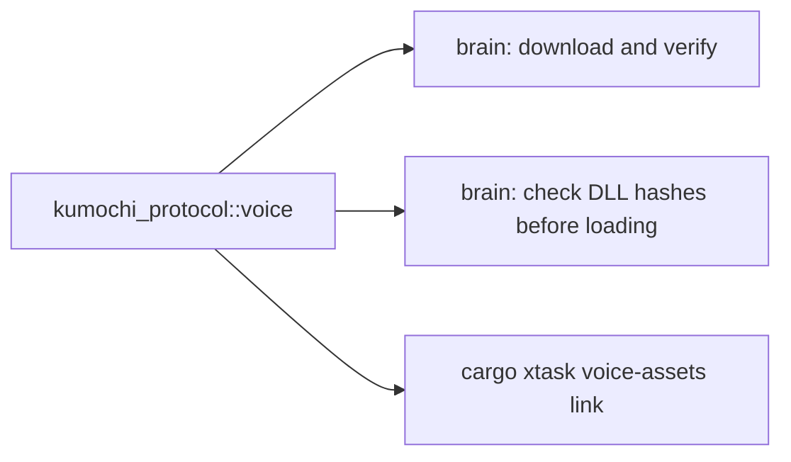
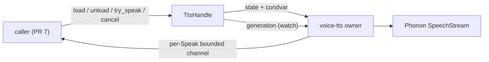

# Voice

Voice is optional. A user installs two parts separately, and each runs locally in the brain:

| Part | Model | Size | License |
|---|---|---|---|
| Speech input | Parakeet TDT 0.6B v3, int8, run through sherpa-onnx | 670 MB | CC-BY-4.0 |
| Spoken replies | Phonon 31M (Q8) with the Juniper voice, run through `ptts` | 65 MB | Apache-2.0 |

Sizes are decimal megabytes of the exact bytes installed.

## The manifest

`kumochi_protocol::voice` is the only list of voice files. Each model file has an immutable
Hugging Face `resolve` URL at a pinned commit, its exact size and its SHA-256. Each native
library has its size and SHA-256. Nothing is unpacked, because every file downloads on its own.



Installed files live in `%LOCALAPPDATA%\<DATA_DIR>\models\<part>\<file>`, where the part folders
are `speech-input` and `spoken-replies`. The native libraries ship beside `kumochid.exe`, and
nothing downloads them.

## Spoken replies

`brain::voice::tts` turns text into 24 kHz mono PCM with Phonon 31M (Q8) and the Juniper voice.
One thread, `voice-tts`, owns the model and every open stream. The handle never waits on it.



- **Load:** one load at a time from `models\spoken-replies`, CPU and Q8 weights, seed 42, then a
  short warm-up. A failed load leaves voice output unloaded; nothing retries on its own.
- **A Speak during a load** waits for it, as the one waiting request: it's spoken if the load
  succeeds and gets `NotLoaded` if the load fails. Unload rejects it, and a cancel makes it stale.
- **Speak:** text is non-empty, NUL-free and at most 1,024 bytes. Each frame gets a fixed +5.5 dB
  gain, is clipped and converted to `i16`. A NaN or infinity fails the segment, and so does
  passing 30 seconds. `Done` carries the total sample count.
- **Cancel:** `cancel` moves a generation. The owner checks it before and after each frame, and
  while it waits for room in a full output channel, so it never blocks on a slow consumer.
  Returning drops Phonon's stream, which stops and joins its two workers on the owner thread.
  Dropping the receiver has the same effect. Each Speak has its own channel: on cancel the caller
  drops that receiver, so no old-generation event reaches the next Speak.
- **Unload and shutdown** are state, not queued commands, so a full queue can't hold them up.
  Unload also cancels and rejects a waiting Speak with `NotLoaded`. Load and warm-up can't be
  interrupted inside Phonon; unload and shutdown take effect when they return.
- **Threads:** xn runs its operators on its own process-wide pool. Voice sizes it to 8 with
  `xn::threadpool::start_pool_with` and checks the width before any inference. It never calls
  `xn::set_num_threads`, which writes the process environment. A pool that comes up short or
  loses a worker keeps voice output unavailable for the rest of the process. The pool's seven
  workers live as long as the process; unload frees the model, not them.
- **Environment:** Kumochi never reads, sets or unsets the process environment for voice. Its
  dependencies read five nonsecret numeric tuning variables themselves: `XN_SPIN_BUDGET`,
  `XN_Q8_REPACK` (xn), `GEMM_PACKED_LHS_CACHE`, `GEMM_PACKED_LHS_CACHE_MB` (xn-gemm) and
  `TOKENIZERS_PARALLELISM` (tokenizers). That's a granted exception until upstream takes explicit
  configuration. Nothing else is allowed: no network, no model hub or cache, and no other app's
  tokens or config.
- **Worker threads:** each stream's two Phonon workers start with `std::thread::spawn`, so a
  refused thread aborts a release brain. Fallible spawns are a follow-up before release.
- **Logs:** the `ptts`, `xn`, `xn_gemm` and `tokenizers` targets are off at every level, since
  their messages can carry paths or text. Errors map to content-free `TtsError` values.

## Provenance

- **Speech input:** `csukuangfj/sherpa-onnx-nemo-parakeet-tdt-0.6b-v3-int8` at
  `2bda32ec70b097a55adaa07d9a7173915b43cc78`, sherpa-onnx's int8 export of NVIDIA's
  [parakeet-tdt-0.6b-v3](https://huggingface.co/nvidia/parakeet-tdt-0.6b-v3), which is CC-BY-4.0.
  The export repository has no model card, so the notice keeps NVIDIA's attribution.
- **Spoken replies:** `gradium/phonon-31m-en` at `92741c5b07d085ff840e26fea8ce43110b87852f`
  (`model.q8.gguf`, `config.json`, `tokenizer.json`), and Juniper from `gradium/phonon-voices` at
  `0ee17205f254b5abc43b266c8a0f215565c352f7`, file `voices/NIWIOv5vTi5eRMj8.safetensors`. Both
  repositories are Apache-2.0.

Each hash in the manifest is the SHA-256 of the file's bytes at that revision. For the LFS files
(the three ONNX files, `model.q8.gguf` and Juniper) it equals the LFS SHA-256 Hugging Face reports.
`tokens.txt`, `config.json` and `tokenizer.json` are plain Git blobs, so their hashes were checked
by hashing the downloaded bytes, and their sizes against the blob metadata.

The native runtime and its license audit are in [voice-natives.md](voice-natives.md).

## Dev machines

A developer who already has the files links them instead of downloading them again:

```text
cargo xtask voice-assets link <models-dir> <natives-dir>
```

On Rez that's `C:\dev\capsula-ws\models` and
`C:\dev\capsula-ws\tools\voice\sherpa\sherpa-onnx-v2.0.1-win-x64-shared-MD-Release-lib\lib`.
The task checks every source's size and SHA-256 before it links anything, then hardlinks the
models into the dev models folder (`Kumochi Dev`) and the DLLs beside
`target\debug\kumochid.exe` and `target\release\kumochid.exe`. Hardlinks take no space, and
they need the sources and the destination on one NTFS volume. The task never copies and never
downloads. A destination that already matches the manifest is kept. Any other existing file there
is a conflict: the task checks every destination before it links anything, and if one conflicts it
links nothing, changes nothing and names the file, to be moved aside by hand. If a link fails
partway, the links that run made are removed. Run it again after `cargo clean`.
