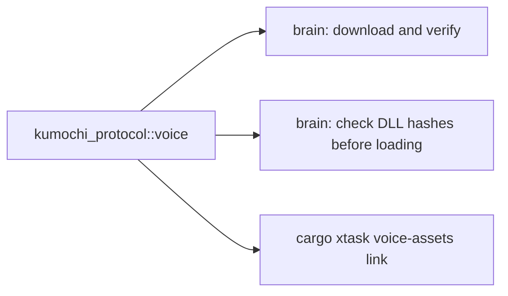

# Voice

Voice is optional. A user installs two parts separately, and each runs locally in the brain:

| Part | Model | Size | License |
|---|---|---|---|
| Speech input | Parakeet TDT 0.6B v3, int8, run through sherpa-onnx | 670 MB | CC-BY-4.0 |
| Spoken replies | Phonon 31M (Q8) with the Juniper voice, run through `ptts` | 65 MB | Apache-2.0 |

Sizes are decimal megabytes of the exact bytes installed.

## The manifest

`kumochi_protocol::voice` is the only list of voice files. Each model file has an immutable
Hugging Face `resolve` URL at a pinned commit, its exact size and its SHA-256. Each native
library has its size and SHA-256. Nothing is unpacked, because every file downloads on its own.



Installed files live in `%LOCALAPPDATA%\<DATA_DIR>\models\<part>\<file>`, where the part folders
are `speech-input` and `spoken-replies`. The native libraries ship beside `kumochid.exe`, and
nothing downloads them.

## Provenance

- **Speech input:** `csukuangfj/sherpa-onnx-nemo-parakeet-tdt-0.6b-v3-int8` at
  `2bda32ec70b097a55adaa07d9a7173915b43cc78`, sherpa-onnx's int8 export of NVIDIA's
  [parakeet-tdt-0.6b-v3](https://huggingface.co/nvidia/parakeet-tdt-0.6b-v3), which is CC-BY-4.0.
  The export repository has no model card, so the notice keeps NVIDIA's attribution.
- **Spoken replies:** `gradium/phonon-31m-en` at `92741c5b07d085ff840e26fea8ce43110b87852f`
  (`model.q8.gguf`, `config.json`, `tokenizer.json`), and Juniper from `gradium/phonon-voices` at
  `0ee17205f254b5abc43b266c8a0f215565c352f7`, file `voices/NIWIOv5vTi5eRMj8.safetensors`. Both
  repositories are Apache-2.0.

Each hash in the manifest equals the LFS SHA-256 Hugging Face reports for that file at that
revision (`tokens.txt` is a plain Git blob, checked by its blob id).

The native runtime and its license audit are in [voice-natives.md](voice-natives.md).

## Dev machines

A developer who already has the files links them instead of downloading them again:

```text
cargo xtask voice-assets link <models-dir> <natives-dir>
```

On Rez that's `C:\dev\capsula-ws\models` and
`C:\dev\capsula-ws\tools\voice\sherpa\sherpa-onnx-v2.0.1-win-x64-shared-MD-Release-lib\lib`.
The task checks every source's size and SHA-256 before it links anything, then hardlinks the
models into the dev models folder (`Kumochi Dev`) and the DLLs beside
`target\debug\kumochid.exe` and `target\release\kumochid.exe`. Hardlinks take no space, and
they need the sources and the destination on one NTFS volume. The task never copies and never
downloads. Run it again after `cargo clean`.
