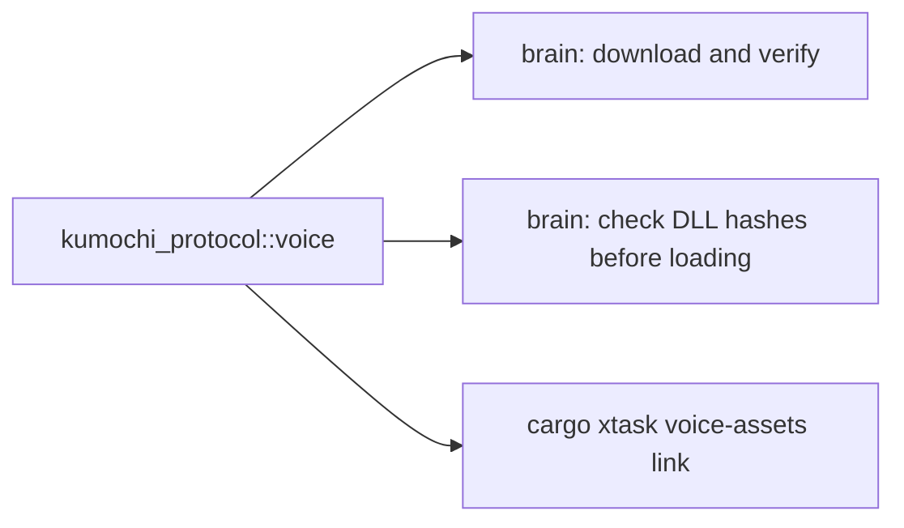
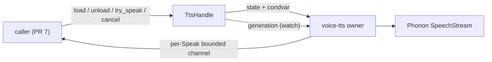
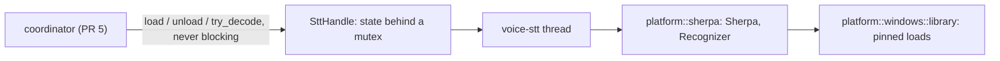

# Voice

Voice is optional. A user installs two parts separately, and each runs locally in the brain:

| Part | Model | Size | License |
|---|---|---|---|
| Speech input | Parakeet TDT 0.6B v3, int8, run through sherpa-onnx | 670 MB | CC-BY-4.0 |
| Spoken replies | Phonon 31M (Q8) with the Juniper voice, run through `ptts` | 65 MB | Apache-2.0 |

Sizes are decimal megabytes of the exact bytes installed.

## The manifest

`kumochi_protocol::voice` is the only list of voice files. Each model file has an immutable
Hugging Face `resolve` URL at a pinned commit, its exact size and its SHA-256. Each native
library has its size and SHA-256. Nothing is unpacked, because every file downloads on its own.



Installed files live in `%LOCALAPPDATA%\<DATA_DIR>\models\<part>\<file>`, where the part folders
are `speech-input` and `spoken-replies`. The native libraries ship beside `kumochid.exe`, and
nothing downloads them.

## Download path

`brain::voice::download::Downloader` installs one part from the pinned manifest. Its caller
supplies the models folder under `platform::data_dir`. Construction makes no request, and
startup never resumes anything automatically; the install task and UI arrive in PR 8.

The separate HTTPS client uses the OS trust roots, no proxy, credentials, cookies, Referer or
compression, and `Accept-Encoding: identity`. The first URL and up to five redirects must use
port 443 without userinfo, on `huggingface.co` or a subdomain of `hf.co`; IP literals are refused.
Signed CDN queries never enter diagnostics.

Existing final files are size- and SHA-256-checked; a bad final is removed before any request.
Free space must cover the remaining bytes plus 10%, rounded up. An exclusively locked `.part`
is rehashed before a Range request. A valid 206 appends; 200 replaces the prefix. A bad range
or 416 restarts once. The manifest bounds the stream, even without Content-Length; a 200 with
a different length is rejected before reading its body. Only a complete hash match is synced
and atomically moved into place.

Cancellation, a short body, transport failure, 429, 5xx or a 30-second idle timeout keep the
partial for the next explicit attempt. Size and hash failures delete it. Cancellation also
interrupts prefix hashing. Connecting is bounded to 30 seconds; there is no total download
deadline. Byte progress is coalesced to at most four updates a second. Tests use only injected
loopback TLS fixtures; the ignored `measure_download_head` requires explicit permission.

## Spoken replies

`brain::voice::tts` turns text into 24 kHz mono PCM with Phonon 31M (Q8) and the Juniper voice.
One thread, `voice-tts`, owns the model and every open stream. The handle never waits on it.



- **Load:** one load at a time from `models\spoken-replies`, CPU and Q8 weights, seed 42, then a
  short warm-up. A failed load leaves voice output unloaded; nothing retries on its own.
- **A Speak during a load** waits for it, as the one waiting request: it's spoken if the load
  succeeds and gets `NotLoaded` if the load fails. Unload rejects it, and a cancel makes it stale.
- **Speak:** text is non-empty, NUL-free and at most 1,024 bytes. Each frame gets a fixed +5.5 dB
  gain, is clipped and converted to `i16`. A NaN or infinity fails the segment, and so does
  passing 30 seconds. `Done` carries the total sample count.
- **Cancel:** `cancel` moves a generation. The owner checks it before and after each frame, and
  while it waits for room in a full output channel, so it never blocks on a slow consumer.
  Returning drops Phonon's stream, which stops and joins its two workers on the owner thread.
  Dropping the receiver has the same effect. Each Speak has its own channel: on cancel the caller
  drops that receiver, so no old-generation event reaches the next Speak.
- **Unload and shutdown** are state, not queued commands, so a full queue can't hold them up.
  Unload also cancels and rejects a waiting Speak with `NotLoaded`. Load and warm-up can't be
  interrupted inside Phonon; unload and shutdown take effect when they return.
- **Threads:** xn runs its operators on its own process-wide pool. Voice sizes it to 8 with
  `xn::threadpool::start_pool_with` and checks the width before any inference. It never calls
  `xn::set_num_threads`, which writes the process environment. A pool that comes up short or
  loses a worker keeps voice output unavailable for the rest of the process. The pool's seven
  workers live as long as the process; unload frees the model, not them.
- **Environment:** Kumochi never reads, sets or unsets the process environment for voice. Its
  dependencies read five nonsecret numeric tuning variables themselves: `XN_SPIN_BUDGET`,
  `XN_Q8_REPACK` (xn), `GEMM_PACKED_LHS_CACHE`, `GEMM_PACKED_LHS_CACHE_MB` (xn-gemm) and
  `TOKENIZERS_PARALLELISM` (tokenizers). That's a granted exception until upstream takes explicit
  configuration. Nothing else is allowed: no network, no model hub or cache, and no other app's
  tokens or config.
- **Worker threads:** each stream's two Phonon workers start with `std::thread::spawn`, so a
  refused thread aborts a release brain. Fallible spawns are a follow-up before release.
- **Logs:** the `ptts`, `xn`, `xn_gemm` and `tokenizers` targets are off at every level, since
  their messages can carry paths or text. Errors map to content-free `TtsError` values.

## Provenance

- **Speech input:** `csukuangfj/sherpa-onnx-nemo-parakeet-tdt-0.6b-v3-int8` at
  `2bda32ec70b097a55adaa07d9a7173915b43cc78`, sherpa-onnx's int8 export of NVIDIA's
  [parakeet-tdt-0.6b-v3](https://huggingface.co/nvidia/parakeet-tdt-0.6b-v3), which is CC-BY-4.0.
  The export repository has no model card, so the notice keeps NVIDIA's attribution.
- **Spoken replies:** `gradium/phonon-31m-en` at `92741c5b07d085ff840e26fea8ce43110b87852f`
  (`model.q8.gguf`, `config.json`, `tokenizer.json`), and Juniper from `gradium/phonon-voices` at
  `0ee17205f254b5abc43b266c8a0f215565c352f7`, file `voices/NIWIOv5vTi5eRMj8.safetensors`. Both
  repositories are Apache-2.0.

Each hash in the manifest is the SHA-256 of the file's bytes at that revision. For the LFS files
(the three ONNX files, `model.q8.gguf` and Juniper) it equals the LFS SHA-256 Hugging Face reports.
`tokens.txt`, `config.json` and `tokenizer.json` are plain Git blobs, so their hashes were checked
by hashing the downloaded bytes, and their sizes against the blob metadata.

The native runtime and its license audit are in [voice-natives.md](voice-natives.md).

## Dev machines

A developer who already has the files links them instead of downloading them again:

```text
cargo xtask voice-assets link <models-dir> <natives-dir>
```

On Rez that's `C:\dev\capsula-ws\models` and
`C:\dev\capsula-ws\tools\voice\sherpa\sherpa-onnx-v2.0.1-win-x64-shared-MD-Release-lib\lib`.
The task checks every source's size and SHA-256 before it links anything, then hardlinks the
models into the dev models folder (`Kumochi Dev`) and the DLLs beside
`target\debug\kumochid.exe` and `target\release\kumochid.exe`. Hardlinks take no space, and
they need the sources and the destination on one NTFS volume. The task never copies and never
downloads. A destination that already matches the manifest is kept. Any other existing file there
is a conflict: the task checks every destination before it links anything, and if one conflicts it
links nothing, changes nothing and names the file, to be moved aside by hand. If a link fails
partway, the links that run made are removed. Run it again after `cargo clean`.

## Speech input

`platform::sherpa` runs Parakeet through sherpa-onnx's C API, loaded at run time. Everything it
makes lives on the thread that loaded it.

- **Recognizer:** Parakeet's transducer files, 8 CPU threads and greedy search.
- **Audio:** mono 16-bit PCM at its capture rate, converted to `f32` once and passed to sherpa-onnx's
  `AcceptWaveformOffline`, which resamples it. Empty audio, a zero rate and lengths past `i32` are
  refused before any native call.
- **Text:** at most 16 KiB of UTF-8, copied out before the result is destroyed.
- **Errors** are `NativeError` values, which carry no native text and no paths. sherpa-onnx itself
  prints one line to stderr when it resamples (see [voice-natives.md](voice-natives.md)).

### The owner

`voice::stt::SttHandle` owns speech input. Its one thread, `voice-stt`, loads the natives and
Parakeet, decodes and unloads, so the coordinator never waits on native work.



- **Control:** load, unload and shutdown set fields in one shared state; none of them queues, so
  none can be refused or held up. At most one decode waits behind the running one, and another is
  `SttBusy`. While no model is ready (unloaded, loading, or after a failed load) a decode is
  answered `NotLoaded` at once, and so is one that arrives after unload while a decode still runs.
  Unload answers a waiting decode `Stale`; a decode in progress finishes and is answered, then the
  model is torn down. A decode whose caller has gone is skipped.
- **Load:** `Sherpa::load`, the recognizer and one second of silence as warm-up. A failed load
  leaves speech input unloaded until the next `load`. A new models folder reloads, and a decode
  left waiting is served by the new model.
- **Shutdown:** dropping the handle lets the current native call finish, tears down in order and
  ends the thread; nothing waits for it.

### The FFI owner

`platform::sherpa` is the only code that calls sherpa-onnx. Its ten C functions sit in a private
table resolved once at load, and the `#[repr(C)]` structs are transcribed from v2.0.1's `c-api.h`.
Compile-time assertions pin their sizes, alignments and the offsets Kumochi writes or reads, and
`measure_sherpa_layout` checks the same values against the header with `cl` on Rez. Every native
object becomes a guard as soon as it's created. The guards borrow from each other, so they're
destroyed in order: result, stream, recognizer, sherpa-onnx, then ONNX Runtime. Nothing in the
module is `Send`.

### The loader policy

`Sherpa::load` stops at the first failure:

1. **Closure check.** If any module named like one the two DLLs import (the list in
   `NATIVE_CLOSURE`, from [voice-natives.md](voice-natives.md)) is already loaded from anywhere but
   its place, it refuses with `Conflict` and loads nothing. The pins must be exactly at the natives
   folder, and everything else directly in the system folder. Windows binds an import to an
   already-loaded module of that name, whatever folder it came from.
2. **Pins.** Each DLL is opened against writers and deleters, and its size and SHA-256 are checked
   through that handle, which stays open until the DLL is loaded.
3. **Loads.** ONNX Runtime, then sherpa-onnx, by full path with `LOAD_LIBRARY_SEARCH_SYSTEM32`:
   sherpa-onnx's `onnxruntime.dll` import binds to the one just loaded, and every other import
   comes from the system folder, never from the DLL's folder, `PATH` or the current directory. A
   missing system dependency, most likely the VC++ runtime, is `Dependency`.
4. **Inventory.** The closure check runs again, and every module that appeared must be a pin or a
   system module, or both DLLs unload and it's `Unexpected`.
5. **Release check.** `SherpaOnnxGetVersionStr` must be `2.0.1` and `SherpaOnnxGetGitSha1`
   `af2d8d81`, or it's `Abi`.

The installer must not put a VC++ runtime beside `kumochid.exe`: the brain imports
`VCRUNTIME140.dll` itself, so an app-local copy would load first and make speech input refuse with
`Conflict`.

### Checks on Rez

These are ignored in CI and read the real DLLs (`SHERPA_NATIVES`, by default beside the test
binary's profile folder), the header (`SHERPA_INCLUDE`), the models (`VOICE_MODELS`) and the clips
(`STT_CLIPS`):

- `measure_sherpa_layout` compiles a probe against `c-api.h` and compares every layout value.
- `measure_native_imports` checks `NATIVE_CLOSURE` against `dumpbin /dependents` of both DLLs,
  minus API sets and `KnownDLLs`.
- `measure_planted_neighbor` plants an `MSVCP140.dll` beside copies of the pins and checks the
  system one loads instead.
- `measure_parakeet` runs the layout check, then times load and release-to-text decodes through
  the owner at 16, 44.1 and 48 kHz, with WER against S5's reference transcripts, and lists the
  modules that appeared.
