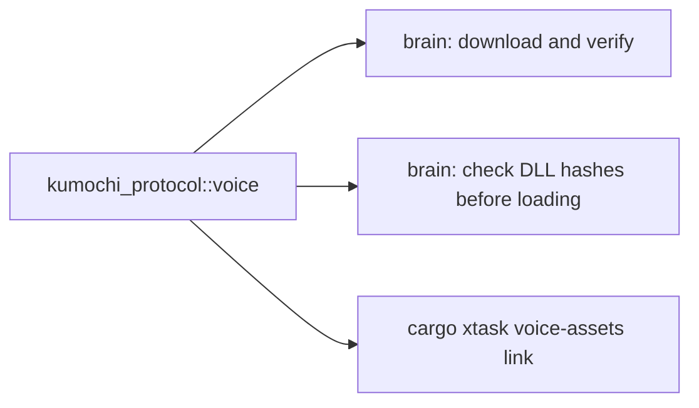
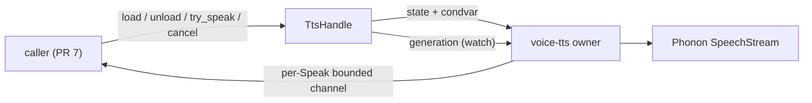
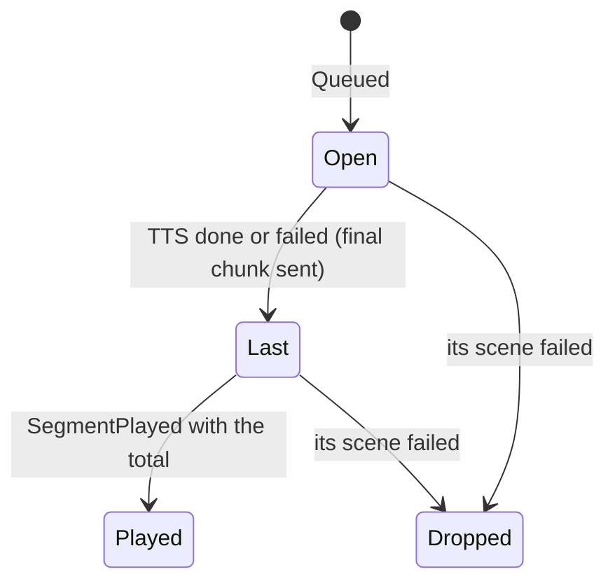
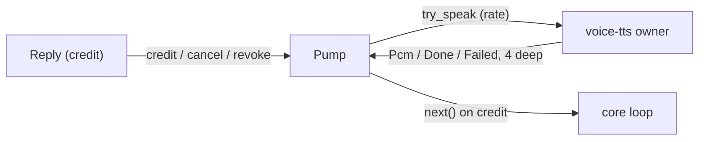
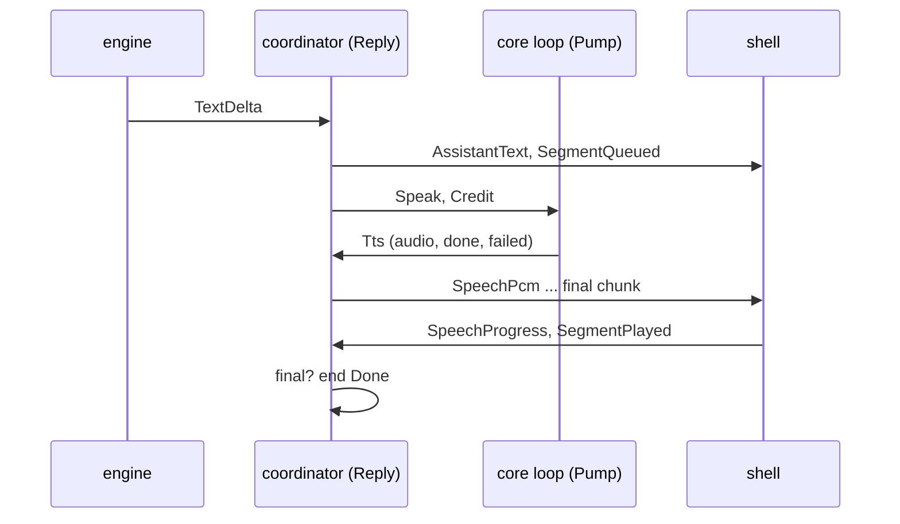
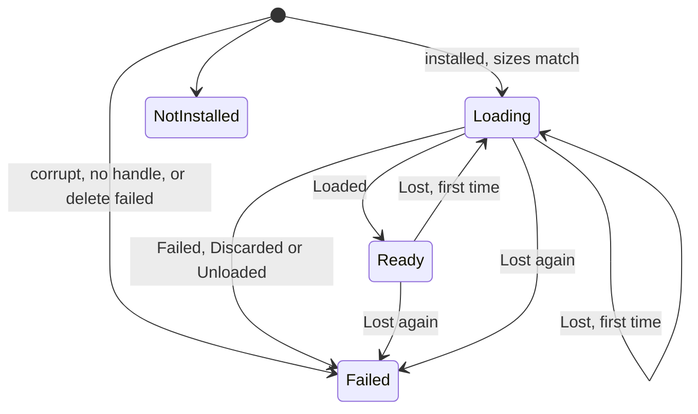
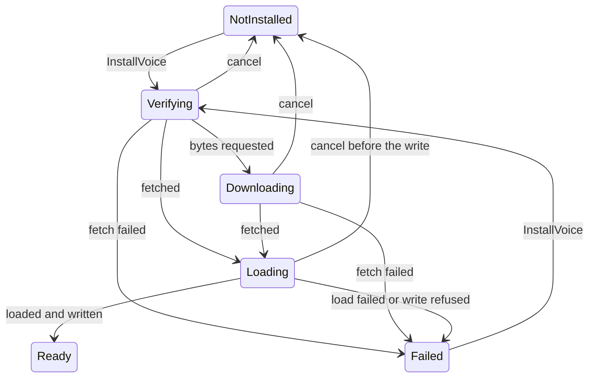
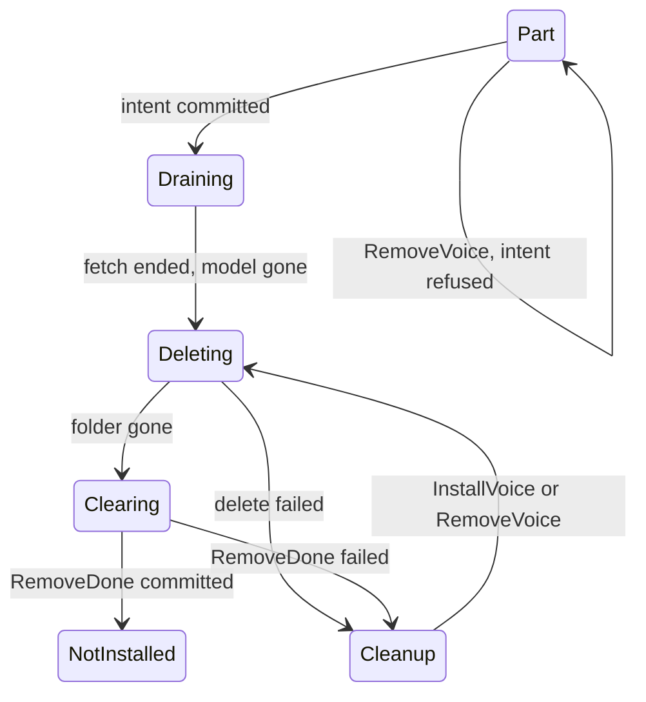
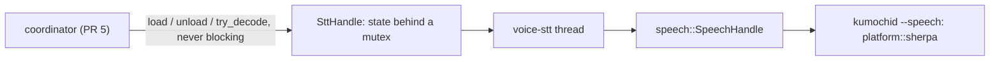
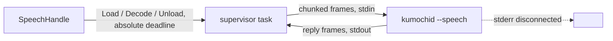

# Voice

Voice is optional. A user installs two parts separately, and each runs locally in the brain:

| Part | Model | Size | License |
|---|---|---|---|
| Speech input | Parakeet TDT 0.6B v3, int8, run through sherpa-onnx | 670 MB | CC-BY-4.0 |
| Spoken replies | Phonon 31M (Q8) with the Juniper voice, run through `ptts` | 65 MB | Apache-2.0 |

Sizes are decimal megabytes of the exact bytes installed.

Hold-to-talk failures log a closed stage and reason at shell admission, capture completion, and
brain hold status/decode boundaries. These diagnostics contain no audio, recognized text,
gesture/session identifiers, device names, paths or foreign error text. A microphone receipt
distinguishes unsupported/unavailable input from discontinuity, capacity and cleanup failures; the
generic user-facing notice does not identify the failed boundary by itself. Debug builds also record
the chord/hold, deferred delivery and stale-admission boundaries, including a chord suppressed by
outstanding key state. They record no key beyond the left Ctrl+Alt chord itself and no ordinary
typing, though debug builds stamp every left Ctrl+Alt chord, including other apps' Ctrl+Alt
shortcuts. Native keyboard registration and capture start remain separate boundaries. The native
gesture deadline records arming and delivery independently, so a delayed deadline can be
distinguished from an admission refusal. The recognition line names what reached the threshold,
`by=Deadline`, `Repeat` or `Release`, and a chord key arriving more than 50 ms after an armed
deadline logs the thread's message queue status bits as one number, once per gesture. Capture
receipts distinguish unreliable driver timestamps from gaps in retained native packets. `Timestamp`
always fails closed. Isolated discontinuities no longer discard an utterance. The adapter reports
each packet's device position, and after physical stop shared `PacketBoundary` sums the frames
missing between kept packets and rejects the hold when they exceed 25% of its span, kept plus
missing frames. Frames lost before the first kept packet are outside the retained audio and don't
count. Discontinuity flags are counted for diagnostics only, since one flag can stand for any amount
of lost audio. A position that restarts, goes backwards or always reads 0 counts no missing frames,
so on such a device the rule checks nothing and the hold passes. There is no lifetime gap limit, so
sparse losses in a long dictation remain admissible. A gap removes audio; it never inserts silence,
replays old audio or admits pre-Listening audio. The queue must still drain after Listening, and the
next nonempty packet is still discarded.

One `held microphone capture summary` is logged after each capture ends, with only numeric
fields: `discontinuities`, `first_discontinuity_packet` (one-based kept ordinal, zero if none),
`first_discontinuity_ms` (observed loop time since stream start), `kept_packets`, `kept_frames`,
`missing_frames` (device frames between kept packets that never arrived), `queue_high_water`
(the most wire chunks seen waiting for the forwarder after a send) and
`discarded_before_listening` (nonempty packets discarded before collection was first seen live;
packets dropped after that, while the queue drains, and the one straddling packet aren't counted).
These count native packets/frames, not the subsequently packed wire chunks. Counters commit
only after an authorized copy and native buffer release. No per-packet allocation, lock,
logging or extra clock query is added for these diagnostics; the first flag uses the loop's
existing monotonic time. Timestamp and over-budget holds are discarded, not transcribed.

The fake-source policy tests use no Windows types, apart from the teardown-error mapping test's two
HRESULT constants. Native adapters supply frame count, first-frame device position, discontinuity
and timestamp-error facts, collection authority and a post-Listening drained-queue observation.
WASAPI alone translates flag bits and owns acquire/release calls; a Core Audio adapter must supply
equivalent facts and the same consent, cancellation and cleanup guarantees. WASAPI requests at least
100 ms of buffering for its 20 ms polling interval. The wire queue is sized from that buffer, room
for all of it drained in one pass plus three chunks, so a stall the buffer absorbs can't overflow
the queue instead. The adapter allocates scratch before Start, and checks the pinned device/format
before Start and after Stop rather than making allocating COM queries in the pump. Mid-stream
unplug/reconfiguration errors from GetBuffer or GetNextPacketSize, a device-invalidated result from
ReleaseBuffer or Stop, or a failed after-Stop check, discard the hold; its generation retires, so
the next hold can open. Any other ReleaseBuffer or Stop failure stays unconfirmed. The initialized
stream's format remains pinned; no reopen or reinterpretation is attempted.

The stop receipt still asserts physical release/join, and the matched wire packet count still
asserts ordered delivery, not lossless device time. Previously the native validator implicitly
required continuity after startup; it now certifies the shared lost-frame bound instead. The
brain receives no synthetic samples or new continuity flag and still waits for true stop before
decoding. A confirmed discarded receipt logs `held speech input ended`; an unconfirmed receipt
logs `held speech input failed`.

## The manifest

`kumochi_protocol::voice` is the only list of voice files. Each model file has an immutable
Hugging Face `resolve` URL at a pinned commit, its exact size and its SHA-256. Each native
library has its size and SHA-256. Nothing is unpacked, because every file downloads on its own.



Installed files live in `%LOCALAPPDATA%\<DATA_DIR>\models\<part>\<file>`, where the part folders
are `speech-input` and `spoken-replies`. The native libraries ship beside `kumochid.exe`, and
nothing downloads them.

## Download path

`brain::voice::download::Downloader` installs one part from the pinned manifest. Its caller
supplies the models folder under `platform::data_dir`. Construction makes no request, and
startup never resumes anything automatically. Its only caller is the installer's one fetch,
through the `download::Fetch` seam, which makes a `Downloader` for each fetch, so start-up builds
none. Installing, cancelling, removing and start-up are in [The installer](#the-installer).

The separate HTTPS client uses the OS trust roots, no proxy, credentials, cookies, Referer or
compression, and `Accept-Encoding: identity`. The first URL and up to five redirects must use
port 443 without userinfo, on `huggingface.co` or a subdomain of `hf.co`; IP literals are refused.
Signed CDN queries never enter diagnostics.

Existing final files are size- and SHA-256-checked; a bad final is removed before any request.
Inspection retains delete access on that same handle, so only the file actually hashed can be
discarded; an invalid final with another hard-link name is refused before deletion.
Before changing any existing file, the entire attempt checks the physical local folder chain,
every final and every partial. Junctions, symbolic links, redirected ancestors and network paths
are refused without cleanup or writes through them. Writable partials must have one name and
stay open exclusively across hashing, resets and writes; publication renames that checked handle
into its held parent, without replacing an unexpected arrival. Read-only final hardlinks
remain supported for the development installer, with writers and rebinding excluded while held.
Both model constructors hold their checked parents and model files until the loaded engine is
destroyed. These storage guarantees are the platform adapter contract; model policy has no OS
conditionals. Intentional linked-folder relocation is not supported.
Installation opens or creates every needed partial before discarding any invalid final, so a
later acquisition refusal leaves the existing files intact.
It denies write sharing on the owned model root and part directory through partial acquisition,
including while empty. These directory guards then close before publication; the checked partial
handles stay held. The shared primitive's threat boundary still applies: medium-integrity code
running as this user can already change the brain, so it isn't defended against here.
The runtime voice and online-fetch diagnostics omit model paths and nested content, including
when the brain is formatted for debugging.
Drive-letter network mappings are refused before opening their root; local drives still pass
the existing held-chain ownership, permission and resolved-path checks.
Start-up inspects sizes through the same checked file handles. A refused path becomes the
existing `Failed` state with `VoiceModelPath`, including constructor failures reported by either
owner; Settings explains that the model folder must be an ordinary local folder. This is not the
restart-only `Unavailable` state: no model remains held after a path refusal.
Removal preflights and retains every model-tree entry before deleting any of them. An unsafe
descendant refuses the whole removal without deleting safe siblings; unrelated staging cleanup
retains its existing behavior.

Free space must cover the remaining bytes plus 10%, rounded up. An exclusively locked `.part`
is rehashed before a Range request. A valid 206 appends; 200 replaces the prefix. A bad range
or 416 restarts once. The manifest bounds the stream, even without Content-Length; a 200 with
a different length is rejected before reading its body. Only a complete hash match is synced
and atomically moved into place.

Cancellation, a short body, transport failure, 429, 5xx or a 30-second idle timeout keep the
partial for the next explicit attempt. Size and hash failures delete it. Cancellation also
interrupts prefix hashing. Connecting is bounded to 30 seconds; there is no total download
deadline. Progress carries a phase: `Verifying` while bytes already on disk are hashed, and
`Downloading` from the first request. A phase change is sent at once; byte counts within a phase
are coalesced to at most four updates a second, so a part that's already whole never shows
`Downloading`. Tests use only injected
loopback TLS fixtures; the ignored `measure_download_head` requires explicit permission.

## Spoken replies

`brain::voice::tts` turns text into mono PCM with Phonon 31M (Q8) and the Juniper voice. Phonon makes
24 kHz; each Speak names the output device's rate, and every frame is resampled to it.
One thread, `voice-tts`, owns the model and every open stream. The handle never waits on it.



- **Load:** one load at a time from `models\spoken-replies`, CPU and Q8 weights, seed 42, then a
  short warm-up. A failed load leaves voice output unloaded; nothing retries on its own. Loads
  and unloads carry an ask and are reported the way speech input's are (see
  [Load asks](#load-asks)).
- **A Speak during a load** waits for it, as the one waiting request: it's spoken if the load
  succeeds and gets `NotLoaded` if the load fails. Unload rejects it, and a cancel makes it stale.
  A stale waiting Speak is replaced unanswered by the next one, so a cancel never leaves TTS busy;
  only a waiting Speak of the current generation makes `try_speak` answer busy.
- **Speak:** text is non-empty, NUL-free and at most 1,024 bytes. Each frame is resampled, gets a
  fixed +5.5 dB gain, and is clipped and converted to `i16`. A NaN or infinity fails the segment,
  and so does passing 30 seconds at the Speak's rate. `Done` carries the total sample count at
  that rate.
- **Cancel:** `cancel` moves a generation. The owner checks it before and after each frame, and
  while it waits for room in a full output channel, so it never blocks on a slow consumer.
  Returning drops Phonon's stream, which stops and joins its two workers on the owner thread.
  Dropping the receiver has the same effect. Each Speak has its own channel: on cancel the caller
  drops that receiver, so no old-generation event reaches the next Speak.
- **Unload and shutdown** are state, not queued commands, so a full queue can't hold them up.
  An unload of the wanted ask also cancels and rejects a waiting Speak with `NotLoaded`. Load and warm-up can't be
  interrupted inside Phonon; unload and shutdown take effect when they return.
- **Threads:** xn runs its operators on its own process-wide pool. Voice sizes it to 8 with
  `xn::threadpool::start_pool_with` and checks the width before any inference. It never calls
  `xn::set_num_threads`, which writes the process environment. A pool that comes up short or
  loses a worker keeps voice output unavailable for the rest of the process. The pool's seven
  workers live as long as the process; unload frees the model, not them.
- **Environment:** Kumochi never reads, sets or unsets the process environment for voice. Its
  dependencies read five nonsecret numeric tuning variables themselves: `XN_SPIN_BUDGET`,
  `XN_Q8_REPACK` (xn), `GEMM_PACKED_LHS_CACHE`, `GEMM_PACKED_LHS_CACHE_MB` (xn-gemm) and
  `TOKENIZERS_PARALLELISM` (tokenizers). That's a granted exception until upstream takes explicit
  configuration. Nothing else is allowed: no network, no model hub or cache, and no other app's
  tokens or config.
- **Worker threads:** the vendored `ptts` 0.6.0 patch uses fallible thread creation for the
  decoder and backbone (and the single-worker inline path). The stream owns each worker as
  soon as it starts. If the next worker cannot start, the failed spawn drops its captured
  channel ends, then the partial stream closes PCM output and joins the decoder before
  returning an error. No worker is detached on this path. Warm-up failures map to `TtsError::Load`;
  request failures map to `TtsError::Synthesis`, without dependency error text. The owner can
  accept a later Speak or unload normally. This does not change xn's permanent-pool guard.
- **Logs:** the `ptts`, `xn`, `xn_gemm` and `tokenizers` targets are off at every level, since
  their messages can carry paths or text. Errors map to content-free `TtsError` values.

### Segments and the reply

A spoken run has two pure parts. Neither does any I/O; the coordinator's `speech` module wires them in (see **A spoken run** below).

**`voice::segment`** cuts the run's streamed answer into sentences:
- A segment ends at `.`, `!` or `?` followed by whitespace. Past 120 characters, `,`, `;` or `:` followed by whitespace also ends one.
- Past 240 characters the segment is cut at its last whitespace, or on a character boundary inside one long token.
- A mark at the end of a delta waits for the next character, so `3.` then `5` stays `3.5`.
- A step's `say` first ends the text before it, so speech keeps the answer's order.
- The producer's close flushes the tail once. Whitespace on its own is never spoken.

**`voice::reply`** holds one run's speech: its segments, the one TTS is making, the audio the shell holds unplayed, and finality.



- **The window.** At most one Speak is out at a time. A new one goes out only while the unplayed audio is under 20 s and at most two segments lie beyond the playing one.
- **Credit.** The pump reads TTS only on credit, which keeps forwarded audio inside the window. `SpeechProgress` gives credit back as it plays, so a 30 s segment streams through the 20 s window.
- **Chunks.** Audio goes out as it's made, in chunks of at most 100 ms. Every queued segment ends with one empty chunk whose `last` carries the samples sent. TTS reaching `Done`, a failure, a zero-output segment and a failed scene all end a segment that way. Final chunks go out in segment order, so a dropped segment's waits for every earlier one's.
- **Finality.** Speech is final when the producer has closed, nothing is being spoken, and every surviving segment has played. After a revoke it's final once the shell's `SpeechStopped` arrives instead.
- **Revoke.** A revoke stops the run's speech for good, and nothing more goes out for the run, a later scene failure included. A Stop from the shell isn't told back to it; any revoke from the brain sends `SpeechRevoked`. A new output-device generation mid-run revokes too: the text stays, and nothing is replayed at the new rate.
- **Refused reports.** A report that can't be true is refused: an unknown segment, one out of order, a total that isn't the samples sent, a quiet answer nobody asked for, or a quiet cursor that skips a segment whose audio hadn't all gone or falls behind what already played. A late report for a dropped segment is ignored.
- **The stall timer.** Every move of a draining run re-arms it, under a new epoch, and only the latest epoch counts. A repeated or backward progress report, or a scene failure that drops nothing, doesn't re-arm it.
- **Heard point.** It's the furthest played sample, with the answer's byte offset where heard speech ends. A text segment counts as heard to its end only when TTS finished it and all of it played, including by a quiet cursor at its total; one TTS failed counts only to its start. The quiet answer is the last word: later progress and played reports don't move the point.
- **The stored point.** When the run is released (its outcome stored and the shell quiet, or gone), the brain writes the point to the run's row: segment, sample, and the byte offset into the run's answer text. The write is an UPDATE that only moves the point forward and never touches an active or deleted run. It's best effort, and NULL means unknown:
  - a run that played nothing, or whose store write failed, keeps NULL, because its stored text may lack what was heard;
  - a run the store gave up on, or whose thread was deleted, has no point;
  - after a disconnect or Quit, the point is the last one received;
  - a failed write leaves NULL too, and nothing answers it.

### The pump and the resampler

**`voice::pump`** is the brain's one reader of TTS. It holds the current Speak's receiver and
forwards audio only while the run's reply has granted credit, so a full channel parks the TTS
thread, never the core loop.



- **One run at a time.** Only a Speak picks the run: a Speak for another run stops the held one and
  starts over at zero credit. Credit for a run the pump doesn't serve is ignored, so a late grant
  from a replaced run can't take the pump back.
- **Credit** is samples granted minus samples forwarded. A TTS event may overshoot it; at zero, the
  next audio waits, read ahead as the one held event. `Done`, a failure and a closed stream need no
  credit, so a full window never hides a segment's end, but none passes audio still waiting.
  `next` is cancel-safe.
- **Cancel** stops the current Speak, drops any held event and keeps the run's credit for its next
  one. **Revoke** does the same and zeroes the credit. The reply, not the pump, keeps a revoked run
  silent for good.
- **A stream that closes without `Done`**, including a Speak TTS was too busy to take, comes back as
  a `Synthesis` failure for its segment.

**`voice::resample`** converts a stream between any two rates with a Blackman-windowed sinc:
16 zero crossings a side, a 128-point-per-crossing table interpolated linearly, and a cutoff at
19/20 of the lower rate's Nyquist.
- Each output sits at its exact rational position in the input, so lengths and timing never
  drift: n inputs make ceil(n * to / from) outputs, however the input is cut into frames.
- It waits for the input it needs on both sides, so there's no delay to trim. `finish` pads with
  silence and flushes the tail.
- Equal rates pass the audio through untouched.
- Per-frame cost on Rez is in the PR (the pump around it, 24 kHz to 48 kHz).

### A spoken run

A run speaks when spoken replies are loaded and the connection has sent `AudioOutput` when the run
is admitted. Otherwise it gets no reply, and its text and steps run as before. Spoken replies
count as loaded while the part is `Ready` and talk-back is on; the brain tells the coordinator
each time that changes, including when a `SetTalkBack` commits.



- **Feeding the reply.** Text deltas, and a drawn step's `say` when the store commits the step,
  feed the run's reply. A failed scene drops that scene's say segments. Speech frames for the
  shell wait behind a pending step, as the run's text does.
- **The pump** is owned by the core loop and read only while the data queue has room. With no
  pump, a Speak fails as if TTS weren't loaded, and the run's remaining segments end empty.
- **Draining.** When the engine finishes, the reply closes. The run ends `done` only once its
  speech is final, so it can sit finished with its speech still playing; see
  [runs.md](runs.md#draining-a-spoken-run).
- **A device change** (a new `AudioOutput` generation) revokes the current run's speech. The run
  goes on as text and ends `done` once the shell's `SpeechStopped` comes back.

## The installer

`brain::voice::installer::Installer` holds one entry per part: what `config.toml` says about it
(absent, installed or removing), its phase, its current token, and how many automatic reloads it
has left. It does no I/O. Each method returns the effects the runtime carries out: start the
fetch, cancel it, load, unload, delete a part's folder, or queue the Activate or `RemoveDone`
write. Tokens come from one counter, and every completion comes back with the token it started
with: a fetch's result, a handle's report (the token is its ask), a write's result or a delete's.
A completion for any other token than the part's current one changes nothing, except while a
removal holds or drains it (see [Remove](#remove)).

At brain start, with no network, after unfinished removals:

1. The speech worker's supervisor with its `SttHandle`, and the `TtsHandle`, start. One that
   can't start leaves its part `Failed { VoiceLoad }` for the session; it never shows `Loading`.
   Spoken replies' handle goes into the pump, the one reader of TTS.
2. Each part listed in `installed` gets a size check of every manifest file. A part that passes
   loads; one that fails is `Failed { VoiceCorrupt, installed: true }` and doesn't load.
   shortcut: a corrupt file of the right size still loads until an install re-hashes it.
3. A removal whose folder couldn't be deleted is `Failed { VoiceStorage, installed: false }`.
   One whose folder is gone shows `NotInstalled` while its `RemoveDone` write is in flight, and
   stays removing until that write commits. If the write fails, the part is
   `Failed { VoiceStorage, installed: false }` too. Either failure is retried by the next
   install or remove of the part, or by the next start (see [Remove](#remove)).



A loss of the current model, whether idle or during a decode, starts one automatic reload with a
new ask; a second loss is `Failed { VoiceLoad }`. The allowance is one per install, and one per
session for a part loaded at start. A late report for an older ask, such as a loss from a worker
the reload replaced, is dropped. `installed` in every `Failed` comes from one place: the part is
durably installed.

### Install and cancel

`InstallVoice` and `CancelVoiceInstall` write nothing themselves. Each is answered accepted, in
queue order, with the current settings, and progress follows as `Voice`.

1. An install of a part that isn't installed, or that failed, takes a new token and fetches. One
   fetch runs at a time, so an install while another fetch runs, even a cancelled one that hasn't
   ended yet, shows `Verifying` and waits its turn.
2. The fetch shows `Verifying` while it hashes files already on disk, and
   `Downloading { done, total }` once it requests bytes. A failed fetch is `Failed` with its key
   (`VoiceNoSpace`, `VoiceDownload`, `VoiceCorrupt` or `VoiceStorage`), and nothing is written.
3. A fetched part loads. A load that fails, or a fresh install lost twice while loading, is
   `Failed { VoiceLoad, installed: false }`, with nothing written.
4. A loaded part stays `Loading` while the Activate write adds it to `installed`. The first
   spoken replies install turns `talk_back` on in the same write, unless the file already has a
   `talk_back` key, so a choice made during the install wins. The part is `Ready` only once the
   write commits. A refused write unloads it: `Failed { SettingsRefused, installed: false }`.
   A loss during the write waits for it: a refused write still fails, and a committed one
   reloads.
5. A retry of an installed part (`Failed` with `installed: true`) fetches, which re-hashes its
   files, then loads, and is `Ready` with no write.

Cancel sends every install that's waiting, fetching or loading back to where it was, with its
files kept, so the next install resumes. A cancelled load's late success is dropped and sends
nothing, because the handle already freed it. A commit in flight isn't cancelled, and neither
is a removal. An install during a removal starts once the removal finishes. Installs keep going while
no shell is connected. Quit tells the running fetch to stop and starts no other, so an install
still waiting never downloads; a commit already queued still lands. A model lost after Quit
fails instead of reloading.



### Remove

`RemoveVoice`'s one answer is its removal intent's write, which moves the part from `installed`
to `removing`. The write takes the op's place in the queue, so it stays in order with other
changes. An Activate that reaches the front after the intent committed isn't written, so it
can't put the part back in `installed`; one behind a refused intent is written as usual.

1. Nothing else happens before the intent commits. The part keeps its phase, model, fetch and
   view, and runs still speak. A refused intent is the op's refused answer and changes nothing:
   what came for the part meanwhile (a fetch's end, a load's report or the Activate's result) is
   held, then applied in order.
2. Once it commits, the part shows `NotInstalled` and drains: its fetch is cancelled and every
   load it started is unloaded. That includes work an earlier cancel or refused Activate already
   let go of, because a cancel changes the token, not what's running. The drain ends once the
   part's fetch has ended and each of those loads has its report that the model is gone
   (`Unloaded`, `Discarded`, `Failed` or `Lost`). A `Loaded` doesn't count, and nothing
   reloads.
3. The part's folder is deleted on a blocking task, with the held folders and the reparse-point
   rule start-up uses (see [settings](settings.md#config-keys)). A folder already gone counts as
   deleted.
4. The `RemoveDone` write takes the part out of `removing`.

A failed delete or `RemoveDone` leaves `removing` set and the part
`Failed { VoiceStorage, installed: false }`. The next `InstallVoice` or `RemoveVoice` of the
part is answered accepted and retries the same delete and write, with no second intent; an
install fetches only once `RemoveDone` commits. An install that waited for a failed delete is
dropped. `RemoveVoice` of a part with nothing installed and no folder is refused with
`Error(VoiceUnavailable)`, and one during a removal is answered accepted. Either way a queued
install of the part is dropped. Cancel doesn't stop a removal. Quit lets a queued intent land like
any other change and stops the removal there, and start-up finishes it from the file.



The brain sends `ControlToShell::Voice` with both parts' `PartState` once per connection, after
`Account` and before `Scenes`, and again on each change. Reports that came while no shell was
connected are applied first, so the view is current. Settings → Voice shows speech input's
state; spoken replies do not yet have their own settings controls.

## Provenance

- **Speech input:** `csukuangfj/sherpa-onnx-nemo-parakeet-tdt-0.6b-v3-int8` at
  `2bda32ec70b097a55adaa07d9a7173915b43cc78`, sherpa-onnx's int8 export of NVIDIA's
  [parakeet-tdt-0.6b-v3](https://huggingface.co/nvidia/parakeet-tdt-0.6b-v3), which is CC-BY-4.0.
  The export repository has no model card, so the notice keeps NVIDIA's attribution.
- **Spoken replies:** `gradium/phonon-31m-en` at `92741c5b07d085ff840e26fea8ce43110b87852f`
  (`model.q8.gguf`, `config.json`, `tokenizer.json`), and Juniper from `gradium/phonon-voices` at
  `0ee17205f254b5abc43b266c8a0f215565c352f7`, file `voices/NIWIOv5vTi5eRMj8.safetensors`. Both
  repositories are Apache-2.0.

Each hash in the manifest is the SHA-256 of the file's bytes at that revision. For the LFS files
(the three ONNX files, `model.q8.gguf` and Juniper) it equals the LFS SHA-256 Hugging Face reports.
`tokens.txt`, `config.json` and `tokenizer.json` are plain Git blobs, so their hashes were checked
by hashing the downloaded bytes, and their sizes against the blob metadata.

The native runtime and its license audit are in [voice-natives.md](voice-natives.md).

## Local model and native files

A developer who already has the files links them instead of downloading them again:

```text
cargo xtask voice-assets link <user-models-dir> <user-native-library-dir>
```

Supply your own model directory and the directory containing the native runtime DLLs described
in [voice-natives.md](voice-natives.md).
The task checks every source's size and SHA-256 before it links anything, then hardlinks the
models into the dev models folder (`Kumochi Dev`) and the DLLs beside
`target\debug\kumochid.exe` and `target\release\kumochid.exe`. Hardlinks take no space, and
they need the sources and the destination on one NTFS volume. The task never copies and never
downloads. A destination that already matches the manifest is kept. Any other existing file there
is a conflict: the task checks every destination before it links anything, and if one conflicts it
links nothing, changes nothing and names the file, to be moved aside by hand. If a link fails
partway, the links that run made are removed. Run it again after `cargo clean`.

### Vendored worker-startup tests

The vendored `ptts` package is not a product workspace member. Run its focused library
regressions through its own manifest, with its declared development dependencies intact:

```text
cargo test --locked --offline --manifest-path vendor/ptts/Cargo.toml --lib worker_startup
```

Its empty workspace boundary selects `vendor/ptts/Cargo.lock`, restored unchanged from the
published 0.6.0 package. Populate the locked dependency sources and registry metadata before
running offline; `clap` and its derive dependencies are required even for this library filter.
These tests use no models or audio. This standalone lock is upstream's snapshot, not the
product lock, so its results do not replace validation of the brain's production dependency
graph. Keep test artifacts in a separate target directory.

## Speech input

`platform::sherpa` runs Parakeet through sherpa-onnx's C API, loaded at run time. Everything it
makes lives on the thread that loaded it.

- **Recognizer:** Parakeet's transducer files, 8 CPU threads and greedy search.
- **Audio:** mono 16-bit PCM at its capture rate, converted to `f32` once and passed to sherpa-onnx's
  `AcceptWaveformOffline`, which resamples it. Empty audio, a zero rate and lengths past `i32` are
  refused before any native call.
- **Text:** at most 16 KiB of UTF-8, copied out before the result is destroyed.
- **Errors** are `NativeError` values, which carry no native text and no paths. sherpa-onnx itself
  prints one line to stderr when it resamples (see [voice-natives.md](voice-natives.md)).

### The owner

`voice::stt::SttHandle` owns speech input. Its one thread, `voice-stt`, asks the speech worker
(below) to load, decode and unload through the brain's runtime, so the coordinator never waits on
that work. sherpa-onnx never loads in the brain.



- **Control:** load, unload and shutdown set fields in one shared state; none of them queues, so
  none can be refused or held up. At most two decodes run and one waits; another queued request is
  `SttBusy`. While no model is ready (unloaded, loading, or after a failed load) a decode is
  answered `NotLoaded` at once, and so is one that arrives after unload while a decode still runs.
  Unload answers a waiting decode `Stale`; both running decodes finish before owned teardown.
  A decode whose caller has gone before admission is skipped. `Decode` and `SttResult` print no
  samples and no transcript text.
- **Stale overlap:** a live first receiver preserves FIFO. If that receiver closes, one wanted
  decode may run beside the stale call on the same loaded model. A stale call still uses a slot
  until completion and join; its text is dropped, not logged. With one live call and a nonclosed
  waiter, the existing Condvar uses10ms receiver-closure checks; no polling is needed
  otherwise. Slots are reaped by completion, so a held stale first call cannot block reuse of the
  other slot. Its production caller is hold-to-talk chat in `runtime::hold`; the shell owns the
  microphone.
- **Load:** the worker's `Load`. A failed load leaves speech input unloaded until the next
  `load`. A newer ask reloads after both running decodes, and a decode left waiting is served by
  the new model.
- **A lost worker:** the `voice-stt` thread has its own subscription to `SpeechHandle::lost`, and a
  small task wakes it on each loss, so an idle loss ends serving too. A load's reply names the
  worker generation that holds the model, and each loss names the generation that died. Only that
  generation's loss is the load's, even one that comes before serving starts. An older worker's
  loss can arrive after a newer load, because the supervisor answers before it broadcasts, so it's
  skipped and the newer model keeps serving and is unloaded as usual. Still-live running replies are answered
  `Failed(WorkerLost)` and a waiting one `NotLoaded`. The ask is reported `Lost` only after that
  worker's confirmed exit, not after the request failure or termination request. Speech input
  stays unloaded unless a newer ask came after the lost load started; a failure's cleanup never
  undoes a newer ask. Retrying is the installer's bounded policy; nothing here retries on its own.
- **Loss delivery:** the owner checks all available generation notices, completions and joins
  before delivering sibling successes. Observed loss is sticky; later valid completions cannot
  restore readiness. A genuinely later loss cannot revoke a success already delivered.
- **Shutdown:** dropping the handle answers the waiter `Stale`, drains both running calls,
  unloads and ends the thread; Drop itself never waits. Fallible decode-thread creation failure
  and a caught unwind in an unwind-capable profile use the existing WorkerLost/retirement path.
  Release keeps `panic = "abort"`: a brain panic is process fail-stop, with no promise of reply
  settlement, orderly owner reports or release.
- **Idle:** running calls, including stale ones, and queued work outrank expiry. The clock resets
  after the last running call ends, not on a policy update or notification. Physical release
  still requires the owned unload receipt or matching confirmed exit described below.

### Load asks

Speech input applies the committed `SttUnload` setting only once installation is ready:
keep the model warm, unload after 15 idle minutes, or unload after an idle hour. Its existing
owner condition variable waits for the remaining interval; there is no polling task or second
timer owner. The interval starts after loading/warm-up and resets after the last decode returns,
including a failed decode. A running or queued decode takes priority over expiry. Unconfigured
or explicitly unloaded input has no wanted model, so changing the setting does not load it.

Expiry clears only the current wanted ask under the owner's mutex. The existing unload and
physical-release confirmation path still runs before `Unloaded` is reported. The installer
then exposes the existing `PartState::Unloaded`, retaining the installed files. An explicit
`InstallVoice(SpeechInput)` request in this state loads those files without another download,
using a fresh ask; reports from the retired ask cannot restore readiness or release the new one.
The configured interval is armed again only after the new load is ready. A failed reload stays
failed, and removal/quit cannot be bypassed by this reload path.

Unlike a startup load, an explicitly requested SpeechInput reload can be cancelled. Cancellation
asks the existing owner to unload its matching ask and rejects late `Loaded` reports, but keeps
the part in `Loading` until that ask's physical terminal report arrives. Only then does it expose
`Unloaded` again; the installed files and configuration remain intact for a fresh reload request.
This idle policy does not unload SpokenReplies or certify all-model memory release.

A connected `KeyDown` also requests this backend reload, but only when the installer is actually
Unloaded, durably installed, has its handle and is not quitting. A removal intent may still show
Unloaded in the view; it is not eligible. Other states are no-ops, without a download or a deferred
install. A key-down received before the matching idle terminal report is dropped, not saved for
that report. Offline/drained key-downs are also dropped and never replayed on reconnect. A load
already started while connected may finish offline; failure to queue its Voice notification ends
the connection without rolling back the load or retrying it.

This is backend reload only: the production shell key-down sender, hold/run admission,
microphone owner, capture and transcription flow remain unavailable. It does not enable
recording, allocate a run or turn, change voice-off behavior or affect SpokenReplies.

Both owners, speech input's and spoken replies', take `load(models, ask)` and `unload(ask)`, where
the ask is the caller's own counter, and send one `LoadReport { ask, event }` per outcome:

| Event | When |
|---|---|
| `Loaded` | the load (with its warm-up) finished and the ask is still the wanted one |
| `Discarded` | the load finished after its unload or a newer ask; sent once the model is freed in the owner thread |
| `Failed` | the load failed and its resources have been released |
| `Unloaded` | the ask's model is freed, or the owner never had that ask |
| `Lost` | speech input only: its worker's exit is confirmed, or its load was definitively never dispatched |

When a load finishes, every command sent meanwhile is already in the shared state, so the owner
keeps the model only if its ask is still wanted. `unload(ask)` clears only that ask and frees only
its model: an unload for any other ask is reported `Unloaded` and changes nothing. An ask stays
the owner's until its model has dropped, so no report says an ask is quiet while its model is
still being freed, and an ask unloaded while an older model drops never starts loading. Reports
go out under the state lock, so an unload's own report can't overtake the owner's. Every
ask that starts loading ends in one of `Discarded`, `Failed`, `Unloaded` or `Lost` once release is
proved. If exit confirmation, dispatch disposition or the exit subscription is lost, speech
input keeps its current ask without a terminal report. Its owner stops serving, and removal stays
blocked rather than deleting files an unconfirmed worker may still hold.

### The FFI owner

`platform::sherpa` is the only code that calls sherpa-onnx. Its ten C functions sit in a private
table resolved once at load, and the `#[repr(C)]` structs are transcribed from v2.0.1's `c-api.h`.
The table's functions are declared `extern "C-unwind"`. sherpa-onnx v2.0.1 doesn't catch every C++
exception (`SherpaOnnxDecodeOfflineStream` reaches ONNX Runtime's throwing `Session::Run`, and
stream and result creation allocate with `new`), and an exception entering Rust through a plain
`extern "C"` is undefined behavior. With `C-unwind` it's a defined foreign unwind instead, which
the speech worker's boundary turns into the worker's exit; nothing recovers from it in-process.
Compile-time assertions pin their sizes, alignments and the offsets Kumochi writes or reads, and
`measure_sherpa_layout` checks the same values against the header with `cl` on Rez. Every native
object becomes a guard as soon as it's created. The guards borrow from each other, so they're
destroyed in order: result, stream, recognizer, sherpa-onnx, then ONNX Runtime. Nothing in the
module is `Send`.

### The loader policy

`Sherpa::load(source, root)` stops at the first failure:

1. **Closure check.** If any module named like one the two DLLs import (the list in
   `NATIVE_CLOSURE`, from [voice-natives.md](voice-natives.md)) is already loaded from anywhere but
   its place, it refuses with `Conflict` and loads nothing. The pins must be exactly at the natives
   folder, and everything else directly in the system folder. Windows binds an import to an
   already-loaded module of that name, whatever folder it came from.
2. **Staging.** The DLLs are loaded only from `<root>\natives\sherpa-onnx-2.0.1`, never from
   `source` (the install folder, or the dev link). See [Staging](#staging) below.
3. **Loads.** ONNX Runtime, then sherpa-onnx, by full path with `LOAD_LIBRARY_SEARCH_SYSTEM32`:
   sherpa-onnx's `onnxruntime.dll` import binds to the one just loaded, and every other import
   comes from the system folder, never from the DLL's folder, `PATH` or the current directory. A
   missing system dependency, most likely the VC++ runtime, is `Dependency`.
   Every folder from the volume root down and each verified DLL handle stay open until both
   loads return.
4. **Inventory.** The closure check runs again, and every module that appeared must be a pin or a
   system module, or both DLLs unload and it's `Unexpected`.
5. **Release check.** `SherpaOnnxGetVersionStr` must be `2.0.1` and `SherpaOnnxGetGitSha1`
   `af2d8d81`, or it's `Abi`.

### Staging

The threat is code that isn't this user at medium integrity: another account, or a
lower-integrity process running as this user. Medium-integrity code running as this user can
already change the brain, so it isn't defended against. `platform::windows::protected` holds the
policy.

- **Root.** In production `root` is Kumochi's folder in the local application data folder that
  `SHGetKnownFolderPath` reports. The `LOCALAPPDATA` variable isn't consulted, because a value
  pointing elsewhere would choose which folders are trusted.
- **Held chain.** Each component from the volume root to `root` is opened without delete sharing
  and with `FILE_FLAG_OPEN_REPARSE_POINT`. Then it's checked through that handle while the
  components above it stay open:
  - It isn't a reparse point.
  - Its final path is the lexical one, compared without case after the `\\?\` form. A UNC or
    volume-GUID result never matches.
  - Its owner is this user, SYSTEM, Administrators or `TrustedInstaller`.
  - No allow entry gives anyone else delete, write-DAC, write-owner, write-data, write-attributes
    or delete-child. Setting a reparse point needs only write-data or write-attributes, so holding
    a handle without delete sharing isn't enough on its own.
  - A mandatory label that applies to it is at least medium and has no-write-up. With no label,
    Windows applies exactly that. A medium label without no-write-up lets lower-integrity code
    running as this user write, so it's refused.

  A component that fails is refused (`Reparse` or `Unsafe`), and nothing loads. On Rez the temp
  folder grants other accounts write access, so it can't be a root.
- **Staging folders.** `natives` and `sherpa-onnx-2.0.1` are created with a protected DACL that
  has one entry: full access for this user, inherited by their files. An existing folder must
  pass the same checks as it stands; it's never re-secured in place, because a new DACL doesn't
  take back rights already granted to open handles. One that fails is refused, so a tampered
  staging folder has to be removed by hand.
- **Files.** A staged DLL that matches its pin is kept. Otherwise it's replaced by a copy of the
  source, read through a handle that refuses writers, with its size and SHA-256 checked as it
  streams. A copy that fails or doesn't match is removed. Each staged DLL is then held against
  writers and deleters, checked like a folder (anyone else may not append either), and verified
  again through that handle.

The tests stage copies of a system DLL in scratch folders under the local application data folder.
They check that a rename or delete of the DLL is a sharing violation while it's held, and that
renames of every held folder fail. A non-empty held folder can't be turned into a junction. A
junction anywhere on the root path, or in the DLL's place, is `Reparse`, with nothing loaded. A
root others can change is `Unsafe`. An existing empty staging folder others could change is
`Unsafe` and left as it is, with no pin copied into it; a handle opened on it beforehand can still
turn it into a junction, and the next stage is `Reparse` with the outside file untouched. A
staging folder labelled low, or medium without no-write-up, is `Unsafe`; medium with no-write-up
stages. A bad source leaves nothing staged. A
copy of the test binary labelled low runs at low integrity and can't open the root, either staging
folder or the DLL for write-attributes, write-data, delete, write-DAC or write-owner.

The installer must not put a VC++ runtime beside `kumochid.exe`: the brain imports
`VCRUNTIME140.dll` itself, so an app-local copy would load first and make speech input refuse with
`Conflict`.

### The speech worker

`platform::sherpa` runs only in `kumochid --speech`, a second worker kind under the screen
worker's supervisor (`supervise`; see [screen.md](screen.md) and [processes.md](processes.md)). A
native exception, abort, access violation or hang costs that process. The brain gets a
content-free `WorkerLost` and keeps running. The model goes with the worker: a respawned worker has
nothing loaded until the next load.



- **Requests.** `Load { natives, models }` refuses a model-directory path that isn't UTF-8 or
  contains NUL with `Native(Input)`, before asking for the protected staging root or loading
  natives. Representable paths keep the existing staging and loader policy: stage from `natives`,
  load, create the recognizer and run one second of silence as a warm-up. A load while loaded
  drops the old model first, including when its replacement has an invalid path.
  `Decode { rate, pcm }` carries mono 16-bit little-endian PCM. `Unload` frees the
  recognizer and then the natives. Without a model a decode is `NotLoaded`. Request and reply
  `Debug` show no audio, text or paths. Failed recognizer creation or warm-up frees every native
  owner before sending `Failed` or waiting for the next request.
- **Concurrency:** at most two scoped native decode calls borrow one recognizer. Each has its
  own waveform, stream, result and text; the owner creates/prewarms the recognizer and joins all
  calls before destroying it, then its libraries, on Load, Unload, EOF or framing error. The
  recognizer is Sync, not Send; Sherpa is neither shared nor moved. This assertion is restricted
  to the pinned sherpa2.0.1/af2d8d81, ORT1.28.2/33ca9628 CPU Parakeet NeMo greedy configuration
  without hotwords/ITN/homophone rules. Upstream's shared DecodeStreams contract and its per-call
  stream/state support it; recheck the assertion for any pin/model/provider/configuration change.
  Three existing ORT sessions configured with8 threads are not an eight-thread process bound.
  Concurrent working sets and arena retention can increase peak memory; no RSS or latency result
  follows from using one recognizer. Only separately admitted exact-artifact measurements count.
- **Output:** share stdout, not an owner-held StdoutLock, under one mutex for each entire framed
  reply including header, chunks and flush. Replies may complete out of order; the unchanged
  supervisor correlates them by ID. No output/control lock is held across joins. A child write
  or completion-publication failure aborts the worker itself even when its owner blocks reading.
- **Release receipts.** Speech input subscribes to process exits before each load and tracks its
  dispatch independently of the reply deadline. `Pending` remains an obligation after timeout;
  only the supervisor's definitive discard gives `NotDispatched`. `Dispatched(generation)` is
  published before the body can reach the writer, including a partial or failed write. Once
  dispatched, release needs a post-drop load failure reply, an unload reply from that same
  generation, or its matching confirmed exit. Another generation's reply or exit, an unconfirmed
  exit, lag and channel closure never discharge it. There is no second kill path or cleanup
  timeout that turns missing evidence into release.
- **Completion ownership.** Load keeps an armed guard through reply delivery and typed
  classification. A timely `Loaded` transfers the model; a timely native `Failed` confirms the
  worker already dropped it. Invalid, late, cancelled or unconsumed completions retire their
  dispatched generation even when no RPC remains pending. Owned unload captures the old worker
  generation and arms its obligation before admission; a full queue, cancellation or refusal
  cannot forget that owner. The supervisor refuses a different-generation unload without
  writing it. Only timely matching `Unloaded` disarms it. Retirement uses the existing supervisor,
  not another kill path, and removal stays draining until matching physical confirmation.
  If the supervisor's retirement lane closes while a handle keeps the exit broadcast alive,
  speech input drains a queued matching exit or fails `ExitUnconfirmed`, retaining its ask.
  A fatal unconfirmed exit publishes `Unavailable` before the owner ends. The installer keeps
  its ask and model obligations, refuses further setup or removal, and Settings asks for a
  restart. This outcome is not a release receipt; late ordinary reports cannot revive it.
  The composed ownership tests use a private per-owner, test-only caller-poll cut in the actual
  STT adapter. They poll the real request through admission, observe its completion waker before
  advancing the original deadline, then resume that same future. The test owner enters its
  runtime's clock context so synchronous owned-unload construction uses the paused test clock.
  A separate observer proves the real exit wait is pending before releasing held true/false
  process confirmation. This controls caller polling, not native instruction suspension; it
  adds no non-test control state, branch, lock or channel.
- **Bounds** [guess]. The rate must be 8–48 kHz. An utterance is at most 60 s and at most
  5,760,000 bytes (60 s at 48 kHz). Both are checked, with the rate, before any duration is
  computed, in the brain before sending and again in the worker. A transcript is at most 16 KiB of
  UTF-8, and the brain checks that again.
- **Deadlines** [guess]. Load 30 s; decode 2 s plus a quarter of the audio's length; unload 5 s.
  Each is absolute from the call and covers queueing, a respawn, every chunk and the native work.
  Missing one loses the worker. Reply ids keep counting across respawns, so a dead worker's late
  output can't answer its successor's request.
- **The fail-stop boundary.** Both the worker owner and every decode child have their own boundary, and
  sherpa-onnx's functions are `C-unwind`. A C++ exception that escapes sherpa-onnx is a defined
  foreign unwind. A release build (`panic = "abort"`) aborts on it. A debug build either aborts
  or returns an opaque error to the boundary, which aborts at once without inspecting or dropping
  it. Nothing serves again on that native state. A Rust panic ends the same way, after the panic
  hook logs only its location. The worker sets `SEM_NOGPFAULTERRORBOX`, so a crash ends at once
  without a dialog.
  Fallible child-thread creation failure before any native work returns the existing
  `Failed(Decode)` instead. Loaded debug Panic/Throw fixtures run on the same decode-child path;
  unloaded fixtures retain the owner path. No wire fault variant or panic-profile change is needed.
- **stderr.** sherpa-onnx prints model paths and exception text to stderr on failure (see
  [voice-natives.md](voice-natives.md)). The worker's stderr isn't connected to anything, and its
  log, `kumochi-speech`, records only content-free codes.

Debug builds take one-request fault fixtures: hang, exit, abort, a noncontinuable access violation
raised with `RaiseException`, a garbage frame, a panic, and a C++ throw. `tests/speech.rs` checks
each of the first six against the real worker. The running request and the one queued behind it
both get `WorkerLost`, a loss is broadcast, and the next worker answers a real Load with exactly
`Native(Input)` for a NUL-containing model path. That refusal reaches the worker without opening
the protected native root, regardless of previously staged pins. The three default speech tests
run their exact child fixtures with private log and temp directories and an explicit environment.
Their child jobs, process and output waits are bounded; cleanup waits for zero active processes
and closed output. An in-memory worker regression uses a root provider that can only refuse, so
the missing-guard variant cannot obtain storage or load natives. The throw fixture remains
ignored and Rez-only. It builds a DLL with `cl /EHs` whose export throws `std::runtime_error` and
calls it through the worker's boundary. The worker must end before the request's deadline, without
replying. A fresh worker must then load the real natives and Parakeet and decode.

### Checks on Rez

These are ignored in CI and read the real DLLs (`SHERPA_NATIVES`, by default beside the test
binary's profile folder), the header (`SHERPA_INCLUDE`), the models (`VOICE_MODELS`) and the clips
(`STT_CLIPS`):

- `measure_sherpa_layout` compiles a probe against `c-api.h` and compares every layout value.
- `measure_native_imports` checks `NATIVE_CLOSURE` against `dumpbin /dependents` of both DLLs,
  minus API sets and `KnownDLLs`.
- `measure_planted_neighbor` stages the pins, plants an `MSVCP140.dll` beside them and checks the
  system one loads instead.
- `measure_parakeet` runs the layout check, then times load and release-to-text decodes through
  the owner and the release `kumochid --speech` at 16, 44.1 and 48 kHz, with WER against S5's
  reference transcripts.

### Held input normalization

The hold accumulator accepts only contiguous, unique native-rate packets. One
KeyUp count, one nonempty last packet at count−1 and the matching physical-stop
receipt must agree; control and PCM may arrive in either order. Zero input uses
count zero without inventing a terminal sample. Validation never waits on queue
capacity.

Malformed framing or a repeated terminal permanently closes that accumulator and
scrubs its owned buffers. Successful PCM transfer is single-use: later input is
rejected and a second take returns no value.

Normalization runs off the capture path, incrementally through the existing sinc
resampler into at most 960,000 mono 16 kHz i16 samples: 1,920,000 bytes, not a
60-second 192 kHz raw recording. The two 3,840-element f32 scratch vectors add
30,720 bytes. Before its first private sample, the hold reserves resampler history
for one maximum packet plus both kernel wings (at most 4,246 f32 elements,
16,984 bytes for 192→16 kHz); legal packets and final padding do not reallocate it.
The shared 2,049-element f64 kernel table adds 16,392 bytes, not per utterance.

Failure/drop zeroizes owned accumulator/scratch capacity and the reserved history
allocation. Successful transfer moves normalized PCM intact and zeroizes the
remaining scratch/history. This does not erase incoming frames,
allocator/OS copies, buffers transferred to other owners or native inference state.
These payload figures are not the full peak: ingress/link queues, transport,
metadata and allocator overhead also count. Scheduling moves the normalized
vector to STT; cancelling its receiver fences the result, not audio already owned
by an in-flight decode. STT's serialization/worker copies and native inference
allocations remain part of the unmeasured end-to-end peak.

Held decode admission reuses the STT owner's current ready load and busy tracking,
resetting its existing idle clock. The shortest 15-minute idle interval exceeds
the bounded hold plus decode; explicit unload, removal and worker loss still
invalidate that load. PCM transferred to STT is scrubbed when its owned decode
ends or is refused, including a busy queue. Cancelling the result receiver fences
delivery, not worker/native copies or physical retirement.

### Voice-only held turns

`voice.hold_to_talk` defaults on, including older files without the key. Settings → Voice
persists its separate `SetHoldToTalk` operation; changing the idle policy leaves it alone.
The Brain refuses held input and key-down reloads while it is off or an off save is queued
or in flight. The Shell also checks its received choice before disrupting local panels;
switching off revokes current input, and switching on waits for the saved answer.
Before closing a panel or discarding typed recovery, Shell also requires speech input to be
ready, loading or idle-unloaded. Other received states show their own notice without taking
Esc, opening a source or changing local drafts and errors. Brain remains the admission authority.

The runtime owns one pre-run hold, keyed by connection epoch and a monotonically
consumed gesture number. Recognition captures defaults and queues a stamped
target/model/deletion read through the existing store reader. Pinned admission
is checked before microphone permission and through ordinary storage/build/send
gates. Missing speech input fails without installing or downloading anything.
The Shell distinguishes missing and unloaded models from its received speech-input state.
An existing load can finish only while that same hold is live. Preparation uses
the store read budget and loading the existing speech load budget.

Microphone frames use an eight-packet queue. The data reader never waits on it:
overflow terminally fails the matching gesture while credit still progresses.
The source independently limits collection to 60 seconds. Brain permits the
10-second startup allowance plus collection, then two seconds for remaining
frames after both final count and physical stop. Neither deadline proves stop.
Exact finalization moves nonempty PCM once to the existing STT owner. Nonblank
text becomes ordinary deletable user history with Hold origin, not a typed/Ask
watermark; blank results create no turn. No held-input path requests a screen.

New typed/Ask input supersedes an unsubmitted hold. Target/model/default/connection
changes and deletion fence admission before acceptance; selection cancellation
is scoped to its gesture. Either pipe ending fences the old owner before grace
controls drain. Only the matching authenticated physical-stop receipt clears
admitted device debt, including during grace; failure, timeout or a new session
cannot borrow uncertain ownership. A failed status write closes the connection.

Device debt retains the authenticated Shell process handle separately from the current
connection. Confirmed exit of that exact process clears its old debt; a live replacement,
reused PID or failed exit query cannot borrow that proof. The current process is checked
live before the retained old process when comparing a same-process reconnect.

The Shell reserves one metadata-only stop slot before queueing recognition. Confirmed
source completion changes it to a retained receipt, which is queued on the current outbox
even if its original Session has ended. Each new connection replays it once, including
after a Brain restart. Only `VoiceHoldStopAccepted` for that receipt, read on the connection that last
carried it, frees the slot; queueing, EOF and a new incarnation do not. While it is occupied,
another hold is Busy without hiding typing or opening another source. No PCM, KeyUp,
recognition or text is replayed. A redundant accepted receipt never restarts decode.

The Brain accepts a same-live-process matching gesture across epochs and acknowledges
processed receipts even when its debt is already clear. A different process's receipt
cannot clear a retained live peer's debt. During grace the stopped core can apply real
proof without an outgoing link; the Shell still replays until a later connection accepts it.

Held input uses the ordinary runtime turn-admission gate both before a microphone
permit and before decoded text becomes a run: initial scene recovery must be
described, outgoing data must be below its cap, and ending-run/cleanup debt must
have room. A closed gate ends that hold once as Busy without storing words or
starting a provider. PCM ingress, control processing and credit remain live;
there is no second queue of recognized words waiting for capacity.

The STT owner publishes serving-ready before Loaded in the same mutex-protected
transition, after checking the current ask and shutdown. The serving loop retains
its worker-loss check before decoding. A prepared
hold waiting on that load can admit the same owner immediately; Loaded never
promises readiness that only a later serving-loop iteration will establish.

Finalization controls check the existing hold deadline before changing audio or
granting a drain/decode budget. A late matching stop still clears physical device
debt, but neither it nor a late KeyUp can revive an expired input.

Shell installs the native gesture fence before GPUI deferral and retains one metadata-only
handoff through admitted source start, physical receipt/count and the matching Hold-origin
run. Per-session liveness closes at either pipe edge. Accepted target/model/account/speech
mutations revoke logical input before enqueue, with a monotonic choice revision to detect
changes away and back. PCM wrappers scrub rejected or dropped queued packets and never count
as typed submissions. Local status, source finalization and ordinary chat are not a second
transcript store or retry queue.

Deferred native typing and Escape retain their original input owner. Superseded typing
cannot open over a newer hold, and an old native Escape can cancel only its captured gesture.
A raw Escape without a hotkey loses that captured owner at key-up; focused-panel Escape
and explicit typing still act on the current input immediately.

Preparing/loading, Listening, stopping, transcribing and thinking reuse the existing dock,
status and text views, with localized accessible status text. Only matching live Admitted
opens the source; Listening precedes acceptance of that source's Running receipt. Thinking
opens the ordinary answer panel without activation or injected focus input, and re-places a
resting drawing clear of it before the next paint. Answering hands off to ordinary Runs. Only a
run's first state carries its origin, so the hold remembers the run that state named and matches
later states by run; Answering, Done, Failed or Interrupted then end it without a speech notice,
since the run's own error or stop already shows, and Esc returns to the ordinary order. A
recognised hold refused at admission always shows a notice, busy, disabled, unavailable or failed
by cause, including one first recognised at its release, whose gate has already closed. While
the onboarding window shows, the native fence drops a hold before recognition, so it is never
refused and shows nothing. One already recognised when the window opens ends through
`cancel_voice`: cancelled at once if it isn't recording yet, otherwise stopping until its
microphone has joined ([onboarding](onboarding.md#hold-to-talk)).

The 300 ms hold deadline is a native one-shot timer. On Windows that is `WM_TIMER`, the lowest
priority message, so a busy UI thread can delay it past the release. Shared gesture code also
schedules the same deadline on GPUI's timer, whose wake is a posted message; whichever arrives
first recognises the hold and the other finds nothing due. Auto-repeat of a held chord key also
advances the gesture, as a backstop that comes only after the keyboard's repeat delay. Explicit typed input cancels and drains the pending hold before its
first submit attempt. Cancellation keeps a recording owner until true completion; an
unconfirmed source remains unavailable rather than claiming stopped or allowing replacement.
No-Running start failures take their notice from the true stop result, not a manufactured
user cancellation. Confirmed unavailable/unsupported microphones have a dedicated notice;
only unconfirmed source cleanup uses the microphone-active restart warning.
When a late receipt confirms cleanup, its confirmed notice replaces that warning without
reviving the terminal hold or transcribing its expired audio.

The Shell data writer serializes into one caller-owned zeroizing buffer and scrubs all
bytes written into it after success, encoding refusal or a partial/failed write, then clears
its length. Earlier frames' written bytes are already scrubbed; each frame's cleanup is
proportional to that frame, not the retained capacity. Writer exit or unwinding scrubs the
whole owned capacity. Frame headers, payload caps, packet drop and credit ordering are unchanged.
This does not erase bytes
already written to the pipe, allocator/OS copies or native speech-runtime storage.
